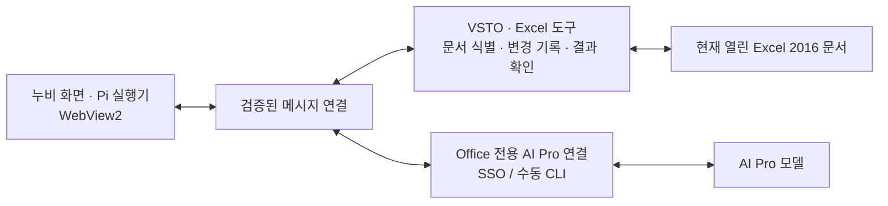

# Office AI Agent 적용 검토와 개선 BP

- 검토일: 2026-09-22
- 대상: Windows의 설치형 Excel 2016, 누비 화면·실행기, 누비의 모든 LLM 제공자 연결
- 상태: 초기 검토에 이어 `packages/nubi-office` 0.2.0 검토 빌드에 반영. 교차 컴파일·합성 통합 검증 완료, Windows 설치·실계정 검증 전.
- Office AI Agent 검토 커밋: `1fd78d345b9444720f6589f1264c80028729a9f0` (Apache-2.0)
- Pi for Excel 검토 커밋: `fd6c9e3c3b206d6e2e39a2957c70714fdc879727` (MIT)
- 검증 범위: 저장소 소스와 공식 문서. Windows 빌드, Excel 2016 32/64비트 설치, 회사 AI Pro SSO·추론은 미검증.

후속 0.3.0 계획·단계 실행·평가 개선은 [추가 검토](2026-09-22-office-plan-harness-evaluation.md)를 따른다.

## 2026-09-22 구현 반영

사용자가 누비에서 연결 가능한 모든 LLM을 요구한 것을 반영하여 AI Pro·ChatGPT·FabriX의 기존 어댑터를 직접 재사용한다. AI Pro CLI와 OpenAI 호환 서버도 지원한다. 구현은 [누비 Office](../../packages/nubi-office/README.md)에 있으며, 아래 초기 제안에서 .NET 제공자 재구현 대신 번들 Node worker 안에 누비 Pi와 어댑터를 유지하는 구조로 확정했다. UI는 WebView2, Excel 도구는 별도의 C# COM 포트다. 누비 제공자 목록과 Office 목록이 일치하는 자동 검사를 추가했다.

VSTO 호스트·누비 브랜드·Pi 실행기 재사용, 문서/범위 바인딩, 충돌 검사, readback, 중복 쓰기 방지, 변경 기록과 복원을 반영했다. 차트·피벗·문서 전체 구조 탐색과 서명 설치본은 완료 항목이 아니다. 아래 BP 표는 후속 업무 확장을 포함한 검토 기록이며, 현재 구현과 검증 경계는 패키지 README를 기준으로 한다.

## 1. 적용 판단

**Office AI Agent를 Excel에 연결하는 기반으로 채택하고, 누비의 화면과 Pi 실행기를 연결하는 방향이 타당하다.** 기존 프로젝트를 그대로 배포하기보다 Office 호스트·셀 조작 기능을 중심으로 가져오는 것을 권한다. 아래 구조와 우선순위는 검토자의 제안이다.

상위 프로젝트는 Windows 10/11, Office 2016 이상, .NET Framework 4.7.2, VSTO, WebView2를 요구한다. 실제 프로젝트 파일에서도 .NET 4.7.2와 WebView2 참조를 확인했다. 이는 적용 가능성의 근거이며 모든 Office 2016 빌드에서의 동작 보장은 아니다. [지원 환경](https://github.com/it235/office-ai-agent/blob/1fd78d345b9444720f6589f1264c80028729a9f0/README_EN.md), [Excel 프로젝트](https://github.com/it235/office-ai-agent/blob/1fd78d345b9444720f6589f1264c80028729a9f0/ExcelAi/ExcelAi.vbproj)

| 구성 | 재사용 또는 변경 방향 |
|---|---|
| Office AI Agent의 Excel VSTO 호스트·작업창 | 재사용 후보. 현재 열린 Excel 인스턴스에 연결한다. |
| `ExcelDirectOperationService.vb` | 값·수식·서식·정렬·차트 등 구현을 활용하되, 대상 문서 식별과 변경 검증을 앞뒤에 추가한다. |
| 누비 브랜드·CX 화면 | WebView2용 화면으로 이식한다. Chrome 저장소·탭·메시지 API는 Office 호스트 어댑터로 교체한다. |
| 누비 `agent-runtime.js` | Pi 실행기 한 개를 사용한다. 상위 프로젝트의 별도 실행 루프와 같은 요청을 중복 실행하지 않는다. 브라우저 전용 도구·상태 문구는 분리한다. |
| 누비 `completion-reader.js` | AI Pro JSON/SSE 응답 파서 재사용 후보. 네이티브 HTTP 스트림을 JS 스트림 인터페이스로 연결하는 작업이 필요하다. |
| AI Pro 인증 | Office 전용 세션으로 연결한다. 확장·라우터의 저장된 토큰을 가져오지 않는다. |
| 기존 `office-legacy-aipro` | 선택 범위 검증·readback·인증 계약의 참고 구현. Office.js 어댑터를 COM 호출에 그대로 사용하지 않는다. |
| 기존 `office-copilot-aipro` | Microsoft 365 Copilot 미리보기 경로로 유지한다. 이번 Excel 2016 작업과 별도다. |

제안하는 사용자 흐름은 **Excel 열기 → 누비 버튼 → AI Pro 연결 → 선택 영역에 요청 → 결과 셀 확인·되돌리기**다. 최종 배포는 설치 프로그램이 종속성과 추가 기능을 구성하도록 설계한다. 사용자가 Node, Python, 터미널 명령을 별도로 설치·실행하는 절차를 제품의 기본 경로로 삼지 않는다.

## 2. 그대로 가져오기 전에 수정할 사항

아래는 확인한 코드 경로의 관찰이다. 프로젝트 전체에 해당 방어가 전혀 없다는 판정이나 실행 재현 결과는 아니다.

### AI Pro 연결은 URL 설정만으로 끝나지 않는다

`AiGateway`에는 API 주소·키·모델을 받아 OpenAI 형식 본문과 Bearer 인증을 보내는 경로가 있다. 그러나 이 클래스 자체는 비스트리밍 호출용이므로 누비의 스트리밍·도구 호출 경로를 이것만으로 대체할 수 없다. [AiGateway](https://github.com/it235/office-ai-agent/blob/1fd78d345b9444720f6589f1264c80028729a9f0/ShareRibbon/Services/Ai/AiGateway.vb)

`ModelApiClient.GetModelsEndpoint`는 `/chat/completions`를 `/models`로 치환하고, 응답에서 `data[].id` 등의 형식을 읽는다. 현재 로컬 AI Pro 구현은 `/api/models`와 `modelList[].name`을 사용한다. 이 계약대로라면 채팅 주소 `/api/v1/chat/completions`를 단순 치환한 `/api/v1/models`는 맞지 않는다. AI Pro 전용 모델 목록·인증 어댑터가 필요하다. [ModelApiClient](https://github.com/it235/office-ai-agent/blob/1fd78d345b9444720f6589f1264c80028729a9f0/ShareRibbon/Config/ModelApiClient.vb)

- Browser SSO: 전용 로그인 세션 → 일회성 code 교환 → 모델 목록 확인. 취소·만료·재시작 후 code를 다시 교환하지 않는다. 실제 서비스의 callback 요청 연계 방식을 확인한 뒤 완료 판정한다.
- 수동 CLI: Base URL·토큰·Model ID를 입력한다. 모델 자동 조회와 SSO를 섞지 않고, 이 경로에만 기존 계약의 `AIPROCLI` 헤더를 사용한다.
- 인증값은 기본적으로 호스트 메모리에 두고, UI에는 로그인 상태·모델만 전달한다. 영구 저장이 필요해지는 경우 Windows 보호 저장소 사용을 별도 설계한다.
- `LLMUtil.SendHttpRequest`에 API 키 앞부분을 Debug 출력하는 코드가 있으므로 적용 시 제거한다. 진단에는 단계·상태 코드·요청 식별자만 사용한다. [LLMUtil](https://github.com/it235/office-ai-agent/blob/1fd78d345b9444720f6589f1264c80028729a9f0/ShareRibbon/Common/LLMUtil.vb)

### 복구는 별도로 구현해야 한다

`UndoManager.CreateExcelUndoPoint`는 정보를 기록하면서 `CanUndo=False`로 설정한다. 다른 경로에는 사본 미리보기 기능도 있지만, 이것이 모든 직접 편집의 값·수식·서식 복원을 보장하지 않는다. 변경 기록이 보인다는 이유만으로 되돌리기를 제공한다고 표시하면 안 된다. [UndoManager](https://github.com/it235/office-ai-agent/blob/1fd78d345b9444720f6589f1264c80028729a9f0/ShareRibbon/Core/UndoManager.vb), [사본 미리보기](https://github.com/it235/office-ai-agent/blob/1fd78d345b9444720f6589f1264c80028729a9f0/ExcelAi/EnhancedPreviewAndConfirm.vb)

### 비동기 처리 중 대상 문서가 바뀔 수 있다

`ExcelDirectOperationService`에는 실행 시점의 `ActiveSheet`·`ActiveWorkbook`을 참조하는 작업이 여럿 있다. AI 응답을 기다리는 중 사용자가 다른 문서로 이동하는 흐름에 대비해야 한다. 요청 시작 시 문서·시트·범위를 고정하고, 적용 직전 다시 확인하도록 어댑터를 둔다. [직접 조작 서비스](https://github.com/it235/office-ai-agent/blob/1fd78d345b9444720f6589f1264c80028729a9f0/ExcelAi/ExcelDirectOperationService.vb)

또한 `ChatControl.CheckAndCompleteProcessingHook`에는 응답 텍스트에서 수식을 감지해 적용을 시도하는 경로가 있다. 누비 도구 호출과 함께 활성화하면 동일 응답에 대한 편집 진입점이 겹칠 수 있으므로, 도구 실행 경로로 통합해야 한다. [ChatControl](https://github.com/it235/office-ai-agent/blob/1fd78d345b9444720f6589f1264c80028729a9f0/ExcelAi/ChatControl.vb)

## 3. 참고할 BP와 실제 반영 방법

| 우선순위 | 참고 구현·문서 | 이 제품에 반영할 내용 | 확인할 결과 |
|---|---|---|---|
| P0 | [Pi: 쓰기 후 확인](https://github.com/tmustier/pi-for-excel/blob/fd6c9e3c3b206d6e2e39a2957c70714fdc879727/src/tools/write-cells.ts) | 변경 전 값·수식을 비교하고, 적용 후 실제 셀을 읽어 값·수식·오류를 확인한다. | 정상 HTTP 응답만으로 편집 성공을 표시하지 않는다. |
| P0 | [Pi: 복구 기록](https://github.com/tmustier/pi-for-excel/blob/fd6c9e3c3b206d6e2e39a2957c70714fdc879727/src/workbook/recovery-log.ts) | 쓰기 전에 영향 범위의 값·수식·변경할 서식을 저장하고, 작업 단위 복원을 제공한다. | 복원 뒤 값·수식·서식이 일치한다. 사용자가 나중에 고친 셀은 덮어쓰지 않는다. |
| P0 | [Pi: 문서별 실행 조정](https://github.com/tmustier/pi-for-excel/blob/fd6c9e3c3b206d6e2e39a2957c70714fdc879727/src/workbook/coordinator.ts) | 문서별 쓰기를 직렬화하고 작업 ID·예상 revision을 전달한다. 추가로 변경 영역 지문을 검사해 사용자의 직접 편집도 감지한다. | 이중 클릭·재연결·문서 전환 시 중복 쓰기나 엉뚱한 문서 수정이 없다. |
| P0 | [Microsoft: Office 스레딩](https://learn.microsoft.com/en-us/visualstudio/vsto/threading-support-in-office?view=visualstudio) | 네트워크는 비동기로 처리하고, Excel COM 접근은 호스트의 UI/STA 디스패처에 모은다. Excel이 편집·대화상자 상태이면 제한적으로 대기한다. | 추론 중 화면이 멈추지 않고, 미확정 쓰기를 재전송하지 않는다. |
| P0 | [Microsoft: WebView2 연결](https://learn.microsoft.com/en-us/microsoft-edge/webview2/concepts/security) | 출처·메시지 스키마·작업 ID를 검사한다. 허용한 명령만 JSON 메시지로 전달하고, 외부 탐색은 호스트 권한과 분리한다. | 채팅·문서에 포함된 HTML이나 외부 페이지가 임의 Excel 명령을 실행하지 않는다. |
| P1 | [Pi: 문서 개요](https://github.com/tmustier/pi-for-excel/blob/fd6c9e3c3b206d6e2e39a2957c70714fdc879727/src/tools/get-workbook-overview.ts) | 시트·표·선택 범위의 구조를 먼저 읽고 필요한 영역을 도구로 추가 조회한다. 읽기와 모델 전송 모두 크기를 제한한다. | 큰 문서에서도 전체 데이터를 매 요청에 보내지 않는다. |
| P1 | [Pi: 도구 결과 UI](https://github.com/tmustier/pi-for-excel/blob/fd6c9e3c3b206d6e2e39a2957c70714fdc879727/src/tools/DECISIONS.md) | 누비 카드에 셀 주소, 변경 전후 작은 표, 결과 확인, 되돌리기 버튼을 표시한다. 주소를 누르면 해당 셀로 이동한다. | 사용자가 JSON이나 실행 로그를 해석하지 않고 변경 결과를 확인한다. |
| P1 | [Microsoft: Excel 성능](https://learn.microsoft.com/en-us/office/vba/excel/concepts/excel-performance/excel-tips-for-optimizing-performance-obstructions) | 이미 존재하는 `Value2` 배열 쓰기를 유지하고, 읽기도 범위 단위로 처리한다. 계산·이벤트·화면 상태를 변경했다면 예외·취소 시에도 원상복구한다. | 셀별 COM 왕복을 줄이고 취소 뒤에도 Excel이 정상 작동한다. |

Pi의 코드는 Office.js를 사용한다. **참고할 것은 도구 계약·변경 관리·UX이며, Office.js 호출을 Excel 2016의 COM에 그대로 복사하는 방식은 아니다.** Pi의 자체 revision도 사용자의 모든 편집을 감지하는 수단은 아니므로 대상 셀 비교와 함께 사용한다.

모든 쓰기는 이미 받은 사용자 요청 범위 안에서 진행한다. 읽기나 명시적으로 요청한 일반 편집마다 승인을 반복하지 않는다. 삭제·대규모 덮어쓰기·외부 전송처럼 범위가 불분명한 작업만 구체적인 변경안을 보여주고 확인한다.

기본 Excel 도구는 `read_range`, `write_cells`, `fill_formula`, `format_range`, `verify_range`, `restore_change`처럼 목적을 정해 제공한다. 상위의 `executevba` 대체 경로는 첫 배포의 기본 도구에서 제외한다. Excel 2016 기능표를 도구와 프롬프트에 함께 반영하고, 지원하지 않는 작업은 명확히 실패시킨다.

## 4. 단계별 적용 범위

1. **호스트와 연결 검증:** 고정 커밋 기반 별도 포크에서 Excel 작업창을 띄우고, 누비 정적 화면과 선택 범위 읽기를 연결한다. .NET의 AI Pro 어댑터를 통해 SSO와 수동 CLI를 각각 검증한다. 이 단계에서 WebView2 안의 Pi 번들·SSE 메시지 전달이 가능한지도 확인한다.
2. **편집 완결:** 값·수식·기본 서식에 문서 식별, 변경 전 비교, 작업 ID, 변경 기록, readback, 복원을 붙인다. 누비가 보내는 도구 호출만 쓰기의 진입점으로 사용한다.
3. **업무 확장:** 정렬·필터·표·차트·피벗을 기능별로 추가한다. 구조 변경은 범위 스냅샷만으로 되돌릴 수 없으므로 별도 복원 전략과 검증을 완료한 뒤 노출한다.
4. **배포:** Office 비트 수와 필수 런타임을 확인하는 설치 패키지를 만든다. 최초 설치·재시작·업데이트·제거까지 검증한다. Visual Studio 없이 쓰는 일반 사용자 환경을 기준으로 한다.

VSTO 포크는 우선 별도 작업 위치에서 검증한다. 기존 Office.js 패키지를 즉시 삭제하거나 같은 배포 이름으로 덮어쓰지 않는다. 새 호스트 검증 뒤 기본 배포 경로 변경 여부를 확정한다.

## 5. 최소 수락 시나리오

| 시나리오 | 통과 조건 |
|---|---|
| Windows + Excel 2016 32/64비트 | 두 비트 수를 지원한다고 배포하려면 각각 설치·작업창·종료·재시작을 확인한다. 한쪽만 확인했으면 범위를 명시한다. |
| 회사 AI Pro SSO | 실제 로그인 → 모델 표시 → 추론 → 만료 → 재로그인. 로컬 가짜 응답과 분리해 기록한다. |
| 수동 CLI | 입력한 Base URL·토큰·모델 사용. SSO·모델 자동 조회 없이 정상 호출한다. |
| 기본 편집 | `D2:D100` 수식 채우기와 서식 적용 후 실제 값·수식·서식 readback이 일치한다. |
| 동시 변경 | 응답 대기 중 대상 셀을 직접 고치면 오래된 제안을 자동 덮어쓰지 않는다. |
| 문서 전환 | A 문서 요청 후 B 문서로 이동해도 B 문서를 수정하지 않는다. A가 닫히면 쓰기를 중단한다. |
| 복원 | 편집 1건을 되돌린 후 원래 값·수식·지원 서식이 일치한다. 이후 수동 변경과 충돌하면 표시한다. |
| 중단·통신 끊김 | 쓰기 실행 뒤 응답이 유실돼도 같은 작업을 재실행하지 않는다. 중단은 미래 작업을 막고 완료된 변경은 명시한다. |
| 편집 제한 | 읽기 전용·보호된 시트·병합 영역·필터로 숨긴 행의 지원 범위를 확인한다. 미지원 상태를 성공으로 보고하지 않는다. |
| 저장·재진입 | 사용자가 저장한 문서를 다시 열었을 때 변경 결과가 유지된다. 저장하지 않은 편집을 저장 완료로 표시하지 않는다. |
| 일반 사용자 설치 | 개발 도구나 터미널 없이 설치 가능하다. 제거 후 Excel 시작 시 추가 기능 오류가 없다. |

현재 결과: 소스 검토와 로컬 구현·합성 통합 검증 완료. 위 실환경 시나리오는 미실행이다.

## 6. 구현 인계용 프롬프트

> Windows Excel 2016용 누비를 Office AI Agent의 VSTO+WebView2 호스트에 연결하라. 상위 커밋 `1fd78d345b9444720f6589f1264c80028729a9f0`을 고정하고 원본 라이선스와 변경 이력을 보존하라. 첫 범위는 누비 작업창, AI Pro·ChatGPT·FabriX·수동 AI Pro CLI·OpenAI 호환 연결, 선택 영역 읽기, 값·수식·기본 서식 편집, readback, 작업 단위 복원이다. 누비 Pi 실행기는 하나만 사용하고 브라우저 전용 API는 호스트 어댑터로 분리하라. AI Pro 모델 목록은 전용 계약을 사용하고 수동 CLI와 SSO를 구분하라. 도구 요청에 문서·시트·범위·작업 ID·예상 상태를 포함하고 Excel STA에서 실행하라. 기존 응답 텍스트 감지 편집과 자동 VBA 대체 경로를 같은 작업에 병행하지 말라. Pi for Excel의 변경 기록·직렬 쓰기·readback 패턴을 COM에 맞게 적용하라. 이 문서의 실환경 수락 조건을 검증하고, 로컬·합성·Windows·실제 AI Pro 성공을 별도로 보고하라. 기존 라우터·Chrome 확장·Microsoft 365 Copilot 패키지는 변경 대상으로 삼지 말라.
