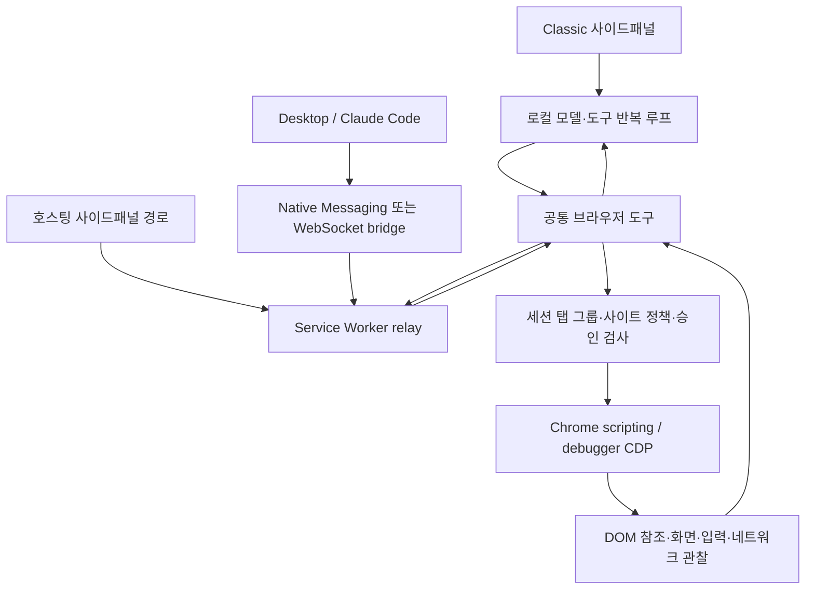

# Claude in Chrome 코드 분석과 누비 브라우저 에이전트 개선안

2026-09-26. 목적은 누비의 브라우저 업무 완주율, 정확도, 응답 속도와 복구 능력을 높이는 것이다. Claude의 기능 수를 따라가는 것을 완료 기준으로 삼지 않는다.

공식 배포본의 주요 클라이언트 경로를 직접 읽고 현재 누비 소스와 대조했다. **가장 유효한 신규 실험은 관찰한 요소 후보에 한정한 의미 기반 검색이다.** 실행 루프, 탭 격리, 복구 분석, 문맥 보존과 검증은 누비에도 이미 있으므로 재구현보다 실제 병목을 계측해야 한다. 실행 코드 변경은 하지 않았다.

## 1. 분석 근거와 범위

- [공식 스토어](https://chromewebstore.google.com/detail/claude/fcoeoabgfenejglbffodgkkbkcdhcgfn)를 이번에 조회해 Claude 1.0.94를 확인했다. 분석 대상은 이전에 Google 공식 업데이트 서버에서 받은 동일 버전의 로컬 해제본이다. 이번에 CRX를 새로 내려받지는 않았다.
- 기존 CRX 기록: SHA-256 `325905e34e61ad37f3ff07eb5ecf81aa96eb8c310adca6ded2309fb9b724649d`. 패키지의 `git-hash.txt`는 `e884a41a3e844489d46a5eac649ad57d54a9c5bf`다. 이 문자열은 공개 Git 저장소의 존재를 뜻하지 않는다.
- 주요 파일 해시를 다시 계산했다. `mcpPermissions`와 `sidepanel`의 해시는 이전 분석과 일치한다. [파일 해시와 검색 위치](2026-09-26-claude-browser-nubi-evidence.json)에 이번에 비교한 누비 파일 해시도 기록했다.
- minify된 JS를 기존 OpenWiki 의존성에 설치된 Prettier 3.9.6으로 임시 폴더에 정렬해 호출 흐름을 읽었다. OpenWiki 모델 분석이나 외부 소스 업로드는 하지 않았다. 정렬된 파일의 줄 번호는 원본 배포 파일의 줄 번호와 다르다.
- 원문: `/var/folders/30/2ns17vk15kn_689zclbvz07c0000gn/T/nubi-claude-public-xxlbgoah/unpacked`. 정렬본: `/tmp/claude-code-review-7G7iDf`. 임시 경로는 삭제될 수 있으므로 해시와 원본 검색 앵커를 함께 남긴다.
- 공개 배포 JS의 분석이며 전체 원본 저장소, 비공개 서버 하네스, 모든 종속 라이브러리의 전수 감사가 아니다. 설치, 로그인, Claude 실행, Qwen 성능 시험은 이번 작업에서 수행하지 않았다.
- Claude 코드의 재사용 라이선스는 확인하지 않았다. 저장소에 원문 코드나 프롬프트를 편입하지 않고 관찰 결과와 자체 설계만 남긴다.

기존 [실행 루프 분석](../../extensions/aipro-chat/docs/CLAUDE-HARNESS-STATIC-2026-09-26.md)을 출발점으로 삼되 아래 핵심 호출 경로는 직접 다시 확인했다.

## 2. 실행 구조: 하나의 루프만 있는 확장이 아니다

| 구성 | 확인한 책임 | 누비에 주는 의미 |
| --- | --- | --- |
| manifest / loader | MV3 worker, sidePanel, debugger, scripting, tabGroups, storage, alarms 등 | Chrome API로 확장 내부에서 브라우저를 제어할 수 있다 |
| `sidepanel-so8SIo6y.js` | Classic 채팅 UI, 직접 모델 호출, 도구 반복, 압축, 녹화 설명 생성 | 이 루프의 특성을 모든 Claude 화면에 일반화하면 안 된다 |
| `mcpPermissions-tSjXinpi.js` | 공통 도구, CDP, 세션 탭, 결과 변환, MCP 실행, 권한 팝업 | 파일명보다 책임이 훨씬 넓다 |
| `service-worker.ts-HKLyjT1Y.js` | bridge, native host, iframe relay, 예약, 외부 메시지 | 외부 호스트의 추론과 로컬 도구 실행이 분리된다 |
| `SavedPromptsService-N3Mr18Wn.js` | 권한 저장/조회, URL 검사와 여러 공유 서비스 | 저장 프롬프트만 담당하는 파일이 아니다 |
| `accessibility-tree.js-B-oUarrX.js` | DOM을 역할/이름/참조 문자열로 변환 | 이름은 accessibility tree지만 Chrome AX tree를 그대로 읽는 경로는 아니다 |
| `agent-visual-indicator.js-*` / `offscreen.js` | 작업 표시와 GIF 생성 등의 보조 기능 | 시각 표시와 실제 도구 성공을 구분한다 |

Classic은 자체 모델 루프를 갖지만 worker에는 `CIC_IFRAME_TOOL_CALL`과 `sidepanel-iframe` 실행 경로도 존재한다. feature flag, 브라우저 제어 동의, 확장 페이지 발신자, 계정 일치와 세션을 검사한다. 어떤 계정에 어느 UI가 활성화되는지는 정적 코드만으로 확정하지 않았다.

**누비 판단:** 현재 worker가 Pi 실행을 소유하는 구조를 유지한다. Classic처럼 UI 문서에 실행을 옮길 이유가 없다. Native Messaging과 cloud bridge는 확장 단독 설치라는 목표를 개선하는 필수 요소가 아니므로 도입 대상에서 제외한다.

## 3. 모델과 도구 루프

Classic의 `Wse` 내부 `Ce`는 모델 스트림을 받고 `tool_use`가 있으면 `we`를 호출한다. `we`는 도구를 순서대로 실행하고 같은 tool ID의 `tool_result`를 대화에 넣는다. 실패와 사용자 거절도 결과로 반환된다. 다음 모델 호출이 그 결과를 읽어 다음 행동을 결정한다.

확인한 차이는 다음과 같다.

1. **호출 실패가 곧 전체 작업 종료는 아니다.** 도구 오류를 다음 모델 판단의 입력으로 사용한다.
2. **도구가 없는 답변이면 일반 루프는 끝난다.** 이 경로 끝에서 누비처럼 모든 원래 요구사항의 충족 여부를 별도 검토하는 코드는 확인되지 않았다. 서버/다른 호스트에도 없다는 뜻은 아니다.
3. **SDK 존재와 실제 사용을 분리해야 한다.** 같은 번들에 ToolRunner, 병렬 실행과 compaction API가 있어도 Classic은 직접 작성한 반복 루프를 사용한다.
4. **API 복구와 권한 대기는 다르다.** 스트림 비활동 감시와 일시 통신 오류 재시도는 모델 호출에 적용된다. 권한 승인은 별도 대기 후 같은 도구를 다시 실행한다.

누비의 `agent-runtime.js`에도 오류 결과 전달, 새 판단, 사용자 질문, 독립 완료 검토가 있다. 이 기반을 교체할 근거는 없다. Claude의 일반 루프를 보고 누비의 최종 검증을 삭제하는 것은 목표와 맞지 않는다.

## 4. 가장 유의미한 차이: 의미 기반 요소 검색

Claude `find`의 실제 경로는 다음과 같다.

1. 현재 탭 그룹과 사이트 권한을 검사한다.
2. DOM에서 역할, 이름, `ref_*`를 갖는 트리를 만든다.
3. 사용자 검색 표현과 트리를 `modelClass: small_fast` 호출에 전달한다.
4. 모델이 관련 요소를 반환하면, 원래 트리에 존재했던 ref만 결과에 남긴다.
5. 후보와 설명을 부모 모델에 돌려준다. `find` 자체는 클릭하지 않는다.

relay 추론에서는 트리 길이를 30,000자로 제한하는 경로가 있다. 최대 20개 후보를 요구하지만 응답 파서는 ref 포함 여부와 출력 형식을 중심으로 검사한다. 모델이 보고하는 전체 후보 개수나 의미적 적합성이 독립 검증된 것은 아니다.

누비는 `browser-dom.js`에서 `dom-accessibility-api`로 역할과 접근성 이름을 계산하고, `evidence-search.js`의 MiniSearch로 어휘 검색을 한다. `rankEvidence`는 `fuzzy: false`이며 이름과 문맥에 가중치를 준다. 일반 page/recovery 하위 분석은 이미 있지만, Claude `find`와 같은 전용 의미 검색 계약은 확인한 주 도구 경로에 없다.

**실험 제안:** 정확한 이름/역할 검색으로 해결되지 않을 때만 기존 선택 모델의 읽기 전용 호출로 후보를 재정렬한다. Qwen 3.8 27B와 사용자가 선택한 모델을 유지하며 별도 Haiku 계정이나 자동 모델 교체를 도입하지 않는다.

- 입력: 현재 관찰 ID, tab/document/frame 식별자, 요청 의도, 마스킹된 후보 설명.
- 출력: 후보 ref, 관찰에서 찾은 근거, ambiguity, partial/omitted 상태. 새 selector나 실행 코드는 받지 않는다.
- 호스트 검사: ref가 그 관찰 집합에 실제 존재하는지 검사하고 반환 전 버전 변화를 확인한다.
- 행동: 부모가 최신 대상을 다시 확인한 뒤 기존 Playwright actionability와 HITL을 통과한다.
- 발동 조건: 어휘 불일치 또는 모호한 후보가 있을 때. 매 클릭마다 호출하면 지연이 늘어난다.
- 평가: 동의어, 아이콘 이름, 같은 이름의 다른 행, iframe, 재렌더링, 실제로 없는 대상에서 선택 정확도와 추가 모델 비용을 측정한다.

추가 추론이 완주율을 높일지는 아직 가설이다. ref 존재 검사는 잘못된 ref를 줄이지만 잘못된 업무 대상을 고르는 문제를 모두 해결하지 않는다.

## 5. `browser_batch`: 속도 패턴을 적용할 범위

Claude의 batch는 병렬 실행이 아니다. 항목을 순차 실행하고 첫 오류에서 멈추며 이미 성공한 결과를 반환한다. 도구별 권한 검사, 사전 그룹 확인, 항목 전후 사이트 정책 검사, 취소와 단계 진행 이벤트가 있다. batch 중 새 권한이 필요하면 부분 결과와 개별 호출 안내를 반환하는 분기도 있다.

좌표 문맥에도 중요한 구분이 있다. batch 실행 중 생성한 화면의 좌표 문맥을 pending scope에 모아 관리한다. 한 호출에 미리 적은 후속 좌표가 중간 screenshot 때문에 다른 좌표계로 갑자기 해석되는 것을 막으려는 구조로 읽힌다. 이는 현재 화면의 의미적 안정성까지 보증하지 않는다.

누비는 이미 `run_playwright` 안에서 여러 관찰된 필드 입력을 지원한다. `browser-agent.js`는 명령별 영수증을 남기고 화면/탭 전환이 생기면 다음 행동 앞에서 `script_checkpoint`로 멈춘다. `agent-runtime.js`는 모델이 한 응답에 낸 여러 도구를 무조건 이어 실행하지 않고 `decisionTool`로 다음 판단을 요구한다.

**선택:** 우선 기존 짧은 스크립트를 모델이 제대로 활용하는지 평가한다. 새 범용 batch 도구나 화면 전환을 넘는 자동 실행은 제안하지 않는다. 한 양식의 이미 관찰한 독립 필드 입력에서만 모델 왕복 감소를 측정한다. 중간 오류 뒤 성공한 입력 재전송 0건, 새 승인/탭/문서 경계에서 중단을 필수 조건으로 둔다.

## 6. 페이지 인식과 실제 입력

Claude의 DOM 트리는 자체 태그→역할 매핑과 aria-label, placeholder, title, label 등으로 이름을 만든다. WeakMap/WeakRef로 DOM 요소와 ref를 연결한다. 기본 depth 15, 요소 10,000개 한도, `read_page` 기본 50,000자 출력 한도가 있다. `all`은 숨겨진 요소도 포함할 수 있고 `interactive`는 가시성과 뷰포트를 필터링한다.

누비는 이미 프레임별 관찰, open shadow root, 표/헤딩/영역/스크롤 정보, 실제 Chrome document ID와 관찰마다 새 ref를 사용한다. **Claude의 간단한 DOM 추출기로 바꾸는 것은 권고하지 않는다.** 특히 `all_frames` content script 설치와 실제 한 도구가 모든 프레임을 읽는 것은 다르다. 확인한 Claude `read_page` 호출은 tab 대상 주입을 사용한다.

Claude의 클릭/키 입력은 `chrome.debugger`의 CDP `Input.dispatchMouseEvent`, `Input.dispatchKeyEvent`, `Input.insertText`를 사용한다. `form_input`은 DOM 속성 변경과 input/change 이벤트도 사용한다. 반환 문구는 필드 조작 결과이며 서버 저장 완료의 근거가 아니다.

누비는 기존 Playwright의 가시성, 안정성, 이벤트 수신과 활성 상태 검사를 유지하는 편이 적합하다. [공식 actionability 계약](https://playwright.dev/docs/actionability)에 맞는 패턴이며, 직접 CDP 클릭으로 교체하면 현재 보호를 다시 구현해야 한다. 누비의 제한된 양식 경로도 native value setter, 이벤트 후 값 유지와 재렌더링 검사를 이미 수행한다.

## 7. 승인과 보안 경계

Claude에는 서로 다른 검사가 겹친다.

- 도구가 사용할 탭이 세션 그룹에 속하는지 검사한다.
- 로컬 managed 정책과 서버의 URL 분류 결과를 검사한다. 서버 분류 실패는 unknown error로 처리하는 경로가 있다.
- permission manager는 거절 사이트, 현재 계획의 승인 사이트, 저장된 권한, 일회성 toolUseId/origin 결합을 처리한다.
- 특정 입력 경로는 승인한 origin과 실제 현재 origin을 다시 대조한다.
- 외부 메시지는 `https://claude.ai` origin 등을 검사하고 OAuth 응답도 시작된 로그인인지 확인한다.

[공식 권한 안내](https://support.claude.com/en/articles/12902446-claude-in-chrome-permissions-guide)의 자동 승인 기능과 이 로컬 사이트 권한 검사는 같은 개념으로 취급하지 않는다. 비공개 안전성 판단 모델의 전체 입력/구현/정확도는 이번 코드로 확인하지 못했다.

`javascript_tool`은 권한 검사 후 CDP Runtime.evaluate로 코드를 실행하고 출력의 민감 패턴을 제거한다. 출력 필터는 실행 자체의 부작용을 제한하는 샌드박스와 다르다. 누비의 제한된 script API를 임의 JavaScript 실행으로 넓히는 방안은 비채택이다.

## 8. 복구와 문맥: 재사용할 원칙, 복사하지 않을 구현

| Claude에서 확인 | 누비 현재 | 판단 |
| --- | --- | --- |
| 도구 오류를 tool_result로 반환 | Pi 도구 결과, 오류 분류, 자동 recovery 분석 | 이미 있음. 반복 실패가 새 관찰/접근으로 바뀌는지를 측정 |
| 스트림 이벤트 기반 idle 300초, 일부 오류 최대 10회 시도 | `model-recovery.js`의 재시도 분류와 activity deadline | 숫자 복사보다 전송/모델 형식/도구 실패 분류를 유지 |
| debugger 분리 오류 뒤 attach 후 command 재호출 | 누비는 미확정 쓰기를 별도 상태로 보호 | Claude의 일반 재호출을 쓰기 복구의 정답으로 채택하지 않음 |
| 별도 모델 요약과 최근 이미지 메시지 보존 | 원래 목표, 명시 답변, 출처 hash/범위, 미확정 기록을 별도 보존 | 누비의 호스트 상태 보존 유지 |
| 탭 변화에 따라 domain skill/탭 문맥 갱신 | 누비 site Wiki, skill 도구와 관찰 문맥 | 기존 기능의 선택 적중률을 평가. 새 Wiki 엔진 불필요 |
| 모델/도구/권한 등의 시간과 결과 계측 | 누비 진행 trace와 일부 실모델 HTTP 계측 | 전체 추론 종료까지 측정하는 평가 기록 보완 후보 |

Classic 요약은 대화를 요약 메시지로 대체하고 최근 사용자 이미지 메시지를 최대 3개 보존한다. 이 방식을 누비의 영수증이나 현재 승인 상태를 요약으로 대체하는 근거로 쓰면 안 된다.

## 9. 예약, 녹화, 연결에서 확인한 제품 설계

worker의 예약 실행은 계정 소유권, 연결된 skill의 사용 가능 여부와 최신 지침을 확인한다. 승인 후 skill 지침이 달라지면 권한 프롬프트를 다시 사용하는 경로가 있다. 여기서 lastRun/실행 이벤트는 작업 시작 경로의 근거이며 사용자 업무 완료를 뜻하지 않는다.

`offscreen.js`는 프레임을 GIF로 인코딩한다. Classic에는 녹화된 행동을 모델로 설명/작업 절차로 변환하는 경로도 있다. GIF 기록과 재실행 가능한 절차의 정확도는 서로 다른 문제다.

Desktop과 Claude Code용 native host 두 종류 및 WebSocket bridge가 확인된다. [Claude Code 공식 Chrome 연동](https://code.claude.com/docs/en/chrome)과도 대응하지만, 이 전송 계층을 누비에 추가한다고 브라우저 목표 선택이나 복구 정확도가 높아지는 것은 아니다. 현재 개선 범위에서는 제외한다.

## 10. 누비 우선순위

아래는 채택 완료 목록이 아니라 **실험 및 개발 명세의 우선순위**다. 정적 분석으로 성능 개선을 확정하지 않는다.

| 순서 | 작업 | 현재 근거 | 성공 판정 |
| --- | --- | --- | --- |
| P0-1 | 실모델 평가 기록을 원인별로 분리 | 이전 Naver 시험은 HTTP 헤더 시간은 있으나 전체 stream 종료 시간은 미측정 | planning/acting/review/recovery별 호출 수, 첫 유효 응답, 완료 시각, 도구 시간, 사용자 대기와 독립 정답을 기록 |
| P0-2 | 계획 형식 복구의 실제 Qwen 재검증 | 현재 `src/api.js`는 실패 이유 피드백, required tool choice, 완전한 JSON 계획 허용을 이미 구현 | 과거 plan_failed를 최신 소스에서 재시험. 첫 행동 도달 여부와 최종 완주를 각각 기록 |
| P1-1 | 의미 기반 요소 검색 실험 | Claude find는 모델 보조 검색. 누비의 주 검색은 어휘 기반 | 의미 불일치 과제에서 선택/완주 개선, 없는 ref/오래된 문서 채택 0, 추가 지연 공개 |
| P1-2 | 같은 근거의 중복 검토 비용 조사 | checkpoint, plan_step, final 검토가 분리돼 있음 | 동일 근거/동일 조건 반복을 계측. 재사용 실험 시 조건/출처/영수증 버전이 다르면 반드시 새 검토 |
| P1-3 | 기존 짧은 스크립트 활용 개선 | 여러 독립 필드 입력과 전환 checkpoint가 이미 있음 | 양식 정확도와 승인 경계를 유지하면서 실제 모델 왕복/시간 감소 |
| P2 | 사이트 지식의 선택과 신선도 평가 | Claude domain skills와 누비 기존 site Wiki/skills | 잘못된 사이트/구버전 지침을 제외하고 필요한 절차 선택률 측정 |

P1-2는 검토가 느리다는 확정 진단이 아니다. 다른 역할의 검토를 모두 중복으로 간주해서도 안 된다. 특히 최종 검토는 전체 원래 요구사항, 최신 근거와 남은 불확실성을 검사해야 한다.

**기존 실패 기록의 해석:** [Naver 실모델 기록을 정리한 문서](../../extensions/aipro-chat/docs/PLAN-ACTION-QUALITY-2026-09-26.md)의 42회/36회 요청은 당시 GPT-5.6 Luna 사례다. Qwen의 측정값이 아니며 HTTP 200은 작업 성공이 아니다. 현재 계획 파서/복구 코드는 그 뒤 변경된 상태이므로 이전 실패를 현재 결함 재현으로 승격하지 않는다.

## 11. 개선 구현자가 지킬 명세

첫 변경은 기존 평가의 모델 활동/도구/검토 시점을 연결하는 계측과 최신 기준선 확정으로 제한한다. 그다음 의미 기반 요소 검색을 선택적으로 추가해 기존 경로와 비교한다.

1. 범위는 `extensions/aipro-chat`와 기존 공통 Pi/OpenWiki 모듈의 필요한 소비 경로다. Desktop/Office/native host를 추가하지 않는다.
2. 대상 검색은 읽기 전용이다. 페이지 데이터를 지시로 실행하지 않고 기존 관찰 집합 밖의 ref를 거부한다. 최신 문서 확인과 실행 승인은 기존 브라우저 실행기가 맡는다.
3. 기존 목표, 명시적 답변, HITL, 질문 대기, 사용자 취소와 미확정 쓰기 계약을 그대로 유지한다.
4. 처음에는 현재 선택 모델을 공유한다. 별도 소형 모델 도입은 카탈로그/비용/사용자 선택 계약을 따로 검토한다.
5. 브라우저 fixture 검사는 잘못된 ref, 동명이인 행, 재렌더링, iframe, 빈 후보, 취소와 부분 범위를 재현한다. 이것을 실제 모델 정확도라고 부르지 않는다.
6. 실제 Qwen 기준선과 변경 후보를 같은 입력/사이트 상태/모델 설정으로 비교한다. 선택 정확도, 요구사항 완주, 오답 완료, 승인 위반, 중복 쓰기, 사용자 개입, 모델 호출과 시간을 개별 지표로 공개한다. 임의 종합 점수를 만들지 않는다.
7. 탐색, 양식 초안, 두 출처 비교, 느린 SPA와 실패 복구를 분리한다. 실서비스의 제출/저장은 기존 최종 승인을 따른다.
8. 한 실험의 효과를 확인한 뒤 다음 변경을 적용한다. 여러 하네스 기능을 함께 바꾸고 전체 효과로 주장하지 않는다.

## 12. 방법론과 오픈소스 선택

| 후보 | 선택 | 이유와 비용 |
| --- | --- | --- |
| 기존 Pi / MiniSearch | 재사용 제안 | 이미 있는 실행기와 어휘 검색 위에 제한된 읽기 전용 후보 판단만 추가할 수 있음 |
| 기존 Playwright CRX / dom-accessibility-api | 유지 | 실제 대상 확인, 접근성 이름, 프레임과 actionability 기반을 보존 |
| 기존 OpenWiki 조회 코어 | 사이트 지식과 근거 조회에 유지 | 실시간 DOM 대상의 실행 권한을 Wiki 답변으로 대체하지 않음 |
| Claude find / batch 패턴 | 자체 설계 참고 | 배포 코드를 복사하지 않고 후보 검증, 순차 실행과 부분 결과 원칙만 활용 |
| Anthropic 단순 도구 루프 방법론 | 평가 설계에 참고 | 복잡한 흐름을 더하기 전에 정확도/지연/호출 비용의 실제 효과 확인 |
| 신규 브라우저 런타임 / 범용 JS / cloud bridge | 비채택 | 현 병목을 해결한다는 근거가 없고 설치/권한/유지보수 범위를 확대 |

[Anthropic의 공개 방법론](https://www.anthropic.com/engineering/building-effective-agents)은 단순한 구성에서 시작해 필요할 때 복잡성을 늘리는 원칙을 설명한다. 이는 과거의 일반 방법론이며 현재 Claude in Chrome 내부 서버 구현의 설명으로 취급하지 않는다. 기존 OSS 버전/라이선스와 대안 검토는 [누비 BP 기록](../../extensions/aipro-chat/docs/HARNESS-BP-2026-09-26.md)을 재사용했다. 새 의존성은 설치하지 않았다.

## 13. 코드를 다시 읽을 때의 길잡이

아래 줄은 이번 임시 Prettier 정렬본 기준이다. 파일명/해시/원본 문자 위치는 별도 evidence JSON과 함께 사용한다.

| 파일 | 시작 줄/검색 앵커 | 읽을 책임 |
| --- | --- | --- |
| mcpPermissions | 7614 `getEffectiveTabId` | 세션 그룹 밖 탭 거부 |
| mcpPermissions | 8760 `sendCommandOnce`, 8787 `sendCommand` | CDP 기한과 재연결/재호출 |
| mcpPermissions | 11390 batch execute | 순차 실행, 부분 결과, 권한/사이트 경계 |
| mcpPermissions | 13111 `find` | 보조 모델 호출과 ref 집합 검사 |
| mcpPermissions | 13280 `form_input` | DOM 입력과 이벤트 |
| mcpPermissions | 14641 `read_page` | DOM 트리 주입/출력 |
| mcpPermissions | 27249 `processToolResults`, 27451 `yy` 부근 | 외부 도구 실행과 권한 조정 |
| sidepanel | 84321 `qre`, 86083 `Wse` | 문맥 압축과 Classic 루프 |
| sidepanel | 86650 `we` 부근, 87080 `messages.stream` | 도구 처리와 모델 반복 |
| service-worker | 170 bridge 연결 부근, 2252 native 연결 부근 | 외부 호스트 연결 |
| service-worker | 2798 iframe 발신자 검사 부근 | 호스팅 패널 relay |
| service-worker | 3940 `zi` 부근, 4204 onMessageExternal | 예약과 신뢰 origin |
| SavedPromptsService | 8130 `vu` 부근, 8290 `checkPermission` | 현재 URL과 권한 검사 |

누비의 대응 출발점은 `agent-runtime.js:279`, `browser-agent.js:65`, `browser-agent.js:585`, `evidence-search.js:12`, `task-plan.js:29`, `src/api.js:283`, `action-recovery-analysis.js:1`이다. 후속 수정 시 반드시 실제 현재 소스에서 다시 확인한다.

이번 산출물의 완료 범위는 코드 분석, 기존 구현과의 차이 판별, 개선 명세와 평가 조건 작성이다. 제품 수정, 빌드, 배포와 실제 모델 개선 검증은 수행하지 않았다.
