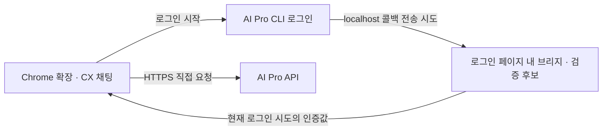

# AI Pro 단독 Chrome 채팅 확장 설계 초안

- 날짜: 2026-09-18
- 사용자 확정 요구: **라우터 설치 없이 확장만으로 사용한다.**
- 현재 로그인 경로: 사용자 요청으로 `/auth/vscode/login?port=...`을 유지한다.
- 현재 상태: 0.3.0에서 사용자가 확인한 POST `/auth/exchange` 코드 교환 계약을 구현했다. 아래 1~19절은 설계와 조사 이력이며 최신 인증 계약은 20절을 따른다. 실제 회사망 검증은 별도다.

## 1. 제안 구조

기존 AI Pro 로그인 화면을 열고, 그 페이지가 localhost로 보내려는 인증 결과를 확장이 전달받는 브리지를 검토한다. 인증값을 받은 뒤 확장이 AI Pro API를 직접 호출하며 CX 채팅 화면을 제공한다. Python·LLM Router·OpenCode·Native Messaging 호스트 설치를 요구하지 않는다.

여기서 재사용하는 것은 기존 인증 절차·AI Pro endpoint·인증 유형·요청/응답 계약이다. 기존 라우터가 실행하는 Python 콜백 서버와 OpenCode 프로세스는 확장에 포함하지 않는다. 확장 단독형의 직접 호출은 별도 검증 대상이며 기존 라우터 경로는 유지한다.

## 2. 현재 코드와 CX 근거

| 항목 | 확인 내용 |
| --- | --- |
| 기존 로그인 주소 | `src/llm_router/aipro.py`의 `AI_PRO_LOGIN_URL`은 `https://aipro.sdsdev.co.kr/auth/vscode/login`이다. 사용자가 제안한 `/auth/cli/login`은 실제 계약을 확인할 대상이다. |
| 기존 콜백 | `aipro_auth.py`가 loopback 포트를 실제로 열고 JWT header·body·query를 수신한다. README와 테스트는 로그인 페이지의 JWT 헤더 전송을 설명한다. 이것만으로 CLI 로그인 페이지의 실제 전송 코드를 확정할 수는 없다. |
| 인증값 | 현재 브라우저 흐름은 JWT 수신이다. API key 신규 발급과 같다고 표현하지 않는다. 만료 후 재로그인이 필요하다. |
| 추론 | `opencode_runtime.py`의 `ensure_profile()`이 AI Pro API key와 브라우저 JWT의 endpoint·Authorization을 구분한다. Chrome 직접 호출을 검증하는 구현은 아니다. |
| 모델 | 사용자가 제공한 `GET /api/models`의 `modelList` 계약을 확장에 연결한다. 화면은 `display_name`, 요청은 `name`을 사용한다. 실제 회사망 응답은 미검증이다. |
| CX | 라우터에는 프런트엔드 `package.json`과 CX 의존성이 없다. `/Users/ganadi/Downloads/CX`에는 package·manifest 버전 0.5.4와 `releases/e2e-cx-design-system-0.5.4.tgz`가 있다. |

## 3. localhost 콜백을 확장으로 연결하는 검증안

일반 Manifest V3 확장은 localhost HTTP 수신 서버를 열어 기존 Python 코드를 그대로 대체할 수 없다. `chrome.sockets.tcpServer`는 Platform Apps API다. 따라서 포트에 서버를 여는 방식과 페이지 안에서 콜백 전송을 연결하는 방식은 구분한다. [Chrome Platform Apps TCP Server](https://developer.chrome.com/docs/apps/reference/sockets/tcpServer)

Chrome은 content script와 페이지의 MAIN 실행 환경에 코드를 넣는 API를 제공한다. 이를 근거로 **로그인 완료 페이지가 fetch/XHR로 콜백을 보내는 경우**, 그 특정 호출을 확장에 전달하는 방식을 기술 검증 후보로 둔다. 이 API의 존재가 AI Pro 페이지에서의 동작 성공을 증명하지는 않는다. [Chrome Content Scripts](https://developer.chrome.com/docs/extensions/develop/concepts/content-scripts), [Chrome Scripting](https://developer.chrome.com/docs/extensions/reference/api/scripting)

검증할 흐름:

1. 사용자가 확장의 `AI Pro SSO`을 누른 경우에만 로그인 시도를 만든다. 확장이 여는 탭 ID, 시도 ID, 만료 시간, 예상 callback host·port를 관리한다.
2. 확인된 AI Pro 로그인 완료 문서에서 callback 실행보다 먼저 MAIN hook과 isolated content relay를 준비한다. 페이지의 실제 경로·frame·전송 API를 확인해야 하며 추측한 경로를 넓게 감시하지 않는다.
3. 이 로그인 시도의 정확한 localhost 목적지·포트·콜백 형식에 해당하는 요청만 처리한다. 나머지 fetch/XHR 동작과 SAML 로그인은 원래대로 유지한다.
4. MAIN hook에서 isolated relay를 거쳐 extension runtime으로 인증값을 전달한다. 확장은 실제 sender의 tab·frame/document·origin과 pending 시도를 검사하고 한 번만 수락한다. 페이지 메시지의 자체 선언값이나 nonce만으로 신뢰하지 않는다.
5. 비밀값은 `chrome.storage.session`에 보관한다. content script에는 저장소 접근을 열지 않고, 로그·URL·클립보드·분석 이벤트로 복제하지 않는다. MAIN 환경은 페이지와 공유되므로 비밀 경계라고 간주하지 않는다.
6. 페이지가 callback 완료 응답을 요구하면 실제 수신·보관 성공 뒤에만 그 전달 완료를 응답한다. 이는 AI Pro 서버의 토큰 수락이나 모델 권한을 증명하는 성공이 아니다. 실제 API 수락은 별도로 확인한다.
7. hook 누락 시 해당 localhost 요청이 우연히 다른 로컬 서비스로 전달되지 않도록, 로그인 탭·목적지에 한정한 session 차단 규칙을 검토한다. 임의 포트는 빈 포트라는 보장이 없다. DNR의 tab ID 조건은 session 규칙에서 지원된다. 이 차단은 수신 서버나 응답 생성 기능을 제공하지 않는다. [Chrome Declarative Net Request](https://developer.chrome.com/docs/extensions/reference/api/declarativeNetRequest)
8. 성공·실패·시간 초과·탭 종료 때 시도·규칙·relay를 정리한다. 스크립트 등록 해제만으로 이미 실행 중인 hook이 제거되지는 않으므로 별도 종료 동작이 필요하다.

최소한의 `webRequest` 헤더 관찰만으로 된다고 가정하지 않는다. 실제 localhost 서버가 없으면 CORS/private-network preflight에서 실패해 JWT를 담은 본 요청까지 도달하지 않을 수 있다. 실제 전송이 Worker 내부, 탐색 리디렉션, form 등 다른 형태면 위 fetch/XHR 연결 방식도 다시 검토해야 한다.

이 브리지는 페이지 구현에 의존하는 호환성 방식이다. 로그인 화면이 바뀌면 재검증이 필요하다. 적용할 수 없다면 그 근거를 남기고 AI Pro가 제공하는 확장 redirect/code 교환 또는 공식 결과 조회 계약을 확인한다. `chrome.identity.launchWebAuthFlow()`는 `https://<extension-id>.chromiumapp.org/*` 리디렉션용이며 현재 localhost callback을 자동 변환하지 않는다. [Chrome Identity](https://developer.chrome.com/docs/extensions/reference/api/identity)

## 4. 직접 API 계약

아래는 현재 라우터에서 읽은 계약이며, Chrome에서 정상 요청으로 수락되는지는 별도로 확인한다. 요청의 User-Agent를 OpenCode로 위장하지 않는다. host permission은 브라우저의 교차 origin 호출 권한을 제공할 뿐, AI Pro 서버의 인증·권한·클라이언트 제한을 해소하지 않는다. [Chrome Cross-origin Requests](https://developer.chrome.com/docs/extensions/develop/concepts/network-requests)

| 인증 유형 | Chat Completions endpoint | 현재 코드의 Authorization |
| --- | --- | --- |
| API key | `https://aipro.sdsdev.co.kr/open/api/v1/chat/completions` | `Bearer <key>` |
| 브라우저 JWT | `https://aipro.sdsdev.co.kr/api/v1/chat/completions` | `<JWT>` |

- CLI 결과가 key/JWT/code 중 무엇인지 실제 계약으로 확인한 뒤 처리한다. 현재 브라우저 JWT 구현을 새 key 발급 기능으로 표시하지 않는다.
- `model`은 AI Pro 실제 모델 ID다. 기존 localhost 라우터 프로필의 별칭을 그대로 보내지 않는다. 표시 이름과 요청용 ID를 분리한다.
- 사내 DNS·인증서 신뢰·발급 계정의 직접 호출 권한을 실제 Chrome에서 확인한다.
- 비밀값은 session 저장소에 둔다. 브라우저 재시작·확장 재로드 등으로 사라지면 재로그인한다. refresh는 AI Pro가 실제 제공할 때만 연결한다. [Chrome Storage](https://developer.chrome.com/docs/extensions/reference/api/storage)
- 로그아웃 시 확장 자격증명·진행 중 인증 시도를 지운다. 별도 원격 폐기 계약이 없다면 회사 SSO 세션까지 종료됐다고 표시하지 않는다.

## 5. CX 채팅 화면

새 React 19 확장 프런트엔드에 CX 0.5.4 TGZ를 고정한다. 주 화면은 Chrome 사이드패널이며 같은 채팅 뷰를 넓은 확장 탭에서도 사용한다. 기존 Python 관리 화면의 프레임워크 변경은 필요하지 않다. [Chrome Side Panel](https://developer.chrome.com/docs/extensions/reference/api/sidePanel)

| 위치 | 구성 |
| --- | --- |
| 로그인 | 서비스 이름, `AI Pro SSO`, 진행·취소·실패·재시도 |
| 상단 | 새 대화·설정·전체 화면 아이콘 |
| 본문 | 사용자·AI 메시지, Markdown·코드, 복사, 재시도 |
| 하단 | 여러 줄 입력, 전송, 생성 중 표시, 요청 취소 |
| 기본 흐름 | SSO 버튼 → 인증 수신 시 채팅 자동 전환. 기본 모델 `GLM-5.2-NVFP4` |
| 설정 | 작은 모달 안에 연결 해제 아이콘을 두고 연결 설정과 진단을 접어 둔다. 모델은 입력창 아래에서 선택한다. |

`cx-ui` 지침과 manifest의 `portable` API인 `CxButton`, `ActionButton`, `Icon`, `CxField`, `CxSelect`, `CxTextarea`, `CxNotice`로 조합한다. 흰 배경·시그니처 블루·로컬 Noto Sans KR를 적용한다. CX가 완성형 채팅이나 인증 로직까지 제공한다고 가정하지 않는다.

- Enter 전송, Shift+Enter 줄바꿈, 한국어 IME 조합 중 전송 방지.
- 대화·초안은 이 브라우저에 저장한다고 표시하고 local 저장소 또는 IndexedDB를 사용한다. Chrome Sync에는 보내지 않는다. 저장 오류 시 초안을 유지한다.
- AI Pro 직접 응답의 SSE/JSON 계약을 확인한다. 기존 라우터의 완료 후 SSE 버퍼링을 직접 호출에도 적용하거나, 직접 호출의 실시간 스트리밍을 미리 보장하지 않는다.
- 네트워크는 열린 채팅 페이지가 소유한다. Service Worker는 패널 열기·인증 조정 등 수명에 맞는 작업을 맡는다. 필요한 인증 시도 상태는 session 저장소로 복구하며 Worker 전역 변수의 지속성에 의존하지 않는다. [Service Worker Lifecycle](https://developer.chrome.com/docs/extensions/develop/concepts/service-workers/lifecycle)
- 패널 닫기·새로고침·재시작 뒤 미완료 응답은 중단 상태로 복구하고 자동 재전송하지 않는다. 클라이언트 수신 취소와 상위 생성 취소 성공을 구분한다.
- conversation/request ID로 응답 역전을 처리한다. 재시도 시 사용자 메시지를 중복 생성하지 않는다.
- 만료는 재로그인, 권한 오류는 모델 권한 안내, 429는 서버의 재시도 안내, 네트워크 오류는 회사망 연결 확인으로 구분한다. 초안과 복구 동작을 유지한다.
- Markdown의 raw HTML 실행을 차단하고 JS·CSS·폰트를 확장에 번들한다. 첫 버전은 텍스트 채팅이다.

## 6. 구현 전달 프롬프트

> 라우터 설치 없이 동작하는 AI Pro Chrome 채팅 확장을 구현한다. `/auth/cli/login?port=XXXX`가 localhost로 인증 결과를 보내는 방식이라는 사용자 가정을 출발점으로 한다. 회사망에서 실제 로그인 완료 페이지·전송 API·callback 형식·반환 자격증명을 확인한 뒤, 확장이 직접 연 로그인 탭의 특정 callback만 확장으로 전달하는 MAIN/isolated 브리지를 먼저 검증한다. 이 방식은 호환성 검증 대상이며 공식 지원을 주장하지 않는다. 로컬 서버·Python·OpenCode·Native Messaging 호스트를 필수 구성으로 되돌리지 않는다. 이후 정상 Chrome 요청으로 AI Pro 직접 추론을 검증한다. CX 0.5.4 TGZ와 cx-ui 스킬을 적용해 사이드패널·넓은 채팅 탭·인증 복구·로컬 대화 저장을 구현한다. 지원되지 않는 발급·redirect·API는 만들었다고 가정하지 않는다. 사용자가 제공한 `/api/models`의 `modelList` 계약은 실제 요청과 선택 UI에 연결한다. API key 수동 입력은 독립 호출 검증 수단이며 자동 로그인 요구의 완료가 아니다. 합성 callback 테스트·실제 Chrome 로그인·실제 모델 응답·재시작 검증을 분리해 보고한다.

## 7. 이번 확인 결과와 완료 기준

- 현재 인증·추론 코드와 CX 0.5.4 package/manifest/TGZ/스킬을 확인했다.
- `PYTHONPATH=src python3 -m pytest tests/test_aipro_auth.py -q` → **5 passed**. 합성 JWT와 기존 localhost 수신 테스트다. 기본 명령은 설치 패키지와 checkout 불일치로 수집 실패하여 `src`를 지정했다. 확장 인증의 검증 결과는 아니다.
- CX lookup은 대상에 `package.json`이 없어 실패했다. 별도 CX 원본을 읽었으며 라우터에 설치됐다고 간주하지 않았다.
- 현재 환경에서 AI Pro 도메인 DNS 해석이 실패했다. `/auth/cli/login` 실응답, 페이지 브리지, Chrome 직접 호출, 실제 모델 권한은 미검증이다.
- 완료 기준: 로컬 라우터가 없는 PC에서 확장 설치 → 회사 로그인 → 인증 결과 수신 → 실제 한 턴·후속 문맥 응답 → 패널 재진입·브라우저 재시작·만료 후 재로그인. 360px 패널과 넓은 탭의 긴 한국어·코드·오류·스크롤·키보드도 확인한다.
- 후속 사용자 요청으로 `extensions/aipro-chat`에 테스트 확장과 ZIP을 작성했다. 설치·회사망 테스트 순서는 해당 폴더의 `TESTING.md`, 합성 Chrome 검증 결과는 `verification/browser-results.json`에서 확인한다. 실제 완료 페이지가 미확인이라 AI Pro origin에 준비 코드를 두고, background에서 pending 로그인 탭·문서·포트를 검증한 경우에만 활성화한다.

## 8. 0.1.2 화면과 모델 목록

- CX 0.5.4의 시그니처 블루, Noto Sans KR, ActionButton, 선택 메뉴와 모달을 유지한다. Codex의 대화 중심 구성을 참고해 첫 입력창을 제목 바로 아래에 두고 대화가 시작되면 하단에 배치한다. 본문에는 반복 브랜드 제목이나 중간점 구분자를 넣지 않는다.
- 로그인 후 `GET https://aipro.sdsdev.co.kr/api/models`를 호출한다. 기존 인증 유형에 맞는 Authorization을 사용하고 모델 목록 요청은 쿠키 없이 보낸다. 회사망의 실제 인증 계약은 추가 확인 대상이다.
- `modelList`에서 `target=chat`, `is_agent!=true` 항목을 `sort_seq` 오름차순으로 표시한다. `display_name`은 표시용, `name`은 요청용이며 숫자 `id`는 추론 요청에 사용하지 않는다. 입력 한도와 컨텍스트 크기는 선택 컨트롤의 설명에 둔다.
- 모델 목록은 현재 인증에 귀속해 session 저장소에 5분 캐시한다. 이전 로그인 응답은 새 로그인 목록을 덮어쓰지 못한다. 선택한 모델이 없어지면 GLM-5.2-NVFP4 또는 첫 사용 가능 모델을 선택한다. 조회 실패 시 기존 선택과 초안을 유지하고 아이콘으로 재조회하며, 빈 목록에서는 전송을 막는다.
- Markdown의 기본 서식, 목록, 표, 코드 블록을 렌더링한다. raw HTML과 외부 이미지 자동 로드는 비활성화한다. 과거 메시지를 읽는 동안 자동 스크롤이 읽던 위치를 바꾸지 않는다.

## 9. 실제 로그인 피드백 반영

사용자가 `/auth/cli/login` 로그인 후 localhost `/auth?code=…&status=00`에서 연결 거부를 확인했다. code는 JWT 형태가 아니며 `/auth/vscode/login`도 같은 흐름이라는 추가 확인을 받았다. 현재 checkout의 AI Pro 콜백과 Git 이력에는 jwt/token/auth_jwt 직접 수신만 있고 code 교환은 없다. 설치된 Python 패키지에는 AI Pro 로그인 모듈 자체가 없으며 AI Pro VS Code 클라이언트 소스도 로컬에서 찾지 못했다.

`webNavigation` 권한으로 현재 로그인 탭과 callback 포트의 최상위 `/auth` 또는 `/callback` 탐색만 처리하도록 추가했다. 명시적 JWT 필드는 기존 검증 뒤 저장하고, code 또는 오류 응답은 로그인 완료로 표시하지 않는다. 탐색을 처리한 뒤 오류 탭을 정리하고 확장으로 돌아온다. URL과 code 값은 진단이나 저장소에 복제하지 않는다.

당시 code-only 탐색에서 별도 코드 교환이 필요하다고 표시했으나, 주소의 code 존재만으로 교환 API 필요성을 단정한 것은 잘못이다. 아래 11절의 기존 라우터 동작 확인을 기준으로 수정했다. 임의의 교환 API는 추가하지 않는다.

## 10. 모델 선택과 컨텍스트 사용량

0.1.4는 입력창의 모델 버튼으로 검색 가능한 CX 모달을 연다. 표시 이름과 컨텍스트 한도, 선택 체크만 보이고 실제 요청 이름과 정확한 한도는 설명에 둔다. 모델 변경은 기존 대화와 초안을 유지한다. 답변에는 요청 시점의 모델 이름을 기록한다. 코드 블록 복사와 최신 답변으로 이동하는 아이콘을 추가한다.

응답의 `usage.prompt_tokens`, `completion_tokens`, `total_tokens`를 검증하고 마지막 성공 응답에 저장한다. JSON과 SSE의 `choices: []` 사용량 전용 프레임을 처리하며 누적 프레임이나 과거 턴을 합산하지 않는다. `stream_options.include_usage`를 요청하되 HTTP 400/422가 해당 필드를 명시적으로 거부한 경우에만 이 옵션을 뺀 요청으로 한 번 재시도한다. 다른 실패는 재시도하지 않는다. 이는 OpenAI 호환 계약이고 실제 AI Pro 지원 여부는 아직 확인하지 못했다. [OpenAI Chat API](https://developers.openai.com/api/reference/resources/chat)

선택 모델과 마지막 완료 응답의 모델이 같고 초안과 진행 중 요청이 없을 때만 마지막 요청 실측으로 표시한다. 그 외에는 실제 전송 대상 대화와 초안의 글자 수로 추정하며 `≈`를 붙인다. 한도는 `context_length`를 사용하고 `max_input_tokens`는 별도로 표시한다. 없는 값은 0이나 모델 이름에서 유추한 용량으로 대체하지 않는다. 추정치로 전송을 차단하지 않는다.

검증: Node 테스트 12개, 합성 API를 사용한 실제 Chrome 검증 29개, CX 검사와 패키지 빌드 통과. 모델 검색, 키보드, 선택 저장, 모델 변경 뒤 추정 전환, 실측값 재진입 복원, 코드 복사 및 360px 패널을 확인했다. 실제 SSO 코드 교환과 회사 API 검증은 미완성이다.

## 11. 성공한 기존 라우터의 SSO 계약 적용

사용자가 SSO 성공 기준을 VS Code 확장이 아닌 이 프로젝트의 라우터 화면으로 확인했다. origin/main 최신 코드와 970ec5a 변경도 확인했으며 `aipro_auth.py`는 코드 교환 HTTP 요청 없이 `jwt`, `token`, `auth-jwt`, Authorization 헤더를 먼저 읽고, 본문과 쿼리의 명시적 JWT를 저장한다. code-only 요청은 400으로 응답하고 JWT 수신을 계속 기다린다.

0.1.5는 확장의 로그인 URL을 `/auth/cli/login?port=...`으로 고정하고 예전 VS Code 설정도 마이그레이션한다. MAIN 브리지의 수신 우선순위와 JSON 성공 응답을 라우터에 맞췄다. code가 함께 있는 JWT 쿼리도 수신하며, code-only 탐색이 도착해도 시도를 즉시 종료하지 않고 이미 전송 중인 JWT 메시지를 최대 10초 더 받는다. 이는 이미 파괴된 페이지의 네트워크 요청을 되살리는 기능이 아니며 실제 서비스 요청 순서는 회사망 재검증 대상이다. JWT가 끝내 없으면 JWT 미수신으로 알리고 code를 인증키로 사용하거나 미확인 교환 요청을 만들지 않는다.

검증: 기존 Python 라우터 인증 11개, 확장 Node 14개, 실제 Chrome에서 합성 API로 34개 통과. JWT와 code 동시 수신, body/query 우선순위, 원래 라우터와 같은 응답, JWT 메시지 지연 도착과 알람 정리, 인증값과 코드 비저장을 확인했다. 현재 환경의 AI Pro DNS 해석은 실패하며 실제 사용자 로그인 완료를 관찰하지 못했다.

## 12. VS Code 로그인 경로 복구

사용자 제공 진단은 `login_opened`, `callback_navigation_seen (navigation/code)`, `callback_missing`이며, 사용자 재시도에서도 JWT 미수신이 반복됐다. 이 기록으로 CLI가 JWT를 추후 전달한다고 보장할 수 없다. 사용자가 기존 라우터에서 성공했던 VS Code 경로로 복구를 승인했다.

0.1.6은 기본값과 저장된 CLI 설정을 `/auth/vscode/login`으로 바꾼다. 모델 선택과 인증 방식은 유지하고, 설정 변경 없이 SSO 버튼에서 기존 라우터 주소를 연다. 이 경로명 때문에 VS Code 앱이나 로컬 라우터가 추가로 필요한 것은 아니다. JWT 수신은 확장이 처리하며 code를 임의로 토큰으로 사용하지 않는다. 실제 회사 서비스 성공을 단정하지 않는다.

검증: 확장 Node 14개, 실제 Chrome의 합성 API 검증 35개, CX 검사와 빌드. 이전 CLI 설정을 저장한 상태에서 같은 프로필로 Chrome을 재시작하여 새 Worker가 VS Code 경로로 마이그레이션하고 실제 로그인 요청 URL도 해당 경로인지 확인한다. 자동 테스트의 명령행 로드 환경에서는 runtime.reload 후 확장 페이지가 차단되어 브라우저 재시작으로 검증했다. 일반 Chrome 확장 관리 화면의 새로고침은 직접 검증하지 않았다. 실제 회사망 SSO 완료는 재확인 대상이다.

## 13. code 리다이렉트와 로컬 포트 수신 구분

사용자가 실제 전달 방식이 브라우저의 localhost `/auth?code=...&status=00` 리다이렉트임을 재확인했다. 일반 확장이 로컬 HTTP 서버를 직접 열 수 없는 것과, 브라우저가 해당 URL로 이동할 때 확장이 URL을 수신할 수 있는 것은 별개다. 따라서 URL 수신을 위해 보조 프로그램이나 AI Pro의 반환 주소 변경이 반드시 필요하다는 설명은 정정한다.

`tests/redirect-probe.mjs`에서 AI Pro 로그인 응답을 HTML 없는 HTTP 302로 구성하고 로컬 서버 없이 0.1.6을 검증했다. code/status URL 감지, 코드만 있을 때 인증 미완료, 명시적 JWT 쿼리가 있을 때 수신, 진단 및 영구 저장소의 인증값 비노출 4개 검증을 통과했다. 결과는 `extensions/aipro-chat/verification/redirect-probe-results.json`에 있다. `CHROME_BINARY`를 설정한 뒤 확장 디렉터리에서 `node tests/redirect-probe.mjs`로 재현한다. 실제 회사 서비스가 HTTP 302를 쓰는지까지 검증한 것은 아니다.

현재 code-only 분기는 code를 감지한 뒤 별도의 JWT를 10초 기다리므로 실제 code 인증 처리가 구현된 상태가 아니다. 현재 checkout의 라우터에도 이 code를 해석하거나 교환하는 구현은 없다. 후속 인증 계약은 미확인이며, 이 검증으로 실제 SSO 성공이나 JWT가 추가로 전달됨을 주장하지 않는다. 제품 코드나 배포 ZIP을 수정한 검증이 아니다.

## 14. 확장 HTTP 콜백 수신기

사용자가 localhost 콜백을 기존 라우터 서버와 동일하게 확장에서 처리하라고 재확인했다. 0.2.0은 MAIN/isolated fetch/XHR 브리지와 DNR 차단, URL만 읽던 webNavigation 처리를 제거하고 Chrome debugger의 Fetch 도메인으로 바꾼다. 로그인 탭을 만들고 해당 localhost/127.0.0.1/[::1] 포트의 Request 단계 수신기를 준비한 뒤 기존 AI Pro 로그인 URL을 연다. 브라우저 요청에 HTTP 상태, CORS 헤더와 JSON 본문을 직접 응답하며 로컬 서버나 보조 프로그램은 시작하지 않는다. Chrome debugger 권한은 로그인 탭에만 일시적으로 사용한다. 기업 정책에 의한 attach 실패와 사용자의 debugger 해제를 별도 오류로 표시한다.

`callback.js`는 기존 서버의 JWT 헤더 → 본문 → 쿼리 우선순위와 GET/POST/PUT, OPTIONS 204를 이식한다. 성공은 200 `{"ok":true,"message":"AI Pro login completed"}`이며 유효 JWT가 없으면 400 `{"ok":false,"message":"valid jwt is required"}`다. 빈 JWT claims와 만료 토큰은 로그인으로 승인하지 않는다. Origin이 없거나 AI Pro일 때만 처리한다. 경로는 기존 서버처럼 고정된 /auth 또는 /callback으로 제한하지 않는다.

기존 라우터에 code 교환 처리가 있다는 앞선 설명은 잘못이다. 현재 소스는 code/status만 있으면 400으로 응답하고 전체 만료까지 기다린다. 확장도 이 계약을 따르며 code를 임의로 인증키로 쓰지 않는다. 별도 10초 종료를 없애고 5분 전체 만료를 유지한다. favicon 같은 부수 요청은 응답하되 실제 콜백 진단을 덮지 않는다.

성공 HTTP 응답 후에는 호출자가 응답을 소비할 수 있도록 1.5초 뒤 로그인 탭을 닫고 debugger를 해제한다. 그 사이 늦은 콜백은 실패 처리하고 기존 인증값을 교체하지 않는다. 취소/만료 시에는 탭을 먼저 닫아 중단된 요청이 실제 로컬 프로세스로 재개되지 않게 한다. 이전 버전의 로그인 attempt는 부팅 시 정리한다. 모델 선택, 컨텍스트, 대화 저장과 직접 API 호출 경로는 유지한다.

검증 결과는 확장의 verification 디렉터리에 기록한다. 순수 계약/수명 테스트, 실제 Chrome의 합성 채팅 검증, HTTP 302와 헤더/본문 수신 검증을 구분한다. 이는 실제 AI Pro 서비스나 기업 정책 환경의 성공 검증이 아니다. 이 구현은 지정한 로그인 탭에서 발생하는 브라우저 요청이 대상이며 다른 프로세스가 직접 소켓으로 보내는 콜백을 받는 서버는 아니다.

## 15. 사용자 0.2.0 실제 콜백 결과

사용자가 0.2.0에서 localhost 페이지에 HTTP 400과 `{"ok":false,"message":"valid jwt is required"}`가 표시됨을 보고했다. 추가 진단은 `callback_receiver_ready`, `callback_received (http/code) HTTP 400`이다. 이는 수신기가 동작했고 code가 있는 요청에서 현재 처리기가 지원하는 JWT 후보를 찾지 못한 결과다. 실제 원문 헤더/본문을 열람한 것이 아니므로 요청 전체에 다른 필드가 없었다고 단정하지 않는다.

동일한 code-only 요청에 현재 저장소의 Python 라우터도 400을 반환하는 단일 회귀 테스트를 재실행해 통과했다. 기존 라우터의 code 처리만 이식하면 된다는 설명은 소스와 일치하지 않는다. 현 소스에는 code 교환/해석이 없고 JWT 필드 수신만 있다. 확장의 콜백 수신 수정과 실제 SSO 성공을 혼동하지 않는다. 성공했던 기존 실행본이 현재에도 같은 서비스에서 로그인되는지 확인 중이며, code를 임의의 API 키로 사용하거나 교환 주소를 추측하지 않는다.

## 16. 성공 예시의 HTTP 응답 대조

사용자가 라우터 화면에서 SSO 버튼을 눌러 연결됐다고 재확인한 뒤, 다시 시도하자 `localhost callback은 도착했지만 유효한 JWT가 없었습니다`가 표시됐다고 보고했다. 이 문구는 현재 Python 라우터의 JWT 미수신 분기와 일치한다. 이어 별도의 성공 예시로 Windows Samsung Browser에서 localhost `/auth`에 GET으로 `code`, `status`를 전달한 요청 기록을 제공했다. 응답은 200, Content-Type은 `text/html; charset=utf-8`, 실제 원격 주소는 loopback이다. 인증 코드, 쿠키 값, 전체 콜백 URL은 이 문서나 테스트에 복제하지 않는다.

이 성공 예시의 HTML 응답은 현재 Python 라우터 및 확장 0.2.0의 JSON 응답과 다르다. 제공된 요청 헤더에는 현재 처리기가 읽는 JWT 헤더가 없으며, Cookie를 AI Pro API 인증값으로 간주하지 않는다. HTTP 200만으로 토큰 발급 또는 저장 완료를 검증할 수 없다. 응답 HTML과 추가 인증 처리는 아직 확인되지 않았고, 해당 응답을 만든 프로그램도 확인되지 않았다. 사용자에게 성공 요청의 Response 탭에서 인증값을 제외한 HTML/안내 문구를 요청했다.

보관된 Windows wheel 0.1.8부터 0.1.16까지의 `aipro_auth.py`는 현재 소스와 동일하다. 0.1.4부터 0.1.7도 동일한 JWT 직접 수신 계약을 사용하며 code 교환은 없다. 따라서 현재 보유한 구버전 배포 파일에서 성공 예시의 HTML 응답 또는 code 교환 구현을 찾았다고 주장하지 않는다.

별도의 임시 Chrome 실험에서는 로그인 페이지의 Blob dedicated Worker가 보내는 JWT 헤더 요청도 현재 확장에서 정상 수신하고 200을 반환했다. 같은 포트에 둔 대조용 HTTP 서버에는 요청이 도착하지 않았다. 이는 합성 Worker 경로 검증이며, 실제 SSO의 Worker 사용이나 성공을 증명하지 않는다. Worker 누락을 원인으로 단정하거나 이를 근거로 수신 대상을 넓히지 않는다. 이 조사에서는 제품 코드와 배포 ZIP을 변경하지 않았다.

사용자는 위 200 + HTML 성공 예시가 **AI Pro VS Code 확장**에서 로그인을 시작한 결과라고 최종 확인했다. 성공하는 인증 계약의 기준은 해당 클라이언트이며, 현재 라우터 소스가 아니다. HTML 응답 내용만으로 code 처리나 토큰 교환 주소를 확정하지 않는다. 현재 작업 환경에는 해당 클라이언트의 VSIX/설치 소스를 찾지 못했다. 확인되지 않은 교환 API를 추측해 배포하거나 code를 JWT/API key로 저장하지 않는다.

## 17. VSIX 없이 브라우저 인증 요청 진단

사용자가 VSIX/설치 폴더를 제공해서 확인하기 어렵다고 답했다. 현재 환경은 여전히 AI Pro DNS를 해석하지 못한다. 0.2.1은 기존 debugger 로그인 탭의 Network 이벤트를 이용해 실제 회사 브라우저에서 인증 요청을 관찰하고, 기존 진단 복사 결과의 `authTrace`에 함께 넣는다. VS Code 내부의 HTTP 요청은 관찰할 수 없으며, 그 경로에만 교환 처리가 있다면 AI Pro 인증 API 명세가 필요하다.

진단은 AI Pro origin의 인증 경로만 대상으로 한다. 경로 부분과 쿼리/본문/JSON 필드 이름을 허용 목록으로 제한하고, 알 수 없는 경로 부분은 `[redacted]`로 표시한다. 값, 원문, 쿠키와 전체 URL을 저장하지 않는다. 최대 40개 요청과 최대 8개의 256 KiB 이하 완료 JSON 응답을 확인한다. 본문을 못 읽거나 이동 전에 응답이 끝나지 않은 경우 상태를 남기며, 빈 필드 목록을 토큰 부재의 증거로 사용하지 않는다. 응답에서 관찰된 인증값은 로그인 자격증명으로 채택하지 않는다.

본문 조회는 콜백 처리 큐와 분리하고 진단 오류는 삼킨다. 저장 직전에 현재 진단 인스턴스를 확인하여 이전 로그인에서 늦게 끝난 조회가 새 진단을 덮지 않게 한다. 새 로그인에서 진단을 초기화하고 취소/종료 시 수집을 멈춘다. 새 권한, 별도 프로그램, 화면 요소는 추가하지 않았다. `code` 교환은 여전히 미구현이며 로그인 해결판으로 표시하지 않는다.

검증: Node 38개, 실제 Chrome에서 합성 API를 사용한 기존 채팅 34개, HTTP 콜백 7개, 인증 진단 3개를 통과했다. 진단 테스트의 토큰 API 경로와 데이터는 테스트 전용이며 실제 AI Pro 명세가 아니다. 실제 Chrome에서 리다이렉트와 완료 JSON 필드 이름 수집, 다른 탭 제외, 기존 진단 복사 동작 및 비밀값 비저장을 확인했다. CX 검사와 빌드도 통과했다. Chrome debugger와 Network 관찰 계약은 [Chrome debugger 문서](https://developer.chrome.com/docs/extensions/reference/api/debugger)와 [DevTools Protocol](https://chromedevtools.github.io/devtools-protocol/)를 참고했다.

## 18. EP SSO 출처와 성공/실패 기록의 구분

사용자가 Edge에서 GET localhost `/auth`의 code/status 콜백 기록을 제공했다. 응답은 400, JSON, Content-Length 46이며 요청 Origin은 `https://epsso.samsung.net`이다. 응답 길이 46은 현재 확장의 `valid jwt is required` JSON과 일치한다. 그러나 0.2.1 처리기에 동일한 EP SSO Origin을 넣으면 403과 43바이트 `origin not allowed` JSON이 나와, 이번 400의 원인을 Origin 차단으로 단정할 수 없다. Fetch 수신 시 실제 관찰한 헤더와 사용자가 복사한 헤더의 차이는 아직 확인되지 않았다. 원래 제공한 code 값과 전체 URL은 복제하지 않는다.

처음 성공 예시는 AI Pro VS Code 확장이 반환한 200 HTML이었다. 사용자는 나중에 동일한 400 JSON 기록을 실패와 성공으로 각각 지칭했으나, 확인 질문 후 실제 성공 기록을 다시 제공했다. 성공도 실패와 같은 Edge 153이며 GET localhost `/auth`에 code/status를 전달하고 200 HTML을 받는다. 성공 응답에는 loopback 원격 주소와 keep-alive/chunked가 표시된다. 성공 요청의 제공된 헤더에는 JWT/Authorization 및 Origin이 없고, 실패 기록에는 EP SSO Origin과 form content-type이 있다. 둘의 code 원문, 포트와 쿠키 값은 문서에 복제하지 않는다. 브라우저 종류가 원인이라는 가설은 이 비교의 근거가 아니다.

비교로 확인되는 것은 같은 code/status 형태의 요청에 서로 다른 수신기가 200 HTML과 400 JSON을 반환한다는 점이다. 성공 요청에 JWT가 숨겨져 있었다고 주장할 근거는 없으며, VS Code 수신 후 인증 처리의 구체적인 교환 API는 이 헤더 기록에 없다. 200 HTML을 흉내 내는 것만으로 AI Pro 호출에 필요한 인증값을 얻었다고 볼 수 없다.

0.2.2 로컬 변경은 실제 요청에 나타난 EP SSO HTTPS origin만 콜백 출처에 추가하고 기존 JWT 검증을 유지한다. source tab/port 검증은 그대로다. 진단에는 수신 Origin을 aipro/epsso/absent/other로 분류해 남기며 다른 도메인이나 원문은 저장하지 않는다. Python 라우터는 변경하지 않았다. 이 보정은 code 교환 미구현을 해결하지 않으며 동일한 code-only에는 400이 유지된다. 실제 로그인 해결을 주장하거나 같은 로그인 재시도를 요구할 근거가 아니다.

0.2.2 검증: Node 39개, CX 검사, 빌드, 합성 Chrome HTTP 콜백 8개와 인증 진단 3개 통과. EP SSO 페이지의 fetch 요청에서 실제 Origin을 관찰했으며, CORS가 적용된 code-only 400 및 후속 유효 JWT 200을 확인했다. 이는 실제 회사 SSO가 후속 JWT 요청을 보낸다는 증거가 아니다. 0.2.2는 로컬 호환성 빌드로 두고 로그인 해결판으로 사용자에게 재설치를 요청하지 않았다.

## 19. 추가 API에 대한 관찰 범위 정정

사용자는 처음에 후속 API를 쓰지 않는다고 말했지만, 확인 질문에는 **브라우저에 추가 요청이 보이지 않았다는 뜻**이라고 답했다. code 자체를 API 인증값으로 사용하는 것으로 확인한 것이 아니다. 데스크톱 VS Code 확장은 자체 extension host에서 실행되므로, 그 내부 또는 보조 프로세스에서 발생한 HTTP 요청을 로그인 브라우저의 네트워크 탭만으로 관찰할 수 있다고 가정하지 않는다.

별도 코드 교환 API가 반드시 있다는 앞선 설명은 확인되지 않은 추론이었다. 교환이 없다는 반대 결론도 근거가 없다. 현재 확인된 사실은 code/status 콜백을 받고 VS Code는 200 HTML을, 현재 Chrome 수신기는 지원되는 JWT가 없을 때 400 JSON을 반환한다는 것이다. code 후속 처리와 AI Pro 호출 인증 방식은 아직 확인하지 못했다. 이 정정만을 근거로 code를 API key/JWT로 채택하거나 JWT 검증을 제거하지 않는다. 추가 브라우저 재로그인 캡처보다 성공하는 클라이언트의 내부 처리에 대한 근거가 필요하다.

## 20. 확인된 code 교환 계약과 0.3.0

사용자는 실제 요청이 POST `https://aipro.sdsdev.co.kr/auth/exchange`, Content-Type `application/x-www-form-urlencoded`, 본문 `code=<수신한 code>`이며 성공 응답이 HTTP 200 JSON `{"token":"<JWT>"}`임을 확인했다. 이 계약으로 19절의 미확인 상태를 해소한다. 예시의 개인 식별 헤더나 실제 인증값은 복제하거나 사용하지 않는다. Node의 User-Agent를 흉내 내지 않고 Chrome의 정상 fetch를 사용한다.

확장이 연 로그인 탭과 지정 loopback 포트에서 GET code/status=00을 받으면 수신 안내 HTML 200을 반환한다. 이 응답만으로 인증을 완료하지 않으며 service worker가 확인된 API에 코드를 한 번 POST한다. 응답 루트 token의 JWT 형식과 만료를 확인한 뒤 세션 인증값을 저장하고 모델 조회 및 채팅으로 전환한다. JWT 서명과 실제 모델 접근 허용 여부는 AI Pro API가 판단한다. 기존 명시적 JWT 헤더/본문/쿼리 콜백도 유지한다.

code는 저장하지 않는다. 로그인 시도별 교환 작업은 취소/만료/연결 해제 시 중단하고 응답을 적용하기 전에 현재 시도와 일치하는지 다시 확인한다. 같은 시도의 중복 콜백은 409로 답하며 다시 교환하지 않는다. worker 재시작 중 교환이 사라지면 새 로그인을 요구하고 소비했을 수 있는 code를 재전송하지 않는다. 15초 제한, 응답 크기 제한, 자동 리다이렉트 차단을 적용하며 HTTP 오류와 잘못된 token을 구분한다. 응답 원문이나 개인 식별 헤더는 진단에 남기지 않는다.

설치용 ZIP은 0.3.0으로 생성한다. 실제 회사 SSO/API 호출은 사용자 회사망에서 확인해야 하며 합성 Chrome 테스트 결과로 성공을 단정하지 않는다. 검증 결과는 확장 verification의 0.3.0 release 기록을 따른다.

## 21. 인증 성공 후 모델 목록 문제

사용자는 0.3.0으로 인증이 완료되지만 화면에 모델이 없다고 보고했다. 회사망 인증 성공은 사용자 확인이며 이 환경에서 실제 로그인이나 모델 호출을 직접 검증한 것은 아니다. 여기서는 AI Pro 도메인이 ENOTFOUND여서 실제 응답을 받을 수 없다.

기존의 `모델 없음`은 modelList가 실제로 빈 경우와 target/is_agent/name 필터에서 모두 제외된 경우를 구분하지 않았다. 0.3.1은 HTTP 상태, 받은 개수, 표시 개수, 필터 제외 사유별 개수만 세션 진단에 추가한다. 전체 제외에는 `목록 확인 필요`를 표시하며 응답 형식 오류는 빈 목록으로 취급하지 않는다. 모델 필터와 Authorization 규칙은 실제 응답 확인 전까지 유지한다. 원문과 인증값은 진단에 남기지 않는다. 진단 없는 이전 캐시는 새로 조회한다.

실제 원인은 아직 확정하지 못했으며 사용자에게 현재 modelList 항목의 name/target/is_agent만 요청했다. 0.3.1은 진단 보완판이며 실제 모델 조회 문제가 해결됐다고 주장하지 않는다.

## 22. 모델 API Bearer 계약 확인과 0.3.2

사용자가 GET `https://aipro.sdsdev.co.kr/api/models`의 Authorization은 `Bearer <token>`이라고 확인하고 모델 10개의 응답을 제공했다. 기존 브라우저 JWT 목록 요청은 접두어 없는 JWT였으므로 확인된 계약과 불일치한다. 0.3.2에서는 이 목록 요청을 Bearer로 수정한다. 코드 교환 API는 그대로이며 별도 채팅 endpoint의 인증 계약을 목록 API만으로 변경하지 않는다.

제공된 목록에서 채팅 모델은 `QWEN3.8-27B-FP8-256K`, `GLM-5.2-NVFP4`, `GPT-OSS-120B-128K` 3개다. 기존 target/is_agent 필터는 이 응답을 정상 처리한다. 화면 표시명과 요청용 name을 분리하고 GLM을 기본 선택한다. GLM context_length는 524288, max_input_tokens는 460800이다. 기타 general/rag/open_api/pull 항목과 env 설정을 채팅 모델에 포함하지 않는다.

모델 캐시의 요청 계약 버전을 2로 두어 기존의 빈 결과를 자동 재조회한다. 합성 Chrome에서 제공된 10개 모델을 사용하여 Bearer GET, 3개 표시, 기본 GLM, 다른 모델 선택, 재진입, 입력 한도 및 컨텍스트, 코드 교환 이후 모델 조회를 검증했다. 실제 회사망 요청 성공은 별도이며 이 환경에서는 합성 네트워크로 검증했다.

## 23. debugger 없는 콜백 수신 가능성 실험

사용자의 검토 요청에 따라 설치판과 분리된 임시 MV3 확장으로 실험했다. `declarativeNetRequestWithHostAccess`의 세션 규칙을 로그인 탭/localhost 포트/GET /auth에 한정하고, URL의 code/status를 확장 내부 콜백 페이지로 전달한다. 페이지는 URL의 코드 부분을 바로 지우고 현재 탭과 시도 nonce를 확인한 worker에 전달한다. 그 뒤 확인된 /auth/exchange → Bearer /api/models를 실행한다.

합성 Chrome에서 HTTP 302와 JavaScript 페이지 이동 2개 흐름이 debugger 권한 없이 통과했다. 같은 포트의 대조용 HTTP 서버에는 요청이 0건 도착했으며, 토큰 교환과 채팅 모델 3개 조회 및 임시 규칙 삭제를 확인했다. 대조 서버는 잘못된 네트워크 전송을 탐지하는 테스트 장치이며 이 설계의 의존성이 아니다. 실험 코드는 `tests/no-debugger-probe.mjs`, 기록은 `verification/no-debugger-probe.json`이다.

이 실험은 실제 회사 SSO/취소/재시작/기업 브라우저 정책/모든 callback 호환성을 검증하지 않았다. 기존 JWT 헤더/본문 콜백은 이 GET 탐색 방식의 범위가 아니다. 0.3.2 설치판은 인증 성공이 보고된 debugger 수신기를 유지하며 이 프로토타입을 포함하지 않는다. 정식 전환 시 추가 loopback 호스트 권한, 외부 접근 가능한 콜백 리소스, 시도 식별/취소/규칙 정리의 전체 수명 검증을 포함해야 한다.

근거: [Chrome declarativeNetRequest](https://developer.chrome.com/docs/extensions/reference/api/declarativeNetRequest)의 tabIds 세션 규칙, regexSubstitution, web_accessible_resources 계약. 일반 이동 감지 이벤트로 로컬 요청을 확실히 막을 수 있다고 가정하지 않는다.

## 24. 채팅 API 계약과 0.3.3

사용자가 POST /api/v1/chat/completions, Authorization: Bearer <token>을 확인했다. 요청의 max_tokens는 예시의 24576, stream과 stream_options.include_usage는 true다. model은 목록의 name을 사용한다. SSO 채팅의 raw JWT 헤더를 Bearer로 고친다. 수동 API key의 기존 /open/api/v1/chat/completions 경로는 유지한다.

제공한 CLI 시스템 프롬프트의 정확성, 언어, 간결성, 근거와 검증 원칙을 브라우저용으로 반영한다. 실제 지원하는 텍스트 채팅 기능만 설명하고 사용자 PC 경로, CLI 스킬과 MCP, 터미널 실행 가능성을 복사하지 않는다. tools 실행기를 구현하지 않은 상태에서 도구 스키마나 tool_choice를 광고하지 않는다. system과 실제 날짜/모델/기능의 environment는 API 요청 시 붙이며 영구 대화에는 사용자와 assistant 본문만 유지한다. 컨텍스트 추정에도 이 고정 비용을 포함한다.

응답 예시의 delta.reasoning → delta.content → finish_reason → choices=[]/usage → DONE 흐름을 지원한다. 추론 원문은 단계 표시 이후 버리고 출력 텍스트와 정규화한 usage만 저장한다. completion_tokens_details.reasoning_tokens는 completion_tokens의 부분집합이며 합계에 더하지 않는다. 출력 한도(length)는 답변과 사용량을 남기고 짧게 안내하며 도구 호출/필터/잘못된 스트림은 성공으로 처리하지 않는다. DONE 뒤에 연결이 열려 있어도 완료하며 손상되거나 큰 프레임은 거부한다. 응답 대기 10분과 worker lease 11분을 맞추고 사용자의 중지는 계속 즉시 처리한다.

첨부한 요청과 일부 SSE에는 복사 과정에서 손상된 JSON 구문이 있다. 이를 느슨하게 파싱하지 않으며 관찰한 필드와 순서에 맞춘 유효한 합성 fixture로 검증한다. 원본의 회사 환경과 도구 설정을 테스트/배포 파일로 복제하지 않는다. 실제 AI Pro 호출 검증과 합성 Chrome 결과를 구분한다.

## 25. 사용자 아이콘과 페이지 스킬을 포함한 0.4.0

사용자가 제공한 SVG 경로, 색상, 그라데이션과 필터를 유지하여 확장 아이콘용 PNG 16/32/48/128 및 화면 SVG를 등록한다. 사용자 요구에 따라 입력창 주변은 페이지 연결, 스킬, 전송/중지 아이콘 중심으로 구성하며 이름이 필요한 모델과 선택 상태만 짧게 표시한다. CX 색상/서체와 채팅 중심 배치를 유지한다.

사용자는 소스와 구조를 현재 웹페이지 HTML/DOM 대상으로 확인했다. 소스 확인, 구조 분석, 입력란 채우기, Playwright 작성의 네 기본 스킬과 Markdown 지침 등록/편집/삭제를 구현한다. 로컬 파일 접근과 Playwright 실행 런타임은 포함하지 않으며 테스트 코드 작성 범위를 명확히 표시한다. 24절의 도구 미연결 초안은 이 범위에 한해 확장되고 0.3.3을 별도 배포하지 않고 0.4.0에 합친다.

activeTab+scripting으로 사용자가 명시적으로 연결한 탭의 주 문서만 읽는다. 다른 도메인의 모든 사이트 권한을 추가하지 않는다. Chrome 문서에 따른 사용자 action의 임시 권한이 필요하다. ISOLATED world에서 고정 함수만 실행하며 모델의 JS/CSS selector를 실행하지 않는다. 페이지 내용은 untrusted tool 데이터로 전송한다. 숨김/스크립트/기존 input 값/민감 입력란은 제외하고 DOM 크기를 제한한다. iframe/shadow 내부와 원본 프로젝트는 대상이 아니다.

fill_form은 관찰된 field ID와 제안값으로 계획을 만들고 UI에서 사용자 적용을 기다린다. service worker는 동일 chat lease/documentId/page binding을 검사하고 단일 계획만 실행한다. 사이트 이동, 요소/의미/기존값 변경 및 5분 만료 시 거부한다. 비밀번호/인증/카드 입력, 클릭과 submit은 제공하지 않는다. 이벤트 핸들러가 다른 요소를 바꾸면 적용 도중에도 멈추고 적용 개수를 보고한다. 도구 결과는 임시 메시지에만 추가하고 사용량은 마지막 API 응답을 기록한다.

근거: [Chrome activeTab](https://developer.chrome.com/docs/extensions/develop/concepts/activeTab), [scripting과 documentIds](https://developer.chrome.com/docs/extensions/reference/api/scripting), [Chrome 확장 아이콘](https://developer.chrome.com/docs/extensions/develop/ui/configure-icons), [Playwright BrowserType](https://playwright.dev/docs/api/class-browsertype).

## 26. 실제 수신 5 / 표시 0 보고와 0.4.1

사용자는 models_received HTTP 200 수신 5 표시 0을 보고했다. 이전에 제공한 10개 항목의 예시와 실제 확장 수신 개수가 다르다. 로그만으로 다섯 항목의 target/name/is_agent 값이나 정확한 제외 사유는 확정할 수 없다. 0.4.0의 배포 parser와 Chrome 합성 검증은 기존 예시를 10개 수신, chat 3개 표시로 처리했다. 이 결과로 실제 회사망 목록 문제가 해결됐다고 주장하지 않는다.

사용자는 목록에 포함된 모든 모델을 동일한 Chat Completions 형식으로 호출할 수 있다고 확인했다. 0.4.1은 target과 is_agent에 따른 표시 필터를 모두 제거한다. chat 우선이나 fallback 분류도 두지 않는다. 유효한 name이 없는 항목과 중복 name만 제외하고 sort_seq와 표시 이름, 컨텍스트 정보를 유지한다. 선택한 name을 그대로 사용하며 분류에 따라 endpoint를 바꾸지 않는다. 22절의 모델 분류 정책은 이 결정으로 대체한다.

캐시 계약을 3으로 올려 이전의 필터링된 목록을 재조회하고 GET /api/models에 no-store를 추가한다. 진단에는 수신/표시/잘못된 이름/중복 개수만 남기고 모델 원문은 기록하지 않는다. 기존 진단 형식의 target과 agent 제외 개수는 0이다. 실제 다섯 항목은 확보하지 못했으므로 다섯 모델이 chat 분류 없이 반환되는 상황은 합성 사례로 검증한다.

## 27. 사이드 패널 중단과 페이지 스킬 자동 연결 0.4.2

사용자는 전체 화면은 정상이나 사이드 패널에서 응답이 중단된다고 보고했다. 실제 Chrome 사이드 패널로 재현한 결과 runtime 메시지의 sender.documentId가 없었다. 0.4.1은 이 값을 getContexts의 documentId와 비교해 열린 패널을 닫힌 것으로 처리했다. 0.4.2는 UI 문서마다 새 clientId를 만들고 documentId가 없는 경우 요청 소유자를 식별한다. GET_STATE를 생존 신호로 사용하며 다른 창에서 조회할 때는 최근 신호에 유예 시간을 둔다. 실제 탭 교체, 만료, 소유 창이 사라진 경우의 정리는 유지한다. 완료와 페이지 도구도 같은 소유권 검사로 처리한다.

사용자가 스킬마다 페이지 연결 아이콘을 요구하는 흐름을 문제로 지적했다. 페이지 스킬 또는 입력 허용 스킬의 메시지를 전송하면 현재 웹페이지를 자동 연결한다. 전체 화면 열기는 원래 웹 탭 ID를 세션에 보관하여 확장 자체를 DOM 대상으로 오인하지 않는다. 새 스킬 요청마다 문서를 다시 연결하되 응답과 입력 계획이 진행 중이면 대상 documentId를 고정한다. 자동 제출이나 추가 사이트 권한을 도입하지 않는다.

네 스킬과 실제 native side panel의 전송 및 DOM 도구 경로를 Chrome에서 합성 AI Pro 응답으로 검증한다. 페이지 fixture는 기존 허용 origin을 사용하므로 타 사이트의 툴바 activeTab 부여와 회사망 실호출은 이 검증 결과에 포함하지 않는다.

## 28. 인증 방식 선택창 접근성 경고 0.4.3

CX 0.5.4 CxSelect가 팝업을 열 때 native option에 aria-hidden=true를 붙였다. 확장 설정의 인증 방식에서 이 상태를 재현했다. 소비 확장은 이 한 곳을 native select로 바꾸고 기존 CX 입력 클래스, CxField의 이름 연결과 설정 저장을 유지한다. 공통 패키지나 node_modules를 숨겨 수정하지 않는다. 360px/1100px에서 선택창 열기, 키보드 초점, 저장/재진입, 모달 초점 복귀와 Chrome 접근성 경고를 확인한다.

참고: https://w3c.github.io/aria/#aria-hidden

## 29. 페이지 이동 후 읽기와 입력 권한 0.4.4

사용자는 확장을 먼저 열고 웹페이지로 이동해도 현재 지원하는 페이지 스킬의 읽기와 입력 기능을 사용할 수 있어야 한다고 요청했다. 임시 activeTab 권한만으로 이 흐름을 보장할 수 없어 HTTP/HTTPS 전체 origin을 optional_host_permissions로 선언한다. 첫 페이지 연결 또는 페이지 스킬 전송의 사용자 제스처에서 chrome.permissions.request를 호출하며 일반 대화에서는 요청하지 않는다. 허용 이후 사이트 이동에도 같은 권한을 사용한다. 거부하면 초안을 유지하고 DOM과 모델 요청을 시작하지 않는다. Chrome 확장 관리에서 권한을 해제할 수 있다.

새 메시지를 전송할 때 현재 대상 문서를 다시 연결하며 이동 자체로 수집하거나 API를 호출하지 않는다. 전체 화면 전환은 아직 권한이 없어 URL을 알 수 없는 경우에도 원래 탭 ID를 기억한다. 실제 DOM 접근 전에는 URL, 인증 페이지 제한과 scripting 권한을 다시 확인한다. 진행 중인 도구와 입력 계획은 기존 documentId에 고정하며 다른 페이지로 옮겨 실행하지 않는다. 페이지 읽기, DOM 확인, 사용자 적용을 거치는 일반 입력란 채우기를 지원한다. Playwright 실행기나 외부 MCP 서버 연결은 이 권한 변경으로 추가되지 않는다.

임시 Chrome 프로필에서 배포 manifest의 실제 권한 안내를 허용하고 AI Pro 이외 origin의 DOM 읽기와 입력을 확인했다. native side panel을 열어 둔 채 두 번째 origin으로 이동 후 다시 읽기, 전체 화면에서 원래 탭 찾기, 입력 계획 취소와 변경 거부, 권한 회수도 검증했다. 네트워크와 페이지는 합성이며 회사망 AI Pro와 임의 사이트의 전체 동작을 검증한 것은 아니다.

참고: https://developer.chrome.com/docs/extensions/reference/api/permissions

## 30. 사용자 스크립트 실행 조사 2026-09-19

사용자가 스킬에 포함한 스크립트를 실행할 방법을 요청했다. 현재 0.4.4의 등록기는 지침만 저장하지만 브라우저용 JavaScript 실행은 chrome.userScripts.execute로 확장 단독 구현이 가능하다. API의 최소 버전은 Chrome 135이며 Chrome 138 이상은 확장 세부정보의 사용자 스크립트 허용 설정을 별도로 켜야 한다. userScripts 권한과 실행 사이트 접근 권한이 필요하다. 이 기능 자체에 debugger 연결은 필요 없다.

권장 구조는 SKILL.md와 scripts/*.js를 함께 등록하고 등록한 코드 버전을 지정해 연결 문서에서 필요할 때만 실행한 뒤 결과를 도구 메시지로 반환하는 것이다. 기본 실행 환경은 USER_SCRIPT이며 AI Pro 토큰이나 확장 저장소를 노출하는 브리지는 만들지 않는다. 해당 환경의 코드도 페이지 DOM을 직접 변경할 수 있으므로 기존 fill_form의 필드별 제한이 자동 적용된다고 설명해서는 안 된다. 사용자 등록 코드와 실행 대상, 변경 범위를 확인하는 흐름이 별도로 필요하다. arbitrary eval을 기존 content script에 추가하는 방식은 사용하지 않는다.

Chrome 149.0.7827.55의 임시 프로필과 테스트 확장에서 실제 사용자 스크립트 허용을 켜고 DOM 텍스트 읽기, 입력, 미리보기 버튼 클릭, 반환값과 비동기 결과, 문서 이동 후 실행을 검증했다. 이 버전의 실제 probe에서 예외의 InjectionResult.error가 비어 있어 코드 실행을 try/catch로 감싸 구조화한 오류를 반환해야 했다. 재현 파일은 extensions/aipro-chat/tests/user-scripts-probe.mjs, 결과는 verification/user-scripts-probe-results.json이다. 사이트는 합성이며 AI Pro 채팅과 연결하지 않았다. 제품 코드와 배포 ZIP은 변경하지 않았다.

일반 PC용 Node/Python 프로세스와 공식 Playwright MCP를 실행하려면 별도 실행 환경 연결이 필요하다. 현재 페이지 작업은 위 JavaScript 경로를 우선하며 공식 Playwright 실행으로 표시하지 않는다. 이는 실행 방법 조사와 제안이며 제품 구현 결정은 아니다.

근거: https://developer.chrome.com/docs/extensions/reference/api/userScripts
https://developer.chrome.com/docs/webstore/program-policies/policies#additional-requirements-for-manifest-v3
https://github.com/microsoft/playwright/blob/main/docs/src/getting-started-mcp.md

## 31. 확장 내부 에이전트 하네스 (0.5.0)

사용자 요청: LangGraph 도입 없이 스킬/도구로 시작하되, OpenCode와 같이 단순 응답보다 강한 작업 실행 구조를 갖춘다. 로컬 라우터 설치 없는 조건을 유지한다.

- `agent-runtime.js`: 제공자와 독립된 도구 반복, 인자 스키마 검증, 오류 결과 피드백, 반복 감지, 실행 한도, 오래된 관찰 축약. `src/api.js`는 기존 AI Pro Bearer/SSE 계약을 어댑터로 유지한다.
- `브라우저 작업` 스킬: inspect → 필요한 저장 키 목록/선택 읽기 → 입력 제안 → 사용자 적용 → 별도 DOM 재확인. 사이트 저장소는 고정 ISOLATED 함수에서 읽는다. 콘텐츠 스크립트의 Web Storage는 대상 페이지 origin을 사용한다. 참고: https://developer.chrome.com/docs/extensions/develop/concepts/storage-and-cookies
- 제안/쓰기 문서 고정, 단일 사용 계획과 사용자 취소 유지. 자동 제출/클릭, 쿠키 접근, 임의 코드 실행은 없다. DOM 검증은 서버 저장 증명이 아니다.
- 저장소는 선택한 업무 키 최대 5개/16,000자, 민감한 키와 알려진 토큰 패턴 제외. 원문 도구 응답은 일시 컨텍스트이며 영구 trace에는 도구명과 상태만 남긴다.
- 스킬 JSON 내보내기/가져오기와 기존 Markdown 가져오기를 지원한다. 내보내기에 인증값, 페이지 값과 대화는 포함하지 않는다. 가져온 기능 선언은 저장 전에 표시한다.
- UI는 CX ActionButton 아이콘과 접힌 실행 기록으로 구성한다. 설정/도구 권한 세부 내용은 스킬 편집에 둔다.
- OpenCode나 원격 MCP 실행기를 통합했다고 표현하지 않는다. 이 버전은 확장 자체 하네스이며 외부 MCP 전송 계층은 추후 범위다. 실행 창을 닫으면 작업을 재개하지 않는다.

검증: 단위 테스트와 실제 Chrome 확장에서 합성 AI Pro 도구 응답으로 저장소-폼 실행, 비밀값 필터, 입력 후 비동기 되돌림 탐지, 공유 파일 왕복과 반응형 UI를 확인한다. 실제 회사망 AI Pro 모델의 도구 선택 능력과 각 업무 사이트 호환성은 별도 검증이다.
