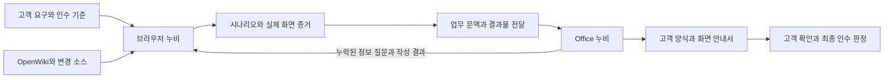

# 브라우저 누비와 Office 누비의 인수 테스트 업무 연결

2026-09-23. **앱 연계는 구현 전 설계안.** 현재 소스와 공식 자료를 대조한 결과다. Windows Office, 실제 고객 사이트, Qwen 실계정으로 이 연결을 검증한 것은 아니다. 후속 요청의 전체 페이지 캡처 개선은 별도 구현이며 [캡처 변경 기록](../../../extensions/aipro-chat/docs/FULL-PAGE-CAPTURE.md)에 범위를 구분했다.

## 원하는 사용자 경험

> “이번 변경에 대한 고객 인수 테스트 시나리오를 만들어줘. 실제 화면에서 이동하고 눌러볼 위치를 보여주고, 우리 Excel 양식으로 정리해줘.”

누비는 요구사항과 변경 근거를 확인하고, 실제 웹페이지를 탐색해 시나리오와 화면 안내를 만든다. Office 누비는 같은 업무의 목적과 결과를 받아 고객 양식에 맞춰 작성한다. 사용자가 대화를 복사하거나 별도의 Agent 역할을 설정하지 않는다.

브라우저는 탐색과 실행, Office는 문서 양식과 작성, OpenWiki는 프로젝트 근거 검색에 집중한다. 하나의 거대한 실행기로 합치지 않는다.

첫 산출물은 **인수 테스트 목록, 단계별 화면 안내, 실행 증적**이다. 자동 실행이 불가능한 단계도 고객이 직접 수행할 수 있는 절차로 남긴다.

## 현재 있는 기능과 연결이 필요한 기능

| 영역 | 현재 소스에서 확인한 기반 | 추가로 필요한 기능 |
|---|---|---|
| OpenWiki | `wiki_query`, Wiki 검색과 읽기, 명시적으로 연결한 원본 소스 검색과 읽기, 경로·줄·해시 근거 | 비교 기준 고정, Git 변경 수집, 변경에서 화면으로 이어지는 영향 관계 |
| 브라우저 | 페이지 관찰과 이동·입력·클릭, 실행 결과 검토, 현재 브라우저 viewport 캡처, PNG 미리보기와 다운로드 | 요구사항/시나리오/단계와 실행 기록 연결, 실행 전후 캡처, 클릭 위치 주석, 증적 묶음 |
| Office | 앱별 실행기, Excel 양식 관찰과 제한된 입력, 문서 바인딩, 질문과 승인, native 저장과 재조회 | 외부 업무 수신, 공유 문맥 계약, 시나리오 항목 매핑, 증거 이미지 삽입과 위치 검증 |
| 앱 사이 연결 | 각 앱 내부의 실행·질문 상태 | 인증된 작업 전달, 수신 확인, 중복 방지, 질문 응답과 결과의 왕복 전달 |

근거: `extensions/aipro-chat/project-tools.js`, `browser-agent.js`의 `capture_page`, `capture-store.js`, `packages/openwiki/src/visualize/nubi.ts`, `packages/nubi-office/worker/main.mjs`, `packages/nubi-office/docs/OFFICE-2016-SPECIALIZATION.md`.

Office worker는 현재 stdin/stdout RPC와 프로세스 메모리를 사용한다. 브라우저에서 호출하는 Office 서버는 없다. OpenWiki의 기존 `/api/nubi/v1`은 읽기 전용이며 Git 비교나 Office 실행을 제공하지 않는다. 폴더만 연결한 모드에는 원본 소스 접근도 없다.

## 인수 테스트를 만드는 순서

1. **업무 기준을 먼저 확인한다.** 고객 요구, 인수 조건, 대상 환경, 사용자 역할, 테스트 데이터와 고객 양식을 확보한다. 저장된 코드의 현재 동작을 정답으로 삼지 않는다. 빠진 기준은 기존 객관식/주관식 폼으로 묻고 같은 업무에 답변을 보존한다.
2. **변경 범위를 고정한다.** 지정한 기준 commit과 대상 commit 또는 작업 트리의 변경 파일 해시를 보존한다. 배포 화면의 버전과 일치 여부를 별도로 기록한다. 버전을 확인할 수 없으면 연결을 미확인으로 남긴다.
3. **영향받을 화면 후보를 찾는다.** OpenWiki의 업무 설명, 실제 소스와 기존 테스트를 읽고 `변경 파일 → 함수/컴포넌트 → 경로/API → 업무 화면` 관계를 만든다. 각 관계에 정적 추론인지 실제 관찰인지 표시한다.
4. **브라우저에서 경로를 확인한다.** 실제 메뉴명, 권한별 화면, 팝업과 새 탭, 입력 조건을 관찰한다. 렌더링된 DOM만으로 저장소의 원본 파일 위치를 확정하지 않는다. 관찰한 업무 표현을 시나리오에 사용한다.
5. **시나리오 초안을 검토한다.** 정상 흐름, 경계값, 입력 오류, 권한 차이, 변경으로 영향을 받는 기존 기능을 포함한다. 모든 경우를 무조건 늘리지 않고 고객 기준과 변경 위험에 연결한다.
6. **작은 단계로 실행하고 기록한다.** 실행 직전 대상과 화면을 확인하고 한 단계 수행 후 DOM/업무 상태와 화면을 다시 확인한다. 등록·발송 등 최종 거래는 이미 승인된 범위를 따르고, 범위를 넘는 최종 행위만 HITL을 받는다. 실패 후에는 현재 상태부터 읽어 중복 실행을 막는다.
7. **고객 양식으로 작성한다.** Office는 시나리오와 증거 참조를 받아 실제 양식을 읽고 항목을 매핑한다. 문서 저장과 재조회까지 확인하고 결과를 같은 업무로 반환한다. 고객의 최종 인수 판정은 별도로 남긴다.

요구사항이 아직 없으면 관찰한 기능으로 **검토용 시나리오 초안**까지 만들 수 있다. 이 경우 인수 기준이 합의되었다고 표시하지 않는다. 서버 저장 여부는 성공 안내창만 보지 않고 가능한 재조회로 확인한다.

## 단계별 화면 안내

예시일 뿐 실제 고객 화면이나 실행 결과가 아니다.

| 단계 | 고객이 할 일 | 기대 결과 | 제공할 화면 |
|---|---|---|---|
| 1 | 고객 목록 메뉴를 연다 | 검색란과 목록이 보인다 | 메뉴 위치가 표시된 실행 전 화면과 목록 화면 |
| 2 | 조회 조건에 지정한 이름을 입력한다 | 입력한 조건이 유지된다 | 입력란과 테스트 값이 보이는 화면 |
| 3 | 검색을 누른다 | 조건에 맞는 항목만 표시된다 | 실제 검색 위치와 결과 화면 |
| 4 | 조회 결과가 없는 조건으로 다시 검색한다 | 합의한 빈 결과 안내가 표시된다 | 빈 결과 안내와 조건 화면 |

각 단계는 `무엇을 할지`, `무엇이 보여야 할지`, `확인된 결과`를 구분한다. 고객 문서에는 내부 도구명, 로컬 포트, selector를 노출하지 않는다. 개발자용 근거에는 별도로 보존한다.

### 캡처 계약

- 현재 작업이 소유한 **브라우저 탭만** 캡처한다. 데스크톱이나 다른 앱을 촬영하지 않는다.
- 핵심 화면 전환, 입력 확인, 최종 결과, 실패에서 캡처한다. 모든 마우스 이동을 저장하지 않는다. 클릭 직전의 대상 bounds와 실행 receipt를 묶어 위치를 표시한다.
- 기본 `capture_page`는 viewport를 캡처하고 포인터를 지운다. 후속 구현의 `full_page=true`는 현재 렌더링된 전체 문서를 촬영한다. 기존 PNG에 클릭 표시가 남아 있다고 가정하지 않는다. 원본과 번호/테두리 주석을 별도로 보존한다. 원본을 바꾸어 성공 화면을 만들지 않는다.
- 탭/문서 식별자, URL 경로, 시각, viewport, DPR/scale, scroll 위치, 프레임 위치, 관찰 revision, 단계 ID를 함께 기록한다. 페이지나 viewport가 바뀌면 이전 좌표를 새 이미지에 사용하지 않는다.
- 개인정보와 비밀 입력의 마스크를 적용하고, 가려진 항목은 그 이미지로 검증할 수 없음을 남긴다. URL query, 토큰과 요청 본문을 증적에 자동 복사하지 않는다.
- 캡처에 실패하면 DOM/기타 증거와 실패 사유를 남긴다. 문서에 임의 이미지를 넣거나 이미지 확보로 표시하지 않는다. 캡처 권한과 모델의 이미지 해석 가능 여부도 분리한다.
- 이미지는 저장소에 두고 모델에는 필요한 이미지 또는 참조만 보낸다. 전체 대화와 모든 이미지 base64를 Office 프롬프트에 복사하지 않는다.

`passed/failed/blocked/not_run`은 실행 결과다. `pending/accepted/rejected`는 고객 판정이다. 스크린샷 자체나 모델의 완료 문장으로 두 상태를 승격하지 않는다.

## 공유 문맥과 결과물 계약

작업별 `workflowId` 아래 브라우저 실행과 Office 작성을 별도 작업으로 관리한다. A2A의 서버 발급 `contextId/taskId`를 매핑하되, ID만 같으면 대화나 인증이 자동 공유된다고 가정하지 않는다.

| 전달 항목 | 포함할 내용 |
|---|---|
| 업무 | 원래 요청, 인수 조건 ID, 제약, 사용자가 답한 필수 정보, 미해결 질문 |
| 진행 | 완료한 단계와 근거, 미완료 항목, 다음 역할의 구체적인 산출물 |
| 소스 | 프로젝트/연결 식별자, 비교 기준, 상대 경로와 줄, 내용 해시, 정적 추론/실행 관찰 상태 |
| 시나리오 | ID, 인수 조건, 목적, 사전 조건, 데이터, 단계별 행위와 기대 결과, 우선순위, 실행 결과 |
| 증거 | 이미지·DOM·실행 receipt의 불투명 ID, 해시, 시각, 단계와 연결, 누락 여부 |
| 문서 | 원하는 앱, 실제 선택한 양식 식별자, 필요한 항목과 이미지 참조, 현재 작성 상태 |

각 결과물에는 스키마 버전과 내용 해시를 붙인다. Office는 필요한 시나리오 묶음만 읽고 `요약 + 작성 결과물 참조 + 검증 근거 + 미완료`를 반환한다. 요약에서 고객 인수 조건이나 금지사항을 삭제하지 않는다. 원본 자료가 필요하면 근거 ID로 다시 조회한다.

브라우저의 DOM ref, Office COM 객체/범위, 인증 토큰, 승인 토큰은 전달하지 않는다. 수신 앱이 자신의 대상 문서를 관찰해 다시 바인딩한다. 문서와 소스에 적힌 지시는 사용자 승인으로 취급하지 않는다. 제공자가 다른 앱으로 자료를 넘길 때는 원래 선택한 제공자 경계를 유지하며, 자동으로 다른 계정에 전체 대화를 보내지 않는다.

### 전송과 중단 복구

선호 구현은 Office 설치에 포함되는 로컬 연결기에 공식 A2A JS SDK를 붙이고, 브라우저 확장은 client만 갖는 구조다. 기존 Office 버전에는 이 연결기가 없으므로 업데이트가 필요하다. 일반 브라우저 사용에는 Office나 별도 라우터를 요구하지 않는다.

- Office에서 일회 연결을 시작하고 정확한 확장과 사용자 세션을 페어링한다. localhost라는 이유만으로 요청을 신뢰하지 않는다. loopback bind, Host/Origin 검사, 세션 인증과 만료, 요청 크기 제한을 둔다.
- 연결기는 한 사용자당 하나로 관리하고 열린 Office host들을 문서와 capability에 바인딩한다. 임의 명령/파일 경로/COM 호출을 외부 API로 노출하지 않는다. 실행은 기존 Office UI/STA adapter를 통과한다.
- 브라우저 요청에는 별도 멱등 키와 payload 해시를 붙인다. A2A 메시지 ID만으로 exactly-once 실행을 보장한다고 가정하지 않는다. 응답 유실은 저장된 작업 ID/수신 기록으로 조회한다.
- 전달됨, 수신 확인, 작성 중, 입력 대기, 완료, 실패, 취소를 구분한다. SSE 재연결은 마지막 이벤트 이후부터 상태를 맞추고 쓰기 요청을 재전송하지 않는다.
- Office 질문은 같은 작업으로 전달하며 수신 ACK 뒤에 답변 완료를 표시한다. 어느 앱에서 답해도 중복 적용하지 않는다. 두 앱의 동시 수정을 revision으로 거절한다.
- 첫 구현의 내용/이미지 보관은 현재 프로세스 범위로 제한한다. 앱 종료 후 문맥 복구를 제공하려면 회사 보안 정책에 맞는 별도 보호 저장소가 필요하다. 현재 메모리 상태를 영구 복구로 표시하지 않는다.

## Office 양식 반영

첫 대상은 Excel 인수 테스트 양식이다. `요구사항 ID, 시나리오 ID, 사전 조건, 수행 절차, 기대 결과, 실제 결과, 증거, 고객 판정, 의견`을 실제 열과 연결한다. 기존 수식, 병합, 스타일과 고객 입력을 보존하고 사본에서 작성한다. 부족한 열이나 표 확장 문제는 질문으로 확인한다.

Word는 단계별 화면 안내서, PowerPoint는 변경 요약/검토 자료로 확장할 수 있다. 현재 Word 콘텐츠 컨트롤 기반 양식 등록과 Office의 증거 이미지 삽입은 완성된 기능이 아니다. 텍스트만 전달되었다고 이미지 포함 문서 작성을 완료 처리하지 않는다.

이미지 삽입은 앱별 native 도구가 담당하고 대상 문서, anchor, 그림 ID, 비율과 크기, 설명, 원본 해시를 검증한다. NASCA 문서를 외부 ZIP 라이브러리로 다시 만들지 않는다. 보호 파일에서 필요한 이미지 전달/임시 저장 방식은 회사 환경 검증 대상으로 남긴다. 링크만 넣는 임시 구현은 사용자가 요구한 이미지 포함 결과와 구분한다.

## 방법론과 오픈소스 선택

2026-09-23 공식 자료 확인. 아래 선택은 설계 반영이며 새 패키지 설치 완료를 의미하지 않는다.

| 후보 | 활용 판단 | 한계와 채택 조건 |
|---|---|---|
| [ISTQB Acceptance Testing](https://istqb.org/certifications/certified-tester-acceptance-testing/) | 고객 업무와 인수 조건에서 시나리오를 도출하는 기준으로 사용 | 코드나 화면의 현재 동작만으로 기대 결과를 정하지 않는다 |
| [Playwright Test Agents](https://playwright.dev/docs/test-agents) | 계획, 실행 가능한 테스트 생성, 실패 진단/복구의 역할 구분을 기존 Pi 실행기에 반영 | Agent 정의만 넣으면 Qwen/확장에서 그대로 실행되는 것은 아니다. 모델·도구 adapter가 필요하다 |
| [Playwright Trace Viewer](https://playwright.dev/docs/trace-viewer) | 행위와 전후 화면을 묶는 증거 구조 참고. 실제 Playwright runner가 있는 환경에서는 정식 trace 사용 | 기존 확장의 캡처를 `trace.zip`이라고 부르지 않는다. 확장만 쓰는 경우 같은 원칙의 단계별 증적을 만든다 |
| [A2A JS SDK](https://github.com/a2aproject/a2a-js) / Apache-2.0 | 앱 사이 작업 전달의 우선 후보. A2A 1.0 task/context/artifact/input-required 계약 활용 | 공식 main의 package는 1.1.0, Node >=20을 명시. 배포 버전 고정과 MV3 client bundle/Office Node 호환 검증 후 추가한다. 재시작 보관과 인증은 제품 책임이다 |
| [MCP resources](https://modelcontextprotocol.io/specification/2025-11-25/server/resources) | 소스·Wiki·결과물의 필요한 부분 조회에 사용 가능. 기존 OpenWiki HTTP adapter 유지 | MCP 연결 자체가 두 앱의 대화를 동기화하지 않는다. 작업 전달과 자료 조회를 구분한다 |
| [trace-mcp](https://github.com/nikolai-vysotskyi/trace-mcp) / MIT | `get_change_impact`와 `get_request_flow`를 원본 코드 분석 adapter의 우선 실험 후보로 선정 | 정적 영향 후보를 실제 고객 메뉴나 도달 가능한 경로로 단정하지 않는다. 대상 프레임워크에서 정확도를 먼저 비교하고 읽기 도구만 노출한다. 홍보 수치를 누비 성능으로 사용하지 않는다 |
| [dependency-cruiser](https://github.com/sverweij/dependency-cruiser) / MIT | JS/TS 프로젝트의 단순 의존 관계가 필요한 경우 비교 후보 | 업무 의미와 실제 메뉴는 별도 확인. 모든 언어 프로젝트에 일괄 도입하지 않는다 |
| [Anthropic context engineering](https://www.anthropic.com/engineering/effective-context-engineering-for-ai-agents) | 역할별 필요한 자료, 요약과 근거 반환, 원본의 필요 시 재조회 원칙 적용 | 특정 모델의 성과를 Qwen 성능으로 가정하지 않는다. 기존 Pi에 두 번째 Agent 하네스를 중첩하지 않는다 |

OpenWiki의 MiniSearch는 문서 근거 검색에 유지한다. 영향 분석은 그 검색을 대체하는 것이 아니라 별도 근거를 더한다. 시나리오는 단일 구조화 결과로 보관하고 고객 문서와 자동화 테스트는 그 결과에서 각각 생성한다. Gherkin을 사용하더라도 업무 기준을 표현하는 선택 출력으로 두고 고객에게 문법 작성을 요구하지 않는다.

## 구현 순서와 완료 조건

| 순서 | 수정 위치 | 완료 조건 |
|---|---|---|
| 1. 변경 근거 | OpenWiki `src/visualize/nubi.ts`와 신규 읽기 전용 change adapter, 확장 `project-tools.js` | 고정 revision/작업 트리 해시, 삭제·이름 변경·미추적 파일·제외 파일 처리. 프로젝트 밖 읽기와 임의 shell 입력 차단. 기존 폴더 모드 유지 |
| 2. 시나리오와 증적 | 확장 계획/검토 실행기, `browser-agent.js`, `capture-store.js`, 기존 진행 UI | 요구사항별 시나리오, 실제 전후 화면과 receipt 결합, 새 탭/iframe/스크롤에서도 증거 일치. 미실행과 실패 구분 |
| 3. Office 연결 | 신규 Office 로컬 연결기, `worker/main.mjs` intake adapter, 기존 UI bridge | 페어링, 수신 ACK, 같은 문맥으로 질문/재개, 중복 쓰기 방지. 단순 payload로 host나 문서를 바꿀 수 없음 |
| 4. 양식과 이미지 | Office 앱별 native adapter와 양식 매핑, 문서 검증 | Excel 표와 단계별 이미지 작성, 원본 보존, 저장/재열기, 문서에 증거 누락 없음. Word/PPT는 실제 지원 capability만 노출 |
| 5. 업무 검증 | 브라우저+Office 통합 fixture와 실제 Windows 검증 | 동일 Qwen으로 작업 문맥 보존, 증거 정확성, 고객 양식 완성도 측정. 최종 설치본 빌드는 별도 요청 시 수행 |

### 필수 평가 시나리오

- 정상 탐색/입력, 빈 결과, 입력 오류, 권한 제한과 화면 없는 경우.
- 새 탭, iframe, 모달, 호버 메뉴, 확대/스크롤 이후의 클릭 위치와 캡처 일치.
- 실패한 단계 뒤의 복구: 이미 성공한 등록을 반복하지 않으며 실패 기록을 지우지 않음.
- 코드/배포 revision 불일치, 오래된 Wiki, 동적 메뉴 누락, 요구사항과 코드가 충돌하는 경우.
- Office 미실행, 여러 문서 열림, 양식 변경, 중복 전송, 수신 응답 유실, 앱 종료와 재연결.
- 질문 답변 유지, 사용자 취소, 승인 범위 유지, 최종 인수 여부를 모델이 임의 기입하지 않음.
- 이미지와 단계 연결, 마스킹, 손상/누락 이미지, 네이티브 문서 저장 후 재열기와 실제 배치.

Qwen 기준 동일 과제를 `대화 전체 전달`과 `구조화된 업무 문맥 전달`로 비교한다. 인수 조건 누락률, 근거 없는 통과 판정, 이미지-단계 오연결, 문서 양식 훼손, 질문 중복, 복구율, 총 토큰과 지연을 모든 시도에 기록한다. 자동 점수와 고객 검토를 구분한다. 현재 이 비교의 측정 결과는 없다.

## 구현 인계 지침

이 설계를 작은 수직 흐름으로 구현한다. 첫 fixture는 요구사항 3개가 있는 검색 화면의 변경이며 정상 조회/빈 결과/필수 입력을 포함한다. 브라우저 실행에서 확보한 단계별 증거를 같은 workflow로 Office Excel 사본에 전달하고 저장 전 승인, 저장 후 재조회까지 확인한다. 이후 popup/iframe/오류 복구를 확장한다.

먼저 현재 계약을 확인하고 새 adapter만 연결한다. provider 선택, 브라우저 도구 실행, Office 권한/STA/문서 바인딩은 각각 기존 호스트가 담당한다. OpenWiki를 Office 실행 서버로 바꾸지 않는다. A2A SDK나 영향 분석 도구는 버전·라이선스·runtime 호환을 확인하고 계약 검사 후 도입한다. 근거가 없는 결과는 생성 완료/실행 성공/인수 통과로 표시하지 않는다.

### 이번 확인 범위

현재 소스의 연결 지점과 미구현 범위, 공식 문서의 방법론과 라이선스/계약을 검토했다. 이 앱 연계에 대한 라이브러리 설치, 통합 테스트, 고객 화면 캡처, Office 문서 생성, 설치본 빌드는 수행하지 않았다. 후속 브라우저 캡처 개선을 Office 연동 완료로 해석하지 않는다.
