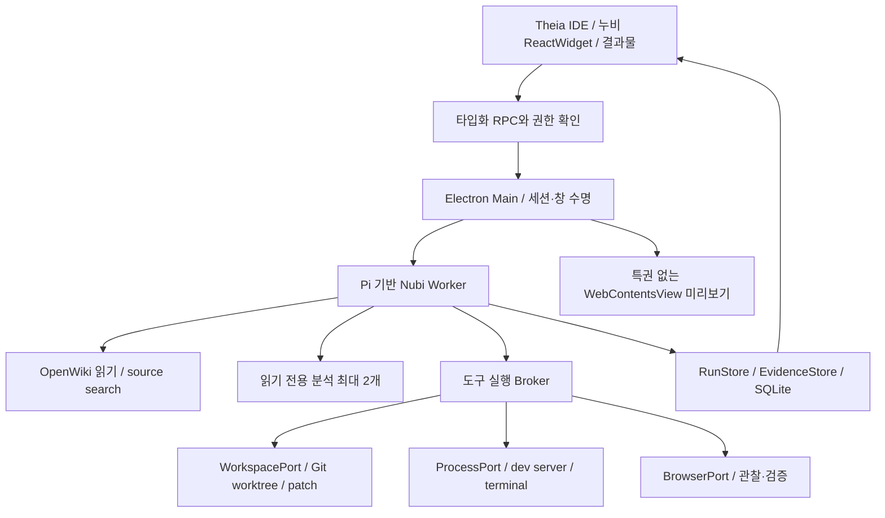

# 누비 Desktop 워크스페이스 설계 제안

2026-09-23. 사용자 확인 범위: 분석·수정·실행·비교. **이 문서는 제안이며 설치형 앱의 구현 완료를 의미하지 않는다.** [BP·선택 근거](../../research/2026-09-23-nubi-desktop-bp.md).

현재 기반 권고는 [Theia 기반 IDE 확장 우선 검증](../../research/2026-09-23-nubi-ide-foundation.md)이다. 독자 Electron shell은 대안이다. Theia의 workspace/SCM/editor/terminal을 사용하고 Pi 하네스와 OpenWiki를 contribution·port로 연결한다.

프로젝트 지식과 다른 누비의 연계는 [Git 기반 프로젝트 허브 명세](2026-09-23-nubi-project-hub.md)를 함께 따른다. 요구사항/사용자 지식/생성 Wiki를 Git에서 추적하고, 갱신 제안은 사람 편집과 기준 버전을 보존한다. 웹·Office에는 범위가 있는 작업과 근거를 전달하고 실행·인증·승인은 각 호스트가 소유한다. OpenSpec 형식의 변경 문서는 우선 예제로 검증하며 기존 프로젝트의 문서 체계를 강제로 교체하지 않는다.

## 목표와 첫 경험

폴더를 열고 자연어 요구를 입력하면 같은 작업 안에서 OpenWiki/소스 근거, 구현 계획, 변경 코드, 실행한 화면, 전후 비교와 검증 결과를 확인한다. 사용자가 Agent 역할이나 복잡한 작업 모드를 먼저 선택하지 않아도 된다.

처음에는 `프로젝트 열기 → 제공자 연결 → 요청`만 필요하다. 프로젝트에서는 언어·Git 상태·실행 명령 후보를 읽고 자동 실행 없이 보여준다. 읽기 전용 분석은 개발 환경이 없어도 가능하다. 실행할 때 필요한 런타임이 없으면 해당 실행에 필요한 항목만 안내한다.

## 화면 배치

```text
┌ 누비   프로젝트 / 현재 작업                 작업 공간   창 조작 ┐
├──────────────┬───────────────────────────┬────────────────────┤
│ 프로젝트     │ 요구사항  연결 지도  코드 │ 누비 / 현재 작업   │
│ 소스·Wiki    │ 미리보기  비교            │ 사용자 요청        │
│ 변경 파일    ├───────────────────────────┤ 계획·실행 기록     │
│ 작업 이력    │ 파일/도식/브라우저/전후    │ 답변·근거          │
│              │                           │                    │
│ 연결·설정    ├───────────────────────────┤ 첨부·모델·입력창   │
│              │ 터미널 / 검증 / 작업 기록 │                    │
└──────────────┴───────────────────────────┴────────────────────┘
```

- 기본 1440×900, 왼쪽 208px, 오른쪽 대화 360px, 중앙 결과 나머지. 사용자가 splitter로 조절하고 프로젝트별 복원한다. 개발/검토 preset은 같은 작업의 배치만 바꾸며 전후 비교에서는 대화를 접어 넓게 볼 수 있다.
- 1280px 이하에서는 탐색을 축소하고 대화/결과 전환을 제공한다. 1024px 아래와 200% 확대에서는 모든 패널을 억지로 나란히 두지 않고 한 영역씩 전환한다.
- 일반 작업에서는 대화와 해당 결과물만 노출한다. 분석 역할·문맥 상세·도구 기록·터미널은 펼쳐 본다. 진행 단계는 실제 이벤트에 따라 표시한다.
- 누비의 낮은 채도, 흰 표면, 청록 캐릭터, Noto Sans KR 14px/22px와 기존 CX를 재사용한다. 친숙한 조작은 아이콘+접근 가능한 이름+툴팁으로 표시한다.
- 처음 실행/빈 프로젝트, 색인 중, 질문 대기, 실패, 취소, 연결 끊김, 근거 오래됨, 복구 대기, 비교 불가 상태를 별도로 둔다. 0%나 성공 상태로 바꾸어 표시하지 않는다.

## 결과물 탭

| 탭 | 담는 내용 | 핵심 조작 |
|---|---|---|
| 요구사항 | 원문, 제약, AC ID, 모호한 점, 통과/실패/미확인 | 조건 수정, 질문 응답, 근거 열기 |
| 연결 지도 | 요구→메뉴/URL→컴포넌트→API→테스트의 관련 관계 | 노드 클릭으로 코드/근거 이동, 추론 관계 필터 |
| 코드 | 변경 파일 목록, Monaco 편집기/diff, 관련 요구 | 한 덩어리 변경 검토, 원본·수정 위치 이동 |
| 미리보기 | 서버 상태, URL, viewport, 관리/외부 연결 구분 | 시작/중지, 새로고침, 요소 선택, 캡처 |
| 비교 | 고정된 기준과 변경본, 화면 병렬/겹침, 요구사항별 검증 | 기준 선택, 동일 시나리오 재검증, 차이 위치 이동 |

OpenWiki는 별도 전면 앱이 아니라 프로젝트 지식과 문서 결과물로 연결한다. 초기에는 기존 visualizer를 별도 탭으로 열 수 있지만, 최종적으로는 필요한 근거와 문서만 공통 결과물 영역에서 읽는다.

## CompareWorkbench 컴포넌트 명세

**용도:** 두 revision의 코드·화면·검증 결과를 같은 기준으로 확인한다. 재현 조건이 없는 임의 두 스크린샷을 기능 검증 결과로 표시할 때는 사용하지 않는다.

구성은 비교 기준 바, 도구 모음, before/after viewport, 요구사항 목록, 선택 근거 drawer다. 기본 variant는 `side-by-side`, 좁은 화면은 `single-toggle`, 이미지 겹침은 `overlay`다. 이미지 확대/이동은 좌우 동기화하되 DOM 스크롤 동기화는 같은 anchor를 확인했을 때만 적용한다.

| 입력 계약 | 타입/필수 | 의미 |
|---|---|---|
| `comparisonId` | string / 필수 | 비교 실행 ID |
| `baseline`, `candidate` | RevisionRef / 필수 | commit, dirty manifest hash, 서버 연결, capturedAt |
| `scenario` | ScenarioRef / 필수 | URL 경로, viewport/DPR, 데이터 seed, 계정 권한 식별자, 마스크 |
| `artifacts` | EvidenceRef[] / 필수 | 호스트가 저장한 이미지·DOM·trace·실행 결과 |
| `criteria` | CriterionResult[] / 필수 | met/unmet/unknown과 근거 ID |
| `mode` | enum / 기본 side-by-side | 비교 표시 방식 |
| `onInspectEvidence` | callback / 필수 | 근거 열기만 수행 |
| `onRecheck` | callback / 선택 | 독립된 검증 실행 요청, 적용/배포는 하지 않음 |

상태: `empty → preparing → ready` 또는 `failed/incomparable/stale/cancelled`. 로딩 때 이전 비교를 보존하고 이전 결과임을 표시한다. 실패·미확인은 색과 아이콘+글자로 구별한다. 새 검증이 이전 실행보다 늦게 도착하면 ID/revision 검사로 현재 결과를 덮어쓰지 못한다.

키보드: 탭은 좌우/Home/End와 Enter/Space, splitter는 방향키, 겹침 slider는 native range 키 조작, 상세는 Escape 닫기와 호출 버튼 초점 복귀. 결과 수 갱신은 `aria-live=polite`; 스트리밍 텍스트 전체를 반복 읽지 않는다. 모션 감소와 고대비를 존중한다. 근거가 없는 비활성 재검증에는 이유를 함께 제공한다.

## 실행 아키텍처



호스트가 파일/프로세스/브라우저 권한을 검증한다. 모델 출력에 승인됨이라는 텍스트가 있어도 권한이 생기지 않는다. API key/토큰은 renderer나 도구 결과에 넣지 않고 Windows OS 보호 저장소와 전용 namespace를 사용한다. TLS 검증을 유지하고 시스템/회사 CA·프록시를 명시적으로 지원한다.

기본 제공자는 기존 누비의 AI Pro·ChatGPT·FabriX를 유지한다. Qwen 3.8 27B의 실제 카탈로그 ID를 기본 후보로 쓰고 선택값을 보존한다. 이름으로 도구/비전/문맥 지원을 추정하지 않는다. ChatGPT 등은 해당 제공자의 허용된 인증·실행 경로로만 연결한다. Claude 구독 토큰을 가져오는 어댑터는 만들지 않는다.

### 공유와 호스트 경계

`nubi-core`: Pi loop, 계획/검토/문맥/분석/근거 계약. `nubi-ui`: 누비 공통 표면. Desktop host: storage, auth callback, fs, process, Git, browser. 이는 새 패키지의 제안 이름이며 현재 존재하는 패키지처럼 import하지 않는다.

추출 전 Chrome global과 side effect 의존성을 목록화하고 pure 함수/port 경계를 만든다. 기존 확장·Office는 public API에 대한 계약 검사로 보호한다. OpenWiki의 DeepAgents runtime을 Pi loop 내부에서 중복 실행하지 않는다. Wiki 생성/업데이트는 추적 가능한 독립 작업으로 호출한다.

### Preview와 자동화의 첫 경계

P0의 실시간 미리보기는 WebContentsView로 제공하고, 자동 검증은 앱이 소유한 Playwright Chromium session에서 수행해 캡처/DOM/trace를 돌려준다. 두 session의 로그인·storage가 같다고 가정하지 않는다. 사용자 화면 선택을 자동화 페이지로 넘길 때는 URL·상태를 다시 관찰한다.

화면에 보이는 동일 WebContentsView를 Agent가 직접 조작하는 경로는 별도 spike다. Playwright Electron 지원/접속 경로, child WebContents 수명, popup, ref 무효화, session 분리를 실제 Windows에서 검증해야 한다. 기존 Chrome debugger/CRX를 무수정 연결할 수 있다고 가정하지 않는다. spike가 실패해도 검증 전용 Chromium과 캡처 비교 흐름은 유지한다.

### 요구사항과 근거 데이터

- `Requirement`: id, 원문, 현재 설명, constraints, acceptanceCriteria, 사용자 변경 이력.
- `SourceRef`: projectId, relativePath, start/end, contentHash, revision.
- `Relation`: from/to, kind, provenance, 상태(static_candidate/runtime_observed/stale/unknown), observedAt.
- `ToolReceipt`: runId, operationId, workspaceId, 입력 fingerprint, beforeHash, 상태(prepared/issued/confirmed/failed/uncertain), afterEvidenceIds.
- `RunEvent`: 단조 sequence, task/step/tool ID, 실제 시각, 공개 상태. 비공개 reasoning은 저장/표시하지 않음.
- `Checkpoint`: 원래 목표, 사용자 수정사항, 계획, 완료 근거, 미완료, 취소/승인 대기, 자식 작업 상태, source revision, cursor.

EventStore가 상태의 기준이며 UI는 이벤트를 구독한다. SQLite에는 요약과 인덱스를, 큰 증거는 해시로 주소화한 파일에 두고 용량·보관·삭제 정책을 제공한다. 비밀/계정 입력은 수집하지 않는다. 이미지 원문은 민감정보일 수 있으므로 필요한 캡처만 저장하고 삭제 기능을 둔다.

### 복구와 쓰기

파일 patch는 읽은 해시가 현재 파일과 일치할 때만 적용하고 변경 후 다시 읽는다. 부분 patch/프로세스 종료/응답 유실은 `uncertain`을 유지한다. 새 파일 생성도 operation ID와 실제 파일 상태를 확인한다. 사용자 수정이 섞였으면 inverse patch를 무조건 적용하지 않는다.

IDE에서 열린 파일에는 URI·editorVersion·dirty·diskHash를 함께 사용한다. 변경은 IDE WorkspaceEdit/bulk edit와 undo 경로로 연결하고 저장되지 않은 사용자 버퍼를 직접 파일 쓰기로 우회하지 않는다. 실행 전 저장 상태와 baseline을 고정하며 proposal 이후 사용자 수정은 stale로 처리한다.

앱 재시작 시 읽기와 기록을 복구하되 쓰기를 자동 재전송하지 않는다. 소유 프로세스의 PID만 믿지 않고 시작 시각/작업 식별자를 확인한다. 사용자 취소는 durable 상태로 유지한다. 새 승인 없이 이전 승인 범위를 넓히지 않는다.

## 로컬 실행 관리

[Bash 중심 실행 환경 BP](../../research/2026-09-23-nubi-shell-environment.md)를 따른다. Windows Git Bash를 기본 CLI 환경으로 검증하고 PowerShell 및 선택형 WSL2 profile을 유지한다. CLI 도구를 적극 활용하되 IDE 버퍼 편집과 BrowserPort의 상태 계약을 우회하지 않는다. exec/poll/stdin/cancel/read_output과 artifact 기반 로그, 작업별 automation profile, 프로세스 소유권을 구분한다. Bash/worktree/renderer sandbox를 OS 명령 격리로 표현하지 않는다.

프로젝트 실행 설정은 command와 args 배열, cwd, port, readiness URL/조건, profile, env 이름, runtime path로 저장한다. 비밀 env 값은 UI/로그/자식 분석에 전달하지 않는다. 포트가 응답한다는 사실만으로 올바른 소스의 서버가 실행됐다고 판정하지 않는다.

Windows 경로 공백/한글, CRLF, 파일 잠금, symlink/junction, PowerShell과 cmd, npm.cmd, 프로세스 트리 종료, Native module ABI를 필수 검증한다. 명령을 검토 없이 문자열 결합하지 않는다. 앱이 실행한 프로세스만 종료하며 기존 사용자의 서버는 연결 해제로 처리한다.

기존 미커밋 변경을 작업 기준에 포함하는 선택과 HEAD 기준 선택을 명확히 구분한다. 원본 checkout에 자동 stash/reset/clean을 실행하지 않는다. baseline/candidate DB는 별도 profile로 분리하고 데이터 마이그레이션이 필요한 작업은 별도 승인된 개발 DB에서 수행한다.

## 완료와 적용

완료는 `코드 수정됨 / 실행 준비됨 / 검사 통과 / 요구 충족 / 사용자 반영됨`을 따로 기록한다. 요구사항이 하나라도 unknown이면 전체 검증 완료를 표시하지 않는다. 모델 검토가 met여도 독립된 검사 근거를 요구한다.

이미 요청된 worktree 내 수정과 로컬 검증은 매 단계 승인으로 막지 않는다. 원본으로 최종 반영, commit/push/PR/배포 및 외부 시스템 최종 거래는 사용자의 기존 승인 범위를 따른다. 일반 조회/초안 작성에 불필요한 승인을 더하지 않는다.

## 성공 기준과 평가

첫 수직 시나리오: React/TypeScript 프로젝트의 빈 검색 결과 요구를 받아 관련 코드와 Wiki 근거를 찾고, worktree에서 수정한 뒤 실행하여 baseline/candidate와 3개 AC 결과를 보여준다. 실제 제공자 연결이 없으면 mock 시나리오로 명확히 구분한다.

필수 검증: 요구사항 보존(압축 전후), 오래된 파일/화면 거부, 읽기 분석의 쓰기 차단, 취소 전파, 중복 patch 방지, dev server 실패/포트 충돌, 결과 순서 역전, 재시작 뒤 uncertain write, 미커밋 파일 보존, 실제 화면·키보드·재조회, Windows 설치/제거.

실모델은 기준 Qwen으로 동일 과제를 단일 Agent와 최대 2개 분석 구성에서 비교한다. 독립 정답 기준 요구 충족률, 거짓 완료율, 잘못된 수정, 중복 실행, 복구율, 전체 토큰/지연을 모든 시도에 기록한다. 초기 제안은 10개 대표 과제×3회이며 성능 수치는 아직 없다.

설치 패키지는 사용자별 설치, 서명/해시, 업데이트 검증, 사내 오프라인 배포 조건을 별도로 검사한다. 이 설계 턴에서는 EXE와 배포판을 생성하지 않았다.
