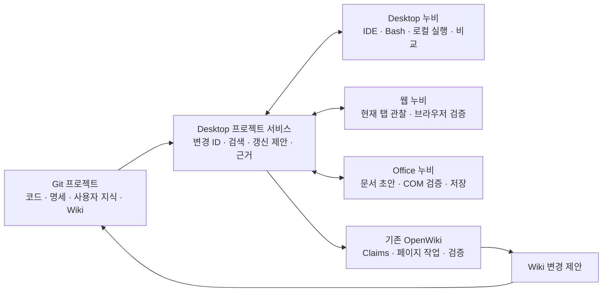

# 누비 프로젝트 지식과 작업 전달 설계

2026-09-23. [조사/OSS 선택 근거](../../research/2026-09-23-nubi-project-knowledge-bp.md). **제안 명세이며 아래 서비스·schema는 현재 제품 API가 아니다.** 기존 Desktop 설계에 추가한다.

## 사용자가 경험할 흐름

웹 누비에서 “이 화면의 검색 조건이 사라지는 문제를 고쳐줘”라고 요청하면 관찰한 화면과 요구를 해당 프로젝트 작업에 연결한다. Desktop은 관련 소스/Wiki를 읽고 수정·실행·비교한다. 사용자는 같은 작업의 Wiki 개선안도 검토한다. 필요하면 Office 누비가 검증 결과를 근거로 보고서 초안을 만든다. 각 결과에서 원래 요구, 소스 버전, 실제 검사 결과로 돌아갈 수 있다.

외부 웹 데이터의 최종 제출이나 Office 기존 문서 수정/최종 저장은 해당 호스트의 기존 승인 경계를 유지한다. 프로젝트 연결 자체가 모든 실행을 승인하지 않는다. 이미 승인된 작업 범위의 읽기·분석·초안에는 추가 승인을 반복하지 않는다.



Desktop 프로젝트 서비스는 설치형 앱의 로컬 backend이다. 별도 중앙 서버 설치는 P0에서 요구하지 않는다. 웹/Office는 기존 단독 사용을 유지하고 연결했을 때만 추가 기능을 사용한다. 앱이 꺼져 있으면 공유 근거의 마지막 버전과 연결 끊김을 표시한다. 실행 중인 Office 작업을 Desktop 연결 종료 때문에 임의 취소하지 않는다.

## Git에 남길 것과 로컬에 둘 것

아래는 새 프로젝트의 제안 구조다. 기존 `docs/specs`, ADR, Spec Kit 등의 구조가 있으면 경로 매핑으로 읽으며 같은 요구를 복제하지 않는다.

```text
src/                              현재 구현
openspec/specs/                   합의된 동작 명세
openspec/changes/<change-id>/     proposal, delta specs, design, tasks
docs/knowledge/                   사람이 고치는 업무 지식·용어·운영 지침
docs/adr/                         설계 선택과 이유
openwiki/                         코드 기반 설명과 OpenWiki 소유 Claims/메타데이터
.nubi/project.json                프로젝트 ID와 상대 경로 매핑, 비밀 없는 설정
```

작업 중 대화·캡처·trace·대용량 로그·토큰·PC 절대 경로·pairing token은 Git에 넣지 않는다. Desktop 로컬 SQLite/근거 저장소에 둔다. 공유하기로 정한 검사 요약만 정제한 artifact로 내보내며 Git 참조가 존재해도 수신자에게 파일 접근권한이 생기지는 않는다.

OpenWiki의 `.claims/`, page manifest, source checkpoint는 문서와 일치하도록 함께 버전 관리할 대상을 adapter에서 정한다. `.run.json`은 현재 작업의 재개 파일로 유지하되 commit 대상에서 제외한다. 생성기의 현재 계약을 검사하지 않고 메타데이터를 직접 재작성하거나 전부 `.gitignore`하지 않는다.

Office 원본과 회사 양식은 해당 앱의 파일/문서 저장 계약을 유지한다. NASCA 문서는 Office open/save 경로를 통하며 Custom XML을 평문 sidecar로 추출하지 않는다. 허용된 요약·opaque artifact ID만 프로젝트와 연결한다. Git LFS도 암호화나 권한 통제를 대신하지 않으므로 바이너리 자동 수집 기능으로 넣지 않는다.

## 사람이 개선할 수 있는 문서와 설정

Wiki 화면에 `읽기 / 원본 / 개선 제안 / 이력`을 둔다. 사람이 작성한 지식은 직접 편집할 수 있고, 생성 페이지의 개선 제안은 어떤 동작을 바로잡으려는지와 출처를 함께 남긴다. 기본 흐름은 그 의도를 `docs/knowledge/` 또는 해당 명세에 보존한 뒤 Wiki 갱신에 입력한다. 고급 사용자가 생성 Markdown을 직접 편집해도 수정 내용을 삭제하지 않는다.

자동 갱신은 다음을 따른다.

1. 현재 Git revision, dirty 파일 manifest, 원본 문서 bytes/hash, IDE buffer version을 고정한다.
2. 사용자 checkout과 분리된 작업 공간에서 영향 문서의 갱신안을 만든다. 미커밋 기준이면 명시적 snapshot을 재현한다.
3. 기준본(base), 현재 사용자본(ours), 생성안(theirs)을 Git 3-way merge로 비교한다. 출처가 없는 최신 파일을 base로 추정하지 않는다.
4. 충돌이 있으면 세 버전과 변경 이유를 보존하고 선택을 기다린다. 깨끗한 텍스트 병합도 동작/Claim 검증의 통과는 아니다.
5. Markdown/frontmatter/링크/Claims를 다시 검사한다. 병합 이전의 검증 stamp를 그대로 사용하지 않고 현재 bytes의 재검증 결과를 반영한다.
6. IDE의 version-aware edit/undo 경로로 변경안을 적용한다. 적용 직전 파일·buffer가 바뀌면 오래된 제안을 적용하지 않는다.

프로젝트 지침·양식·Agent skill도 원본과 사용자 override를 구분하고 Git diff로 바꾼다. 신뢰된 instruction 경로는 명시적으로 등록한다. Wiki에 적힌 명령이나 웹 텍스트가 실행 권한/승인/시스템 지침으로 승격되지 않는다. 앱 업데이트가 사용자 설정이나 지식을 덮어쓰지 않는다.

## 지속적인 갱신

`변경 감지 → 영향 범위 계산 → 문서 갱신안 → 검증 → 반영 → 검색 색인 갱신` 순서다. watcher는 시작 신호이며 정확성 판단은 Git 상태·내용 해시·Claims preflight로 한다. branch 전환, 대량 변경, watcher 이벤트 누락 뒤에는 다시 전체 상태를 대조한다. dependency를 알 수 없으면 영향 없음으로 생략하지 않고 재검토 범위를 넓힌다.

저장 이벤트마다 LLM을 호출하지 않는다. 저장 이벤트를 합치고 영향 문서를 표시하며, 사용자 요청/작업 완료/설정한 유휴 시점에 제안을 만든다. 생성 폴더·로그·색인을 감지 입력에서 제외해 자기 갱신 루프를 막는다. 프로젝트별 하나의 Wiki writer와 generation ID를 사용하고 다른 branch/작업의 늦은 결과는 적용하지 않는다. 생성 도중 소스가 바뀌면 기존 OpenWiki drift 검사로 다시 계획한다.

`최신 / 재검토 필요 / 갱신 중 / 검토 대기 / 충돌 / 일부 실패 / 확인 불가`를 따로 표시한다. 문서가 생성된 시각은 소스 최신성의 증거가 아니다. Markdown을 사람이 저장한 성공과 코드 사실 검증 성공도 구분한다. 모델 연결이 없어도 문서 열기·직접 편집·Git 비교는 가능하다.

Git은 로컬 이력을 관리하며 `동기화`는 원격 fetch/push 상태다. 자동 감지·갱신안 생성과 자동 commit/push는 분리한다. 처음부터 원격 자동 반영을 켜지 않고 기존 사용자 승인/저장소 정책을 따른다. GHES에서 예약 작업을 쓰려면 접근 가능한 runner와 제공자 인증을 별도 확인한다.

앱 버전 업데이트, OSS upstream 업데이트, 프로젝트 지식 업데이트도 별개다. upstream은 고정 버전/라이선스/계약 회귀를 검토한 upgrade 변경으로 반영한다. 사용자 문서나 프로젝트 skill을 패키지 파일 복사로 초기화하지 않는다.

## 세 누비의 공유 범위와 책임

| 공유하는 것 | 소유 호스트에 남기는 것 |
|---|---|
| projectId, changeId, requirement/AC ID, 공개 작업 상태 | Desktop fs/process, 웹 tab/frame 권한, Office COM 문서 바인딩 |
| 버전/해시가 있는 source·Wiki·artifact 참조 | 제공자 인증값, 브라우저 cookie, Office 인증 메모리 |
| 사용자가 확인한 제약·답변 중 해당 과제에 필요한 부분 | 전체 대화/비공개 추론/불필요한 문서 내용 |
| 실행 요청·취소 요청·영수증·검증 결과 | 실제 승인 판단, 불확실한 쓰기의 reconcile |

projectId는 저장소의 명시적 식별자로 두고 로컬 clone/worktree는 별도 workspaceId로 연결한다. 경로만으로 같은 프로젝트라고 추정하지 않는다. branch 이름만으로 검증 버전을 식별하지 않고 commit OID와 dirty snapshot hash를 사용한다. 두 PC의 clone이 같은 projectId를 갖더라도 별도 pairing과 읽기 범위가 필요하다.

브라우저 접속은 기존 OpenWiki의 loopback 읽기 API와 별도로 **새 작업 전달 capability**를 협상한다. 구버전의 읽기 token을 실행 token으로 재사용하지 않는다. Host/Origin, 프로젝트, capability, 만료, 메시지 크기를 검사하고 프로젝트 연결을 해제하면 관련 권한을 회수한다. localhost라는 이유로 요청을 신뢰하지 않는다.

Office는 기존 stdin/stdout host-worker 계약을 유지하고 host adapter가 프로젝트 서비스와 통신한다. Desktop이 worker의 runStart나 COM 함수를 직접 호출하는 일반 원격 실행 API를 만들지 않는다. Excel/Word/PPT별 지원 capability를 실제 native 구현에서 광고하고 지원하지 않는 작업은 전송 전에 표시한다.

## 작업 전달 계약

[handoff-request.schema.json](../../design/nubi-project-hub/handoff-request.schema.json)은 **요청 모양만 검사하는 설계 예제**다. 인증·권한·날짜 의미·경로 containment·버전 일치·영수증은 수신 구현이 별도로 검사해야 한다. 임의 명령 문자열, 실행 승인 boolean, 제공자 토큰은 payload에 넣지 않는다.

필수 식별자는 protocolVersion, requestId, projectId, changeId, sender/receiver instance, requestedCapability, requirementIds, sourceSnapshot, input artifact refs, expiresAt이다. 요청의 출처 필드는 인증된 연결 정보와 같아야 한다. payloadHash는 검증된 입력의 정규화 bytes로 수신자가 계산하며 동일 키의 다른 입력을 거부한다.

수신 저장은 `(authenticated sender, projectId, requestId)` 유일 키와 payload hash로 중복을 판정한다. 결과 응답이 유실되면 먼저 status/receipt를 조회한다. unknown은 미실행의 증거가 아니므로 특히 기존 Office 프로세스의 상태가 사라졌다면 자동 재전송하지 않는다. 네트워크 전달은 중복될 수 있고 외부 부작용의 exactly-once를 약속하지 않는다.

상태는 `queued → accepted → running → completed/partial/failed/cancelled`이며 중간에 `waiting_input`, `waiting_approval`, `uncertain`을 둘 수 있다. accepted는 접수 성공이지 목표 달성이 아니다. 만료는 미접수 작업의 시작을 막고 이미 실행 중인 작업의 취소를 대신하지 않는다. 취소 요청과 취소 확인도 구분한다. 앱이 다시 켜져도 취소된 작업을 자동 재개하지 않는다.

Desktop의 durable outbox와 수신 adapter의 durable inbox는 후속 구현 대상이다. 현재 Office의 메모리 runLookup을 영속 보장으로 표시하지 않는다. 수신 앱의 새 instance에서는 오래된 tab/document 바인딩을 재사용하지 않는다. 살아 있는 소유자와 generation을 확인한 뒤 필요한 입력만 다시 묻는다.

공유 근거에는 범위·출처·capturedAt·sourceSnapshot·확인 상태를 넣는다. 보고서에는 통과·실패·미확인을 그대로 가져오며 Wiki의 오래된 Claim이나 정적 소스 연결을 실제 브라우저 검사로 바꾸지 않는다. 민감 문서 내용은 허용된 자료만 전달하며 외부 URL을 자동 다운로드하지 않는다.

## 구현 순서와 완료 조건

1. **읽기 통합:** 같은 프로젝트에서 Desktop/웹 누비가 Wiki·명세·소스 출처를 보여준다. Office는 검증된 요약 artifact 읽기부터 시작한다. 기존 단독 동작을 유지한다.
2. **문서 개선:** 사람 편집 → 갱신 제안 → Git diff → 충돌 보존 → Claims/링크 재검증을 연결한다. 이후 branch 변경·rename/delete·미커밋 파일·생성 도중 소스 변경을 검사한다.
3. **작업 전달:** capability handshake, 수신함, 취소·재조회부터 연결한다. 중복 전달·서로 다른 입력의 같은 ID·권한 만료·다른 프로젝트·재시작·미확정 쓰기를 검사한다.
4. **수직 검증:** REQ-014 요청 → 코드 수정 → 같은 버전 브라우저 비교 → Wiki 제안 → Office 보고서 초안. Windows 실호스트·실제 Qwen·저장 후 재열기를 각각 입증한다.

OpenSpec adapter는 문서를 기계적으로 archive한 것만으로 검증 완료를 표시하지 않는다. 실제 코드/문서 반영 revision에 대해 AC 근거가 연결되어야 하며, 별도 Wiki PR을 사용하면 그 PR의 source baseline이 소스 PR과 일치하는지 확인한다. 테스트 fixture 통과와 설치형 제품 성공은 별도로 보고한다.
