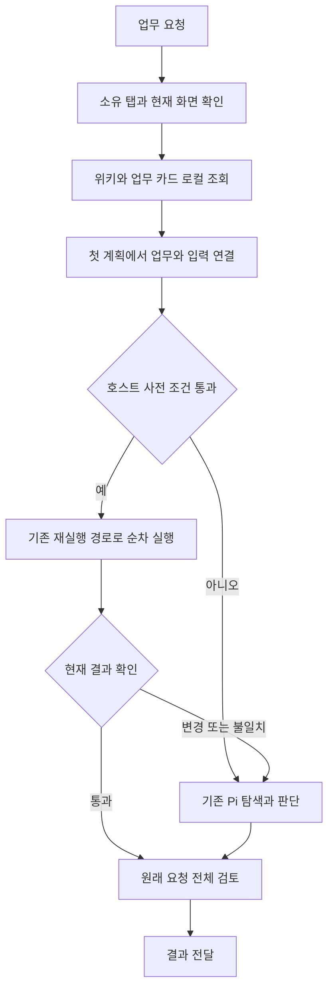

# 누비 브라우저 내장 위키 기반 빠른 업무 실행

작성일: 2026-10-01 KST. 상태: 사용자 요청 방향에 따른 구현 전달 명세. 상세 계약은 제안 상태이며 실행 코드와 속도 효과는 미검증이다.

근거: [방법론과 소스 검토](../../research/2026-10-01-browser-site-knowledge-automation-bp.md). 프로젝트 역할 규칙에 따라 설계와 구현 명세를 산출한다.

## 1. 목표와 범위

사용자가 평소처럼 업무를 요청하면 내장 사이트 위키에서 업무를 찾고, 현재 화면과 맞는 검증 절차를 선택해 반복 탐색과 행동별 모델 호출을 줄인다. 모드를 고르거나 이전 대화를 찾을 필요가 없게 한다.

초기에는 Chrome 확장 내부의 단순 조회와 top frame의 고유한 폼 대상만 지원한다. 기존 Pi, MiniSearch, 질문, 승인, 실행 영수증, 미확정 쓰기 차단, 원래 계획과 최종 검토를 유지한다. 추가 Python/Node 실행기, Native Messaging, 원격 캐시, 자동 크롤링, 외부 위키 쓰기는 포함하지 않는다.

MUST: 위키 문서, 검증된 절차, 이번 입력값, 현재 실행 증거를 분리한다. NEVER: 과거 입력값이나 과거 승인을 현재 실행에 자동 승계한다.

## 2. 단계별 적용

| 단계 | 변화 | 수용 조건 |
| --- | --- | --- |
| P0 | 첫 계획 전에 내장 위키와 업무 후보를 로컬 조회해 전달 | 페이지 관찰 권한 유지, 별도 위키 모델 호출 없음, 불필요한 조회 왕복 감소 |
| P1 | 완료 기록을 위키 업무 카드로 검토 등록하고 기존 재실행기로 실행 | 입력값 분리, 새 화면 대조, 질문과 승인 유지, 행동별 모델 요청 0회 |
| P2 | 달라진 구간만 기존 Pi에서 확인하고 보완 | 완료한 쓰기 미재전송, 미확정 쓰기에서 중단, 변경 절차는 검토 후 새 버전 |
| 후속 | 검증된 절차의 부분 재사용과 조합 | 각 절차의 입출력과 검증 조건을 평가한 뒤 별도 설계 |

P0만 반영한 효과와 P1까지 반영한 효과를 분리한다. 고급 절차 그래프나 임베딩을 먼저 도입하지 않는다.

## 3. 데이터와 저장 계약

### 업무 카드

현재 위키 Markdown은 사용자가 읽고 수정하는 업무 안내다. 여기에 연결되는 구조화 절차는 호스트가 검증한 실행 기록의 제한된 사본이다. Markdown을 코드로 실행하지 않는다.

제안 저장소: 기존 `browserKnowledge`와 별도 local key `browserSiteProcedures`. 업무 카드는 `wikiRef`로 기존 문서를 연결하고 기존 문서 스키마를 불필요하게 변경하지 않는다. 기존 문서/외부 Wiki ZIP은 그대로 유지한다.

| 항목 | 계약 |
| --- | --- |
| `id`, `schemaVersion`, `version`, `revision` | 카드 식별과 경쟁 저장/철회 검사 |
| `wikiRef` | 정확한 origin/provider/URL/documentVersion 및 검토한 Markdown 해시 |
| `title`, `purpose`, `aliases` | 값이 없는 업무 설명, 사용자가 검토한 별칭 |
| `scope` | origin, provider, 적용 화면, 확인된 사이트 사용 범위 |
| `preconditions` | 화면 제목/영역/고유 필드의 현재 상태, 지원 입력 유형과 범위 |
| `inputs` | 변수 이름, 의미, 자료형, 단위, 필수 여부, 출처와 연결 규칙 |
| `steps` | 기존 도구 allowlist, 의미 대상, 입력 변수 참조, 단계 사전/사후 조건 |
| `requirements` | 처리하는 업무 조건과 각 조건을 확인할 단계/증거 |
| `source` | 완료 작업과 관찰의 비민감 식별자, 관찰 범위, 확인일, 생성 방법 |
| `status` | `draft`, `reviewed`, `revalidated`, `needs_review`, `disabled` |
| `evidence` | 재사용 확인 횟수/결과/날짜. 보장 확률로 표시하지 않음 |

`reviewed`는 사용자가 내용을 검토한 상태다. 새 입력값의 통제된 재실행을 통과해야 `revalidated`로 올라간다. 가져온 카드와 예전 대화의 기록은 자동 승격하지 않는다. 초기 저장 상한은 카드 50개, 카드당 32KiB, 단계 80개 이내로 제안한다. 상한 초과는 원문을 자르지 않고 등록을 보류한다.

검토한 카드의 첫 재사용 확인은 사용자가 해당 카드를 지정한 시험 요청으로 수행한다. 호스트가 사전 조건/입력과 각 결과를 확인하고 기존 질문/승인/최종 요구사항 검토를 유지한다. 새 입력값으로 독립 확인까지 통과한 경우에만 `revalidated`가 된다. `reviewed`를 일반 자연어 요청의 자동 실행 대상으로 먼저 사용해 자격을 얻는 순환 구조를 만들지 않는다.

완료 로그의 `goal`, 대상 문맥, destination, 주소를 그대로 영속 복사하지 않는다. 기존 `knowledgeURL`의 허용 주소와 값 없는 호스트 메타데이터만 채택하고 개별 이름/업무 번호/검색 조건은 입력 변수로 분리한다. 필터만으로 개인정보가 완전히 제거됐다고 표시하지 않는다. 초안에는 어떤 메타데이터가 남는지 보여 준다. raw DOM, 비밀번호, token, 쿠키, 화면 이미지, script와 첨부 ID는 저장하지 않는다.

현재 입력값은 기존 `chrome.storage.session`에 실행별로 보관한다. URL에 동적 값이 필요한 절차, MEMORY_STEPS, 외부 MCP, canvas, 좌표, drag, 임의 키 조합, child frame, ordinal 대상은 초기 빠른 실행 후보에서 제외하고 기존 Pi로 처리한다. 기존 수동 재실행 지원 범위는 이 신규 경로의 지원 범위와 구분한다.

카드 등록/삭제/철회는 기존 위키 저장의 직렬 처리 경로에서 수행한다. 호스트 저장 직전에 wikiRef/version/hash/revision을 재검사하고 단일 `chrome.storage.local.set`에 관련 변경을 담는다. 이를 DB 트랜잭션이나 여러 프로세스의 잠금이라고 표현하지 않는다. readback으로 저장을 확인하고 늦은 초안/진행 중 lease도 다음 도구 전에 철회 여부를 검사한다. 위키 삭제, 비활성화, 본문 수정, stale, 카드 수정은 빠른 실행을 중단하고 재검토 상태로 만든다. 구조 자동 갱신은 카드 재사용 자격을 자동 갱신하지 않는다.

### 실행 관찰

기존 위키 `document`는 부분 표본이며 실행 대상의 완전한 계약이 아니다. 현재 실행의 관찰에서 필요한 영역과 고유 대상의 type/required/readonly/disabled/단위/관찰된 선택지/제약을 별도로 확인한다. 속성을 못 읽으면 unknown으로 두고 필요한 항목이 unknown이면 빠른 쓰기를 선택하지 않는다. 표시 순서, 좌표, 생성 id나 전체 DOM 해시만으로 동일성을 판정하지 않는다.

계정/조직/역할 정보는 현재 화면에서 확인 가능한 범위 식별 신호나 사용자가 확인한 적용 범위만 사용한다. 자격증명이나 다른 사이트 저장소를 읽어 식별하지 않는다. 같은 origin이라도 서로 다른 업무 범위를 구분할 수 없으면 해당 쓰기 절차는 일반 Pi로 처리한다. 저장된 범위는 접근권한을 부여하지 않는다.

## 4. 발견과 실행 흐름

1. `START_CHAT`에서 현재 소유 탭/대화/제공자/credential 세대를 확인한다. 기존 첫 관찰을 재사용한다. 관찰이 필요한 상태에서는 이를 읽기 전용으로 먼저 확보한다. 단순 대화에는 페이지 작업을 추가하지 않는다.
2. 첫 계획 호출 전에 `searchKnowledge`와 기존 MiniSearch로 후보를 최대 3개 찾는다. 관찰한 사이트/경로/업무 목적/검토된 별칭과 입력 설명을 검색한다. 별도 DeepAgents 호출은 추가하지 않는다. 원문 발췌와 카드 메타데이터를 합쳐 제안 초기 예산 6,000자로 제한하되 전체 사용자 요청과 정정은 줄이지 않는다.
3. 기존 첫 계획 모델 호출에서 후보의 적용 여부, 처리 가능한 요구사항, 빠진 요구사항, 입력값 출처를 함께 결정한다. 별도 선택 모델 호출을 붙이지 않는다. 후보 없음, 유사 업무 다수, 불완전 조건은 일반 Pi 또는 기존 질문으로 처리한다. 어휘 점수를 실행 권한/성공 확률로 사용하지 않는다.
4. 모델은 카드 ID/version과 입력 변수의 연결, 원래 조건별 검증 연결을 제안한다. 호스트는 현재 저장 자료와 대조한다. 모델이 steps나 검증 조건을 임의 생성해 빠른 경로에 넣을 수 없게 한다. 사용자의 명시적 스킬 선택과 `/plan`은 우선하고 `/plan`에서는 읽기만 허용한다.
5. 사용자가 이번 요청에서 이미 제공한 값은 재질문하지 않는다. 부족하거나 단위/대상이 모호하면 같은 작업의 QuestionForm으로 묻는다. 이전 대화 값, 예제 값, 모델 추정값으로 채우지 않는다. 질문은 절차 등록 승인이나 제출 승인이 아니다.
6. 모든 사전 조건과 입력이 통과하면 기존 `runReplay`를 호출하는 연결 경로로 실행한다. 신규 직접 DOM 쓰기나 별도 실행기를 만들지 않는다. `RUN_TOOL`/`APPLY_FILL`과 기존 대상/문서/승인/fingerprint/receipt 보호를 거친다. 각 행동은 기존 현재 관찰에서 다시 바인딩한다.
7. 새 페이지/의존 선택/새 입력칸은 실제 관찰 후 다음 행동을 한다. 알려지지 않은 분기는 일반 Pi로 넘긴다. 같은 화면의 정적인 폼 입력은 기존 `fill_form` 지원 범위에서 최대 20칸을 한 그룹으로 처리할 수 있지만, 모든 대상을 확인한 뒤 순차 적용하고 검증한다. 임의 그룹 확대나 병렬 쓰기는 금지한다.
8. 등록/전송/삭제/다운로드/업로드는 기존 해당 승인을 유지한다. 승인 직전과 승인 후 재개 때 카드와 문서 버전도 확인한다. 승인 카드의 대상은 현재 실행 대상이다.
9. 실행 통과 뒤 원래 요청 전체에 대한 기존 최종 검토를 호출한다. 계획 단계의 결과 검토/저장 readback도 유지한다. 기존 수동 재실행 종료 분기를 그대로 사용해 새 요청을 complete로 바꾸지 않는다. 정상 재사용 구간에서는 행동별 모델 호출이 없지만 계획, 필요 질문, 최종 검토의 호출은 남는다.

## 5. 빠른 실행의 자격과 복구

빠른 실행은 `revalidated`, 신선한 wikiRef, 현재 요청 전체의 요구사항 연결, 새 관찰의 고유 대상, 유효 입력, 소유 탭, 기존 승인 정책을 모두 만족해야 한다. 초기에는 카드에 포함되지 않은 요구사항이 하나라도 있으면 카드 전체 실행은 선택하지 않는다. 관련 위키 안내는 일반 Pi에 제공할 수 있다.

대상 매칭은 role/name/영역 문맥 및 저장한 필수 제약을 현재 관찰에 대조한다. 순서만으로 매칭하거나 type/required/readonly 변화를 점수로 상쇄하지 않는다. 이름이 같아도 항목이 여럿이면 실행하지 않는다. 부분 관찰에서 안 보이면 기존 이름 기반 좁은 관찰을 한 번 사용하고 여전히 불확실하면 일반 경로로 돌아간다. 부분 관찰을 사이트 전체 변경이라고 표시하지 않는다.

| 상황 | 처리 |
| --- | --- |
| 캐시/색인 조회 실패, 카드 없음 | 일반 Pi. 업무를 실패로 끝내지 않는다. |
| 쓰기 전 사전 조건 불일치 | 실행하지 않고 필요한 화면을 일반 Pi로 확인 |
| 일부 단계가 검증된 후 새 조건 등장 | 완료한 단계/영수증/현재 값/원래 AC를 전달하고 남은 부분만 판단 |
| 쓰기 결과 유실 또는 미확정 | 기존 receipt/실제 상태 확인 경로. 맹목 재전송과 캐시 fallback 쓰기 금지 |
| 사용자 취소 | 중지 유지. 자동 재개/자동 절차 변경 없음 |
| worker 재시작 | 기존 체크포인트의 일시중지 계약 유지. 지식 카드를 실행 체크포인트로 사용하지 않음 |
| 보완 후 성공 | 새 후보 버전을 제안. 사용자 수기 위키를 덮어쓰거나 자동 승격하지 않음 |

입력 검증은 자료형, 관찰한 단위, 표시 이름/실제 선택값, 현재 필수 항목과 조건별 항목을 함께 확인한다. 검증한 칸과 확인 못 한 칸을 구분한다. `verify_page` 성공을 서버 저장 성공으로 확대하지 않는다. 서버 반영을 요구한 업무는 실제 재조회 결과를 완료 조건에 연결한다.

## 6. 생성과 CX

새 업무 카드의 근거는 호스트가 `verification passed`와 `goalReview complete`를 확인한 작업이다. 모델의 완료 문장, 실패한 도구, 단순 위키 수집은 검증 절차를 만들 수 없다. `/wiki`만 한 문서는 안내 자산으로 유지한다. 완료 기록은 출처이고 검토 전 카드 초안은 자동 실행 대상이 아니다.

기존 위키 초안 저장 화면에서 관련 업무 절차의 입력 항목과 지원 범위를 함께 확인하고 한 번에 저장할 수 있게 한다. 처음부터 모든 사용자를 대상으로 절차 설문을 추가하지 않는다. 등록한 절차는 내장 위키 화면에서 조회/사용 중지/삭제/재확인을 제공한다. 스크립트 실행 편집기를 추가하지 않는다.

진행 문구는 `저장된 절차로 작성 중`, `화면이 달라 다시 확인 중`, `결과 확인 중`처럼 실제 시작/결과 이벤트에 연결한다. 주요 대상과 결과만 강조한다. 진단용 후보 순위/캐시 키/도구 전체 이력은 기존 디버그 모드에 둔다. Nubi/CX 토큰, 기준 HTML, 접근성 이름/툴팁, 질문 초안과 스크롤 보존을 유지한다. 지원 상태는 `검토한 절차`, `재사용 확인됨`, `재확인 필요`로 표시하고 빠른 실행 성공 보증처럼 표현하지 않는다.

업무 카드 등록은 기존 위키 검토 저장에서 연결할 절차와 지원 범위를 확인하는 동작으로 완료한다. 별도 모드 선택이나 추가 설정 단계를 만들지 않는다. 재사용을 확인한 카드의 요청별 사용은 일반 업무 권한 안에서 자동 선택하되 기존 최종 승인을 유지한다. 이전 위키 자동 갱신 설정을 카드 등록/변경 허용으로 해석하지 않는다.

## 7. 검증과 도입 기준

평가군 A: 현재 후보의 기존 내장 위키와 수동 재실행. B: P0 사전 조회. C: P0+P1 업무 카드 자동 선택. 같은 소스 후보, 모델, 제공자, 계정 범위, 입력과 시간 조건으로 비교한다. 실계정 없는 환경은 합성이라고 명시한다.

대표 반복 업무 최소 10개를 초기 집중 세트로 사용한다. 각 업무는 첫 실행(지식 없음), 새 대화 재사용(새 값), 브라우저 재시작 후 재사용(값 없음), UI 변경(대상 없음/중복/행 순서/단위/선택지/새 필수 칸), 부분 실패, 사용자 정정, 취소, 승인, 응답 유실을 평가한다. 안정 업무의 속도 비교는 같은 유형별 최소 5회로 시작하고 실행 순서를 교차한다. 적은 표본의 p95를 확정적 개선 수치로 표시하지 않는다.

분리 보고할 항목:

- 시간: 전체 벽시계, 사용자 대기, 능동 처리 시간, 검색, 모델, 관찰, 실행/대기, 최종 검토. 관찰이 도구 시간에 포함되면 중복 합산하지 않는다.
- 호출: 계획/선택, 행동, 질문, 복구, 최종 검토, 위키 초안 생성. 빠른 단계의 모델 호출 0회와 전체 요청 무모델을 구분한다.
- 결과: 후보 검색 정확도, 잘못 선택한 카드, 입력 정답, 독립 과업 통과, 실제 저장 확인, 답변 전달, 미완료/시간 초과.
- 비용: 토큰, 첫 학습/검토 비용과 재사용 횟수. 학습 비용을 제외한 warm 시간만 제품 전체 속도라고 부르지 않는다.
- 회귀: 승인 전 반영, 중복 쓰기, 취소 후 실행, 다른 탭 조작, 이전 값 누출, 변경된 문서 실행, 미확정 동작 재전송.

제안 도입 문턱: 안정적인 재사용 업무에서 행동 모델 호출 최소 50% 감소와 사용자 대기 제외 중앙 처리 시간 최소 30% 감소를 목표로 한다. 이는 측정 전 제품 목표이며 공식 BP 점수나 예상 실측값이 아니다. 독립 완료율이 기존보다 낮으면 통과하지 않는다. 금지 회귀는 0건이어야 하며 한 건이라도 있으면 빠른 경로를 중지한다. 새 기능 집중 세트가 통과한 뒤 기존 쉬움→어려움 30개 전체 회귀를 수행하고 렌더된 결과 완료 후 5초 간격을 유지한다. 집중 결과를 전체 누비 점수로 표시하지 않는다.

필수 의미 회귀: 같은 개수의 행 재정렬, 이름이 같은 다른 폼, 단위 변경, 새 필수 입력칸, 선택지 값 변경, 오래된 위키/카드, 질문 후 정정, 승인 중 문서 수정, 부분 쓰기 후 response loss. 결과는 실제 DOM/독립 기대값과 필요 시 저장 후 재조회로 판정한다.

현재 기준 검사: `node --test tests/browser-replay.test.mjs tests/browser-knowledge.test.mjs` 25개 통과. 새 경로는 아직 구현/검증 전이다. 구현 후 단계에 맞는 단위 검사, 실제 Chrome 합성 통합, `npm run design:check`, `npm run verify:identity`, 필요 패키징과 실모델 평가를 구분한다. 릴리스/실계정 업무 반영은 기존 사용자 승인 시점을 유지한다.

## 8. 구현 전달 프롬프트

> 누비 Chrome 확장의 내장 사이트 위키를 빠른 업무 실행에 연결하라. 이 명세와 조사 기록, root/확장 AGENTS.md를 먼저 읽는다. 기존 브랜치의 변경을 보존하고 Office/Desktop/OpenWiki 서버는 수정하지 않는다.
>
> P0부터 작은 변경으로 시작한다. 현재 요청의 실제 소유 탭에서 읽은 관찰과 origin/provider로 로컬 위키/카드 후보를 첫 계획 전에 조회하고 기존 계획 호출에 제한된 후보를 전달한다. 별도 모델 호출이나 전체 위키 삽입을 추가하지 않는다. 먼저 A/B로 탐색/모델 호출과 지연을 측정한다.
>
> 다음 P1에서 검증된 기록의 값 없는 제한된 사본을 검토형 업무 카드로 등록한다. 기존 browserKnowledge 문서와 연결하되 값/스크립트/전체 URL/ordinal/child frame 의존 항목은 빠른 경로에서 제외한다. 기존 runReplay와 RUN_TOOL, APPLY_FILL, 승인과 영수증 경로를 재사용하며 직접 DOM 쓰기를 추가하지 않는다. 카드 선택은 기존 첫 계획에서 제안하고 호스트가 버전/현재 화면/입력/전체 조건을 검증한다. 자동 선택 경로는 기존 수동 재실행 종료 분기로 완료하지 말고 원래 계획 검토와 최종 요구사항 검토를 유지한다.
>
> 단계마다 새 결과를 확인한다. 미확정 쓰기는 먼저 실제 상태와 영수증을 확인하고 자동 재전송하지 않는다. P2 복구는 이미 검증한 단계와 사용자의 답/정정을 보존하며 달라진 부분만 Pi에 넘긴다. 새 절차는 자동 승격하거나 수기 본문을 덮어쓰지 않는다.
>
> 금지 회귀/관찰 부족/요구사항 누락/잘못 선택한 카드 사례를 검사한다. 합성 Chrome과 실모델 성능을 분리하고 같은 모델/후보의 A/B/C 결과를 보고한다. 명세의 목표치를 실제 달성했다고 추정하지 않는다. 실제 반영한 BP, 비채택 이유, 테스트와 남은 검증을 기록하고 사용자 승인 없는 배포는 하지 않는다.

검토 대상 파일: `browser-knowledge.js`, `site-wiki-retrieval.js`, `browser-replay.js`, `background-runner.js`, `public/background.js`, `agent-runtime.js`, `task-plan.js`, `form-workflow.js`, `src/BrowserWiki.jsx`, 사이트 위키 설정, 기존 replay/wiki 테스트. 새 연결 모듈 이름은 구현자가 정하되 공통 실행기를 복제하지 않는다.
