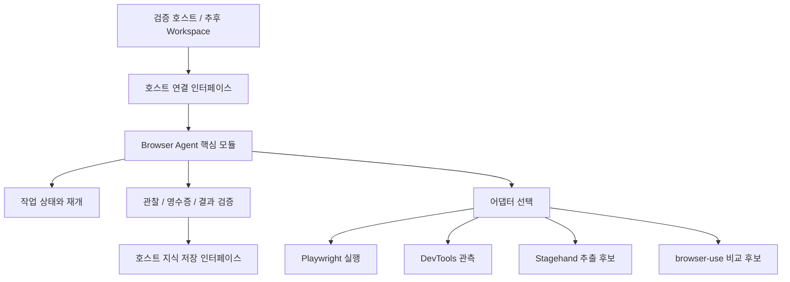

# 누비 Browser Agent 독립 모듈 설계

날짜: 2026-10-15

상태: 사용자 모듈화 방향을 기록한 설계 초안. 구현과 제품 통합 전이다.

품질 고도화와 Codex 벤치마킹은 [별도 구현/평가 계획](../plans/2026-10-15-nubi-browser-agent-codex-benchmark.md)을 따른다. 공개 하네스 계약의 참고와 실제 Codex 성능 비교, 도구/모듈/제품 검증을 분리한다.

사용자 후속 결정 2026-10-15: MUST 처음부터 누비 Workspace에 등록/해제/재연결할 수 있는 애드온 계약을 유지한다. [Codex 고정 소스 대조 결과](../../research/2026-10-15-nubi-browser-agent-codex-source-audit.md)를 반영한 연결 계약은 12절에 정의한다.

## 1. 사용자 결정과 이번 범위

브라우저 강화 기능은 하나의 독립 모듈로 만들고, 추후 누비 Workspace의 인앱 브라우저 활용에 맞춰 최적화해 적용한다. 앞선 대화의 설계 검토 범위를 이어 이번에는 책임, 연결 계약, 후보 기술의 역할과 구현 순서를 정의한다.

- 이번 산출물: 독립 모듈의 설계와 구현 전달 명세.
- 후속 구현: 제품과 분리한 모듈 및 로컬 검증 호스트.
- 후속 통합: Workspace의 기존 Pi, BrowserHost, 승인, 저장소와 연결한 뒤 실제 업무에 맞춰 최적화.
- 이 문서는 외부 패키지 채택, 제품 런타임 변경, 설치판 빌드나 배포의 완료를 뜻하지 않는다.

제안 패키지명은 `packages/nubi-browser-agent`다. 이번에는 패키지 코드와 의존성을 생성하지 않는다. 단일 진입점 아래 핵심 기능과 선택 어댑터를 둔다.

## 2. 목표와 모듈 경계

목표는 자연어 브라우저 업무를 관찰 → 판단 → 실행 → 결과 확인으로 진행하며, 로그인과 사용자 개입 뒤에도 같은 작업의 미완료 부분을 이어가는 것이다.

| 모듈 책임 | 호스트 책임 |
| --- | --- |
| 브라우저 작업 상태, 단계, 대기 이유, 재개 절차 | 앱과 탭 생성, 실제 브라우저 세션, IPC와 프로세스 |
| 관찰과 행동, 결과 영수증의 공통 형식 | 인증 입력, 쿠키와 토큰, 실제 권한 판정과 승인 UI |
| 목표별 수집 결과와 출처, 미확인 범위 | 원문 저장 위치, 보존 기간과 프로젝트 접근 권한 |
| 실패 분류, 미확정 실행 조정, 결과 검증 | 모델 연결과 인증, 최종 파일 및 업무 변경 승인 |
| 선택 어댑터 등록과 같은 과제 비교 | 중앙 채팅, 보조 브라우저, 시스템 알림 표시 |

핵심 모듈은 Electron, React, Desktop 내부 클래스와 OpenWiki 구현을 직접 import하지 않는다. 호스트 기능은 주입하는 인터페이스로 받는다. 기본 설계는 TypeScript 라이브러리이며, 별도 서버, Python, 클라우드 브라우저는 기본 요구사항에 넣지 않는다.

## 3. 구성

모듈화는 외부 도구들을 모두 동시에 설치한다는 뜻이 아니다. 기본 구현에 필요한 연결부터 만들고 선택 어댑터는 별도로 활성화한다. 후보의 연결 실패는 해당 기능의 미지원 상태로 반환하며, 다른 브라우저 실행이나 권한 확대로 자동 대체하지 않는다.

## 4. 호스트 연결 인터페이스

아래는 개념 계약이며 구현 코드는 아니다.

| 인터페이스 | 제공 기능과 제한 |
| --- | --- |
| `BrowserPort` | 호스트가 허용한 탭 연결, 관찰, 행동, 현재 바인딩 확인. 실제 브라우저 소유권은 호스트에 둔다. |
| `ModelPort` | 주어진 문맥과 도구로 판단 요청. 기존 제공자 인증을 재사용하며 모듈이 로그인하지 않는다. |
| `PolicyPort` | 동작과 대상의 허용 검사, 승인 요청, 승인된 정확한 호출의 실행 권한 확인. |
| `HumanInteractionPort` | 로그인, CAPTCHA, 파일 선택, 확인이 필요한 상황을 호스트에 전달하고 응답을 받는다. |
| `TaskStorePort` | 작업 기록의 버전 조건부 저장과 조회. 저장 충돌은 감지하고 오래된 상태로 실행하지 않는다. |
| `KnowledgeSinkPort` | 허용된 수집 묶음을 저장 후보로 전달하고 실제 반영 영수증을 받는다. OpenWiki는 추후 어댑터다. |
| `EventSink` | 실제 시작, 결과, 대기와 오류 이벤트. 진행률을 시간만으로 만들지 않는다. |

독립 검증에서는 로컬 시험 호스트를 주입한다. Workspace 통합에서는 기존 저장소와 작업 ID를 사용해 하나의 권위 있는 상태를 유지한다. 제품 작업 상태와 별도의 자동 실행 스케줄러를 중복 생성하지 않는다.

모듈 단독 사용에서는 주입한 모델을 호출할 수 있다. Workspace에 붙일 때에는 기존 Pi가 계획과 답변을 소유하고 모듈은 브라우저 작업 계약을 제공한다. 두 에이전트 루프가 같은 탭의 다음 행동을 동시에 결정하지 않는다.

## 5. 작업과 실행 기록

| 기록 | 필수 내용 |
| --- | --- |
| 작업 | `taskId`, 프로젝트/소유 범위, 원래 요청, 완료 조건, 상태, 버전 |
| 실행 시도 | `attemptId`, 활성 실행 어댑터, 마지막 체크포인트, 대기 이유 |
| 현재 바인딩 | 탭, 문서, 프레임, 관찰 버전, 호스트 제어권 세대 |
| 행동 | `actionId`, 대상, 정확한 인자 fingerprint, 승인 참조, 발행 여부 |
| 영수증 | `not_started`, `issued`, `confirmed`, `unconfirmed`와 실제 결과 근거 |
| 수집 | 원문 참조, 정제한 URL, 제목, 시각, 내용 해시, 읽은 범위, 누락/오류 |

DOM ref와 selector는 현재 관찰의 임시 참조다. 체크포인트를 읽었다는 이유로 재사용하지 않는다. 전체 문서 이동 외에 SPA 화면, 대상 값과 폼 구조의 변경도 실행 직전에 확인한다.

비밀번호, MFA, 인증 callback 값, 쿠키, 토큰, 원시 인증 헤더는 모델 문맥과 작업 로그에 넣지 않는다. URL은 인증값을 제거하고 필요한 업무 식별 정보만 호스트 정책으로 보관한다. 원문 본문은 작업 체크포인트에 중복 저장하지 않고 허용된 근거 저장소의 참조로 관리한다.

## 6. 상태와 사용자 제어권

상태 이름은 모듈의 개념 상태다. 추후 Workspace의 기존 상태에 명시적으로 매핑한다.

| 상태 | 다음 행동 |
| --- | --- |
| `RUNNING` | 현재 관찰과 정책에 근거한 다음 단계 실행 |
| `WAITING_FOR_USER` | 사용자 개입 대기. 대기 이유는 login/captcha/file_selection/approval/clarification/recovery로 구분 |
| `REVALIDATING` | 새 바인딩과 목표 페이지 접근, 현재 대상을 읽기로 재확인 |
| `VERIFYING` | 요청의 완료 조건과 실제 근거 대조 |
| `COMPLETED` | 필요한 결과 검증과 요청된 저장/반영 영수증까지 확인 |
| `PAUSED` | 재개 판단이 필요한 실패나 미확정 실행. 보존된 결과와 이유 표시 |
| `FAILED` / `CANCELLED` | 종료 결과 보존. 자동 재개 금지 |

사용자 응답 뒤에는 `WAITING_FOR_USER → REVALIDATING → RUNNING`으로 진행한다. 실행 전 승인은 승인 대상이 여전히 일치할 때만 사용할 수 있다. 사람이 페이지를 바꾸면 오래된 승인은 재검토한다.

로그인은 URL 키워드만으로 판단하지 않는다. 호스트가 로그인 폼의 존재, 알려진 SSO 이동, 인증 응답과 목표 콘텐츠 접근 여부를 함께 확인해 민감한 값 없는 신호만 제공한다. 403은 권한 부족과 구분한다. 일반 탭의 SSO 이동도 보호 대상이다.

로그인 개입 시 호스트는 관련 탭/팝업의 제어권을 사용자에게 넘기고 대기 중 행동을 무효화한다. 인증 화면의 DOM, 입력값, 캡처와 원시 네트워크 자료를 모델에 보내지 않는다. 사용자 완료 응답 뒤 목표 화면을 확인하고 새로운 관찰로 재계획한다. 로그인 전 클릭을 자동 재전송하지 않는다.

작업 상태 복원과 인증 세션 복원은 별개다. 재시작 후에는 중단 상태로 읽고 사용자의 명시적 재개 후 새 탭/세션을 연결한다. 세션 지속 정책은 각 호스트가 소유하며 모듈이 별도 인증 저장소를 만들지 않는다.

## 7. 후보 기술의 역할과 채택 조건

| 후보 | 모듈 내 역할 | 채택 조건 |
| --- | --- | --- |
| Playwright MCP | 기본 관찰과 실행 어댑터 | 기존 누비 탭/문서 바인딩과 승인 계약을 유지. 독립 검증용 연결과 추후 Electron 연결을 분리 |
| Chrome DevTools MCP / CDP 관측 | Network, 오류와 지연의 원인 관찰 | 먼저 읽기 전용의 정제한 메타데이터. Electron 탭 연결 호환성을 확인한 경우에만 선택 사용 |
| Stagehand | 요소 후보 탐색, 스키마 기반 추출과 행동 재사용 실험 | 같은 근거에서 추출 정확도/비용을 비교. 대상 조작은 공통 정책과 영수증 경계를 통과 |
| browser-use / Browser Use Pi | 복잡한 탐색 과제의 비교 실행 후보 | 별도 시험 탭/시도에서 비교. 기존 Pi와 이중 제어 금지. 제품 연결 전 승인/세션/실행 범위 준수 입증 |

동일 탭의 능동 실행자는 한 시점에 하나다. DevTools 관측도 호스트가 소유한 연결/중재 경로를 사용하며, 두 도구가 debugger 연결을 경쟁하게 두지 않는다. 실행자 전환은 발행 중 행동이 없고 미확정 결과를 정리한 체크포인트에서만 허용한다. 인증 또는 정책 차단을 피하기 위해 어댑터를 바꾸지 않는다.

현재 확인한 Workspace 기본 MCP는 공식 `@playwright/mcp` 0.0.83을 번들한다. 독립 모듈의 의존성 버전은 구현 시 실제 호환성과 라이선스를 확인해 고정한다. 외부 도구의 원래 실행 권한이나 임의 JavaScript 기능은 모듈의 승인 권한으로 승계하지 않는다.

DevTools MCP는 공식 Chrome 지원과 Electron 호환을 구분한다. Browser Use Pi의 Pi/TypeScript 공통점은 검토 이유이며 호환성 증거가 아니다. Stagehand의 스키마 검증은 사실 정확도나 전체 페이지 수집의 증거가 아니다.

## 8. API 조회와 OpenWiki 연결

Network 관찰, 요청의 의미 확인, 조회 도구 등록을 각각 분리한다. 발견한 요청을 자동 실행 도구로 등록하지 않는다. 허용 origin/경로/인자/응답 필드와 부작용을 확인한 API만 호스트 내부에서 조회한다. GET/POST 이름만으로 읽기 여부를 판단하지 않는다. 인증 헤더와 쿠키는 반환하지 않는다.

지식 수집은 요청 또는 설정으로 허용한 범위에 한정한다. 현재 화면 열람, 답변 생성, 장기 저장과 OpenWiki 반영은 서로 다른 영수증을 갖는다. OpenWiki 저장 실패가 이미 성공한 브라우저 행동의 재실행 이유가 되지 않게 한다.

수집 결과에는 원문과 생성 요약을 구분하고 출처/시각/범위/누락을 남긴다. 기존 Wiki와 사용자 편집을 덮어쓰지 않으며 저장 범위와 반영 승인은 호스트가 확인한다. Office/NASCA 첨부는 기존 읽기 계약을 가진 별도 호스트 기능으로 연결하며 범용 ZIP 파서로 우회하지 않는다.

## 9. 구현 순서와 독립 검증

1. 공통 계약과 작업 상태, 로컬 시험 호스트, Playwright 어댑터를 만든다. 제품 코드를 먼저 옮기거나 Desktop 내부 서비스를 import하지 않는다.
2. 로그인 제어권 전달, 재관찰, 체크포인트, 취소와 미확정 실행을 검증한다.
3. 제한된 Network 관측을 추가하고 같은 문제의 원인 구분에 도움이 되는지 측정한다.
4. Stagehand 추출과 browser-use 탐색을 각각 선택 후보로 연결해 현재 실행과 비교한다. 개선이 입증된 기능만 기본 후보에 포함한다.
5. Workspace 어댑터로 기존 작업/승인/BrowserHost/모델/지식 저장에 연결한다. 이후 실제 인앱 사용에서 호출 수와 지연을 최적화한다.

첫 고정 과제는 이슈 검색 → 결과 페이지 이동 → 이슈 상세 수집 → 출처 있는 요약이다. 수집 결과의 선택 저장을 별도로 확인한다. 로컬 검증은 로그인/SSO 유사 페이지를 사용하고 실계정 성공으로 표시하지 않는다.

필수 반례는 중간 세션 만료, 인증 팝업, 권한 부족, SPA 화면 전환, 사용자의 탭 이동, 오래된 승인, 중복 이름 대상, 응답 유실, 실행 중 종료, 취소와 재시작이다. 발행 전 실패와 미확정 발행을 구분하고 잘못된 대상 조작/중복 쓰기/취소 후 실행이 없어야 한다.

동일 모델/초기 상태/입력/권한/뷰포트로 각 고정 과제를 3회 비교한다. 업무 정답, 완주, 복구, 사용자 개입, 모델 호출/토큰, 전체 시간과 도구 시간을 구분한다. 사용자 대기는 따로 표시하고 실패를 분모에서 빼지 않는다. 로컬 모의, 실제 모델, 사내 SSO/JSM, Windows/Electron 결과를 각각 기록한다.

최적화는 실제 계측 뒤 수행한다. 연결 재사용, 필요한 영역의 관찰, 결과에 최신 관찰 포함과 검증된 절차 재사용을 우선 비교한다. 승인/대상 확인/결과 검증을 생략해 얻은 속도는 개선으로 채택하지 않는다.

## 10. 구현 담당에게 전달할 지침

이 문서와 기존 인앱 Playwright/승인 코드를 읽고 공통 계약과 로컬 시험 호스트부터 구현한다. 목표 패키지는 `packages/nubi-browser-agent`이며 핵심 모듈의 Electron/Desktop/OpenWiki 직접 의존을 금지한다. 외부 어댑터는 선택 의존성으로 분리한다.

첫 구현은 Playwright와 사용자 개입/재개, 영수증, 결과 검증이다. DevTools/Stagehand/browser-use를 모두 필수 패키지로 묶지 않는다. Workspace 제품 연결은 후속 단계로 유지하고 기존 설치판과 인증/승인 설정을 변경하지 않는다. 파일/네트워크 접근 권한이 큰 후보는 독립 검증 호스트에 격리한다.

재개는 새 관찰을 요구하며 과거 ref/입력값/승인을 자동 승계하지 않는다. 정확한 한 번 실행과 실제 영수증을 사용하되, 응답 유실이나 종료 상황에서 정확히 한 번 성공을 보장했다고 주장하지 않는다. 미확정 쓰기는 읽기로 조정한 뒤 다음 단계를 결정한다.

## 11. 근거와 현재 확인 범위

- [인앱 Playwright 설계](../../../packages/nubi-desktop/docs/PLAYWRIGHT-MCP-2026-10-15.md)
- [기존 승인 재개와 모의 검증 범위](../../../packages/nubi-desktop/docs/MCP-APPROVAL-FIX-2026-10-15.md)
- [인앱 브라우저 동작과 지연](../../../packages/nubi-desktop/docs/IN-APP-BROWSER-FLOW-2026-10-15.md)
- [기존 후보 비교](../../research/2026-09-20-browser-workflow-options.md)와 [품질 개선 검토](../../research/2026-10-01-nubi-browser-next-quality-methods.md): 확장 대상의 과거 검토이며 Desktop 적용 완료 증거가 아니다.
- 공식 자료 확인 2026-10-15: [Playwright MCP](https://github.com/microsoft/playwright-mcp), [DevTools MCP](https://github.com/ChromeDevTools/chrome-devtools-mcp), [Stagehand](https://github.com/browserbase/stagehand), [browser-use](https://github.com/browser-use/browser-use), [Browser Use Pi](https://github.com/browser-use/browser-use-pi).

이번에는 설계 문서와 저장소의 방향 기록만 작성한다. 모듈 구현, 어댑터 호환 실험, 성능 비교, 실모델/실서비스 실행과 Workspace 연결은 수행하지 않았다.

## 12. Workspace 애드온 연결 계약

모듈은 지원 버전의 Workspace가 시작 후에도 추가/비활성화/재연결할 수 있는 설치된 애드온이다. 임의 원격 코드 다운로드나 일반 Electron plugin loader를 기본 기능으로 추가한다는 뜻은 아니다. 활성 실행 중 변경은 안전한 정지 경계에서 처리한다.

### 공개 진입점과 버전

| 계약 | 요구사항 |
| --- | --- |
| manifest | `addonId`, 패키지 버전, `addonApiVersion`, 지원 host API 범위, `checkpointSchemaVersion`, 필수/선택 capability |
| 등록 | manifest와 설치된 진입점을 확인하는 단계. import/등록만으로 브라우저/모델/네트워크/작업을 시작하지 않음 |
| attach | 호스트 포트를 받아 `instanceId`, 프로젝트 범위, `attachGeneration`, 지원 기능과 상태를 반환. 같은 연결의 중복 요청은 중복 등록하지 않음 |
| 호출 | 호스트의 task/run과 모듈의 attempt/action을 연결. 실제 탭 제어권은 호스트 lease와 세대 검사로 확인 |
| 이벤트 | instance/generation/task/action/event 순번과 state version을 포함. 구독 해제 가능하며 UI에는 정제한 DTO만 전달 |
| suspend | 신규 접수 중단, 대기/진행 호출 정리, 영수증과 체크포인트 저장 확인. 사용자의 명시적 재개를 기다림 |
| detach/dispose | 본인이 만든 구독/연결/임시 자원만 정리. 사용자 탭, 호스트 세션과 작업/원문 저장소를 삭제하지 않음 |

host API major와 schema/capability가 호환되지 않으면 실행 전에 거절한다. 선택 기능 누락은 해당 기능만 미지원으로 반환한다. capability 선언은 권한 부여가 아니며 실제 도구 실행은 호스트의 현재 정책을 따른다.

최소 연결은 Browser/Policy/HumanInteraction/TaskStore/Event 포트다. 모델 판단은 호스트 Pi 경로 또는 명시적으로 주입한 ModelPort 중 하나가 소유한다. KnowledgeSink와 DevTools/Stagehand/browser-use는 선택 capability다. 새 인증 저장소와 모델 기본값을 만들지 않는다.

### 연결 수명주기

`REGISTERED → ATTACHING → READY → DRAINING → DETACHED`를 기본으로 한다. 부분 연결 실패는 `ERROR`와 정리 결과를 남긴다. 재연결은 새 generation으로 시작한다. detach는 즉시 성공으로 처리하는 삭제 버튼이 아니다.

1. 호스트와 함께 신규 작업/행동의 접수를 닫는다.
2. 아직 발행하지 않은 큐를 취소하고 진행 호출에 취소를 전달한다. 이미 발행한 변경을 되돌렸다고 표시하지 않는다.
3. 종료를 확인할 수 없는 호출은 `unconfirmed`로 저장하고 호스트가 관리하게 한다.
4. 대기 질문/승인과 작업 상태의 저장 성공을 확인한다. 저장 실패 시 성공을 반환하지 않고 복구 가능한 소유권을 남긴다.
5. 자신의 listener/연결을 정리하고 그 뒤 host에 detach 완료를 통지한다. 이전 generation의 늦은 callback은 상태/실행에 적용하지 않는다.

재연결은 보존된 기록과 현재 호스트 상태를 읽고 원자적으로 구독한다. 호스트 스냅샷에는 기준 이벤트 순번을 포함해 중간 이벤트 유실/중복을 조정한다. 과거 Promise, DOM ref와 승인 효력을 복원하지 않으며 사용자의 명시적 재개 뒤 새 관찰로 이어간다. 호스트가 이미 실행한 호출은 영수증으로 반환한다.

### 데이터와 UI 소유권

작업/근거/승인 기록은 호스트의 기존 저장소를 권위 있는 원본으로 유지한다. 모듈은 이름공간과 schema가 있는 하위 상태만 저장한다. 업데이트 migration은 이전 기록을 보존하며 실패 시 원본을 복구할 수 있어야 한다. 새 포맷을 구 버전이 조용히 읽어 실행하지 않는다.

Workspace 연결은 호스트 어댑터에서 수행하고 core에 `ProjectService.prototype`, 전역 IPC, 저장 경로와 Electron 객체를 넣지 않는다. worker/main 경계에는 버전이 있는 직렬화 DTO를 쓰고 함수 포트는 각 프로세스의 연결 어댑터가 구현한다. 애드온이 다른 프로젝트와 세션의 전역 객체를 바꾸지 않는다.

중앙 대화, 오른쪽 인앱 브라우저, 사용자 질문/승인과 시스템 알림은 기존 Workspace UI를 사용한다. 모듈은 표시용 상태와 다음 행동을 전달한다. 별도 채팅/로그인/승인 화면이나 모듈 전용 모델 선택 흐름을 만들지 않는다. 시각/키보드/모션은 기존 Nubi 공통 계약을 따른다.

### 독립 개발 중의 호스트 호환 증거

첫 구현부터 최소 계약 호스트로 attach/호출/대기/재개/suspend/detach/재연결을 확인한다. 호스트 fixture도 공개 API만 사용하며 core 내부 상태에 의존하지 않는다. 이 계약 검사는 실제 Electron/Workspace 런타임 성공과 구분한다.

첫 반례는 [소스 벤치마킹의 AD-01~AD-12](../../research/2026-10-15-nubi-browser-agent-codex-source-audit.md#6-먼저-만들-계약-반례)다. 이 계약을 통과한 뒤 실제 Workspace 어댑터에서 기존 탭/승인/모델/저장소와 연결하고 제품 검증을 수행한다. 언제든 연결 가능하다는 목표를 버전 무관한 호환 또는 무조건적인 실행 중 교체 보장으로 표시하지 않는다.
