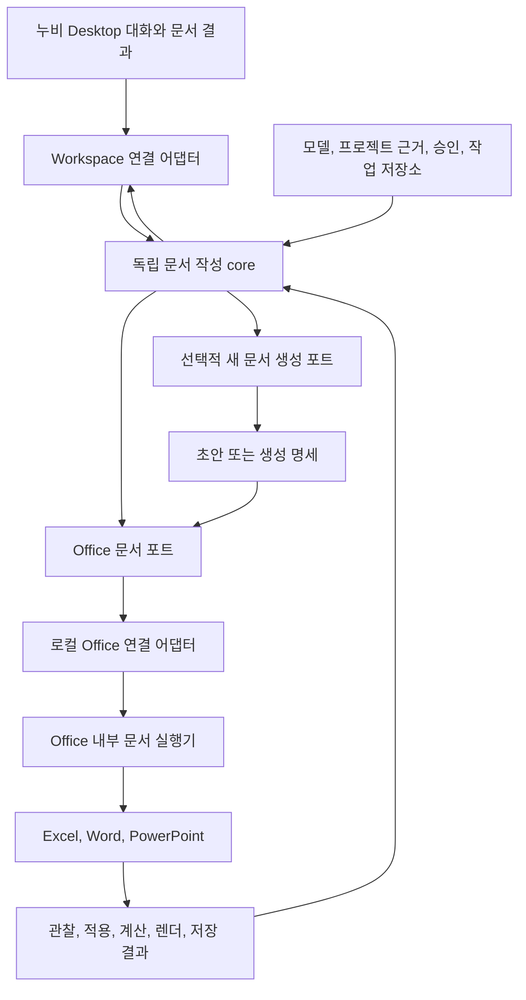

# 누비 문서 작성 모듈과 Desktop 관리 흐름

날짜: 2026-10-15.

상태: 사용자 방향을 구체화한 설계 제안. 구현, 새 의존성 도입, 실제 품질 측정, Office 설치 빌드와 Workspace 연결은 수행하지 않았다.

후속 구현: 사용자의 순차 개발 승인 뒤 `packages/nubi-document-agent`에 GenOffice 기반 Word 부분 수정의 첫 계약 구현을 추가했다. [첫 구현 결과](../../research/2026-10-15-document-agent-first-slice.md)를 따른다. 모델/Office 포트는 시험용이며 실제 Office/Windows/NASCA/제품 연결과 품질 측정은 아직 수행하지 않았다. 아래 범용 기능과 전체 단계가 구현되었다는 뜻은 아니다.

후속 사용자 방향: 오픈소스와 기존 구현을 실제 기반으로 활용하면서 작은 기능 단위로 적용하고 벤치마킹한다. 앞선 소스 대조를 출발점으로 기존 Office X/GenOffice와 누비 Office의 재사용 가능한 부분을 연결한다. 전체 제품 참조 72회가 끝나야 재사용 작업을 시작할 수 있다는 순차 게이트는 두지 않는다.

## 1. 목표와 설계 전제

사용자는 누비 Desktop에서 프로젝트 자료와 작성 과정을 관리하면서 Excel, Word, PowerPoint 문서를 만들고 고치기를 원한다. 문서 작성 모듈은 독립 개발하고 추후 Workspace와 스케줄러에서 같은 계약으로 호출한다.

사용자가 확인한 NASCA 환경에서는 Office에서 문서를 열면 내부 사용과 복사가 가능하다. 따라서 회사 문서의 읽기와 변경 경계는 열린 Office로 둔다. 새 생성 라이브러리 선택에 앞서 Codex와 Claude Code의 작성/수정/검증 방식을 벤치마킹한다.

이 문서의 세부 포트 이름, 패키지 경로와 단계별 과제는 제안이다. 특정 Agent 엔진과 IPC 제품을 확정하지 않는다.

## 2. 사용자에게 보이는 흐름

1. 사용자가 현재 프로젝트의 대화에서 자료를 선택하거나 열린 Office 문서를 연결한다.
2. 요청이 새 작성, 기존 수정 또는 양식 기반 작성인지 모듈이 판단한다. 대상이 모호한 경우에만 기존 질문 폼으로 확인한다.
3. 누비가 대상 문서와 작성 계획을 보여준다. 모듈은 필요한 범위를 읽고 구조를 관찰한다.
4. 새 문서는 초안을 만들고, 기존 문서는 관찰한 범위에 대한 변경안을 만든다.
5. 기존 승인 계약에 따라 대상과 영향을 확인한 뒤 Office에서 반영한다.
6. 실제 내용과 계산/서식/배치를 검사하고 남은 차이를 수정한다.
7. 승인된 최종 파일을 저장하고 재열기 결과를 확인한다. 누비에는 결과 파일 참조, 근거와 남은 항목을 남긴다.
8. 사용자가 이어서 수정하면 같은 문서 이력과 요청을 연결하되 현재 Office 상태를 다시 읽는다.

예시: “지난달 PPT의 구성을 참고하고 이번 달 Excel 수치로 Word 보고서를 작성해 줘.” PPT는 구조 참고 자료, Excel은 숫자의 근거, Word는 결과 문서로 각각 구분한다. 파일을 제공했다는 이유만으로 그 파일의 디자인까지 복제하지 않는다.

화면은 왼쪽 프로젝트/대화 목록, 중앙 요청/계획/질문/승인/결과, 오른쪽 문서 정보/변경 비교/가능한 미리보기 구성을 유지한다. Office 편집은 실제 Office 창에서 수행한다. Office 연결이 준비되지 않으면 필요한 앱과 한 가지 연결 동작을 표시한다. 초기 범위에 Office 창을 Electron 안에 삽입하는 기능은 넣지 않는다.

## 3. 책임과 데이터 소유권

| 구성 | 소유할 책임 | 경계 |
| --- | --- | --- |
| Workspace 호스트 | 프로젝트/대화, 사용자 요청, 선택 모델, 원문 참조, 승인, 작업 상태와 결과 이력 | 기존 호스트 기능과 저장 정책 사용 |
| 독립 문서 core | 요구사항, 근거 선택, 구조 계획, 도구 선택, 변경안과 결과 검토 | Desktop 내부 객체와 인증 저장소에 의존하지 않음 |
| Office 어댑터 | 실제 열린 문서 identity, 구조/범위 관찰, 쓰기, 계산, 렌더와 저장 영수증 | COM 객체는 Office 측 경계 안에 유지 |
| 생성 어댑터 | 필요할 때 새 문서 초안 생성 | 보호 원본을 직접 ZIP으로 재작성하지 않음 |
| 기존 보호 저장소 | 원본 보존/복구에 필요한 문서 스냅샷 | Native의 기존 보호 저장 계약 유지 |

호스트에는 요청과 근거의 버전, 관찰/변경/검사 영수증, 파일 참조를 남긴다. 문서 본문과 전체 파일을 새 대화 로그에 무조건 중복 저장하지 않는다. 현재 모델이 볼 수 있는 근거만 주입한다. OpenWiki의 과거 요약은 현재 문서의 실제 수식/서식 상태를 대체하지 않는다.

문서 작업 이력은 Office 파일 전체를 일반 Git diff로 비교한다는 뜻이 아니다. 지원되는 변경 항목, 문서 버전 참조와 실제 검증 결과를 먼저 제공한다.

## 4. 논리 구조

### 기존 구현의 재사용과 새 연결

`office_x`에는 GenOffice AgentLoop/provider, 문서 엔진과 VSTO 도구 연결이 있다. `packages/nubi-office`에는 기존 native 도구, 승인/스냅샷/readback과 생성 경로가 있다. 먼저 지원 작업과 라이선스, 의존성을 대조하고 필요한 부분을 가져온다. 외부 작업 디렉터리의 절대 경로를 배포 의존성으로 넣지 않는다.

현재 Office X의 stdio는 VSTO가 시작한 Node worker와의 통신이다. 이것을 Desktop과 Office 사이의 연결이 이미 완성된 증거로 취급하지 않는다. 새 호스트 어댑터는 동일 사용자 세션의 Office 실행기와 연결하고 준비 완료를 실제 응답으로 확인해야 한다.

물리 연결은 로컬 전용 IPC 후보를 작은 왕복으로 검증해 고정한다. 호스트와 Office의 상관 ID, 연결 세대, 사용자 세션 범위와 메시지 크기를 검사한다. 기존 stdio 구조를 재사용할지 전용 로컬 채널을 둘지는 이 검증에서 결정한다. Desktop A2A/HTTP 서버와 범용 플러그인 플랫폼은 만들지 않는다.

VSTO는 Office가 로드하는 추가 기능이며 Office 객체 모델은 thread-safe하지 않다. 모델 통신은 비동기로 처리하고 Office 조작은 기존 UI/STA 실행기로 직렬화한다. [VSTO 구조](https://learn.microsoft.com/en-us/visualstudio/vsto/architecture-of-vsto-add-ins?view=vs-2022), [Office 스레딩](https://learn.microsoft.com/en-us/visualstudio/vsto/threading-support-in-office?view=vs-2022).

Microsoft는 Automation으로 시작한 Office에서 VSTO가 예상대로 동작하지 않을 수 있다고 설명한다. 첫 연결은 사용자가 정상 실행한 Office와 실제 추가 기능 준비 응답을 기준으로 한다. Office 프로세스 실행 성공만으로 연결 성공을 표시하지 않는다. 자동 실행은 후속 실환경 검증 항목이다.

## 5. 먼저 고정할 실행 계약

전체 공통 계약은 [에이전트 연동 가이드라인](2026-10-15-nubi-agent-integration-guidelines.md)을 따른다.

| 계약 | 핵심 항목 |
| --- | --- |
| 애드온 정의 | ID/버전, host API 호환 범위, checkpoint schema, 앱별 capability |
| 실행 입력 | task/run/중복 방지 ID, project/conversation, 목표/완료 조건, 허용된 source/target 참조, 선택 모델 |
| 문서 바인딩 | host instance, Office session, document ID, 앱 종류, 관찰 revision과 범위 |
| 변경안 | operation ID, 대상 문서/범위, 이전 상태 조건, 제안 내용, 영향과 승인 참조 |
| 이벤트 | 연결 세대, task/run/action, 순번, 단계, 실제 결과와 대기 이유 |
| 결과 | 파일 참조, 요구사항별 검사, 적용/계산/저장/재열기 상태, 미지원/미확정과 근거 |
| 제어 | 시작, 질문/승인 응답, 중지, 명시적 재개, suspend/detach와 재연결 |

상태 제안은 `RUNNING`, `WAITING_INPUT`, `WAITING_APPROVAL`, `PAUSED`, `VERIFYING`, `COMPLETED`, `FAILED`, `CANCELLED`다. 부분 적용이나 미확정 쓰기는 이 상태와 별도의 결과 필드로 유지한다. 취소는 변경을 되돌렸다는 뜻이 아니다.

모델 판단을 소유하는 실행기는 하나다. 기존 Pi를 쓰거나 GenOffice를 호스트의 ModelPort로 연결하는 방식을 비교한다. 두 실행기가 같은 문서의 다음 쓰기를 동시에 결정하지 않는다. 독립 실행에서도 시험 호스트가 같은 포트를 주입한다.

### 최소 Office 기능

| 기능 | 요구사항 |
| --- | --- |
| 연결/바인딩 | 앱별 준비 상태와 현재 사용자가 선택한 문서를 확인 |
| 구조 관찰 | 실제로 읽은 범위, 미지원 개체와 누락을 함께 반환 |
| 범위 읽기 | 값/수식/표시/서식과 대상 ID를 구분 |
| 변경 적용 | 승인과 관찰 revision을 재확인하고 지원 작업만 실행 |
| 결과 검사 | 실제 readback, 필요 시 계산/렌더, 비대상 보존 결과 |
| 초안/저장 | 새 문서와 기존 문서의 소유권을 구분하고 최종 저장을 승인에 결합 |

Excel은 시트/범위/병합/수식/계산, Word는 story/문단/run/표/스타일, PowerPoint는 슬라이드/도형/텍스트 run/표/차트/노트/마스터 관계를 앱별 capability로 다룬다. 첫 버전에서 모두 지원했다고 선언하지 않고 구현된 관찰/변경 범위를 명시한다.

## 6. 정확성과 복구

- 사용자가 Office에서 직접 편집한 내용을 실행 직전에 다시 확인한다. 다른 문서로 전환됐다는 이유로 대상이 바뀌지 않게 한다.
- 문서가 닫히거나 다시 열렸다면 이전 세션 바인딩을 폐기한다. 이전 승인으로 새 문서를 변경하지 않는다.
- 파일명/경로만으로 동일 문서를 판단하지 않는다. 관찰 버전과 실제 문서 세션을 함께 확인한다.
- 승인 UI는 누비의 기존 폼을 사용하며 native 실행기는 같은 승인 대상/범위를 검증한다. 기존 저장/반영 HITL을 없애거나 중복 팝업으로 분기하지 않는다.
- 여러 개체 변경을 전체 원자적 트랜잭션이라고 가정하지 않는다. 부분 변경, 미실행, 검증 실패를 반환한다.
- 쓰기 응답 유실 시 같은 operation의 영수증과 실제 상태를 먼저 읽는다. 맹목 재전송하지 않는다.
- 문맥은 요구사항, 근거 버전, 현재 문서/관찰, 완료/남은 단계와 영수증으로 보존한다. 사용자가 취소한 작업은 자동 재개하지 않는다.
- 실제 진전 없이 같은 원인으로 세 번 실패하면 보존된 작업과 재시도/중지 선택을 기존 HITL로 전달한다.
- 중지/해제 시 새 호출 접수를 닫고 진행 호출 결과와 대기 상태를 저장한다. 결과가 불명확하면 미확정으로 남기며 사용자 문서를 임의로 닫지 않는다.

스케줄러는 같은 실행 계약을 호출하되 Office 미연결, 로그인 세션 부재 또는 승인 필요 시 구조화된 대기로 돌아간다. 독립 모듈이라는 이유로 무인 Office 실행까지 보장하지 않는다.

## 7. 개발 순서와 단계별 완료 기준

| 순서 | 작업 | 확인할 결과 |
| --- | --- | --- |
| 1 | Codex/Claude Code 벤치마킹 명세 | 앱별 새 작성/기존 수정/양식 활용/복구 총 12과제의 입력, 독립 정답, 보존 목록과 채점 기준 |
| 2 | 같은 과제의 제품 참조 실행 | 작은 기능 적용과 나란히 두 제품의 과제별 3회 결과 확보. 전체 12과제의 두 제품 합계는 72회이며 버전/모델/도구와 실패를 기록 |
| 3 | 기존 구현 기반 모듈 계약과 시험 호스트 | Office X/GenOffice와 누비 Office의 실제 재사용 범위를 고정하고 호스트 기능 주입. 가짜 문서 포트로 호출/질문/승인/중지/재연결 검사. Office 성능 성적으로 취급하지 않음 |
| 4 | 세 앱의 얇은 Office 연결 | 실제 앱별 바인딩, 한 범위 읽기, 작은 변경, readback, 승인된 저장과 재열기 |
| 5 | 독립 문서 core | 요구사항 → 관찰 → 계획 → 작성/변경 → 검사 → 보완 루프. 같은 12과제 36회 후보 평가 |
| 6 | Desktop 애드온 연결 | 기존 프로젝트/대화/모델/승인/저장소로 같은 작업 실행. 재시작/프로젝트 전환과 사용자 편집 보호 |
| 7 | 복합 자료와 실제 회사 검증 확대 | Excel 근거 → Word 보고서/PPT 작성, 실제 Office 2016/NASCA와 허용 모델별 결과 |

2단계의 72회와 5단계의 36회는 합계 108회다. 현재 어느 실제 trial도 실행하지 않았다. 제품별 모델/도구가 다르면 전체 제품 참고 결과로만 보고, 누비 방식의 효과는 같은 모델/도구/입력에서 기준선과 개선 후보를 별도로 비교한다.

1차 소스 대조는 완료한 상태다. 이후 단계 2~5는 작은 기능 단위로 진행한다. 기존 구현의 재사용 범위 선택 → 독립 연결 → 같은 과제의 Codex/Claude 참조 결과와 누비 결과 비교 → 차이 수정 → 다음 기능 순서로 반복한다. 전체 72회 참조 실행을 끝내기 전에도 기존 구현 연결을 진행할 수 있다. 세 앱 공통 계약으로 작은 동작을 먼저 확인하며, 단계 6에서는 초기부터 유지한 애드온 계약을 실제 제품 호스트에 연결한다.

첫 사용자 흐름은 “기존 문서를 누비 대화에 연결 → 요청 → 변경안 → 승인 → 실제 Office 반영 → 결과 확인”이다. 이후 새 작성과 양식 활용, 여러 자료를 사용하는 흐름을 확대한다. Desktop의 별도 문서 관리 화면을 먼저 크게 만들지 않는다.

## 8. 재사용 후보와 도입 판단

| 후보 | 우선 검토 내용 | 채택 조건 |
| --- | --- | --- |
| 기존 Nubi UI/승인/작업 저장 | 대화, 질문/승인, 프로젝트와 결과 연결 | 상태/권한/복구 계약 회귀 없음 |
| 기존 Office native 실행기 | 문서 바인딩, UI/STA, readback과 보호 스냅샷 | 실제 세 앱과 회사 문서에서 정확한 관찰/변경 |
| Office X/GenOffice | AgentLoop, 도구 계약과 새 문서 엔진 | 호스트 기능 주입, 라이선스와 의존성, 기존 기능의 실제 지원 범위 |
| ExcelJS/docx/PptxGenJS 등 | 새 문서 생성의 앱별 공백 | 고정 과제에서 품질/보존/비용 이점 확인 |
| Codex/Claude 문서 스킬 | 관찰, 국소 변경, 구조/화면 검증과 수정 반복 방식 | 참고 방법과 복제/재배포할 코드를 구분 |

직접 새로 만들 범위는 기존 자산을 잇는 애드온/호스트 계약, 앱별 부족한 작업, 실제 결과 검증과 사용자 흐름으로 한정한다. 기존 기능으로 해결되는 Agent loop, 인증, 승인, 문서 생성과 native 접근을 중복 구현하지 않는다. GenOffice의 core/provider와 문서 엔진은 기존 Office X 도입분에서 필요한 의존성만 추출하고 하나의 모델 실행 주체와 호스트 권한을 유지한다. 앱별 생성기는 기존 엔진의 공백이 확인된 경우 하나씩 비교해 추가한다.

후보 비교, 스타 수와 소스 범위는 [오픈소스 검토](../../research/2026-10-15-document-authoring-module-options.md), [Codex/Claude 대조](../../research/2026-10-15-document-agent-codex-claude-source-audit.md)를 따른다. 새 런타임/웹 편집기를 추가하지 않고 기존 기능/설계 패턴으로 해결할 수 있는지도 비교한다.

메일 본문과 OpenWiki는 호스트가 현재 허용한 범위만 근거로 사용한다. 메일 첨부 분석의 활성/비활성은 Desktop의 최신 범위와 capability를 따른다. 이 문서 작성 설계만으로 기존 메일 기능의 가드를 해제하지 않는다.

## 9. 이번 산출물과 남은 결정

최초 산출물은 논리 구조, 실행/문서 계약, UI 흐름과 개발 순서 설계다. 이후 사용자의 순차 개발 승인으로 `packages/nubi-document-agent`에 GenOffice 기반 Word 변경안/승인/검증 계약과 native 조회/읽기 프로토콜 어댑터를 구현했다. [첫 구현 기록](../../research/2026-10-15-document-agent-first-slice.md)과 [Word 읽기 연결 기록](../../research/2026-10-15-document-agent-native-word-read.md)을 따른다. 모의 연결 검사는 실제 Office/모델/제품 검증이 아니다. 기존 Office 문서, 인증과 설치판은 변경하지 않았다. native/installer 최종 빌드는 사용자의 명시적 최종 빌드 요청 시에만 수행한다.

기존 DLL을 재사용하는 [개발용 Windows 읽기 호스트](../../../packages/nubi-document-agent/WINDOWS-WORD-READ.md)와 stdio 호출자를 준비했다. 현재 사용자에게 Windows 환경이 없어 실제 실행은 미검증이다. 다음은 이 경로의 DLL/Word 읽기를 실제 확인하고, 별도 native 쓰기의 바인딩/승인/재확인/readback을 검증하는 것이다. 12과제 명세와 두 제품의 참조 결과도 기능별로 확보한다. 기존 Office X/GenOffice와 누비 Office를 출발점으로 보강하고 실제 성적에 따라 Agent 실행기/생성 엔진의 유지 또는 교체를 판단한다. `packages/nubi-document-agent`의 core/contracts, host adapters, 앱별 document adapters와 시험 호스트를 책임별로 구분한다.
