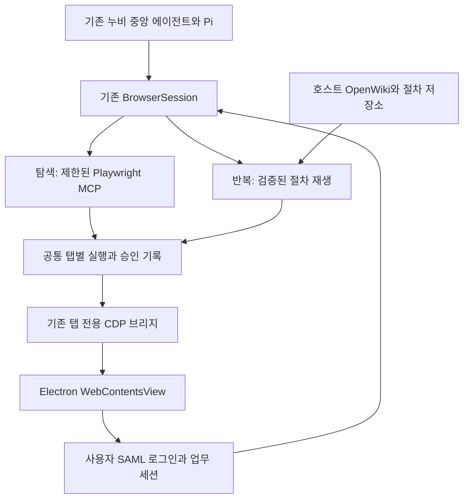

# 기존 누비 브라우저 모듈의 하이브리드 실행 연결 명세

2026-10-16. 사용자 제안과 현재 소스를 대조한 적용 명세다. 이 문서 작성으로 Desktop의 batch 실행/영구 업무 세션이 구현되었다고 표시하지 않는다. 제품 실행 코드와 인증 설정은 이번 조사에서 변경하지 않았다.

## 결론과 소유권

누비 중앙 Pi가 의도/계획/질문/승인/모델/결과를 소유한다. 기존 독립 Browser Agent의 core와 `./memory`를 사용하며 두 번째 자율 모델 루프나 브라우저 안의 채팅을 만들지 않는다. 사이트별 정보는 호스트의 검증된 지식/절차로 제공하고 범용 core에 Jira/JSM selector나 정답을 넣지 않는다.

핵심 최적화는 매 단계 전체 화면을 모델에 보내는 횟수다. 각 단계의 현재 DOM/프레임/대상 유일성/대기/접근 검증은 유지한다. 모델이 한 번 선택한 검증된 절차를 호스트가 단계별로 실행하고 결과 요약과 필요한 근거만 모델에 돌려준다. 한 호출로 묶여도 외부 사이트의 여러 쓰기는 원자적 transaction이 아니다.

## 현재 확보한 것과 연결 공백

| 항목 | 현재 | 필요한 보완 |
| --- | --- | --- |
| 중앙 에이전트와 BrowserSession | Desktop `runtime/browser-agent-host.mjs`에서 core 사용 | 기존 단일 모델/승인/기록 경로 유지 |
| Electron 내부 탭 | `BrowserHost`의 WebContentsView | 다른 브라우저로 교체하지 않음 |
| 탭 전용 CDP | `playwright-tab.cjs`의 임시 loopback capability endpoint, 단일 WebContents | 같은 연결을 두 실행 방식이 공유/직렬화. 두 번째 debugger attach 금지 |
| 일반 웹 실행 | 제한 MCP + documentId/snapshot 검증 | 탐색의 fallback으로 유지 |
| 절차 재생 | 독립 `createReplayMemory`, 기존 `runReplay/recordTarget`, revalidated 절차, 부분 복구 | Desktop 호스트의 store/view/BrowserMemoryPort와 중앙 도구 연결 |
| 구조 관찰 | 선택 Playwright adapter에 candidates/frames 구현 | Desktop은 현재 제한 MCP snapshot/hash 기반. 문자열 snapshot을 구조 관찰로 위장하지 않고 실제 구조 evidence 연결 |
| OpenWiki | 독립 모듈에 호스트 주입 계약 | Desktop의 실제 지식/절차 버전과 폐기 상태를 매 단계 검증 |
| 일반 웹 세션 | `nubi-browser-${randomUUID()}` 임시 partition | 업무 사이트 영구 profile과 로그아웃/만료/프로젝트 접근 범위 |
| 회사 로그인 | `persist:nubi-company`와 별도 보호 탭 | 모델/메일/업무 로그인 책임을 섞지 않고 업무 탭으로의 명시적 접근 계약 |

`createReplayMemory`는 이미 `runReplay`를 주입받고, 매 관찰/행동 전에 card/위키/프로젝트를 확인한다. binding/observation 변경으로 **발행하지 않았음이 확인된 현재 단계**만 1회 새 관찰 후 복구한다. 확인/미확정 쓰기, 사용자 대기나 취소를 일반 재시도로 다루지 않는다. 저장된 입력값은 슬롯으로 분리하며 새 요청의 값만 주입한다.

이 기능의 새로운 소스 검사에서 memory 계약 44/44, 실제 Chrome + 공식 MCP fixture 1/1을 통과했다. 후자는 새 입력 3개로 기존 절차를 재사용한다. 실제 모델 판단/누비 Electron batch 연결/사내 SAML/Windows 성적은 아니다. [검증 로그](../../../verification/large-document-context-2026-10-16/)를 참조한다.

## 실행 경계

중앙 도구는 검토 가능한 `procedureId + version + current values + tab binding`을 받는다. 임의 JavaScript 문자열과 무제한 Page 객체를 모델에 주지 않는다. 현재 누비 MCP는 evaluate/run_code/cookie/network/file 접근을 노출하지 않는다. 기존 제약을 `browser_run_code`로 우회하면 안 된다.

첫 연결은 저장된 선언형 절차를 기존 Playwright 실행기로 수행하는 방식이다. 호스트 소유 TypeScript workflow가 추가로 필요하면 코드 해시, 허용 동작/출처/입력 schema, 검증 조건을 등록하고 같은 정책 lane과 단계별 receipt로 실행한다. 생 Page 객체를 실행 코드에 넘기기 전에 기존 정책 밖 행동을 막는 별도 실행 표면이 필요하다. Jira별 함수가 범용 core의 기본 동작이 되어서는 안 된다.

동일 탭은 탐색과 절차 실행을 동시에 발행하지 않는다. 절차 동안 탭 lease/queue와 cancellation을 공유한다. 각 단계가 현재 탭/문서/프레임에 다시 결합하며 navigation 후 새 documentId와 관찰을 얻는다. 이전 ref나 전역 `.first()`로 모호한 대상을 조용히 선택하지 않는다.

승인 대상은 실제 절차 버전, 정확한 입력값/대상과 쓰기 효과다. 기존 MCP 승인 한 번을 앞으로의 임의 쓰기 전체 승인으로 확대하지 않는다. 일괄 승인을 도입한다면 중앙의 기존 폼에 해당 범위를 구체적으로 표시하고 허용된 단계만 실행한다. 결과 불명 단계는 reconciliation 또는 사용자 대기이며 전체 절차를 재시작하지 않는다. 최종 업무 완료는 실제 저장 후 readback과 기존 독립 결과 검토로 판단한다.

## SAML과 세션

일반 BrowserHost는 현재 메모리 session이다. `persist:nubi-company`가 있다는 이유로 Jira/JSM의 모든 로그인도 재시작 후 유지된다고 표시하지 않는다. [Electron 공식 session 문서](https://www.electronjs.org/docs/latest/api/session#sessionfrompartitionpartition-options)대로 `persist:`가 있는 partition만 디스크 지속 세션이다.

호스트가 관리하는 업무 profile을 선택해 원래 페이지와 SAML 팝업이 같은 session을 사용하게 한다. 현재 `createWindow`의 guest WebContents/opener/POST 보존을 유지한다. 팝업을 URL만 복사해 GET으로 재생하지 않는다. Chromium 정책, 인증 확장/장치 인증 등 회사 조건은 실제 환경에서 확인한다.

현재 PlaywrightHost와 connectTab은 authentication/companyLogin/명시적 custom-session 탭을 보호한다. 따라서 partition 이름만 바꾸거나 이 검사를 삭제해서 연결하면 안 된다. 로그인 입력/MFA/인증 중에는 사용자에게 맡기고, 인증 왕복 종료 뒤 허용된 업무 origin과 실제 계정/대상 화면을 호스트가 확인한 탭에만 새 execution capability를 부여한다. IdP와 보호 탭은 계속 제외한다. URL 하나나 HTTP 200만으로 로그인 성공을 추정하지 않는다.

쿠키/토큰/SAMLResponse를 프롬프트/로그/위키/절차에 넣지 않는다. profile 권한/로그아웃/사용자 변경/만료는 capability와 작업 관찰을 무효화한다. 영구 session은 만료를 없애지 않으며 Edge/Chrome의 session을 자동 공유하지 않는다.

[Playwright 공식 문서](https://playwright.dev/docs/api/class-browsertype#browser-type-connect-over-cdp)는 CDP 연결이 전용 Playwright protocol보다 기능 충실도가 낮다고 설명한다. 현재 제한 bridge에서 지원하는 frame/popup/navigation의 실동작을 검사하고 앱 전체 debug port를 열어 통과시키지 않는다. [자동 대기](https://playwright.dev/docs/actionability)는 대상의 동작 가능성을 검사하지만 업무 저장 성공이나 중복 쓰기 방지를 대신하지 않는다.

## 구현 순서와 채택 기준

1. 기존 보호된 탭 연결 위에 구조 관찰/view를 주입하고 current bindings와 frame 교체를 검증한다.
2. Desktop에 `createReplayMemory`와 기존 host store를 연결한다. 첫 범위는 입력/검색/결과 읽기 3~5단계다. 중앙 도구에서 한 절차를 선택하고 완료한 prefix를 보존한다.
3. 동일 요청으로 일반 탐색과 재생을 최소 3회씩 비교한다. 처음 탐색/학습/검증 비용, 다음 작업 재사용 비용, 모델 호출 수, 전체 입력/출력, 브라우저 호출 수와 전체 시간을 따로 기록한다. 아직 관찰하지 못한 업무를 성공으로 세지 않는다.
4. 업무 session lifecycle과 SAML 사용자 대기/복귀를 연결하고 최초/재시작/만료, 팝업 POST/opener, 로그아웃, 다른 계정/탭으로의 접근 거절을 검사한다.
5. 사용자 허용 범위의 실제 Jira/JSM에서 읽기 과제부터 평가한 뒤 상태 변경 등 쓰기를 별도 평가한다. 최종 상태/대상과 중복 발행 0건을 독립 readback으로 확인한다. Windows 설치판/실계정/회사 네트워크 결과를 따로 남긴다.

고정 벤치마크에는 10단계 정상 흐름 외에 지연 렌더, 이름이 같은 버튼, 교체 iframe, 3탭 중 잘못된 탭 선택, 만료 후 로그인 복귀, 4번째 단계 이후 실패, 쓰기 뒤 응답 유실, 취소/재시작을 포함한다. 속도만 좋아지고 정확도/복구가 나빠진 후보는 채택하지 않는다. 학습비를 제외한 재사용 지연과 학습비 포함 손익분기 반복 횟수를 모두 제시한다.

앞선 큰 문서 조사와도 연결된다. 브라우저의 상세 DOM/절차별 기록은 호스트에 보존하고 모델에는 검증 결과, 값, 출처와 실패 위치를 제한해 반환한다. 과거 큰 snapshot을 매 단계 재삽입하거나 90% 압축 설정 하나로 문맥 문제를 해결했다고 표시하지 않는다. [문서 재현과 비교](../../research/2026-10-16-large-document-context-benchmark.md)를 함께 따른다.

## 제품 연결 후속

이 명세 뒤 사용자 승인에 따라 기존 runReplay와 BrowserSession을 사용하는 현재 관찰 대상의 입력/클릭 batch, 기존 MCP 승인, 일반 웹 지속 세션과 SAML 왕복 자동화 제외를 연결했다. 상세한 현재 범위와 실제 Electron/프로세스 재시작 근거는 [적용 기록](../../../packages/nubi-desktop/docs/COMPACTION-AND-HYBRID-2026-10-16.md)을 따른다. 위키 절차 자동 학습/qualification/재사용, Page 기반 전체 구조와 실제 사내 SAML은 이 연결만으로 완료 처리하지 않는다.
