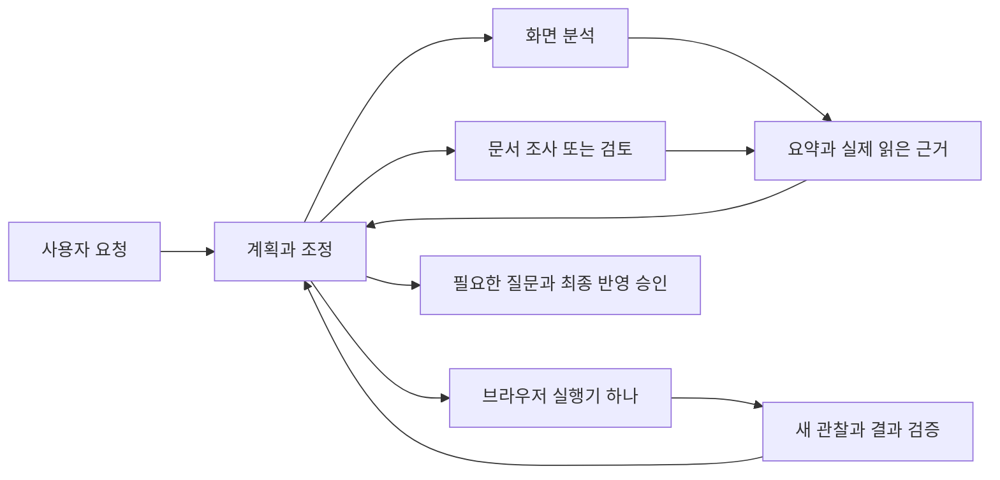

# Anthropic 방법론을 적용한 누비 하네스

2026-09-23. 기준 모델은 Qwen 3.8 27B다. 기존 Pi 실행기를 개선한 로컬 후보이며, 실모델의 정확도와 총 토큰 절감은 아직 측정하지 않았다.

## 선택과 적용

| 확인한 공식 자료 | 누비에 적용한 내용 |
| --- | --- |
| [Anthropic multi-agent 연구](https://www.anthropic.com/engineering/multi-agent-research-system) | 주 Agent가 목표와 완료 조건을 정하고 독립적인 조사만 분담한다. 작업별 조사량을 조절하고 먼저 도착한 근거를 다음 판단에 반영한다. |
| [Context engineering](https://www.anthropic.com/engineering/effective-context-engineering-for-ai-agents) | 큰 원문을 반복 전송하는 대신 근거 ID를 남기고 필요할 때 해당 구간을 읽는다. 원래 요구, 최근 관찰, 실패와 실행 기록은 보존한다. |
| [장기 작업 하네스](https://www.anthropic.com/engineering/effective-harnesses-for-long-running-agents) | 기존 계획과 체크포인트를 유지하고 완료 조건을 실제 결과에 대조한다. 모호한 완료 주장만으로 다음 단계에 넘어가지 않는다. |
| [Planner / generator / evaluator 실험](https://www.anthropic.com/engineering/harness-design-long-running-apps) | 계획, 실행, 독립 검토의 책임을 구분한다. 모델마다 효과가 다른 강제 문맥 초기화나 과도한 역할 분리는 도입하지 않았다. |
| [Agent 평가 방법](https://www.anthropic.com/engineering/demystifying-evals-for-ai-agents) | 수정 전 실패를 재현하고 실제 Chrome에서 입력 결과, 중복 실행, 원래 탭 보존을 검사한다. 합성 응답 회귀와 실모델 평가는 구분한다. |

오픈소스는 이미 설치한 MIT `@earendil-works/pi-agent-core@0.86.1`의 독립 Agent와 `prepareNextTurn`, MIT `minisearch@7.2.0`의 근거 검색을 실제 사용한다. [Pi 공식 subagent 예제](https://github.com/earendil-works/pi/tree/main/packages/coding-agent/examples/extensions/subagent)의 별도 문맥, 사용량, 취소 전파를 MV3 안에서 구현했다. 예제의 Node 자식 프로세스는 실행하지 않는다.

[Anthropic Claude Cookbooks](https://github.com/anthropics/claude-cookbooks/tree/main/patterns/agents)의 MIT orchestrator-workers와 evaluator-optimizer 구현도 확인했다. 책임 분리와 평가 피드백 패턴을 적용했으며 코드를 복사하거나 Anthropic SDK를 번들한 것은 아니다. 예제의 무한 반복이나 내부 사고 출력도 도입하지 않았다. Qwen과 기존 제공자 계약을 유지한다.

## 역할과 권한

| 담당 | 필요한 자료와 완료 조건 | 권한과 반환 |
| --- | --- | --- |
| 주 Agent | 사용자 요구와 제약, 계획, 최신 화면 | 조정과 브라우저 실행. 질문, 최종 승인과 결과 검증을 담당한다. |
| 화면 분석 | 지정한 관찰과 확인할 항목 | 지정 근거의 읽기만 가능하다. 요소 후보와 모호한 점을 반환한다. |
| 문서 조사 | 좁은 질문, 연결된 프로젝트, 완료 조건 | 현재 프로젝트의 Wiki/소스 읽기만 가능하다. 사실과 경로를 반환한다. |
| 독립 검토 | 완료 조건과 지정 근거 | 빠진 요구와 모순을 확인한다. 실제 실행의 성공을 인증하지 않는다. |
| 실패 분석 | 오류와 부분 실행 기록, 최신 관찰 | 실패 원인과 바꿀 방법, 다음 확인 항목을 반환한다. 쓰기를 재실행하지 않는다. |

동시 분석은 최대 두 개다. 담당끼리 직접 지시하거나 다른 담당을 생성하지 않는다. 결과가 충돌하면 주 Agent가 근거를 다시 읽거나 새 관찰을 얻는다. 현재 DOM과 실행 기록을 오래된 분석보다 우선하며, 사용자의 선택이 필요한 경우 기존 질문 폼을 사용한다. 하위 보고는 사용자 승인과 동작 권한을 만들지 않는다.

## 이번 변경

### 작업에 맞는 조사량

`delegate_analysis`에 `effort`를 추가했다. 생략하면 기존 `standard`다.

| 할당 | 용도 | 모델 판단 / 최대 입력 문자 |
| --- | --- | --- |
| `quick` | 하나의 사실 확인 | 3 / 16,000 |
| `standard` | 자료 비교 | 6 / 32,000 |
| `deep` | 여러 자료의 조사 | 10 / 48,000 |

마지막 판단은 확보한 발췌로 부분 결과를 돌려주는 데 예약한다. 완료된 조사는 일찍 끝낸다. 큰 입력은 최근 실제 읽은 발췌로 줄이며, 빠진 구간을 인용할 수 없다. 주 Agent는 미완료 범위만 다시 정한다. 이는 담당별 자원 할당으로, 사용자 작업 전체의 실행 횟수 제한이 아니다. 같은 실패를 반복하려고 할당만 늘리지 않도록 안내한다.

### 원문을 다시 읽을 수 있는 문맥 정리

전송 문맥이 32,000자를 넘으면 오래된 큰 읽기 결과를 작은 근거 참조로 바꾼다. 최근 두 읽기는 그대로 둔다. 현재 실행의 근거 저장소에 전체 응답이 있을 때만 정리하며, 자료가 없거나 저장 중 잘린 경우 원문을 유지한다. 이미지, 오류, 승인/질문 대기와 쓰기 결과도 이 정리에서 제외한다.

원래 Pi 대화와 도구 호출/결과 쌍은 변경하지 않는다. 모델이 `read_analysis_evidence`에 ID와 검색어/구간을 넘기면 필요한 부분만 다시 읽는다. 저장소는 실행당 최대 48개이며 활성 담당의 입력은 보존한다. 실행 종료 후 ID의 재조회나 브라우저 재시작 복원을 보장하지 않는다. 사라진 자료는 새로 허용된 읽기로 얻어야 한다.

### 실패를 사실로 바꾸지 않는 보고

근거에 호스트가 판단한 `source_status`를 넣는다. 오류 기록만 인용한 사실이 있으면 화면/문서/검토 담당의 `complete` 보고를 거부하고 교정 피드백을 돌려준다. 실패 원인 담당은 오류 자체를 분석할 수 있지만, 여전히 참고 의견이다.

각 근거에는 **담당이 실제 읽은 범위에서 최대 320자의 발췌**를 붙인다. MiniSearch가 관련 구간을 고르며 읽지 않은 본문을 가져오지 않는다. 큰 문서와 하위 대화 전체는 주 문맥에 합치지 않는다. 이 검사는 읽기 여부와 실패 구분을 보장하는 계약 검사다. 인용 내용이 주장을 논리적으로 입증하는지는 주 Agent와 기존 독립 검토에서 판단하므로 사실 정확도의 보증은 아니다.

## 평가

- 변경 전: 새 요구를 검사하는 네 가지 시나리오가 실패했다. 단순 조사도 6회, 과거 원문 유지, 실패 조회의 완료 보고 허용, 근거 발췌 미제공을 확인했다.
- 변경 후: 단위 검사로 조사량, 잘못된 근거 거부, 실패 후 조회 변경, 근거 재조회와 실행 기록 보존을 검사한다.
- Chrome: 두 담당의 독립 문맥, 먼저 도착한 결과 전달, 실제 입력과 검증, 늦은 결과의 오래된 상태 표시, 원래 탭 보존을 검사한다. 계획/복구/압축 회귀도 새 프로필로 세 번 반복한다.
- 실모델: Qwen 실제 응답의 정확도, 지연, 전체 토큰은 별도 비교가 필요하다. 합성 응답의 호출 수와 문자 감소량을 실모델 성능 향상으로 보고하지 않는다.

실모델 비교에서는 같은 과제의 단일 분석과 역할별 분석을 각각 여러 번 실행하고, 모든 시도의 성공 여부와 총 usage, 지연을 기록한다. 단순 읽기는 추가 담당 없이 끝내는지, 독립 자료 비교는 정확한 근거가 모이는지, 실패 후 이미 작성한 내용을 다시 입력하지 않는지 함께 평가한다. 실제 환경 결과를 우선하며 특정 도구 순서를 정답으로 고정하지 않는다.

이번 검증의 수치와 후보 파일은 `verification/anthropic-harness-2026-09-23/`에 기록한다. 이는 공개 배포나 실계정 연결 검증을 대신하지 않는다.
