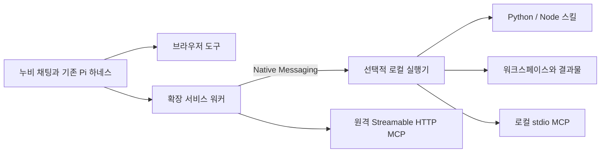

# 실행형 스킬과 로컬 워크스페이스

2026-09-22 설계 제안. 현재 Beta 1.0.0에는 로컬 Python/Node 실행기와 외부 MCP 클라이언트가 없다. 이 문서는 구현 계약과 검증 기준이며 설치본에 반영된 기능 목록이 아니다.

## 제안

스킬은 `SKILL.md`와 스크립트가 들어 있는 폴더로 관리하고, 폴더 또는 ZIP으로 가져온다. 누비가 필요한 지침과 코드를 읽고, 선택한 워크스페이스에서 실행한 뒤 결과물을 확인한다. Python/Node 실행에는 선택적 **누비 로컬 실행기**를 연결한다. 기존 Pi 하네스와 AI Pro/ChatGPT/FabriX 연결을 유지한다.

일반 채팅과 브라우저 자동화에는 로컬 실행기나 LLM Router 설치를 요구하지 않는다. 브라우저의 파일 선택 권한이나 경로 문자열만으로 PC의 Python/npm을 실행할 수는 없다. 로컬 기능은 실행기 설치가 한 번 필요하며, 사용자가 터미널 명령을 매번 실행하는 흐름으로 만들지 않는다.

## 사용자 흐름

예: “현재 페이지를 정리해서 회사 양식의 Word 보고서로 저장해줘.”

1. 누비가 페이지를 읽고 관련 보고서 스킬의 지침, 필요한 스크립트와 양식을 확인한다.
2. 작업 폴더가 없으면 채팅에 **“저장할 폴더를 선택해 주세요.”** 폼을 표시한다.
3. 사용자가 폴더를 선택하면 필요한 라이브러리를 전용 환경에 설치하고 문서를 생성한다.
4. 파일을 다시 열어 형식과 내용을 확인한다. 실패하면 원인을 읽고 수정한다.
5. 채팅에 파일 카드와 미리보기, 다운로드, 폴더 열기 아이콘을 표시한다.
6. 메일 발송이나 사이트 등록까지 요청했다면 초안을 준비하고 기존 HITL에서 최종 승인을 받는다.

이미 선택한 폴더와 허용한 실행 범위에서는 같은 질문을 반복하지 않는다. 문서 생성과 의존성 준비는 요청한 작업에 포함하고, 새로운 접근 범위나 시스템 변경이 필요한 경우에만 추가 선택을 받는다.

## 스킬 등록과 공유

[Agent Skills 명세](https://agentskills.io/specification)의 폴더 구조를 따른다. 폴더가 원본이며 ZIP은 가져오기와 공유에 사용한다. 가져오기 자체가 외부 업로드를 뜻하지 않는다.

```text
report-maker/
  SKILL.md
  scripts/create_report.py
  references/writing-guide.md
  assets/report-template.docx
  pyproject.toml
  uv.lock
```

JavaScript 스킬은 `scripts/*.mjs`, `package.json`, 잠금 파일을 사용할 수 있다. 단일 Python 파일은 PEP 723 의존성 선언도 지원한다. 모든 스킬에 두 언어 설정이나 누비 전용 매니페스트를 요구하지 않는다.

- **등록:** 폴더 선택 또는 ZIP 가져오기 → 이름/설명 자동 인식 → 필요한 실행 환경 확인 → 추가. 이름과 긴 지침을 직접 입력하는 화면은 보조 편집 기능으로 남긴다.
- **읽기:** 기본 컨텍스트에는 이름과 설명만 넣는다. 선택된 스킬의 지침과 필요한 파일만 읽고 실행 파일을 결정한다.
- **실행:** 가져오는 순간에는 코드를 실행하거나 패키지를 설치하지 않는다. 실제 작업 시 등록된 파일과 해시를 확인해 실행한다.
- **변경:** 폴더도 등록 시 스냅샷으로 보관한다. 원본 폴더 변경이 승인 없이 다음 실행에 섞이지 않도록 새로고침 시 변경 내역과 버전을 갱신한다.
- **공유:** 지침, 스크립트, 양식, 의존성 선언과 잠금 파일을 ZIP에 담는다. 인증정보, `.env`, 가상환경, `node_modules`, 사용자 결과물은 제외한다. 포함 파일을 확인할 수 있어야 한다.
- **호환:** 기존 `.skill.json`과 단일 `SKILL.md`는 지침형 스킬로 계속 가져온다. 기존의 50자 표시 이름과 새 표준의 기술 식별자는 분리한다.

ZIP은 임시 영역에서 파일 수/압축 해제 크기를 제한하고 검사 후 원자적으로 등록한다. 절대 경로, 상위 경로 탈출, 심볼릭 링크, Windows 경로 변형과 대소문자 충돌을 거부한다. 여러 스킬이 있는 묶음은 발견한 스킬을 선택하게 하고 임의로 하나만 실행하지 않는다.

## 워크스페이스와 HITL

설정에 **워크스페이스** 한 행을 추가한다. 폴더 이름과 변경/열기 아이콘을 표시하고 전체 경로는 상세에서 확인한다. 기본 폴더를 기억하되, 대화별 작업 폴더를 선택할 수 있게 한다.

필요할 때 나타나는 채팅 폼은 기존 질문 카드의 스타일을 재사용한다. 폴더 선택이 기본이고 **경로 직접 입력**은 보조 방식이다. 처음 설치가 필요하면 같은 카드에서 설치와 연결 확인으로 이어진다. 일반 브라우저 대화에는 이 폼을 띄우지 않는다.

`request_workspace`는 일반 `ask_user` 텍스트 답변과 구분한 시스템 이벤트다. 실행기가 OS 폴더 선택창을 열거나 입력한 경로를 검증하고, 사용자의 선택에 결합된 `workspaceId`를 돌려준다. 모델이나 웹페이지가 보낸 경로만으로 접근 권한을 만들지 않는다.

- 실제 경로, 존재 여부, 쓰기 가능 여부, 심볼릭 링크/Windows junction과 UNC 정책을 검사한다.
- 선택 요청은 clientId, conversationId, requestId와 만료 시간에 묶고 오래된 폼의 답은 적용하지 않는다.
- 실행 중인 작업은 시작 시의 workspaceId에 고정한다. 기본 폴더 변경으로 진행 중 작업의 저장 위치가 바뀌지 않는다.
- 취소하면 해당 로컬 작업만 중단한다. 연결이 끊기면 상태와 재연결 동작을 같은 카드에 남긴다.
- OpenWiki의 읽기 전용 폴더 연결은 그대로 유지한다. Wiki 폴더 선택을 쓰기/실행 권한으로 확대하지 않는다.

CX 기준은 [시각 표준](VISUAL-STANDARD.md), `design/agent-deck.css`, `src/surfaces.css`다. 로컬 Noto Sans KR와 공통 본문/보조/모달 크기를 사용한다. 폴더, 새로고침, 다운로드, 삭제처럼 명확한 조작은 접근 가능한 이름과 툴팁이 있는 아이콘으로 표시한다. 경로와 설치 로그는 접고, 필요한 오류와 다음 동작은 유지한다. 기존 첨부 카드와 상단 토스트를 재사용한다.

## 연결 구조



[Chrome Native Messaging](https://developer.chrome.com/docs/extensions/develop/concepts/native-messaging)을 로컬 연결에 사용한다. 실행기와 host 등록은 별도 설치 프로그램이 담당하고 확장은 worker에서 연결한다. 확장 ZIP만으로 실행기 설치가 완료됐다고 표시하지 않는다. 현재 unpacked 설치 ID를 정확히 허용하고 업데이트 시 ID와 저장소를 보존한다. 제어용 localhost 포트를 사용자에게 입력시키지 않는다.

큰 결과물은 artifactId로 참조하고 다운로드 시 순서와 해시가 있는 작은 청크로 전송한다. Native Messaging의 호스트→확장 메시지는 1 MiB 한도이므로 파일 전체를 한 메시지에 넣지 않는다. 브라우저의 네이티브 메시지 프레이밍과 MCP stdio 프로토콜을 같은 스트림으로 혼용하지 않는다.

실행기는 모델을 따로 호출하는 에이전트가 아니다. 기존 Pi가 관찰, 도구 선택, 실행 결과 확인과 복구를 담당한다. 현재 브라우저의 제한된 JavaScript 도구와 로컬 Node 도구는 실행 권한과 이름을 분리한다.

## 실행과 라이브러리

Python은 [uv](https://docs.astral.sh/uv/guides/scripts/)의 선언된 의존성과 잠금 파일을 활용한다. JavaScript는 Node와 [npm 잠금 기반 설치](https://docs.npmjs.com/cli/v11/commands/npm-ci/)를 활용한다. 스킬 해시, 의존성 잠금, 런타임 버전과 OS별로 환경을 재사용한다. 스킬 환경은 관리 캐시에 두고 결과물은 선택한 워크스페이스에 저장한다.

- 필요한 런타임은 설치 프로그램 또는 관리된 다운로드로 준비한다. 사용자 전역 Python/npm 설정을 바꾸지 않는다.
- 없는 라이브러리는 선언에 추가하고 잠금 결과를 기록한 뒤 전용 환경에 설치한다. 무관한 사용자 프로젝트의 `node_modules`를 재설치하지 않는다.
- 회사 패키지 저장소, 프록시와 인증서를 지원한다. TLS 검증을 끄거나 비밀값을 채팅에 출력하지 않는다.
- 패키지 설치 훅도 코드 실행으로 취급한다. 이미 허용된 작업 범위에서는 진행하고 관리자 권한, 전역 설치나 새 접근 범위는 별도 처리한다.
- 경로와 인자는 구조화해 전달한다. 스크립트는 등록된 상대 경로와 해시로 지정하고 실행 가능한 임의 셸 문자열을 기본 인터페이스로 삼지 않는다.
- stdout/stderr, 종료 코드, 변경 파일과 검증 결과를 제한된 크기의 구조화된 결과로 돌려준다. 프로세스 종료 코드 0만으로 성공을 선언하지 않는다.

**워크스페이스는 작업 위치이며 그 자체가 OS 보안 샌드박스는 아니다.** 가상환경, cwd, MCP roots만으로 임의 Python/Node의 다른 파일 접근을 막을 수 없다. 초기 지원 범위는 사용자가 신뢰해 등록한 로컬 코드 실행으로 명시한다. “선택 폴더 밖 접근 차단”을 제공하려면 별도의 OS/컨테이너 격리 어댑터와 실제 탈출 방지 검증을 먼저 완료해야 한다. 지원되지 않는 환경에서 격리가 있다고 표시하지 않는다.

최소 도구 계약은 `read_skill_file`, `request_workspace`, `workspace_read/write/search`, `ensure_dependencies`, `run_skill_script`, `job_status/cancel`, `read_artifact`다. 실행 요청에는 workspaceId, skillId, packageHash, scriptPath, argv와 idempotencyKey를 결합한다. 사용자별 인증정보와 LLM 제공자 토큰은 자식 프로세스에 자동 상속하지 않는다.

## MCP 연결

[공식 MCP SDK](https://github.com/modelcontextprotocol/typescript-sdk)의 구현 시점 안정 버전을 잠가 사용한다. [표준 전송](https://modelcontextprotocol.io/specification/2025-11-25/basic/transports)에 맞춰 로컬 stdio는 실행기가 프로세스를 시작하고, 원격 Streamable HTTP는 확장에서 직접 연결 가능한 경로를 둔다. 원격 서버 사용만을 위해 로컬 실행기를 필수로 만들지 않는다.

연결 설정은 주소 또는 로컬 실행 설정을 받아 `initialize`와 `tools/list`로 확인한다. 연결 테스트가 업무 도구를 실행하지 않는다. 인증 없는 연결, Bearer 연결과 OAuth 필요 상태를 구분하며 OAuth는 표준 발견/로그인 흐름을 지원해야 완료로 표시한다. 임의 인증 우회는 하지 않는다.

도구 이름은 서버별로 구분하고 입력 스키마, 응답 크기, 시간 제한, 취소와 연결 종료를 처리한다. 사용 중인 스킬과 과제에 필요한 도구만 Pi에 노출한다. 도구 설명과 결과는 참고 데이터이며 승인 권한이 아니다. MCP의 쓰기 도구도 기존 발송/게시 HITL을 우회하지 않는다.

로컬 MCP에는 사용자가 선택한 [roots](https://modelcontextprotocol.io/specification/2025-11-25/client/roots)를 전달하고 변경 시 통지한다. roots는 서버에 알리는 작업 범위이며 OS 접근 제한을 대신하지 않는다. 원격 서버에 로컬 파일이 자동 공유되지 않으며 필요한 자료만 별도 전달한다. 서버 인증값은 스킬/ZIP/대화에 포함하지 않는다.

## 작업 유지와 검증

로컬 작업은 jobId와 저널로 시작/진행/종료/불확실 상태를 기록한다. 재연결 시 설치나 파일 쓰기를 무조건 다시 실행하지 않는다. 중단은 자식 프로세스까지 처리하고, 결과 파일은 workspaceId에 결합된 artifactId로 제공한다.

문서는 실제 파일 존재, 크기, 형식 파싱과 요청 내용 포함 여부를 확인한다. 지원하는 형식만 미리보기를 제공하고 나머지는 다운로드한다. 기존 파일을 수정할 때는 변경 전 해시를 확인하고 임시 파일 생성 후 교체한다. 결과 파일이 준비되기 전 업로드 승인을 요청하지 않는다.

Native Messaging 연결만 추가한다고 전체 대화가 창 종료 후 계속 실행되지는 않는다. 실행 중인 로컬 작업 복구와 UI 밖에서 Pi 루프 전체를 지속하는 [목표 7](IMPLEMENTATION-GOALS.md)은 분리한다.

## 구현 순서와 완료 기준

| 단계 | 변경 대상 | 실제 확인할 흐름 |
| --- | --- | --- |
| 1 | 새 로컬 실행기 패키지/설치 프로그램, manifest, background, 설정과 workspace 폼 | Windows 우선 설치 → 폴더 선택 → 파일 저장/재읽기 → 재연결. macOS는 별도로 검사 |
| 2 | skills.js, Skills.jsx, 패키지 저장/검사, 의존성/실행 도구 | 폴더/ZIP으로 같은 스킬 등록 → Python DOCX와 Node HTML 생성 → 검증 → 채팅 다운로드 |
| 3 | MCP 어댑터, 동적 도구 카탈로그와 기존 Pi 연결 | stdio/HTTP 도구 목록/호출 → 취소/오류/재연결 → 제공자별 같은 도구 흐름 |
| 4 | 프로젝트 제작 도구와 artifact 전송 | 코드 저장 → 설치/빌드 → localhost 확인 → 수정 → 승인 뒤 대상 업로드 검증 |

단계마다 유효/오류/취소, 폴더 변경, 경로 탈출, 오래된 폼, 동일 요청 재전송, 의존성 실패와 반쯤 생성된 파일을 검사한다. 인증정보가 결과와 ZIP에 섞이지 않는지 확인한다. 좁은 패널과 큰 창에서 폼, 초점 복귀, 결과물 카드와 다운로드를 조작한다.

완료는 실제 Native Messaging 설치본과 프로세스 실행을 확인한 범위로 한정한다. 모의 서버 검사만으로 Windows/Edge 지원이나 회사망 설치 성공을 주장하지 않는다. 기존 확장 단독 사용, 로그인 시 debugger 미사용, 브라우저 작업과 최종 승인 회귀 검사도 유지한다.

관련 범위: [로컬 프로젝트 제작](STATIC-PROJECT-AGENT.md), [미반영 목표 5/6](IMPLEMENTATION-GOALS.md). 이 설계로 OpenWiki 서버에 실행/쓰기 권한을 추가하지 않는다.
