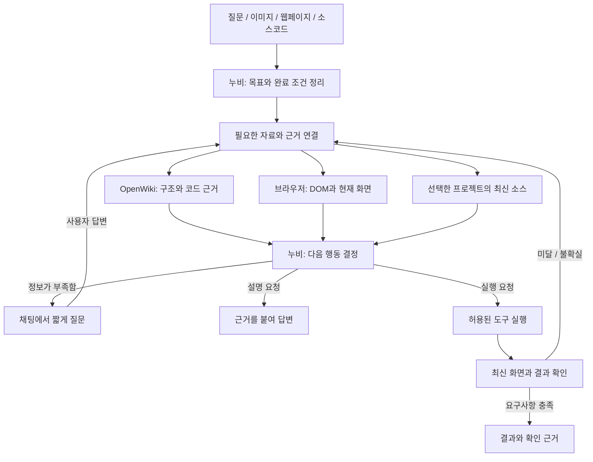

# OpenWiki와 누비 연결 설계

상태: **설계 개정안 v2, 2026-09-21. 후속 버전에서 읽기 연결을 구현했으며, 아래 전체 개발 흐름은 아직 미구현이다.**

2026-09-22: [브라우저 직접 연결](OPENWIKI-BROWSER-CONNECTION.md)을 누비 1.1.0 / OpenWiki-SDS 0.6.0에 구현했다. 프로젝트 연결, Wiki/소스 읽기와 인용이 첫 범위다. 1.1.1은 설정 폴더 직접 읽기를, 1.2.0은 이미지/문서/소스 첨부와 붙여넣기를 추가했다. 아래 계약의 코드 수정/빌드/로컬 개발 미리보기는 후속 목표이며 전체 구현으로 간주하지 않는다.

**OpenWiki는 코드 이해에 필요한 지식과 근거를 제공하고, 누비는 사용자와 대화하며 화면을 관찰하고 실행 결과를 검증한다.** 이미지, 웹페이지, 소스코드, 질문 어느 것에서든 같은 작업을 시작한다. 로컬 프로젝트 연결은 선택 기능이며 기존 브라우저 작업은 확장만으로 유지한다.

검토 기준은 누비 0.12.1과 저장소의 [독립 OpenWiki 패키지](../../../packages/openwiki/ENTERPRISE.md)다. OpenWiki 원본은 [UPSTREAM.json](../../../packages/openwiki/UPSTREAM.json)에 고정한 LangChain OpenWiki 0.5.2 커밋 `715109a8ab1cda6d47680fcc8170e203c751bf61`이다. 패키지의 AI Pro/FabriX 연결과 누비의 OpenWiki 연결은 서로 다른 기능이다.

## 1. 기존 설계에서 보완한 점

| 기존 공백 | 개선 결정 |
| --- | --- |
| 화면에서 코드를 찾아 수정하는 흐름만 있음 | 질문, 이미지, URL, 코드 조각을 동등한 시작점으로 지원 |
| Wiki와 화면의 근거를 이어 주는 계약이 없음 | 자료마다 출처, 버전, 관련 요구사항, 확인 수준을 기록 |
| 정보 부족을 오류로 종료하기 쉬움 | 채팅 안에서 질문하고 답을 받은 뒤 같은 작업 재개 |
| 모든 도구가 페이지 연결에 묶임 | 대화, 자료, 브라우저, 프로젝트 도구를 필요한 조건으로 각각 활성화 |
| 코드 수정 성공과 화면 성공이 섞일 수 있음 | 코드 검토, 화면 관찰, 동작 검증, 실제 저장을 구별 |
| 창이 닫혔을 때 진행 중 작업의 처리가 모호함 | 질문과 실행 기록을 보관하고 재관찰 후 재개 |
| 로컬 연결의 권한만 다룸 | 확장 CSP, 연결 인증, 프로젝트 범위, 장기 작업 계약까지 명시 |

## 2. 역할과 연결 구조



| 구성 | 책임 | 맡기지 않는 일 |
| --- | --- | --- |
| 누비의 기존 Pi 하네스 | 목표, 자료 선택, 도구 실행 순서, 질문, 최종 검토 | 근거 없이 성공 선언 |
| OpenWiki | 저장소 구조, 관계, 문서와 버전이 있는 코드 근거 | 브라우저 조작과 실제 화면 성공 판정 |
| Playwright CRX + QuickJS | DOM/화면 관찰, 이동, 입력, 클릭, 재확인 | PC 전체 화면 수집, 로컬 파일/쉘 직접 실행 |
| 선택적 로컬 연결 프로그램 | Wiki 검색, 최신 소스 읽기, 프로젝트 연결, 후속 변경/테스트 작업 | 임의 경로 접근, 웹페이지가 지시한 명령 실행 |
| 기존 결과 검토기 | 사용자 요구사항과 새 근거 대조 | 실행기 답변만 믿거나 작업 범위 확대 |

누비의 주 실행 루프는 하나로 유지한다. OpenWiki의 생성 Agent는 Wiki를 만들거나 갱신할 때만 사용한다. 매 질문마다 두 Agent가 서로 호출하는 구조나 새 LangGraph 런타임을 추가하지 않는다.

OpenWiki의 현재 MCP는 `openwiki_begin`, `openwiki_submit_plan`, `openwiki_next_page`, `openwiki_inspect_page_claims`, `openwiki_submit_page`, `openwiki_finish`로 문서 생성 수명주기를 제공한다. 범용 Wiki 검색/소스 편집 API가 아니다. 검색은 연결 프로그램이 Markdown/메타데이터를 읽어 제공하고 최신 파일은 별도 읽기 도구로 확인한다. 시각화 서버의 `/api/graph`를 파일 편집 API로 사용하지 않는다. [공식 역할 설명](https://github.com/langchain-ai/openwiki#coding-agent-integrations), [고정 버전 계약](../../../packages/openwiki/src/integrations/core/protocol.ts)

## 3. 어떤 자료로도 시작하는 흐름

| 입력 | 사용자 예시 | 누비의 처리 | 자료가 부족할 때 |
| --- | --- | --- | --- |
| 질문만 | “이 서비스에서 주문은 어떻게 저장돼?” | 연결된 프로젝트의 Wiki와 관련 소스를 조회하고 흐름 설명 | 프로젝트가 여러 개면 하나만 선택 요청 |
| 현재 페이지/URL | “이 페이지에서 저장이 안 돼” | 사용자 요청으로 페이지 연결, DOM/상태 관찰, 필요할 때 캡처 | 로그인 필요 상태를 알려주고 재개 |
| 이미지 | “이 시안처럼 버튼을 바꿔줘” | 첨부를 시각적 목표로 읽고 현재 화면과 비교 | 대상 페이지/프로젝트가 없으면 연결 요청 |
| 소스코드 | “이 컴포넌트가 화면 어디에 쓰여?” | 붙여넣기/첨부 코드를 읽고 연결된 저장소에서 일치하는 위치 탐색 | 일치하지 않으면 독립 코드 조각으로 설명 |
| 혼합 입력 | 화면 캡처 + URL + “이 오류 고쳐줘” | 기대 모습, 현재 상태, 코드 근거를 분리해 비교 | 해결에 꼭 필요한 동작 조건만 질문 |

첨부는 선택 파일과 붙여넣기를 지원한다. 구현된 범위는 PNG/JPEG/WebP 이미지, PDF/Word(docx)의 텍스트와 UTF-8 텍스트/코드다. 파일명만으로 신뢰하지 않고 형식과 크기를 검사한다. 상한은 메시지당 4개/총 8MiB, 이미지당 4MiB/20MP, 텍스트/문서 원본 8MiB, 추출 텍스트 12MiB/400만 자다. PDF는 2,000쪽까지 읽는다. 초과분을 자르지 않고 전송 전에 오류로 표시한다. 압축 파일 실행, 임의 HTML 렌더링, 프로젝트 전체 업로드는 첫 범위에서 제외한다.

**사용자가 올린 이미지와 누비가 캡처한 이미지는 구별한다.** 전자는 참고 이미지이고 후자는 관찰 시점의 웹페이지 근거다. 누비가 직접 캡처할 대상은 연결된 브라우저 탭뿐이다. 참고 이미지의 좌표로 실제 페이지를 클릭하지 않는다.

모델 능력은 도구와 별도로 확인한다. 현재 브라우저 이미지 경로는 `skills.js`의 Qwen3.8 조건에 묶여 있고 FabriX는 텍스트 전용이다. 새 설계는 제공자/모델별 `vision`, `tools`, 입력 한도를 관리한다. 이미지 읽기가 필요한데 미지원이면 “이미지를 읽을 모델이 필요해요”와 모델 선택을 제공한다. 이미지를 조용히 누락하거나 임의 모델로 바꾸지 않는다. DOM만으로 답할 수 있는 작업은 계속 처리한다.

## 4. 자료를 연결하고 판단하는 계약

### 4.1 공통 근거

다음은 **신규 논리 스키마**이며 기존 저장 구조를 그대로 설명하는 것이 아니다.

```ts
type Evidence = {
  id: string;
  kind: 'wiki' | 'source' | 'page' | 'image' | 'user_answer' | 'test';
  origin: 'user' | 'repository' | 'browser' | 'local_job';
  purpose: 'reference' | 'observed' | 'expected';
  artifactRef: string;                 // 원문은 별도 저장, 인증값 없음
  projectId?: string;
  revision?: {commit?: string; fileHash?: string; buildId?: string};
  page?: {tabId: number; documentId: string; navigationId: string};
  locator?: {path?: string; startLine?: number; endLine?: number};
  observedAt: number;
  freshness: 'current' | 'stale' | 'unknown';
  match: 'exact' | 'candidate' | 'unlinked';
  requirementIds: string[];
};
```

1. Wiki는 탐색 지도로 사용하고 중요한 주장에 연결된 현재 소스와 테스트를 읽는다. Wiki의 버전이 다르면 오래된 근거로 표시한다.
2. 파일의 실제 동작을 설명할 때는 최신 소스가 기준이다. 사용자가 원하는 결과는 사용자 지시가 기준이며 이미지/페이지/코드 내부 문장을 실행 지시로 승격하지 않는다.
3. 화면의 현재 상태와 실행 결과는 새 DOM/캡처가 기준이다. 화면과 코드가 다르면 다른 배포 버전, 미반영 빌드, 다른 URL 여부를 확인한다.
4. 외부 사이트의 DOM만으로 비공개 서버 소스를 알 수 있다고 주장하지 않는다. 첨부 코드도 저장소 파일과 해시가 일치하기 전에는 참고 자료다.
5. OpenWiki의 repository Claims와 브라우저 관찰 기록을 분리한다. 웹 캡처를 OpenWiki가 검증한 코드 근거처럼 저장하지 않는다.
6. 자동 압축에는 목표, 제약, 사용자 답변, 자료 참조, 미완료 검증을 남긴다. 실제 DOM ID/좌표는 재사용하지 않고 최신 상태에서 다시 얻는다. 필요한 이미지는 선택한 자료 참조로 재로딩하되 원문이 없으면 재첨부를 안내한다.

### 4.2 화면에서 코드로 연결

첫 정확한 연결 대상은 React + Vite 프로젝트 하나다. 개발용 플러그인의 불투명한 요소 ID를 연결 프로그램이 파일/컴포넌트/빌드로 해석한다. 개발 빌드에서만 노출하며 절대 로컬 경로를 페이지에 넣지 않는다. 공통 컴포넌트 정의와 사용하는 위치를 구분하고 핸들러/API 흐름은 소스에서 추가 확인한다.

프로젝트 ID, 현재 URL, 빌드 ID, 파일 해시가 맞아야 `exact`다. 플러그인이 없는 사이트에서는 DOM 텍스트, 코드 검색, 라우트로 찾은 결과를 `candidate`로 표시한다. 후보만으로 원본 파일을 바로 덮어쓰지 않는다. 해당 플러그인이 없어도 질문과 페이지 자동화는 동작한다.

## 5. 정보가 부족할 때 질문하고 이어가기

사용자는 일반 채팅으로 자유롭게 질문한다. 누비도 필요한 정보가 없을 때 **`ask_user` 도구**로 짧게 질문한다. 현재 프롬프트의 “부족하면 질문하라”를 실제 작업 대기/재개 계약으로 확장한다.

- 기본은 한 번에 질문 하나, 선택지는 2~3개와 직접 입력. 이미지/코드 첨부가 필요한 질문에는 같은 카드에서 첨부도 제공한다.
- 이미 대화나 자료에 있는 답은 다시 묻지 않는다. 직접 읽을 수 있는 페이지/코드를 사용자에게 대신 조사해 달라고 하지 않는다.
- 질문 전에 목표를 바꾸지 않는 읽기 작업은 진행할 수 있다. 답이 필요한 쓰기와 결과 판단은 보류한다.
- 예: “저장 후 목록으로 이동할까요, 현재 화면에 남을까요?” 이미 사용자가 정한 흐름이면 질문 없이 수행한다.
- 선택지 클릭만으로 발송하지 않는다. 답변 제출을 별도 동작으로 하고, 질문 닫기/시간 경과를 응답이나 승인으로 처리하지 않는다.
- 입력 요청과 승인 요청을 구분한다. 기존에 허용된 작업을 반복 승인받지 않으며 발송/삭제 등 요청 범위를 넘어서는 동작은 추가 권한이 있어야 한다.

```ts
type PendingQuestion = {
  id: string;
  taskId: string;
  taskVersion: number;
  requestId: string;
  providerScope: string;
  prompt: string;
  choices?: {id: string; label: string}[];
  accepts: ('text' | 'image' | 'source' | 'page')[];
  reason: 'missing_input' | 'ambiguous_target' | 'approval';
  status: 'pending' | 'answered' | 'cancelled' | 'superseded';
};
```

질문을 내보내기 **전에** 작업/질문 상태를 저장한다. `ask_user`가 `waiting_user`를 반환하면 Pi의 현재 실행을 끝내고 이후 같은 배치에 있는 쓰기 도구도 실행하지 않는다. 모델 요청/타임아웃/debugger 연결을 열린 채로 답을 기다리지 않는다. UI의 `FINISH_CHAT`는 이를 실패나 완료로 덮어쓰지 않는다.

답변은 `taskId + questionId + taskVersion`을 검증해 한 번만 수락한다. 선택지와 자유 입력은 사용자 메시지로 기록하고 기존 목표에 합친다. 제출 후 현재 창에서는 새 실행 소유권을 얻어 재관찰부터 이어간다. 창 재진입만으로 자동 실행하지 않으며 이전 질문 카드를 복구한다. 취소, 새 대화, 연결 해제, 다른 제공자 대화로 전환된 뒤 도착한 오래된 답은 해당 작업을 실행하지 못한다.

## 6. 도구 계약과 실제 연결 위치

아래 이름은 **누비가 추가할 계약**이다. OpenWiki에 이미 있는 도구로 소개하지 않는다. 도구는 등록 여부, 제공자 능력, 사용자 요청 범위와 연결 상태를 모두 통과한 경우에만 모델에 노출한다.

| 도구 범주 | 계약 | 활성화 조건 |
| --- | --- | --- |
| 사용자 대화 | `ask_user` | 페이지/프로젝트 없이도 사용 가능 |
| 첨부 자료 | `read_artifact` | 사용자가 첨부했거나 이번 작업에서 생성한 자료 |
| 브라우저 | 기존 `read_page`, `browser_snapshot`, `capture_page`, `run_playwright`, `verify_page` | 페이지 요청과 사이트 접근 권한, 시각 도구는 모델 능력 확인 |
| 코드 근거 | `wiki_search`, `read_source`, `resolve_component` | 선택 프로젝트와 로컬 연결 인증 |
| 변경/검증 | `prepare_patch`, `preview_start`, `test_run`, `apply_patch`, `job_status`, `job_cancel` | 후속 단계, 해당 프로젝트와 변경 요청 범위 |

로컬 도구의 요청은 `protocolVersion`, `requestId`, `taskId`, `projectId`, `operation`, 검증된 `arguments`, 변경 시 `baseRevision`을 포함한다. 결과는 `evidence[]` 또는 `jobId`, 잘린 범위와 다음 읽기 참조를 반환한다. 파일 경로는 프로젝트 기준 상대 경로다. 첫 검색은 상위 5개, 기본 읽기는 파일당 200줄 이내로 시작하고 추가 범위는 필요할 때 요청한다. 전체 저장소/DOM을 매번 모델에 넣지 않는다.

| 현재 파일 | 구현 시 변경 |
| --- | --- |
| `skills.js` | `browserTools`의 페이지 전제를 범주별 도구 구성으로 분리. 일반 질문/첨부만으로도 대화 도구 사용 |
| `public/background.js` | `RUN_TOOL`의 소유권 검사 다음에 사용자/자료/프로젝트 도구를 분기하고 브라우저 도구에만 페이지 연결 요구 |
| `agent-runtime.js` | 기존 Pi 루프에 질문 대기와 자료 근거 반환 추가. 브라우저 없는 작업에도 필요 시 결과 검토 활성화 |
| `context-state.js` | 버전이 있는 작업, 질문, 근거 참조, 미확인 실행 기록을 저장/재개 |
| `goal-review.js` | 브라우저 전용 근거에서 source/wiki/image/user-answer/test 근거로 확장. 잘린 자료나 낡은 자료로 완료하지 않음 |
| `src/api.js` | 제공자별 이미지 인코딩/한도, 도구 지원, 질문 대기 종료와 재개 반영 |
| `capture-store.js` 및 새 자료 저장 계층 | 기존 캡처 출처를 보존하고 사용자 첨부는 다른 출처로 저장. 이미지 바이트를 transcript/진단에 넣지 않음 |
| `src/App.jsx` | 첨부, 질문 카드, 자료/결과 카드, `waiting_user` 상태. 질문 중에도 초안 유지 |
| `public/manifest.json` | 선택적 로컬 HTTP 연결의 권한과 CSP를 함께 검증 |

**2026-09-22 구현 기준:** CSP는 OpenWiki 읽기 연결을 위해 `http://localhost:*`, `http://127.0.0.1:*`, `http://[::1]:*`를 허용한다. 연결 인증과 읽기 범위 검증은 worker와 OpenWiki 서버에서 별도로 수행한다. 파일 수정/빌드 실행기는 아직 없다. 기존 HTTP 사이트 권한은 CSP나 로컬 작업 실행 권한을 대신하지 않는다. 사이트 content script가 로컬 요청을 중계하지 않고 신뢰된 확장 worker만 통신한다. [Chrome 네트워크/CSP 문서](https://developer.chrome.com/docs/extensions/develop/concepts/network-requests)

## 7. 로컬 연결과 실행 경계

첫 연결은 `프로젝트 연결 → 로컬 연결 프로그램과 일회 연결 → 폴더 선택 → 연결 확인`이다. 일반 사용자에게 포트나 localhost 주소를 상시 표시하지 않는다. 진단에서만 확인한다. 초기 개발판은 로컬 OpenWiki와 Node 환경이 필요하며 확장 단독/원터치 설치라고 표시하지 않는다. 배포용 설치 프로그램은 별도 후속 산출물이다.

연결 프로그램은 `127.0.0.1`에만 바인딩한다. 일회 연결 코드를 통해 등록된 확장에만 세션 토큰을 발급하고 선택 프로젝트의 `realpath`와 경로 범위를 서버에서 검사한다. Origin/Host 검사는 보조 수단이고 모든 자료/작업 API는 인증을 요구한다. 경로 탈출과 외부 symlink, 임의 URL 프록시, wildcard CORS를 허용하지 않는다. 인증값을 페이지, URL, Wiki, 모델 입력에 넣지 않는다.

초기 연결 토큰은 신뢰된 session 저장소에 두고 브라우저 재시작 시 재연결한다. 프로젝트 별칭은 보관 정책에 따라 남길 수 있다. 영구 연결을 원하면 OS 자격증명 저장소를 쓰는 별도 설치 방식으로 설계한다. LLM Router나 OpenCode를 기본 의존성으로 추가하지 않는다.

OpenWiki 문서 생성 인증과 누비 대화 인증은 별개다. 이미 생성된 Wiki는 추가 모델 호출 없이 읽는다. 갱신은 고정된 로컬 OpenWiki의 자체 인증으로 실행하고 누비의 토큰을 `.env`에 복사하지 않는다. OpenWiki 사용량을 누비 대화 usage와 중복 합산하지 않으며 측정되지 않은 사용량은 미집계로 표시한다.

코드 변경은 사용자의 현재 미커밋 변경을 포함한 기준 해시를 기록한 뒤 분리 작업 복사본에 만든다. `prepare_patch` 결과로 diff와 영향 범위를 제공하고 별도 미리보기에서 검증한다. 원본 반영은 사용자 요청/승인 범위 내에서 실행하되 기준 파일이 바뀌면 적용하지 않는다. 테스트/미리보기는 등록된 명령 ID와 검증된 인자를 사용하며 모델이 준 임의 쉘 문자열을 실행하지 않는다. 의존성 설치나 새로운 실행 명령은 별도 범위로 다룬다.

## 8. 작업 상태와 복구

```text
received → gathering → planning → acting → validating → complete
               ↘ waiting_user → gathering
acting/validating → gathering (추가 관찰 또는 수정)
진행 중 → paused / cancelled / failed
```

상태는 현재 단계의 요약이며 비공개 reasoning 원문을 저장하거나 표시하지 않는다. 누비의 논리 `taskId`와 일회 모델 실행의 `requestId`를 분리하고 버전이 지난 실행의 쓰기를 거부한다. 복잡한 분산 시스템 대신 기존 확장 저장소와 로컬 job 저장소를 사용한다.

| 자료 | 저장 위치와 수명 |
| --- | --- |
| 목표, 요구사항, 질문/답, 자료 참조 | 제공자별 대화 상태. 현재 데이터 보관 설정을 따르고 대화 삭제 시 함께 삭제 |
| 첨부 이미지/코드 원문 | 별도 확장 IndexedDB, 사용자 첨부 80개/80MiB. 캡처와는 별도 한도이며 초과 시 자동 삭제 대신 안내 |
| 최신 DOM, 요소 ID, 좌표 | 실행 중 임시 자료. 탐색/재시작 후 재관찰 |
| 원본 소스/Wiki | 로컬 프로젝트. 필요한 발췌만 이번 모델 요청으로 전달 |
| 변경 복사본, 테스트 로그, 작업 상태 | 로컬 연결 프로그램. 완료/취소 후 보관 여부와 삭제 동작 제공 |
| 제공자 인증/연결 토큰 | 각 인증 저장소에 분리. 컨텍스트 압축/진단/첨부에서 제외 |

service worker의 전역 변수만으로 대기 상태를 유지하지 않는다. 브라우저는 worker를 종료할 수 있으므로 질문과 작업 영수증을 먼저 저장한다. [Chrome worker 수명 문서](https://developer.chrome.com/docs/extensions/develop/concepts/service-workers/lifecycle)

장기 로컬 작업은 `jobId`와 순서가 있는 이벤트로 조회한다. 같은 요청 ID의 중복 호출은 같은 job을 반환한다. 창이 닫혀도 로컬 job은 상태를 보관하며 다시 열면 결과를 읽는다. 취소 요청과 실제 프로세스 종료를 구분한다. 웹사이트 쓰기는 exactly-once를 보장할 수 없으므로 실행 후 응답을 잃었을 때 `unknown`으로 남기고 재확인한다. 저장/전송을 무조건 재실행하지 않는다.

질문 대기 시간은 기존 모델 호출 제한과 분리한다. 답변 후에는 새 실행 예산을 얻되 이전에 한 동작과 남은 검증을 유지한다. 누적 횟수 상한은 없으며 진행 없는 반복 중단과 사용자 중지를 유지한다.

## 9. 결과 확인 기준

| 요청 | 완료로 인정할 근거 | 부족한 근거 |
| --- | --- | --- |
| 코드 설명 | 현재 소스 위치와 내용을 인용하고 Wiki와 다른 부분 설명 | Wiki 요약만으로 현재 코드 단정 |
| 이미지/시안 비교 | 참고 이미지와 같은 조건의 실제 페이지 캡처, 차이 설명 | 이미지 없이 “같아졌습니다” |
| 입력/클릭 | 새 DOM에서 목표 값과 필요한 화면 변화 확인 | 클릭 도구의 `ok` |
| 저장 | 요청한 저장 결과와 재조회/재진입 결과 확인 | 입력값만 남음 또는 저장 알림만으로 서버 영구 저장 단정 |
| 코드 변경 | 기준 버전의 diff, 빌드/미리보기 반영, 요구사항에 해당하는 테스트 | 패치 적용만 완료 |
| 사용자 질문 답변 | 사용자가 묻는 범위에 필요한 자료와 한계 설명 | 불필요한 실행이나 저장소 수정 |

자료 간 충돌이 있으면 무엇이 관찰됐고 무엇이 추정인지 결과에 남긴다. 시각 비교는 같은 뷰포트, 폰트, 데이터와 모션 정지 조건을 사용한다. 이미지가 비슷하다는 사실은 동작 검증을 대신하지 않는다. 로컬 fixture, 모의 API, 실제 사내 서비스 검증 결과를 구분한다.

## 10. 누비의 화면 흐름

기존 CX와 [시각 기준](VISUAL-STANDARD.md)을 따른다. 입력창은 하단, 사용자 메시지만 말풍선, Agent 답변은 박스 없는 본문을 유지한다.

- 입력창에 **첨부 아이콘 하나**를 추가한다. 파일 선택과 이미지/코드 붙여넣기를 지원하고 첨부는 작은 미리보기로 보여준다. 현재 페이지 링크 아이콘은 유지하되 자연어 요청으로 자동 연결한다.
- 프로젝트가 필요한 순간에만 작은 연결 카드를 보여준다. 연결 후에는 프로젝트 이름만 표시하고 포트/경로/진단은 접는다.
- Agent가 묻는 질문은 대화 안에 문장 하나와 선택 버튼으로 표시한다. 직접 답하거나 자료를 첨부할 수 있다. 필수 질문은 자동 사라지는 토스트로 표시하지 않는다.
- 진행 문구는 “화면 확인 중”, “관련 코드 찾는 중”, “결과 확인 중”, “답변을 기다려요”로 제한한다. 상세 도구 로그는 접는다.
- 결과는 핵심 문장과 필요한 카드만 표시한다. 코드 근거는 파일/줄, 이미지는 확대/다운로드, 변경안은 diff, 검증은 확인 항목을 연다. 없는 결과물 카드는 만들지 않는다.
- 청록은 누비/현재 단계, 블루는 선택/실행, 옅은 면은 참고 자료에 사용한다. 성공과 실패는 색뿐 아니라 짧은 문구와 아이콘으로 구별한다. 아이콘 버튼은 접근 가능한 이름, 키보드 초점과 완료 피드백을 제공한다.

예: “이 화면처럼 바꿔줘” + 시안 → 필요한 경우 “어느 페이지에 적용할까요?” → 코드 근거 → 변경 미리보기 → 입력/저장 테스트 → “빈 값에서는 저장되지 않고 입력 후에는 저장됩니다.”와 전후 이미지/변경안.

## 11. 구현 순서와 인수 기준

### 1단계: 자료를 이해하고 답하는 한 흐름

첨부, `ask_user` 대기/재개, 읽기 전용 프로젝트 연결, Wiki 검색/소스 읽기, 기존 브라우저 관찰을 먼저 연결한다. 이미 있는 Wiki가 없어도 소스 검색 또는 페이지 분석은 가능하다. Wiki 생성/갱신 때문에 모든 질문을 막지 않는다.

대표 검증: **“이 캡처의 저장 버튼이 어떤 코드인지 알려줘” → 필요한 대상 질문 → 관련 후보/정확한 파일을 구별 → 최신 소스와 화면을 대조한 답변.** 소스 수정 없이 입력 네 종류와 질문 재개를 모두 통과시킨다.

### 2단계: 변경과 실행까지 닫힌 흐름

React/Vite 요소 연결, 분리 작업 복사본, diff, 미리보기와 테스트 job을 추가한다. “필수 값이 없으면 저장되지 않게 해줘”에 대해 코드 변경, 빈 값/유효 값 테스트, 새로고침 후 결과를 확인한다. 원본 반영은 기준 해시와 요청 범위를 지킨다.

### 3단계: 갱신과 확장

Wiki의 변경 근거를 필요한 범위만 갱신하고 여러 프로젝트/프레임워크, 재사용 가능한 스킬/MCP, 설치 프로그램으로 확장한다. 앞 단계가 검증되기 전 범용 작업 서버부터 만들지 않는다.

| 시나리오 | 반드시 확인할 결과 |
| --- | --- |
| 질문만 있고 탭 없음 | 페이지 연결 오류 없이 질문 또는 코드 근거 답변 |
| 이미지 + 미지원 모델 | 이미지 누락 없이 모델 선택/텍스트 대안 안내 |
| 사용자 이미지와 현재 화면 불일치 | 참고 이미지와 실제 관찰을 구별, 오래된 좌표 실행 없음 |
| 코드 조각 + 프로젝트 없음 | 코드 설명 가능, 임의 로컬 파일 접근 없음 |
| Wiki와 소스 버전 불일치 | 최신 소스 우선, 오래된 근거 표시 |
| 질문 직후 패널 닫기/worker 종료 | 질문 복구, 응답 전 실행 없음, 답변 제출 한 번만 수락 |
| 대기 중 URL/파일/제공자 변경 | 소유권 확인과 재관찰, 오래된 답변/패치 실행 거부 |
| HTTP 로컬 연결 | host permission과 CSP 포함 실제 패키지에서 연결/거부 검증 |
| 연결 끊김/중복 job/취소 | 상태 재조회, 중복 실행 억제, 취소 결과 확인 |
| 코드 변경 후 저장 결과 | diff, 빌드 반영, 화면과 재조회 확인을 별개로 기록 |
| 자료에 숨은 실행 지시 | 사용자 작업 범위 확장 없이 참고 자료로만 처리 |
| 대화 삭제/보관 한도 | 첨부 정리, 원본 소스 보존, 초과분 명시 |

## 12. 현재 완료 범위

이 문서는 전체 개발 흐름의 설계다. 현재 OpenWiki 폴더/서버 읽기, 대화의 질문/승인과 사용자 첨부를 구현했다. [목표별 현황](IMPLEMENTATION-GOALS.md)과 버전별 검증으로 실행 증거를 구분한다. 코드 수정/빌드/개발 미리보기/업로드 도구는 아직 구현하지 않았다.
