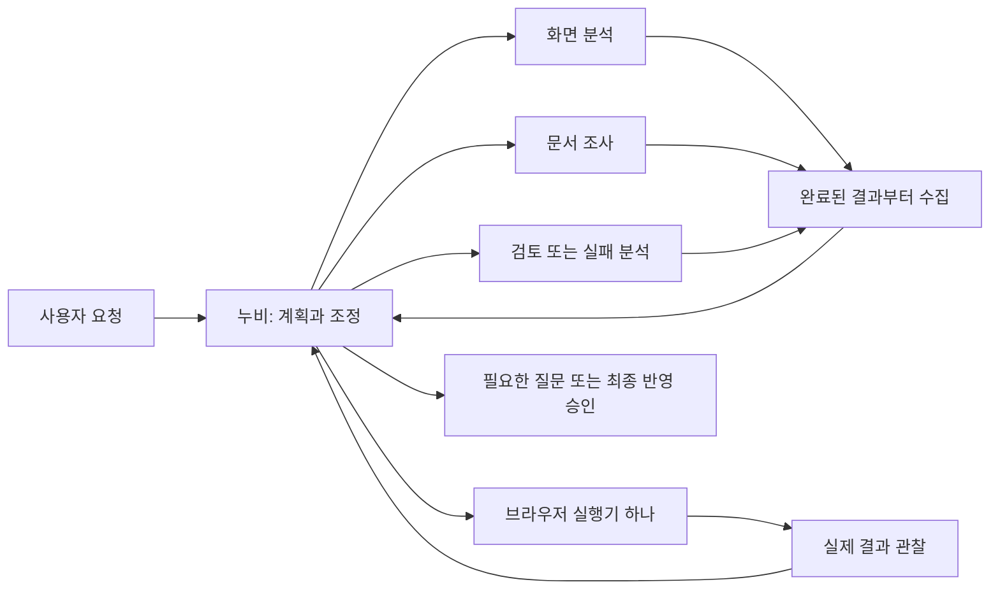

# 역할별 분석 Agent

2026-09-23 갱신. 로컬 구현 후보 `1.0.0-beta.12` / Chrome `1.4.15`. 표시 버전은 `Beta 1.0.0`이다. 공개된 beta11과 구분하며, 실계정 Qwen 성능과 비용 개선은 아직 측정하지 않았다.

## 선택

**설치된 MIT Pi `0.86.1`을 유지하고 브라우저용 조정 계층을 추가했다.** Qwen 3.8 27B 기준의 기존 제공자 어댑터, 작업 계획, 도구 피드백과 검증을 재사용한다. 새 로컬 실행기나 서버 설치는 필요 없다.

| 비교 대상 | 확인한 내용 | 적용 |
| --- | --- | --- |
| [Pi 공식 subagent](https://github.com/earendil-works/pi/tree/main/packages/coding-agent/examples/extensions/subagent) | 독립 문맥과 병렬 실행 예제. 실제 구현은 Node 자식 프로세스를 실행한다. | 브라우저 안에서 독립 `Agent`를 생성한다. 예제의 프로세스 실행 코드는 가져오지 않는다. |
| [Deep Agents JS](https://docs.langchain.com/oss/javascript/deepagents/subagents) | 역할별 지침, 좁은 도구 집합, 문맥 격리와 짧은 결과 반환. [비동기 도구](https://docs.langchain.com/oss/javascript/deepagents/async-subagents)는 실행과 결과 수집을 분리한다. | 시작, 다음 결과 수집, 중지, 근거 조회 패턴을 적용한다. LangChain/LangGraph 런타임을 중복 설치하지 않는다. |
| [Anthropic 다중 Agent 사례](https://www.anthropic.com/engineering/multi-agent-research-system) | 명확한 작업 분담, 근거 참조, 평가와 복구가 중요하다. 다중 Agent는 토큰 소비를 늘릴 수도 있다. | 필요한 독립 분석만 위임한다. 주 문맥 크기와 전체 API 사용량을 구분한다. |
| [Browser Use 실제 구현](https://github.com/browser-use/browser-use/blob/main/browser_use/agent/service.py) | 실패를 다음 모델 입력에 돌려주고 정체 시 계획을 수정하도록 안내한다. | 실패 기록과 현재 화면을 분석해 다른 접근을 고른다. Python 런타임을 확장에 이식하지 않는다. |

이 선택은 MV3, 기존 Pi 통합과 제공자 계약에 대한 적합성 판단이다. 오픈소스 전체의 성능 순위나 Qwen 정확도 우위를 뜻하지 않는다. 외부 소스를 복사하지 않고 설치된 Pi API와 확인한 패턴으로 구현했다.

## 실행 흐름

최대 두 담당이 동시에 분석한다. 누비는 분석을 시작한 뒤 독립적인 작업을 계속한다. 완료된 요약은 Pi의 `prepareNextTurn`에서 다음 판단에 한 번만 전달된다. 실행 중인 다른 담당은 기다리지 않는다. 다음 단계에 결과가 꼭 필요한 경우에만 `collect_analysis`로 기다린다. 진행 중인 담당은 최근 실행 기록이 늘어나도 화면에 유지한다.

| 역할 | 자료 | 허용 도구 |
| --- | --- | --- |
| 화면 분석 | 지정한 DOM, 캡처, 관찰 결과 | 지정 근거의 구간 또는 이미지 조회 |
| 문서 조사 | 구체적인 질문과 연결된 프로젝트 | 허용된 Wiki/소스 검색과 읽기 |
| 독립 검토 | 완료 조건과 지정 근거 | 지정 근거 조회 |
| 실패 분석 | 실패한 입력, 실행 기록, 최신 관찰 | 지정 근거 조회 |
| 누비 | 사용자 요구, 제약, 계획, 결과 요약 | 기존 브라우저 도구, 질문, 승인, 검증 |

단순한 읽기나 입력은 누비가 직접 한다. 역할은 모델 이름만 보고 우열을 단정하지 않는다. 첫 구현은 현재 선택한 제공자와 모델을 사용하며, 이미지 요청만 기존 이미지 모델 경로를 따른다. 다른 제공자의 연결로 자료를 자동 전달하지 않는다.

독립적인 화면 분석과 연결된 Wiki 조사는 함께 시작할 수 있다. 서로 다른 자료 비교, 실패 원인 조사도 범위를 나눌 수 있을 때 위임한다. 한 담당의 결과가 다른 담당의 입력이 되는 작업은 순서대로 맡긴다. 같은 목표, 제약, 완료 조건, 조사량, 근거 목록의 작업은 필드나 근거 ID 순서가 달라도 기존 작업을 재사용한다. 관련 없는 작업은 취소하며 슬롯 수를 늘려 성능 향상으로 간주하지 않는다.

## 문맥과 근거

- 하위 Agent에 전체 대화를 복사하지 않는다. 작업 1,800자, 제약 800자, 완료 조건 400자와 최대 6개의 관찰 ID를 전달한다.
- 원문은 현재 실행의 메모리에 보관한다. 담당은 한 번에 최대 6,000자만 읽는다. 긴 원문은 기존 MiniSearch 7.2.0으로 해당 근거 안의 키워드를 검색하거나 다음 구간을 요청한다. 반환 구간의 원문 위치와 읽은 범위를 보존한다. 검색 결과가 없거나 일부만 읽었을 때 대상이 없다고 단정하지 않는다. 인증용 credential 객체는 프롬프트에 넣지 않는다.
- 반환은 600자 이내 요약, 최대 5개 사실과 근거 ID, 불확실성과 다음 행동이다. 실제 읽지 않은 근거를 인용하면 모델에 오류를 돌려 교정한다. 근거마다 실제 읽은 구간의 최대 320자 발췌와 성공/실패 상태를 붙인다. 실패 원인 분석 외에는 실패한 조회만 인용한 사실을 완료 보고로 인정하지 않는다.
- 큰 Wiki 원문과 하위 도구 대화는 주 대화에 합치지 않는다. 큰 주 문맥의 오래된 성공 읽기는 현재 실행에 전체 원본이 있을 때 근거 참조로 바꾸며 최근 두 읽기와 오류/이미지/쓰기는 유지한다. 주 Agent는 필요할 때 근거 ID로 원문을 확인한다. 경로와 해시는 원래 문서 조회 결과에서 유지한다.
- 작업별 effort에 따라 quick은 3회/16,000자, standard는 6회/32,000자, deep은 10회/48,000자를 할당한다. 생략하면 standard다. 마지막 호출은 추가 조사 대신 현재 확보한 원문 발췌를 정리하는 데 예약한다. 한도에 가까우면 부분 결과, 불확실성, 다음 조사 범위를 반환한다. 이때 원래 작업/제약/완료 조건은 유지하고 아직 읽지 않은 자료와 빠진 이미지를 근거로 만들지 않는다. 정리 응답 자체가 실패하면 오류와 읽은 근거 목록을 반환한다. 사용자 전체 작업을 횟수 제한으로 종료하지 않는다.
- 작업 ID와 상태는 대화 요약 밖의 실행 레지스트리에 둔다. 문맥을 압축한 뒤에도 지정 ID로 결과를 다시 받을 수 있다. 이는 현재 실행 내 보존이며, 브라우저 재시작 후 하위 세션을 복구하는 영속 저장은 아니다.

`input_characters`, `peak_input_characters`, `read_characters`, `returned_characters`는 문맥 크기 지표이며 토큰 절감량이나 정확도가 아니다. 각 보고서에는 모델 호출 수와 정상 반환된 서버 usage 합계를 넣고 누락 여부를 표시한다. 누락값은 `null`이며 0으로 만들지 않는다. 전송 재시도까지 포함한 전체 사용량은 기존 사용량 원장이 기준이다. 최종 주 Agent 컨텍스트 사용량에 하위 사용량을 더하지 않는다.

## 실행과 복구 경계

하위 Agent에는 페이지 클릭, 입력, 이동, 코드 실행, 승인, 다른 Agent 생성 도구가 없다. 브라우저 실행기는 기존 순차 실행과 실제 노드 검사를 유지한다. 문서 읽기도 현재 worker 소유권과 프로젝트 연결 검사를 통과한다.

페이지 관찰을 갱신하거나 변경하면 이전 분석 근거를 오래된 자료로 표시한다. 호버와 스크롤도 포함한다. 빈 구간 조회는 근거를 읽은 것으로 인정하지 않는다. 분석 요약은 실행 증거가 아니며 최종 검토에 성공한 브라우저 결과처럼 넣지 않는다. 누비가 최신 화면을 확인하고 `verify_page`와 기존 최종 요구사항 검토를 수행한다.

실패 복구는 다음과 같이 구분한다.

1. 일시적인 모델 연결 오류는 추론 전용 재시도로 처리한다. 대기/오류 분류/불확실한 실행의 정책은 [오류 복구](ERROR-RECOVERY.md)를 따른다.
2. 도구 실패는 입력과 결과, 부분 실행 기록을 모델에 돌려준다. 필요한 경우 실패 분석 담당에게 좁은 원인 조사를 맡긴다.
3. 모델이 현재 상태에서 다른 방법을 고른다. 완료했거나 실행 여부가 불확실한 쓰기를 다시 실행하지 않는다.
4. 한 담당의 실패는 다른 담당의 결과를 버리지 않는다. 교정 가능한 보고 형식과 근거 오류는 해당 담당만 다시 판단한다.
5. 사용자 정보가 부족하면 주 Agent가 질문한다. 최종 등록/발송은 기존 승인 절차를 따른다.

사용자 취소, 질문/승인 대기, 완료 시 하위 요청도 취소한다. 뒤늦은 결과는 다음 대화에 넣지 않는다. 진행 표시도 취소로 정리한다. 단일 작업과 다중 분석 모두 기존 결과 검증을 건너뛰지 않는다.

## 진행 표시

기존 CX/사용자 HTML 토큰과 채팅 Markdown 렌더러를 공유한다. 진행 설명은 굵게, 코드, 목록, 링크를 지원하고 짧은 도구 표시명에는 인라인 Markdown을 적용한다. 실행 상태 아이콘은 실제 도구 이벤트를 따른다. 원시 HTML과 외부 이미지 로딩은 허용하지 않는다. 목록 애니메이션을 중첩하지 않고 글자의 불투명도를 낮추지 않는다.

## 검증과 남은 범위

단위 검사와 실제 Chrome의 합성 Qwen 응답으로 문맥 격리, 요청 동시성, 먼저 완료된 결과 수집, 실패 후 접근 변경, 취소, 근거 제한, 사용량 및 마크다운 표시를 확인한다. `tests/role-agents-browser.mjs`와 `tests/analysis-delivery-browser.mjs`는 새 프로필에서 실행하며 `verify:browser`의 반복 대상이다. 후자는 기본 전용 창에서 첫 분석 자동 전달, 다른 분석 중 초안 입력과 실제 값 검증, 원래 탭 보존과 새로고침 후 중복 입력 방지를 검사한다.

실제 AI Pro Qwen 평가에 필요한 `NUBI_EVAL_TOKEN`은 현재 실행 환경에 설정되어 있지 않다. 실제 요청 정확도, 지연과 총 토큰의 단일/다중 비교는 미실행이다. 합성 검사의 사용량 수치는 집계 계약 검증에만 사용한다.

아직 구현하지 않은 범위는 역할별 다른 제공자 선택, 하위 작업의 재시작 복원, 독립적인 여러 브라우저 쓰기 세션이다. 이 후보는 현재 연결 안에서 읽기 분석을 분리하는 첫 적용이다. 공개 릴리스 파일은 이 문서 작성만으로 교체하지 않는다.

Anthropic 공식 사례와 이번 조사량/문맥/근거 개선의 선택은 [적용 기록](ANTHROPIC-HARNESS-QUALITY.md)에 정리했다.
