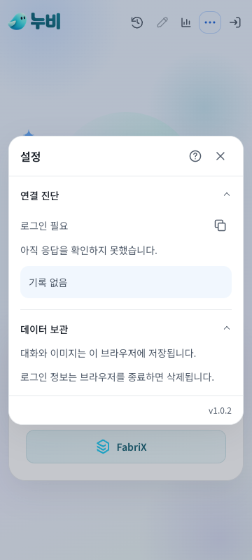
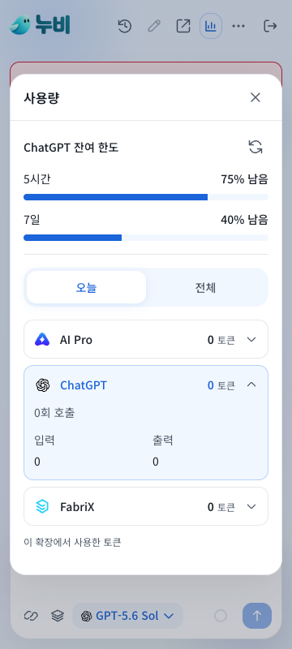
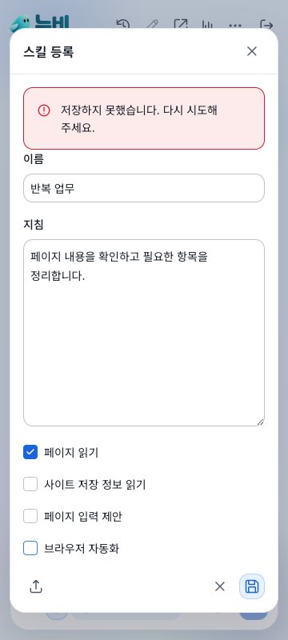

# 1.0.2 모달 글꼴과 가독성

연결 진단은 본문 12px과 기본 고정폭 로그 글꼴, 데이터 보관은 본문 14px을 사용하고 있었습니다. 모달 공통 스타일을 정리해 설정, 도움말, 모델 선택, 스킬 목록/편집, 사용량, 컨텍스트, 대화 이력, 삭제 확인, 초안 수정, 입력 확인, 이미지 확대에 적용했습니다.

- 글꼴: Noto Sans KR
- 제목: 16px, 본문/항목명/입력/버튼: 14px
- 날짜/단위/버전: 12px, 컨텍스트 대표 수치: 24px
- 진단 기록도 본문 글꼴로 표시하고 긴 내용은 줄바꿈
- 한국어 문구는 단어를 유지해 줄바꿈하고, 긴 주소/파일명은 화면 안에서 줄바꿈
- 설정/사용량/스킬/컨텍스트/도움말의 반복 문구를 줄이고 필요한 동작과 설명만 유지

승인, 삭제 대상, 데이터 보관, 지원 범위와 실패 복구 안내는 유지합니다. 코드 결과물의 고정폭 글꼴과 기존 CX 색감/상단 토스트/모션은 유지합니다.

## 확인

`npm run design:check`와 `npm run build:candidate` 통과. 실제 Chrome 확장에 설치한 최종 빌드로 아래 5개 검사를 통과했습니다.

| 검사 | 범위 |
| --- | --- |
| ui-simplicity-browser | 320/360/1100px, 48개 화면 상태의 글꼴 459개. 접힌/펼친 항목, 도움말 전 주제, 모델 목록, 저장 오류, 삭제 확인, 모션 감소 |
| accessibility-browser | 설정 키보드/초점 복귀, 진단 복사, 재진입, 접근성 경고 없음 |
| approval-browser | 초안 수정 글꼴, 입력/검증/승인과 오래된 승인 거절 |
| captures-browser | 이미지 확대 글꼴, 다운로드, 사이드 패널, 보관/삭제 |
| page-skills-browser | 입력 확인 글꼴, 승인 후 반영, 오류 검증, 스킬 가져오기/내보내기 |

[검증 기록](evidence/1.0.2-report.json). 실제 브라우저 동작은 로컬 테스트 페이지와 합성 모델 응답으로 확인했습니다. 실계정 SSO나 회사 페이지를 검증한 결과가 아닙니다.

시각 검토:

검사한 후보 ZIP을 재빌드 없이 설치 파일로 승격했습니다.

- 파일: `aipro-chat-extension-1.0.2.zip`
- SHA-256: `10f5970392a94b258791a79a3b41f605914a9195be8041189b7e48d600f11309`
