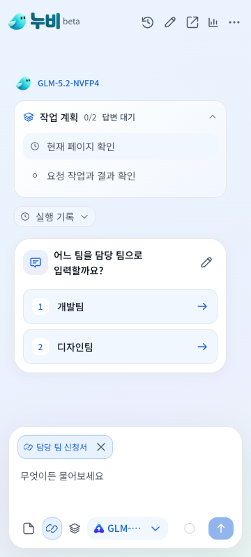

# 결과를 보며 이어가는 브라우저 작업 검증

표시 버전 **Beta 1.0.0**, Chrome 내부 버전 **1.4.10**, 패키지 **1.0.0-beta.7**.

## 변경

기존 Pi Agent Core의 실행 훅을 사용해 도구 결과를 모델이 확인한 뒤 다음 행동을 선택하도록 바꿨다. 한 응답에 읽기와 추측 입력이 함께 생성되어도 입력을 먼저 실행하지 않는다. 계획과 도구 선택은 실제 작업 앞에 함께 처리한다.

Playwright는 클릭, 선택값 변경, 이동과 새 창 전환 뒤에 새 관찰을 반환한다. 후속 행동은 다음 모델 판단에서 선택한다. 이미 확인한 입력란들은 함께 작성할 수 있다. 부분 실행의 명령 기록을 전달하므로 이전 입력이나 창 열기를 반복하지 않고 남은 작업을 이어갈 수 있다.

필수 정보가 없으면 질문 카드로 멈추고 답변 후 원래 목표를 이어간다. 초안은 검증 후 승인을 받으며 연필로 수정하면 다시 반영하고 검증한다. 누적 실행 횟수 제한이나 새로운 외부 실행기는 추가하지 않았다. 세부 계약과 오픈소스 선택은 [설계 기록](ADAPTIVE-TOOL-TURNS.md)에 있다.

## 검증 결과

- 단위 검사 **303개**, 디자인 검사와 빌드 통과.
- 관련 Chrome 검사 **15개 스위트 37회** 통과. 핵심 11개는 새 프로필로 각 3회 반복하고 제공자와 승인, CSP 검사 4개를 추가했다.
- 별도로 질문과 재개 검사 **1회** 통과. 당시 테스트가 HEADED 설정을 읽지 않아 이 기록은 headless 검사이며 창 표시 검증으로 간주하지 않는다. 해당 설정은 후속 릴리스에서 수정했다.
- ZIP의 **416개 파일**이 검사한 dist와 같음을 확인했다. 후보 ZIP을 다시 빌드하지 않고 배포한다.

[통합 결과](evidence/beta-1.0.0-adaptive/report.json), [창을 띄운 검사](evidence/beta-1.0.0-adaptive/headed/report.json), [팝업과 승인](evidence/beta-1.0.0-adaptive/popup-approval-browser.json), [스크립트 복구](evidence/beta-1.0.0-adaptive/script-preflight-browser.json).

초기 검사에서는 팝업 닫기와 다음 클릭이 한 스크립트에서 모두 실행된다는 기존 fixture의 기대값이 실패했다. 팝업을 닫은 뒤 부분 실행과 새 관찰을 확인하고 다음 호출에서 한 번 클릭하도록 fixture를 수정했다. [실패 기록](evidence/beta-1.0.0-adaptive/prior-failed-report.json)과 [실패 로그](evidence/beta-1.0.0-adaptive/prior-failed-script-preflight.log)를 보존했다. 패키지 코드는 바꾸지 않았으며, 선행 통과 기록과 후속 반복 기록은 동일한 빌드 해시로 검증했다. 후속 검사는 서로 다른 프로필에서 최대 3개 스위트를 병렬 실행했다.

- 빌드 트리 SHA-256: `57c904f665867284fde3f3f1d78caf23a67a59e106b0c0d72626b6c094d94e7e`
- ZIP SHA-256: `5e361ea74643b2af6d1279c9cafa2e990e5b62908480aaab2e6aba77e2b6fadd`

## 확인한 흐름

읽기와 추측 입력이 섞인 응답에서 읽기만 실행하고, 필요한 값을 질문한 뒤 새로고침과 답변을 거쳐 한 번 입력한다. 새 창과 noopener 탭을 확인한 다음 초안을 작성하고 검증한다. 다른 탭이 활성화되어도 원래 초안에 수정사항을 반영하고, 새 승인 후 등록을 한 번만 실행한 뒤 부모 화면에서 결과를 확인한다.

선택값 변경, iframe, shadow DOM, 가려진 요소, 늦게 나타나는 입력란, 문법 오류와 부분 실행 복구도 검사했다. 화면에서 이미 확인한 입력란 65개의 묶음 처리와 기존 중지 동작은 유지된다. 보류된 도구 제안은 실행 기록이나 실패로 표시하지 않는다.

브라우저 검사에는 합성 사이트와 합성 모델 응답을 사용했다. 실제 Chrome 입력과 클릭을 검증했으며, 실제 사내 페이지나 AI Pro/ChatGPT/FabriX 계정의 성공률을 측정한 것은 아니다. 전체 기능 행렬 재검사도 아니다. [실모델 평가](evidence/beta-1.0.0-adaptive/agent-live-evaluation.json)는 `NUBI_EVAL_TOKEN`이 설정되지 않아 미실행이다.

## 설치

[설치 ZIP](https://github.com/plaire48/ai_workspace/releases/download/nubi-v1.0.0-beta.7/nubi-beta-1.0.0.zip). 기존 설치 폴더의 파일을 교체한 뒤 확장 관리에서 새로고침한다. 표시 버전은 Beta 1.0.0이며 내부 업데이트 번호는 1.4.10이다.
