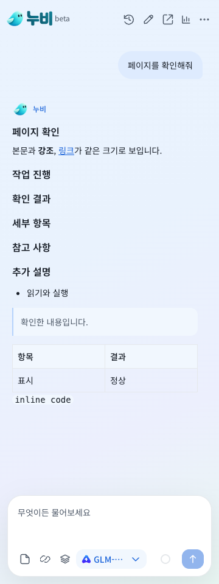

# 링크와 질문 흐름 검증

첫 후보의 검증 이력이다. 이후 토글 인식, 모델 연결 복구와 Qwen 기본값을 추가했다. 실제 배포 파일과 최종 검증은 [브라우저 코파일럿 검증](VERIFICATION-BETA-1.0.0-CONTROLS.md)을 따른다.

표시 버전 **Beta 1.0.0**, 내부 업데이트 **1.4.11**, 패키지 **1.0.0-beta.8**.

## 변경

텍스트, 카드와 아이콘 링크를 실제 DOM 참조로 실행한다. `display: contents` 링크와 이벤트/포인터 후보를 관찰에 포함하고, 일반 카드를 결제 입력란으로 오인하던 필터를 수정했다. “신청 내역 보기”와 “등록 화면 열기”는 준비 단계로 구분하며 실제 발송과 등록 승인은 유지한다. 가림이나 비활성은 구체적인 복구 사유를 반환한다.

계획 단계에서 필요한 정보를 질문할 수 있다. 검토가 보완을 반복해도 오류 문구로 종료하지 않고 객관식 또는 서술형 질문을 띄운다. 새로고침 후 답변하면 원래 목표를 이어가며 같은 입력을 반복하지 않는다.

제목은 16/24px, 본문은 14/22px, 날짜와 버전은 12px로 통일했다. 질문, 승인, 모달과 채팅에 같은 Noto Sans KR를 사용한다. 코드 블록은 기존 모노스페이스 13px를 유지한다. 설계 근거와 오픈소스 비교는 [링크 실행 기록](BROWSER-LINK-RELIABILITY.md)에 있다.

## 결과

- 단위 검사 **304개**, 디자인 검사와 빌드 통과.
- 관련 Chrome **17개 스위트, 33회** 통과. 핵심 8개를 새 프로필에서 각 3회 반복했다.
- 실제 창을 띄운 링크와 질문 재개 검사 **2회** 추가 통과. HEADED 옵션이 실제 headless 설정에 적용되는 것을 확인했다.
- **320/360/1100px**에서 제목, 본문, 입력란, 질문/승인과 펼친 설정의 계산 스타일을 검사했다.
- 설치 ZIP **416개 파일**이 검사한 dist와 바이트 단위로 일치한다. 검사 뒤 재빌드하지 않았다.

[통합 결과](evidence/beta-1.0.0-guided/report.json), [실제 창 검사](evidence/beta-1.0.0-guided/headed/report.json), [링크 실행](evidence/beta-1.0.0-guided/link-actions-browser.json), [질문과 재개](evidence/beta-1.0.0-guided/clarification-browser.json), [계산 스타일](evidence/beta-1.0.0-guided/typography-browser.json).

일반/영역 없는/이벤트/카드/아이콘/iframe/shadow/new-tab 링크와 조회/작성 화면 열기를 확인했다. 가림과 비활성은 클릭하지 않으며 최종 발송 링크는 승인을 요구한다. 계획 질문, 검토 질문, 진전 없는 보완의 질문, 직접 답변과 재개, 팝업 초안 수정과 승인도 검사했다.

초기 후보에서는 계획 도구가 update_plan만 있다는 이전 fixture가 실패했다. 새 계약의 ask_user를 포함하도록 수정했다. 폰트 검사에서 아이콘 전용 버튼의 숨겨진 라벨을 일반 본문처럼 검사한 부분도 수정했다. 실패를 보존하고 최종 후보는 전체 선택 범위를 새로 검사했다. [계획 fixture 기록](evidence/beta-1.0.0-guided/prior-planning-fixture-report.json), [폰트 fixture 기록](evidence/beta-1.0.0-guided/prior-typography-fixture-report.json).

- dist SHA-256: `32c572a04645f4d09983bdcfc207c6a54a358a05876cdc6a479cd4638892e00c`
- ZIP SHA-256: `8a66852ccafa789ea010eb905d5e83dd9613c5e139c58ed2a7f01e288f95e5af`

합성 사이트와 합성 모델 응답을 이용한 실제 Chrome 검사다. 사내 실제 페이지나 AI Pro/ChatGPT/FabriX 실계정의 성공률을 측정한 결과는 아니며, 전체 기능 행렬 재검사도 아니다.

## 설치

이 후보를 그대로 배포하지 않았다. [최종 검증 기록](VERIFICATION-BETA-1.0.0-CONTROLS.md)의 ZIP을 기존 설치 폴더에 덮어쓴 뒤 확장 관리에서 새로고침한다.
