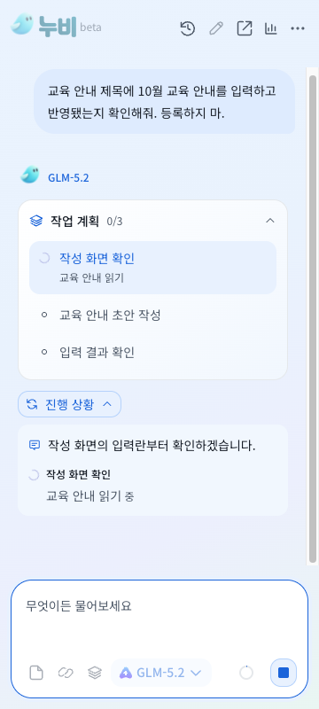

# 작업 계획과 실시간 진행 표시

표시 버전 **Beta 1.0.0**, Chrome 내부 버전 **1.4.9**, 패키지 **1.0.0-beta.6**.

## 변경

채팅에 작업 계획을 먼저 보여주고, 현재 도구가 실행되는 동안 최근 진행 기록을 펼친다. 모델의 짧은 공개 진행 설명과 실제 도구 상태를 함께 표시한다. 읽기/입력/검증 행의 스피너는 도구 종료 이벤트가 오면 같은 행의 완료 아이콘으로 바뀐다. 다른 실패 때문에 실행하지 않은 호출은 실행 보류로 구분한다.

모델이 계획 없이 작업을 요청하면 같은 제공자에 계획만 먼저 요청한다. 계획을 저장하기 전에는 해당 작업 도구를 실행하지 않는다. 계획 생성 요청의 사용량도 기존 집계에 포함한다. 일반 대화와 선행 질문에는 계획을 강제하지 않는다.

단계별 완료 수와 현재 단계를 표시한다. 질문, 승인 대기, 중단 시 미완료 단계를 유지하며 최종 요구사항 검토가 통과하기 전에는 전체 완료로 만들지 않는다. 진행 기록의 표시용 `progress` 필드는 실제 도구 인자, 중복 쓰기 판정과 검증 근거에서 제외한다. 모델의 비공개 reasoning 필드는 표시하거나 저장하지 않는다.

계획과 기록은 답변에 연결해 다음 대화, 새로고침, 이력 선택 뒤에도 유지한다. 작업 중 최근 4개 기록을 보이고 아이콘으로 전체 기록을 펼친다. 완료하면 실행 기록을 접는다. CX 토큰, Noto Sans KR, 14px 본문과 12px 보조 글씨, 기존 HTML의 옅은 색과 모션 감소 설정을 사용한다.

## 실제 탭 제어

[Claude Chrome 방식 검토](CHROME-AGENT-REFERENCE.md)를 기록했다. 누비는 기존 Playwright CRX의 실제 Chrome 디버거 경로로 조작하며, 로그인과 단순 읽기는 디버거를 연결하지 않는다. 새 탭/창 추적과 작업 종료 시 해제를 회귀 검사한다. 탭 그룹 UI와 범용 콘솔/네트워크 수집 기능은 이번 변경에 포함하지 않는다.

## 검증

단위 검사 **300개**, 디자인 검사, 빌드와 관련 브라우저 **25개 스위트 41회**가 통과했다. 핵심 진행/복구/질문/새 탭/승인/실행 검사는 새 프로필에서 각 3회 수행했다. 별도로 창을 띄운 진행 표시와 디버거 검사 2회도 통과했다.

[통합 결과](evidence/beta-1.0.0-progress/report.json), [진행 표시](evidence/beta-1.0.0-progress/task-plan-browser.json), [창을 띄운 진행 검사](evidence/beta-1.0.0-progress/headed/task-plan.json), [창을 띄운 디버거 검사](evidence/beta-1.0.0-progress/headed/browser-debugger.json), [녹화](evidence/beta-1.0.0-progress/task-plan-demo.webm).

초기 검사에서 새 계획 호출을 누락한 출력 복구 fixture의 사용량 기대값이 실패했다. 실제 입력/검증은 통과했고 집계에는 계획 호출이 포함되어 있었다. 모든 요청을 세도록 fixture를 수정한 뒤 해당 검사와 남은 스위트를 실행했다. [실패 기록](evidence/beta-1.0.0-progress/prior-failed-report.json)을 보존했으며 앞서 통과한 스위트는 변경하지 않았다. 통합 결과는 아래 동일 빌드의 선행 통과 로그와 후속 로그를 합친 기록이다.

- 빌드 트리 SHA-256: `75e78e0d590e78a990e0df029787cb9bd5e2c6d8be2d529de0df5c0bfe452314`
- ZIP SHA-256: `b4f66759244c2b6125c92485fa733bbe448ba857d0c180c523d8f4b822b9c1eb`

진행 표시 검사는 계획 없는 모델 응답 → 계획 저장 → 실제 페이지 읽기 → 입력 → 결과 검사 → 최종 검토를 실행한다. 실제 입력은 한 번만 일어나고, 계획의 3/3 완료 표시는 최종 검토가 끝난 후에 나타난다. 오류 복구, 승인, 질문, 컨텍스트 재개와 제공자별 전송 검사는 기존 시나리오와 함께 확인한다.

화면 중단 표시는 저장 상태를 주입한 검사이며, 실제 중단 후 재개는 별도 context-browser 검사로 확인한다. Chrome의 사용자 취소 이벤트는 테스트에서 전달한다. 브라우저의 기본 디버깅 표시줄을 사람이 눌렀다고 주장하지 않는다.

모델 응답과 사이트는 합성이다. 실제 Chrome 입력/클릭/탭 전환과 UI 검증을 실제 AI Pro/ChatGPT/FabriX 계정이나 모델 자율 판단 성능 검증으로 해석하지 않는다. 전체 기능 행렬 재검사도 아니다.

## 설치

[설치 ZIP](https://github.com/plaire48/ai_workspace/releases/download/nubi-v1.0.0-beta.6/nubi-beta-1.0.0.zip). 기존 설치 폴더에 덮어쓴 뒤 확장 관리에서 새로고침한다. 통과한 후보 ZIP을 다시 빌드하지 않고 배포한다.
