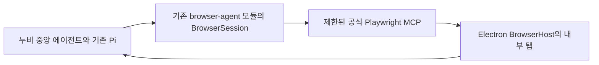

# 기존 중앙 에이전트와 브라우저 모듈 연결

누비 중앙 에이전트가 요청, 계획, 모델 호출, 질문, 승인과 결과를 계속 소유한다. 오른쪽 브라우저에는 웹페이지만 표시한다. 별도 브라우저 에이전트 대화창, 요청창, 작업 생성 API나 모델 루프는 추가하지 않는다.

## 화면과 실행 구조

화면은 기존 Electron `BrowserHost`의 `WebContentsView`다. HTML `<webview>` 태그나 별도로 실행하는 Chrome 창이 아니다. 공식 Playwright MCP는 기존의 탭 전용 연결로 해당 내부 탭만 제어한다.

`runtime/browser-agent-host.mjs`가 독립 `packages/nubi-browser-agent`의 기존 core에 호스트 기능을 주입한다. 일반 웹 작업의 열기, 관찰과 입력/클릭도 이 연결을 사용한다. 기존 `open_workspace_page`는 Desktop에서 같은 브라우저 실행 경로로 들어간다. 이미 사람이 열어 둔 일반 탭은 중앙 에이전트의 첫 snapshot에서 해당 작업에 연결할 수 있다.

새 모델이나 자격 증명 저장소를 만들지 않았다. 기존 Pi가 다음 도구를 선택하고, 기존 MCP 질문 폼과 Windows 알림이 승인 여부를 결정한다. 승인된 정확한 인자에만 모듈의 실행 허용을 주입한다. 로그인/인증 탭, 임의 JavaScript, 쿠키와 파일 접근의 기존 제한을 유지한다.

## 개발 작업 연결

`open_development_preview(processId, url?)`는 해당 작업의 살아 있는 서버와 관찰한 URL의 HTTP 응답을 확인한 뒤 기존 인앱 탭을 열거나 재사용한다. 새 탭 열기는 기존 MCP 승인을 사용한다. 같은 미리보기 요청으로 서버나 탭을 중복 생성하지 않는다. 일반 웹 작업에는 개발 서버를 요구하지 않는다.

이후 중앙 에이전트가 반환된 tabId, documentId와 관찰한 ref로 기존 Playwright 도구를 호출한다. 호스트는 현재 작업/탭/문서와 snapshot 버전을 대조하고 BrowserSession의 durable checkpoint에 실행 기록을 먼저 남긴다. 개발 미리보기는 관찰한 서버 origin에 한정하며 일반 웹 작업의 승인된 이동은 일반 HTTP(S) 페이지를 지원한다.

입력/클릭이 확인된 뒤에는 새 DOM 결과를 같은 모델에 돌려준다. 후속 관찰만 실패했을 때 이미 확인한 동작을 반복하지 않는다. 불확실한 입력은 불확실한 상태로 보존하며 현재 페이지를 읽을 수 있어도 다시 입력할 권한으로 바꾸지 않는다. 중앙 대화의 중지는 같은 BrowserSession도 취소한다. 대화별 controller proxy와 프로젝트 호스트가 같은 SQL store의 한 모듈 인스턴스를 공유한다.

독립 결과 검토에는 현재 연결된 탭과 프로세스, 모듈의 실제 readback을 전달한다. 다른 탭, 중지한 서버, 오래된 문서와 단순 페이지 열기는 개발 동작 성공으로 승격하지 않는다. HTTP 200, 도구 실행 확인, 실제 요구사항 만족은 각각 구분한다. `functionalVerified:false`는 도구 수준에서 유지하며 최종 의미 판단은 기존 검토 흐름이 맡는다.

## 적용과 검증

`scripts/build-browser-agent-core.mjs`는 기존 모듈의 core 원천만 esbuild로 묶는다. 선택 Page/Stagehand 어댑터의 peer dependency를 새로 설치하지 않는다. `npm test`의 pretest와 기존 runtime 빌드가 같은 core를 준비하고 최종 Electron 번들 안에 포함한다.

최초 실패와 최종 로그, 실제 Electron 캡처, 소스/빌드 해시는 [검증 폴더](../verification/development-browser-2026-10-16/)와 해당 폴더의 `implementation-summary.json`에 기록한다.

- 일반 웹의 모듈 연결과 관찰 전 입력 거절, 개발 서버/탭 재사용, 정확한 승인 후 입력 1회, 불확실한 실행 재전송 거절, 변경된 문서/대상/사이트와 중지 후 거절을 검사한다.
- 기존 Pi의 열기/입력 승인과 같은 작업 이어쓰기를 검사하고, 실제 독립 검토 입력에 연결된 브라우저 기록이 도착하는지 확인한다.
- 실제 Electron `WebContentsView`와 IPC, 공식 MCP, 기존 Pi와 BrowserSession을 함께 실행한 시험에서 한글 입력, 버튼 클릭, 결과 DOM 재읽기, 탭 1개와 서버 1개를 확인한다. 모델은 scripted fixture이며 실제 모델의 자율 판단 성적이 아니다.
- 빌드한 앱은 중앙 대화 입력창 하나와 기존 오른쪽 웹 화면을 유지하는지 확인한다. 브라우저 안의 별도 요청창을 만드는 중간 시도는 사용자 정정 후 제거했다. 기존 BrowserPane, renderer, ToolsMenu와 공통 스타일은 작업 시작 전 바이트와 일치한다.

현재 Desktop 어댑터의 관찰 범위는 기존 제한 MCP의 snapshot과 탭/문서 ID다. 독립 모듈의 선택 Page 기반 구조 관찰, 화면 위키 학습, 절차 재생과 Stagehand까지 전부 연결했다는 뜻은 아니다. 자동 reconciliation을 추측해 불확실한 동작을 완료 처리하지 않는다. 실제 모델/사내 로그인/Windows 설치판과 해당 선택 기능의 제품 성적은 이번 로컬 연결 검사로 입증하지 않는다. 문맥 압축 기본값 75%도 유지한다.

최종 검사: 전체 1,676개 중 1,480 통과, 196 건너뜀, 실패/취소 0개다. 관련 집중 검사 74개, 기존 Electron 화면 22개와 중앙 입력/브라우저 화면 검사 3개를 통과했고 Electron 빌드와 디자인 검사를 통과했다. 전체 검사 시작 이후 실행 원천 해시는 변하지 않았다. 실제 Electron 모듈 연결 시험은 열기/입력/클릭의 기존 승인 3건, 확인된 입력 동작 2건, 탭 1개와 서버 1개를 기록했다.
