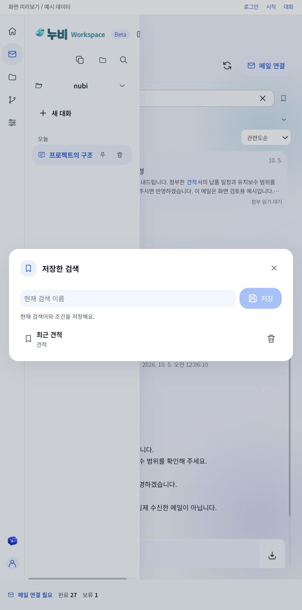

# 누비 Workspace 기능 품질 점검

후속 변경과 현재 빌드는 [사이드바/Office 후속 점검](QUALITY-FOLLOWUP-2026-10-05.md)을 따른다. 아래 해시와 확인 기록은 첫 점검 시점의 결과다.

2026-10-04부터 2026-10-05까지 현재 Electron 구현을 이전 요청과 대조하고 누락된 연결과 실패 처리를 수정했다. 사용자 결정에 따라 자동 테스트는 실행하지 않았다. **Electron 빌드 성공, 소스 계약 검토, 예시 데이터 화면의 직접 확인**을 구분한다. 실계정, Windows 설치판과 실제 모델 품질의 전체 통과 보고서가 아니다.

## 이번에 발견하고 수정한 문제

| 문제 | 반영 | 확인 범위 |
| --- | --- | --- |
| 메일의 고정, 태그와 저장한 검색이 백엔드에만 있고 화면에서 사용할 수 없음 | 원문에 작은 고정/태그 아이콘, 검색 옆 북마크, 접힌 추가 조건을 연결했다. 저장한 검색은 이름 하나로 등록하고 선택하면 검색어/조건/정렬을 함께 복원한다. | 예시 메일을 고정하고 태그를 저장한 뒤 조건 검색 1개, 저장/복원/삭제를 직접 확인했다. 실제 SQLite 재시작 복원은 소스 검토이며 이번 실계정 확인은 아니다. |
| 필터 제안과 저장한 검색을 열 때 원문과 첨부를 모두 다시 읽음 | 제안은 수집 메타데이터와 로컬 태그만 조회한다. 원문/첨부 검색은 기존 해시와 색인 검증을 유지한다. | 소스 검토. 많은 실제 메일의 처리 시간은 미측정이다. |
| 이전 메일/첨부의 늦은 응답이 다음 선택을 덮어쓸 수 있음 | 원문 선택 세대와 생존 여부를 근거 조회, 첨부 표시, 실패 토스트까지 대조한다. | 첫 메일을 지연시킨 예시 화면에서 다음 메일을 선택했고 다음 원문이 유지됐다. |
| 저장 실패를 사용자가 복구하기 어려움 | 고정은 성공 응답 뒤에만 갱신하고 태그 저장 실패는 모달과 입력 초안을 유지한다. 중복 저장을 막고 공통 2초 CX 토스트를 사용한다. | 저장 오류 예시에서 고정은 false, 태그 입력은 그대로 남고 오류 토스트가 표시되는 것을 확인했다. |
| 터미널 실행 응답이나 상태 조회가 끊기면 실행 종료처럼 취급할 수 있음 | 요청 ID에 실행을 묶고 시작 전 프로세스 기록에도 ID를 남긴다. 응답 유실은 읽기 전용 영수증 조회로 복구한다. 상태 조회는 겹치지 않게 순차 호출하고 실패 간격을 늘린다. | 예시 실행 응답과 후속 조회 3회를 실패시켜 입력 잠금/복구 안내/출력 복원/종료 후 해제를 확인했다. 예시 실행 횟수는 1회다. 실제 셸/전송 장애는 이번에 실행하지 않았다. |
| 실행 확인 전 터미널 닫기와 폴더 변경이 가능함 | 실행/미확정 상태는 즉시 잠그고 완료 확인 전 탭 닫기와 프로젝트 변경을 차단한다. 파일/웹과 같은 위치와 크기의 X를 터미널 탭에 추가했다. | 예시 실행 중 X로 닫히지 않고 완료 후 닫히는 것을 직접 확인했다. |
| GHES 회사 인증이 Desktop에서 암호화 파일로 저장됨 | Device Flow 계약은 유지하고 Desktop keyStore를 실행 중 Map으로 바꿨다. 종료 시 메모리를 지우며 기존 `ghes.enc`는 읽거나 사용하지 않는다. | main 번들 및 소스 확인. 기존 파일 삭제, 실제 회사 SSO와 재로그인은 수행하지 않았다. |
| Office 템플릿/슬라이드쇼와 확장자가 누락된 첨부를 지원 형식으로 선택하지 못함 | 기존 PDF/Mammoth/ExcelJS/SAX 파서에 DOCM/DOTX/DOTM, XLSM/XLTX/XLTM, PPTM/PPSX/PPSM/POTX/POTM와 알려진 MIME 선택을 추가했다. 첨부 종류 필터도 같은 확장자를 인식한다. | 빌드와 파서 소스 검토. 각 형식의 실제 파일 해석, 매크로/이미지/노트/재계산은 성공 검증하지 않았다. 매크로를 실행하지 않는다. |
| README가 Theia를 현재 실행 화면으로 설명함 | 현재 Electron/React Arborist/Monaco/xterm 구성, 메일 OFF/ON, 메모리 인증과 이번 확인 범위를 반영했다. | 문서와 현재 진입점 대조. 이전 검사 기록은 유지하지만 현재 성적에 합산하지 않는다. |

## 요청별 현재 상태

| 영역 | 현재 연결과 유지 계약 | 남은 확인/개발 |
| --- | --- | --- |
| 중앙 대화, 큐와 진행 | 브라우저 확장의 계획/발화/Trace/질문 폼/큐를 재사용한다. 입력과 근거를 보존하며 현재 실행 순서에 표시한다. 사용자 입력을 자동 승인으로 취급하지 않는다. | 실제 복합 요청의 완주, 검색 정확도, 중단/재개 품질은 실모델 고정 과제로 별도 측정해야 한다. |
| 모델/추론/문맥 | AI Pro Low/Medium은 `reasoning_effort`, Extra high는 해당 키워드 생략 계약을 유지한다. FabriX는 추론 설정을 보내지 않는다. 제공자 목록과 모델 선택을 유지한다. 보고된 사용량과 추정치를 구분하고 모델 창의 75%를 압축 기준으로 사용한다. | 실제 AI Pro/ChatGPT 요청 성공과 카탈로그 변화는 재측정하지 않았다. 모달/UI 확인은 응답 성공 증거가 아니다. |
| 위키 | 폴더/Git 연결 후 선택 모델로 호스트 백그라운드 초기화를 수행한다. 실제 처리 개수와 단계 진행을 사용하며 사용자 위키와 해시가 바뀐 소스를 보호한다. | 실제 큰 저장소의 처리 시간과 품질, 모든 코드가 문서화됐는지는 미측정이다. |
| 파일 | 탐색과 필터, Monaco 편집, 더블클릭 파일 탭과 변경 파일 목록의 해당 파일 열기를 연결한다. dirty/undo/원본 해시/readback을 유지한다. | Windows 대형 파일/특수 인코딩/권한 제한과 실제 장시간 편집은 미확인이다. 지원 밖 파일을 강제로 재인코딩하지 않는다. |
| Git | 브랜치와 커밋별 파일, +/- 개수, 첫 부모 또는 최초 커밋의 읽기 전용 Monaco 비교를 연결한다. | 이번 화면 확인은 예시 커밋과 diff다. 실제 다양한 브랜치/merge/binary/rename 조합 전체를 다시 실행하지 않았다. |
| 터미널 | 프로젝트 범위, 선택한 OS 셸, xterm 출력과 실행 영수증을 연결한다. Windows PowerShell은 기존 UTF-16LE 명령/UTF-8 출력 처리를 유지한다. | 실제 Windows 한글 출력과 프로세스 종료는 미확인이다. 호스트 재시작의 미확정 실행은 `interrupted`이며 자동 재실행하지 않는다. |
| 메일 수집/정리 | 화면과 독립된 호스트에서 POP3 UIDL 영수증을 비교한다. OFF는 새 수집/첨부 읽기/원본 저장/모델 호출을 멈추고 ON/재로그인은 서버에 남은 미수신 자료를 이어 받는다. 실제 작업 수와 시간을 표시한다. | 실제 Gmail/회사 POP3 재연결과 누락 복구를 이번에 재측정하지 않았다. 서버에서 삭제되거나 POP에 노출되지 않는 메일은 복구할 수 없다. |
| 메일 검색/Agent | 원문/첨부/개인 위키 검색에 조건을 먼저 적용하고 메일별 결과와 실제 찾은 위치를 표시한다. 페이지 이동/보기 개수/원문 다운로드/선택 메일 근거 연결을 유지한다. | 대량 메일의 성능과 실제 모델 근거 정확도는 미측정이다. 다운로드 UI와 파일 해시 계약은 소스 검토다. |
| 스킬/AI Workspace | AI Workspace와 커스텀 관리, 단일 등록 흐름, 스킬 목록/삭제/편집과 slash 명령을 유지한다. 인증값을 모델에 전달하지 않고 스킬 지침을 실행 권한으로 취급하지 않는다. | 실제 사내 GHES/SSO, 카탈로그와 설치/업데이트/복구의 전체 검증은 남아 있다. |
| 모달/CX | 공통 DetailPanel/ActionButton과 파랑 토큰을 사용한다. X 닫기, 바깥 클릭 유지, 간단한 이름/입력/목록을 사용한다. 로컬 상태와 서버 상태를 구분한다. | 예시 화면의 수동 확인이며 모든 OS/배율/언어의 접근성 통과 결과는 아니다. |
| Browser | 앱 자체 WebContentsView의 격리된 메모리 세션으로 로그인/페이지/콜백 복귀를 연결한다. callback 완료는 소유 탭만 닫는다. | Google 패스키는 미해결이며 외부 삼성 브라우저의 기존 창/쿠키/로컬 저장소 공유는 미구현이다. 아래 경계를 따른다. |
| A2A/Computer Use/Claude | 현재 Beta에서 시작하거나 노출하지 않는다. 서버와 화면 양쪽 비활성 경로를 유지한다. | 사용자 결정에 따라 이번 구현 범위에 다시 넣지 않는다. |

## 아직 완료하지 않은 항목

1. **Google 패스키 인증:** Electron 로그인 안내/timeout 최적화가 Google의 passkey/OAuth 허용을 보장하지 않는다. 실제 Windows Hello/회사 장치 인증과 Google 정책 경계는 [패스키 조사](LOGIN-PASSKEY-2026-10-04.md)에 남겼다. 인증서/보안 경고/사용자 에이전트 우회와 외부 인증 저장소 복제는 추가하지 않았다.
2. **구형 DOC/XLS/PPT와 OCR:** 기존 파서는 현대 OOXML 텍스트를 읽는다. 구형 바이너리 문서, 이미지로 된 PDF, 암호화 문서와 NASCA 파일을 읽기 완료로 표시하지 않는다. 형식별 파서, 실제 한국어/표/슬라이드 입력, 크기/시간 제한과 독립 원문 대조가 필요한 후속 개발이다. 새 Office 확장자 지원도 실제 자료별 검증은 별도다.
3. **외부 삼성 브라우저 세션 공유:** 현재 구현은 앱 자체 브라우저다. 기존 외부 탭을 드래그해 쿠키/토큰/로컬 저장소까지 복제하는 연결은 없다. 허가된 확장/호스트 연계 방식과 외부 브라우저의 지원 API가 확정되기 전 세션 공유처럼 표시하지 않는다.
4. **실환경 전체 확인:** Windows 설치판, 실제 POP3/모델/사내 GHES 인증과 복합 Agent 과제의 독립 결과 확인은 아직 수행하지 않았다. 현재 로컬/예시 결과를 일반 품질 점수로 만들지 않는다.

## 방법론과 오픈소스 판단

| 참고/도구 | 실제 적용 또는 비선택 |
| --- | --- |
| [React useEffect 공식 문서](https://react.dev/reference/react/useEffect) | 비동기 응답의 cleanup과 stale 결과 차단을 현재 메일 선택과 조회에 적용했다. 별도 상태 프레임워크는 추가하지 않았다. |
| [xterm.js 공식 API](https://xtermjs.org/docs/api/terminal/classes/terminal/) | 기존 MIT xterm/fit을 유지하고 출력과 실행 기록의 소유권을 분리했다. 단순 출력 실패를 프로세스 종료로 취급하지 않는다. 새 터미널 의존성은 추가하지 않았다. |
| [MiniSearch](https://github.com/lucaong/minisearch) | 기존 MIT 로컬 검색을 유지하고 메타데이터 제안 조회의 원문 재읽기를 제거했다. 별도 검색 서버는 도입하지 않았다. |
| [officeParser 공식 저장소](https://github.com/harshankur/officeParser) | 현대 Office/ODF/PDF 파서 후보지만 구형 DOC/XLS/PPT 공백을 그대로 해결하지 않아 교체하지 않았다. 기존 형식에 중복 의존성을 추가하지 않았다. |
| [word-extractor 공식 소스](https://github.com/morungos/node-word-extractor/blob/develop/package.json) | MIT 구형 Word 후보로 검토했다. XLS/PPT/OCR을 함께 해결하지 않고 실제 문서와 제한 검증이 없어 이번 번들에 채택하지 않았다. |
| [기존 기능 점검](QUALITY-AUDIT-2026-10-04.md)과 [CX 점검](UI-CX-QUALITY-2026-10-04.md) | 기존 요청 해석/계획/실행/검토/근거 하네스와 UI 변경을 재사용했다. 과거 합성 검사 수를 이번 전체 통과 수로 합산하지 않았다. |

## 직접 확인과 빌드

- `npm run build:electron`: 최종 코드 변경 후 exit 0. Node 런타임/main/renderer/Monaco worker를 빌드했고 활성 번들의 Theia 입력 금지 검사가 통과했다. Windows 설치 EXE는 만들지 않았다.
- 예시 메일 28개에서 고정/태그, 고정+태그 조건 1개, 저장한 검색의 검색어/조건 복원과 삭제를 확인했다.
- 저장 실패 예시에서 false 고정 상태와 태그 입력 초안, 늦은 응답 예시에서 다음 원문 유지, 터미널 응답 유실 예시에서 1회 실행과 잠금/복구/종료를 확인했다.
- 저장한 검색 모달은 실제 기본 DOM 너비 638px에서 X/이름 입력/저장/목록을 확인했다. 넓은 미리보기와 Git 비교도 확인했지만 모든 배율/브레이크포인트 통과로 확대하지 않는다. 창 크기 override는 복원했다.
- 별도 예시 미리보기에서 기록된 콘솔 오류는 없었다. 실제 계정, 사용자 파일과 명령은 이 예시 동작에 사용하지 않았다.
- 자동 테스트, 새 외부 패키지 설치, commit/push와 배포는 수행하지 않았다.

최종 산출물 SHA-256:

```text
main.cjs       cfed8adad21849f8bd2ed7d7275f2f4dd420db70aad3c62f4089fddbc06a9f3b
renderer.js    a1d32af2adf1d89338cd4c9ff9ee5de7e7439cb3be2e017d3e4813185ac60fbe
renderer.css   f2a23183f652e89eada5f25fb73ad7bb6f2611a9a07ac76d497b814024df4fbe
document-extract.mjs 2824c982f08a95c3b6d7b22413884b0d47ab445394e161ad15e37aa64ab1d3ff
```

수정 소스와 최종 빌드는 준비됐지만 실행 중인 사용자의 Electron은 재시작하지 않았다. 앞선 자동 승인 검토가 로그인/미저장 편집 상태의 유실 위험으로 새로고침을 거절했고 승인 답변은 아직 없다. main/백엔드 변경 적용에는 전체 재시작과 재로그인이 필요하다.



이 화면은 예시 데이터다. 실제 Gmail 수신 결과나 실제 회사 계정의 화면이 아니다.
