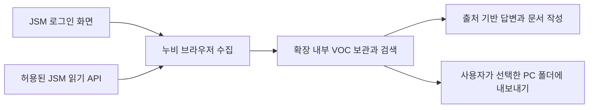

# JSM 수집과 VOC Workspace 연계 검토

2026-09-23. 상태: 정제 JSON의 버전 보관, 검색과 Pi 구간 조회는 [VOC-IMPORT.md](VOC-IMPORT.md)에 구현했다. 아래 설계 전체가 구현된 것은 아니다. JSM 연결, 첨부파일 전달, 자동 수집기와 문서 변환기는 아직 구현하지 않았다. 실계정이나 사내 JSM에 접근하지 않았다.

## 목표와 사용자 흐름

사용자는 로그인한 JSM 화면에서 “이번 달 내가 처리한 티켓과 첨부 문서를 이 Workspace에 정리해 줘”라고 요청한다. 누비는 기간, 프로젝트, 처리 기준을 확인하고 티켓별 원본, 문서 본문, 처리 이력과 출처가 있는 요약을 쌓는다. 이후 “같은 오류가 있었는지”, “그때 어떻게 해결했는지”, “아직 조치되지 않은 VOC가 무엇인지”를 근거와 함께 답한다.

“내가 처리한 것”은 현재 담당자, 과거 담당 이력, 직접 남긴 조치 댓글 중 어느 의미인지 다를 수 있다. 최초 한 번 기존 객관식/직접입력 폼으로 확인한다. 상태가 Done이라는 사실과 문제 해결이 검증됐다는 주장은 분리한다.

설정은 대상 JSM, 수집 범위와 저장 폴더를 중심으로 구성한다. 기존 채팅에서 수집/문서 읽기/저장/검증 진행을 보여주고 결과는 티켓 목록과 원본 링크로 확인한다. 별도 대시보드부터 만들지 않는다. 불명확한 분류와 근거 충돌만 질문으로 전달한다. 요청한 수집과 지정 폴더 내 신규 보관은 작업 범위에 포함시키며, JSM 댓글 전송이나 상태 변경은 기존 외부 쓰기 승인 흐름으로 분리한다.

## 구성

2026-09-23 사용자 결정: 먼저 브라우저 안에서 수집하고 관리한다. A2A와 Desktop 수신은 이번 구현 대상에서 제외한다. 아래 브라우저 경로는 설계이며, 기존 Desktop JSON 보관 기능과 구분한다.



브라우저만으로 티켓 읽기, 목록 관리, 근거 검색, 요약과 내보내기가 가능하다. 로그인 상태는 현재 브라우저에서 유지하며 A2A, 로컬 서버와 Desktop 설치를 전제로 하지 않는다. 실제 JSM 화면과 허용된 API 범위는 확인해야 한다.

PC 폴더 보관은 Chrome/Edge의 File System Access API를 사용한다. 사용자가 확장 전체 화면의 버튼을 눌러 폴더를 선택하고 쓰기를 허용해야 한다. 경로 문자열 입력만으로 권한을 얻을 수 없다. 권한 철회/만료 시 다시 연결하며, 저장 버튼 클릭과 실제 파일 readback 검증을 구분한다. 기존 OpenWiki 폴더 연결은 읽기 전용이므로 VOC 쓰기에 그대로 전용하거나 권한을 조용히 확대하지 않는다.

## 현재 구현과 필요한 변경

| 영역 | 현재 확인 | 필요한 작업 |
| --- | --- | --- |
| 페이지 수집 | 확장의 페이지 관찰, 탐색, 첨부 다운로드 도구가 존재 | JSM 필드/댓글/다음 페이지를 실제 근거에 연결하는 수집기 |
| 폴더 선택 | `WikiFolderSettings.jsx`, `wiki-folder.js`는 읽기 전용 연결과 권한 복구 제공 | 별도 VOC 폴더 핸들, 사용자 동작에 연결한 쓰기 허용과 저장 readback |
| 브라우저 보관 | 확장 내부 영속 저장과 작업 복구 기반 존재 | IndexedDB VOC 원본/정제본, revision/첨부 저장 상태, 검색 색인 |
| Desktop 보관 | `nubi-voc-v1` JSON의 버전 보관과 검색/구간 읽기 구현 | 브라우저 내보내기 계약과 동일하게 유지. 직접 앱 간 전달은 보류 |
| 문서 해석 | 문서/이미지 도구의 실제 지원 범위에 따라 다름 | 텍스트 PDF/Office와 스캔 문서를 구분해 브라우저 라이브러리 평가 |
| A2A | 기존 일반 작업 전달 코드와 별개 | VOC 파일 전송과 새 연동은 구현하지 않음 |

브라우저 내부 보관과 PC 폴더 내보내기는 별도 영수증으로 관리한다. 페이지 수집 → 원본 확보 → 정제 → 저장 검증 → 색인의 진행을 구분한다. 창 종료와 다운로드 실패를 수집 완료로 표시하지 않는다.

## 수집 방법

1. 연결된 페이지의 주소, 접근 가능한 티켓과 실제 필드 이름을 관찰한다. Cloud/Data Center/커스텀 포털을 확인한다.
2. 허용된 공식 읽기 API가 있으면 ID, 제목, 상태, 설명, 댓글, 첨부 목록과 페이지네이션을 구조화해 받는다. 댓글/첨부/변경 이력은 목록 조회에 모두 포함된다고 가정하지 않는다.
3. API가 없거나 화면 전용 정보라면 브라우저에서 필드 라벨, 제목, 표, 댓글 작성자/시각, 문서 링크를 읽는다. 접힌 영역과 다음 페이지를 펼치고 수집한다. API 사용을 필수 전제로 삼지 않는다.
4. 불분명한 시각 정보는 화면 캡처와 이미지 모델로 보완한다. OCR이나 이미지 추정만 있는 필드는 추정으로 남긴다. 로그인 화면/오류 페이지를 정상 티켓이나 첨부로 저장하지 않는다.
5. 첨부는 원본 파일을 받고 다운로드 완료, 형식, 실제 크기와 해시를 확인한 뒤 변환한다. 파일명만 보였거나 다운로드 버튼을 눌렀다는 이유로 완료 처리하지 않는다.

API 인증은 브라우저 로그인과 별도일 수 있다. 계정의 실제 조회 범위를 넘는 정보는 요구하지 않는다. 브라우저 쿠키를 문서나 모델 문맥으로 복사하지 않는다. 내부 댓글/공개 댓글의 구분과 접근 범위를 출처 메타데이터에 유지한다. 최신 문서는 대상 JSM의 버전과 다를 수 있어 경로/필드 계약을 실제 응답으로 검증한다.

## 데이터 보관과 정제

예시 구조이며 실제 저장 위치는 사용자가 지정한다.

```text
<workspace>/voc/
  sources/<source-id>/tickets/<issue-id>/
    revisions/<revision-id>/
      ticket.json
      timeline.json
      attachments/<attachment-id>/<safe-name>
      documents/<attachment-id>.md
      documents/<attachment-id>.json
      summary.md
      manifest.json
    notes.md
  reports/
```

- 원본: 실제 받은 티켓/댓글/첨부 데이터. URL, 수집 시각, 원격 updated 시각, source/issue/comment/attachment ID와 SHA-256을 기록한다.
- 정제본: 제목/본문/표/섹션을 유지하고 메뉴나 중복 UI를 제거한다. 티켓 단위와 댓글/문서 단위의 경계를 보존한다. 원본 위치를 역추적할 수 있어야 한다.
- 구조화 VOC: 현상, 영향, 제품/메뉴, 분류, 조치 내용, 처리 상태, 원인, 담당/처리 시각, 관련 티켓. 각 판단에 원본 근거 ID와 위치를 붙이고 모르면 비워 둔다. 원문 진술과 AI 추론을 구분한다.
- 사용자 메모: `notes.md`처럼 생성물과 분리하고 자동 덮어쓰지 않는다. 정제/요약 재생성은 새 revision을 만든다.
- SQLite와 검색 색인은 재생성 가능하게 하고 원본 파일을 기준으로 복구한다. 파일은 임시 저장 후 검증해 원자적으로 확정하고 manifest로 누락을 검사한다. 경로는 호스트가 만들며 첨부 파일명이나 모델 출력이 Workspace 밖 경로를 결정하지 못한다.

출처 사이트 + issue ID + 원격 버전/내용 해시로 중복을 막는다. 날짜별로 원본을 중복 복사하지 않고 보고서에서 기간별 조회한다. 재수집은 updated 범위에 겹침 구간을 두고 모든 페이지를 읽은 뒤 체크포인트를 확정한다. 수집 중 변경된 티켓은 다시 확인한다. 접근 거부, 삭제, 암호화 파일, 변환 불가는 각각 상태를 남긴다. 조회 실패를 삭제로 해석하지 않는다. 수집 완전성을 확인할 수 없으면 `partial`로 표시한다.

## 에이전트와 문맥

기존 Pi를 유지한다. 계획과 수집 상태는 호스트 저장소에 보관하고 모델 문맥 압축과 별개로 유지한다.

- 수집 담당: 브라우저/읽기 API의 한 작업 실행 주체. 각 페이지의 누락과 다음 페이지를 확인한다.
- 문서 분석 담당: 독립적인 첨부 문서를 제한된 동시성으로 읽는다. 해당 파일과 관련 티켓 발췌만 전달한다.
- 분류/검토 담당: 구조화 결과와 관련 근거를 받아 누락, 모순, 근거 없는 결론을 검사한다.
- 주 실행기: 요약, 근거 ID, 미확인 항목을 받아 다음 단계를 결정한다. 저장은 확장의 단일 작업 실행기가 담당한다. PC 폴더 내보내기는 허용된 폴더 핸들에서만 수행한다.

파일 전문을 모든 담당과 매번 공유하지 않는다. 티켓 ID, 파일 해시, 페이지/섹션 위치를 기준으로 필요한 부분을 조회한다. 긴 작업은 티켓/첨부 단위 영수증을 확인하며 재개하고 불명확한 결과를 재다운로드/재저장으로 무작정 반복하지 않는다. 공급자별 하네스를 새로 만들지 않고 기존 Qwen 등 모델 연결을 유지한다.

## BP와 오픈소스 판단

| 자료/후보 | 이 업무에 적용할 부분 | 판단 |
| --- | --- | --- |
| [OpenAI harness engineering](https://openai.com/index/harness-engineering/) | 찾기 쉬운 지식 구조, 작은 색인에서 상세 근거로 이동, 검증 가능한 실행 환경 | 문서 구조/근거 색인에 적용할 방법론. OpenAI의 JSM 운영 사례라는 뜻은 아님 |
| [Anthropic effective agents](https://www.anthropic.com/engineering/building-effective-agents), [context engineering](https://www.anthropic.com/engineering/effective-context-engineering-for-ai-agents) | 명확한 수집 단계는 정해진 흐름으로, 모호한 해석은 agent 판단으로 처리. 독립 문서 분석만 병렬화하고 근거는 필요할 때 조회 | 기존 Pi/분석 조정기를 보강하고 프레임워크 교체는 하지 않음 |
| [Playwright Downloads](https://playwright.dev/docs/downloads) | 클릭 전 다운로드 대기 등록, 완료 후 영구 경로 저장, context 종료 전 확보 | Desktop이 소유한 Playwright 경로의 기준. 확장의 스크립트 도구가 같은 네이티브 download 객체를 제공한다고 가정하지 않음 |
| [Docling](https://github.com/docling-project/docling), 코드 MIT | PDF 레이아웃/표/OCR과 Office 문서의 구조화 JSON/Markdown | 품질 중심 1순위 평가 후보. Python worker와 모델 자산 준비가 필요하며 모델별 라이선스는 별도 |
| [Microsoft MarkItDown](https://github.com/microsoft/markitdown), MIT | 다양한 파일을 LLM용 Markdown으로 변환 | 가벼운 비교 후보. 복잡한 표, 페이지 근거와 OCR 품질은 같은 표본으로 비교해야 함 |
| [mcp-atlassian](https://github.com/sooperset/mcp-atlassian), MIT | Jira/Confluence의 JQL 검색과 이슈 조회, Cloud/Server/Data Center 연결 | 선택적 API 연결 후보. Atlassian 공식 제품이 아니며 JSM 커스텀 필드/첨부 지원은 별도 검증 |
| 기존 OpenWiki, MiniSearch, IndexedDB | 근거 검색과 브라우저 변경 이력 | 재사용 후보. A2A 추가 구현은 보류. OpenWiki에 폴더만 지정하면 VOC가 자동 색인된다고 가정하지 않음 |

사내 API 범위는 [JSM Data Center](https://developer.atlassian.com/server/jira-servicedesk/rest/)와 [Cloud 요청 API](https://developer.atlassian.com/cloud/jira/service-desk/rest/api-group-request/)를 기준으로 설치 버전에 맞춘다. 이번 조사는 라이브러리 도입이나 정확도 평가 완료를 의미하지 않는다.

## 첫 구현과 평가

첫 범위는 “브라우저에서 티켓 한 건의 본문/댓글 수집 → 확장 내부 보관 → 출처를 누르면 원문 확인”이다. 이어서 첨부 수집과 사용자가 선택한 폴더 내보내기를 검증한다. 그다음 목록/기간 수집과 변경분 갱신, 마지막으로 유사 VOC 검색과 보고서를 추가한다.

처리 완료, 재개됨, 첨부 없음, 여러 페이지 댓글, 스캔 PDF, 표 포함 문서, 중복 첨부, 접근 불가, 다운로드 중단, 사용자 수정본이 있는 표본으로 평가한다. Qwen 기준으로 수집만 정확한지와 요약이 정확한지를 따로 측정한다.

| 검사 | 통과 기준 |
| --- | --- |
| 수집 누락 | 허용 범위의 기준 목록과 비교해 누락을 표시하고, partial을 complete로 표시하지 않음 |
| 파일 저장 | 받은 원본과 저장 파일의 해시 일치. 로그인 HTML을 문서로 오인하지 않음 |
| 재실행 | 같은 원본의 revision이 중복 생성되지 않으며 중단 후 확정된 파일을 다시 쓰지 않음 |
| 정제 정확도 | 표본의 필수 필드, 댓글 경계, 표/페이지 위치를 사람이 만든 기준과 비교 |
| 요약 근거 | 현상/원인/조치/완료 주장에 실제 근거 위치가 연결되고 미확인 원인을 단정하지 않음 |
| 변경 이력 | 댓글 추가/상태 변경을 새 revision으로 남기고 사용자 메모와 기존 원본 보존 |
| 검색 | 준비한 과거 VOC 질문에서 관련 티켓과 근거의 순위/정확도를 측정. LLM 평가만으로 통과하지 않음 |
| 복구/격리 | 세션 만료, 접근 권한 변경, 수신 중단을 구분하고 다른 Workspace나 작업에 저장하지 않음 |

다음 실환경 확인 항목: JSM 종류/버전, 샘플 티켓, 사용자에게 허용된 API 여부, 대표 첨부 형식과 저장 폴더. 지금 단계에는 실제 VOC 수집/다운로드/저장 결과가 없다.

## 브라우저 경로의 검증 기준

- 로그인 만료, 접힌 댓글, 페이지네이션과 첨부 실패를 구분하고 누락은 `partial`로 표시한다.
- 확장 재시작 후 원본/검색/수집 체크포인트가 복구된다. 진행 중 쓰기는 실제 저장 결과로 조정한다.
- 사용자 폴더 선택 취소, 쓰기 거부와 권한 철회 시 다른 폴더로 쓰지 않는다. 파일 readback 해시가 일치해야 내보내기 완료다.
- 원본과 사용자 메모를 덮어쓰지 않으며 같은 티켓의 같은 revision은 중복 생성하지 않는다.
- PDF/문서 변환은 실제 표본의 표와 페이지 근거로 평가한다. Python 기반 Docling/MarkItDown은 브라우저 내 실행으로 약속하지 않는다. 먼저 PDF.js, Mammoth 등 브라우저 호환 후보의 라이선스와 형식별 품질을 검토한다.
- API와 로그인 토큰, 쿠키는 모델 문맥과 내보내기에 포함하지 않는다. JSM 댓글 등록/상태 변경은 읽기 수집 범위에 포함하지 않는다.

폴더 접근 근거: [Chrome File System Access 공식 문서](https://developer.chrome.com/docs/capabilities/web-apis/file-system-access). 실제 확장 side panel에서 picker를 열 수 없는 경우 기존 전체 화면 폴더 선택 흐름을 재사용한다. 이 설계 갱신만으로 실제 JSM 수집/첨부 저장을 검증했다고 표시하지 않는다.
