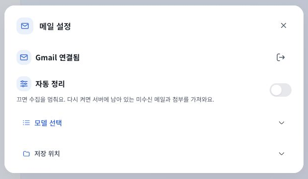

# 메일 설정과 처리 상태

모델 선택은 아이콘과 선택한 모델 이름만 표시한다. 미선택 시에는 하나의 `모델 선택` 동작을 두고 중복 제목과 대화창 로그인 안내를 표시하지 않는다. 기존 제공자/모델 선택, 로그인과 연결 필요 상태는 유지한다.

하단은 현재 연결/자동 정리 설정을 이전 작업 snapshot보다 우선한다. OFF는 `자동 정리 꺼짐`, 자동 정리 ON에서 수집만 중지한 상태는 `수집 일시중지`다. 0건 요약은 숨기고 실제 완료/보류/확인 필요 건수가 있을 때만 표시한다. 중지된 작업의 타이머와 첨부 진행을 실행 중으로 보이지 않게 하되 이전 완료 시각과 소요 시간은 유지한다.

기존 CX, 모델 선택과 POP3 단계 계약을 재사용했다. 새 의존성이나 메일 수집 로직 변경은 없다. 인증은 기존 메모리 전용이며 UI 단순화를 연결 완료로 해석하지 않는다.

Electron 빌드는 완료됐다. 자동 테스트는 실행하지 않았다. 4320의 명시적 예시 화면에서 빈 메일/OFF는 상태만, 보관 기록/OFF는 `완료 1, 보류 1`, ON/수집 중지는 `수집 일시중지`로 구분했다. OFF에 옛 pause snapshot이 포함돼도 OFF 표시가 우선했다. 모델 선택 목록을 열어 예시 모델을 고르면 목록이 접히고 모델 이름이 갱신됐다. 실제 POP3, 모델 계정과 실행 중인 Electron 적용은 별도이며 앱 재로드는 기존 자동 승인 검토 거절로 대기 중이다.

