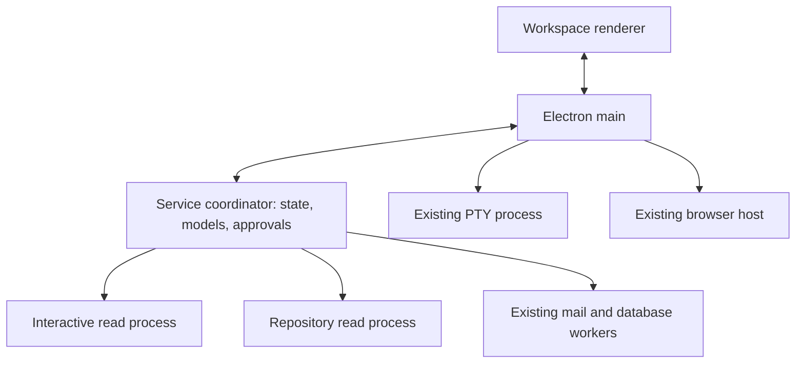

# Local read-task process isolation

## Finding and scope

Nubi already separates the renderer, Electron main, service coordinator, PTY,
browser engines and several parser/database workers. It is not a single OS
process. Two remaining costs were reproduced: code-map parsing/PageRank ran in
the service coordinator, and every syntax/outline/type/repository analysis
started a fresh parser thread. The service still owns project execution,
SQLite state, provider connections, approvals and reconciliation.

The change moves trusted, read-only CPU work behind two lazy reusable Node
processes. The interactive lane handles syntax, outline and type diagnostics.
The repository lane handles import-graph maps and bulk Wiki repository analysis.
A large repository job cannot occupy the interactive parser. Existing mail,
database, terminal, browser and Office execution paths remain their own owners.
This is local process isolation, not cross-machine coordination.

## References and choice

- [Electron performance guidance](https://www.electronjs.org/docs/latest/tutorial/performance)
  recommends moving CPU-heavy work away from UI coordination and avoiding eager
  loading. Read API imports no longer eagerly import TypeScript through the map.
- [Node worker guidance](https://nodejs.org/docs/latest-v24.x/api/worker_threads.html)
  explains parser startup overhead and reusable pools. AsyncResource preserves
  request-to-result diagnostic context.
- [VS Code utility-process source](https://github.com/microsoft/vscode/blob/main/src/vs/platform/utilityProcess/electron-main/utilityProcess.ts)
  provided lifecycle and environment-boundary reference. Our coordinator is an
  ordinary Node service, so its children use Node fork with the existing Electron
  executable rather than importing an Electron-main-only utilityProcess API.
- [Piscina](https://github.com/piscinajs/piscina) provided queue-pressure, one-job
  worker and idle-retirement reference. We reuse native Node facilities with a
  fixed two-lane contract; no additional package or upstream source was copied.

Only fixed parser/map handlers are exposed. Neither a script evaluator nor
project plugin execution is introduced. This is not an OS security sandbox.
Provider credentials and NODE_OPTIONS are not inherited by compute children.
They receive the exact file/input scope needed for the read, while host writes,
model execution and permission decisions retain their existing owner.

## Bounds, cancellation and publication

Each lane runs one task and has at most sixteen pending requests. Input is
limited to 96 MiB of estimated clone size per request and 128 MiB across pending
and active inputs. Child JavaScript heaps are limited to 384/512 MiB. These are
not hard RSS limits. Unused children retire after 45 seconds. No child starts
until there is actual work.

Deadlines include queue wait. Cancelling a queued read removes that read.
Cancelling an active read terminates that lane's child; replacement waits for
exit, so a stuck parser cannot accumulate replacement processes. Timeout, crash
and shutdown reject the affected read and discard late replies. They never
replay the interrupted task. A later queued/new read can use a fresh process.
Closing the service also closes its compute children. AsyncResource scope and
payload-free lane/PID/queue/RSS diagnostics support investigation.

A real disconnect-during-read test reproduced an existing closed-IPC reply
crash. Service replies now check the live connection and handle send failure;
disconnect rejects reads and completes the normal shutdown instead of trying
to publish a response to the departed parent.

Syntax/type failures continue through the existing quality gate. Optional map
failures keep their existing source-tool fallback. Current source hashes,
source observations, project binding and final write/readback checks remain in
the host. No store/credential owner or durable write queue was duplicated.

## IPC is part of the workload

The first isolation experiment returned the entire map. On the large synthetic
corpus this raised coordinator stalls to 155–187 ms: deserializing thousands of
symbols can be worse than the original incremental computation. That failed
experiment is retained in `verification/read-task-isolation/isolated-large.json`.

Product callers now explicitly request a navigation projection: the complete
file ranking, entry points and coverage summary, plus at most 200 context files
with eight symbol entries each. The planner uses its existing top sixty; coding
context uses its existing bounded list. Full direct map results remain available
for the existing map API/tests, subject to the result size limit. The parser and
PageRank algorithm are unchanged. Worker bundle source inputs are included in
the build's release-source closure, and Electron copies the resulting worker.

## Verification and limits

The measurement script creates 120 local TypeScript files and supports ordinary
and large corpora. The paired navigation experiment uses 6,000 functions per
file, two map runs and six short syntax checks. Baseline runs the same map core
in the coordinator and starts a parser thread per syntax request. The new path
uses the production process/projection. Rank, coverage/context and diagnostic
hashes must match. Source hashes, elapsed times, coordinator heartbeat stalls,
RSS observations and child PIDs are recorded for both approaches.

The initial paired navigation sample preserved all result hashes. Map heartbeat
stall maxima were 33.43/20.26 ms inline and 1.36/1.34 ms isolated. Total map time
was 1785/1714 ms inline and 2096/1832 ms isolated: process startup and coordination
cost time while freeing the coordinator. Per-request parser threads took
173–179 ms. The isolated parser took 201 ms cold and 0.33–0.70 ms for the five
subsequent calls. Keeping parsers warm costs additional process memory; lazy
start, queue bounds and idle retirement control that tradeoff. Final reruns are
recorded separately; these few local observations are not statistical claims.

Regression tests exercise real child processes, bounds, saturation, independent
lanes, queue/active cancellation, deadlines, crash, idle retirement, shutdown,
environment isolation, real parser output, full/projection parity and source
non-execution. The existing map, coding quality, Wiki and package tests remain
required. The built Electron probe checks repeated actual outlines while Wiki
input remains intact and exercises the shipped repository worker.

Regression review also replaced four old timing/text assumptions: a two-constant
parse is no longer guaranteed to exceed 1 ms; concurrent new-file requests may
return a verified `alreadyApplied` receipt; hidden-modal selectors changed; and
compact Wiki descriptions use different punctuation. Checks retain real deadline
work, exactly one creation event, live-update modal behavior and the same model
guidance. Product approval, modal and model-routing behavior was not relaxed.

Final verification on this source:

- `npm test`: 2,642 passed, 201 existing feature-disabled skips, zero failures
  out of 2,843 tests. The earlier failing harness assumptions were retained in
  the first run log and corrected before the complete rerun.
- Renderer/backend build passed. The shipped-worker Electron probe passed all
  three checks. The existing Electron shell flow passed its 24 checks, including
  editor/readback, PTY, browser, narrow layout and Wiki settings re-entry through
  the shared background queue.
- The final paired map heartbeat maxima were 33.97/22.20 ms inline and
  1.84/1.66 ms isolated. Total times were 1818/1799 ms and 2110/1899 ms.
  The isolated parser was 221 ms cold and 0.30–0.74 ms warm; baseline repeated
  parser startup was 174–175 ms after its first call. Map context/coverage and
  diagnostic hashes matched. Raw results and source hashes are in
  `verification/read-task-isolation/final-{inline,isolated,comparison}.json`.

The central SQLite owner and full conversation/state payloads remain candidates
for separate profiling. This change does not promise the absence of every
bottleneck, increase model/network capacity, or verify Windows, company SSO,
Office/NASCA, installer lifecycle or real-model throughput.
