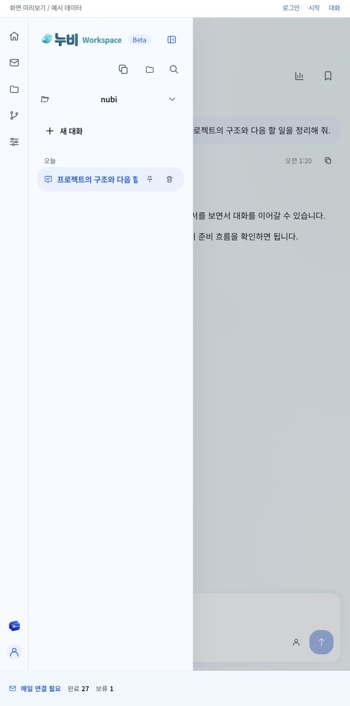
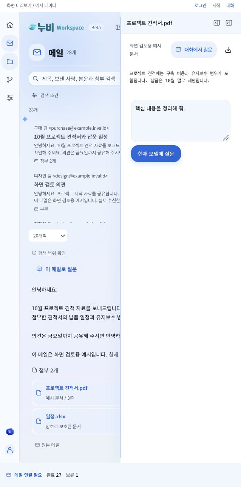

# 기능 품질 후속 점검

기존 [전체 기능 점검](FUNCTIONAL-QUALITY-AUDIT-2026-10-05.md)의 남은 항목을 이어서 수정했다. 2026-10-05 후속 사용자 요청은 양쪽 사이드바의 기본 펼침 상태, NASCA 문서를 Office 2016으로 자동 열어 읽기다. 자동 테스트와 native/Windows 설치 빌드는 실행하지 않았다. 전체 제품이 통과했다는 결과가 아니다.

## 발견과 수정

| 문제 | 반영 | 확인 |
| --- | --- | --- |
| 왼쪽 로고/접기 버튼이 244px 사이드바에서 잘림 | 기본 300px, 최소 284px를 공유 상수/저장 너비/스타일에 적용했다. 좁은 overlay에서도 대화 최소 너비를 사이드바 폭에서 다시 빼지 않는다. 과거 작은 저장 값만 최소로 올린다. | 638px 예시 화면의 사이드바 300px, 로고/버튼 행 267px에서 가로 넘침 없음. |
| 오른쪽 공간을 예약할 때 실제 왼쪽 너비 대신 작은 가상 너비를 사용 | 실제 열린 너비와 입력의 최소 너비, 오른쪽 최소 320px를 함께 예약한다. 부족하면 overlay로 전환한다. 오른쪽 기본은 420px이며 유효한 사용자의 너비를 보존한다. | 실제 DOM 1480×960에서 왼쪽 300px/오른쪽 저장 너비 456px/중앙 672px, 양쪽 헤더와 대화의 scrollWidth=clientWidth. 키보드 Home으로 오른쪽 320px/중앙 808px도 확인. 기본 복원 더블클릭은 이번 도구에서 너비 변화가 관찰되지 않아 통과로 표시하지 않는다. |
| 수동 첨부 미리보기가 호스트에서 직접 파싱해 worker 제한을 우회 | 같은 해시의 검증된 읽기 캐시를 재사용하거나 수집과 같은 worker/Office 읽기 제한을 적용한다. 원본을 다시 확인한다. | 소스 검토/빌드. |
| NASCA Office 문서에 일반 파서를 적용 | Windows의 Word/Excel/PowerPoint 첨부를 Office COM Open/ReadOnly로 연결했다. 바이트 동일성/ACL/FullName/읽기 범위/버전/원본 해시를 검증한다. 오류 후 일반 파서로 우회하지 않는다. | JS 빌드와 PS1 자산 포함. Windows PowerShell 구문/Office/NASCA 실행은 미검증. |
| 수동 읽기 성공이 첨부 검색과 Agent의 본문 근거에 전달되지 않음 | 검증된 수동 결과도 첨부 영수증에 저장하고 첨부 완료 수를 갱신한다. 일반 파서 결과를 Office 성공으로 승격하지 않는다. 기존 사용자 위키를 덮어쓰지 않는다. | 소스 검토/빌드. |
| 긴 읽기의 중복 클릭과 조용한 대기 | 첨부 버튼에 읽기 중 spinner/aria-busy와 중복 클릭 차단을 연결했다. 설치/정책/시간 초과/원본 변경을 구분한 공통 오류 토스트를 사용한다. | 소스/JSX 빌드. Windows의 실제 읽기 대기 UI는 미검증. |
| OFF/종료의 늦은 수동 읽기 결과 | 활성 읽기 controller를 취소하고 수동 요청도 메일 세대가 바뀌었으면 결과 저장/표시 전에 중단한다. | 소스 검토/빌드. |

Office 읽기는 [별도 계약](OFFICE-ATTACHMENT-READING-2026-10-05.md)을 따른다. 기존 COM 읽기 전용/관찰 범위/승인/원본 보존 원칙과 Microsoft 공식 Open/AutomationSecurity 문서를 적용했고 새로운 외부 라이브러리는 도입하지 않았다. Word-extractor/SheetJS/OCR 후보는 NASCA 요구를 해결하지 못해 채택하지 않았다.

## 빌드와 남은 확인

최종 `npm run build:electron` exit 0. Node 백엔드, main/renderer, Monaco worker와 Office PS1 자산을 포함했다. Windows Office 실행과 회사 정책, NASCA 문서의 원문 대조/한국어/날짜/표/시간 초과/기존 Office 문서 보존은 실제 환경에서 확인해야 한다. Desktop 첨부 읽기는 기존 누비 Office의 편집/저장 계약을 대신하거나 A2A를 활성화하지 않는다.

기본 Electron 크기와 좁은 창의 예시 데이터 화면을 직접 확인했다. 임시 viewport는 복원했다. 배율 보정 없는 최초 viewport는 DOM이 2960px로 나왔고, 보정 후 실제 DOM 1480×960을 확인했다. 넓은 화면의 스크린샷 도구가 여백을 잘못 포함해 해당 이미지는 근거에서 제외했다. 아래 이미지는 638×1284의 좁은 창에서 로고/버튼을 확인한 예시다.



최신 빌드의 별도 4320 예시 화면에서 메일의 PDF 첨부 클릭 → 오른쪽 본문 미리보기 → 질문/다운로드 동작 표시를 확인했다. 실제 수신이나 Office 추출 성공을 확인한 결과가 아니다. 긴 Windows 읽기의 spinner는 소스/빌드 확인 범위를 유지한다.



Google 패스키/OAuth 허용, 스캔 PDF OCR, 외부 삼성 브라우저 세션 공유, 실제 POP3/모델/GHES/Windows 설치 검증은 기존 보고서의 미완료 범위를 유지한다. 이번 직접 수정과 이전 예시 결과를 전체 실환경 성공으로 합산하지 않는다.

실행 중인 사용자의 Electron은 아직 재시작하지 않았다. 앞선 자동 승인 검토가 로그인과 미저장 편집 유실 위험으로 reload를 거절했으며 승인 답변이 없다. 백엔드 반영에는 재시작과 재로그인이 필요하다.

최종 산출물 SHA-256:

```text
main.cjs          cfed8adad21849f8bd2ed7d7275f2f4dd420db70aad3c62f4089fddbc06a9f3b
renderer.js       b2314169add8d582600f095b1e537ed165fb2aee1c8571a4c6837da34e5ef255
renderer.css      e5b8406891860126f1d4cd1589f6d49ee8df040d72b96b901921573a89296c5c
service-entry.mjs a924d55d23d757074cde0f4d9f09f9e3cfbc90b47644b6498e01164ad711dd31
office-document.ps1 f4de8b524b24bf0025ab7582805df8f06ad08a3d27a810495faf6c8f842652a8
```
