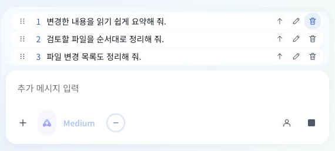

# 대기열 여백과 버튼

기존 Desktop 대기열은 행 높이가 36px, 행 간격과 목록 위아래 여백이 4px였다. 버튼에는 투명한 1px 테두리가 남아 있었다.

공통 CX 버튼과 브라우저의 `QueuedInputs`를 유지하고 Desktop identity CSS만 조정했다. 행은 28px, 간격과 위아래 여백은 2px다. 버튼과 행 그림자를 제거하고 모든 대기열 버튼의 hover를 `--deck-blue-soft`와 `--deck-blue-deep`로 맞췄다. 누름으로 위치가 움직이지 않으며 키보드 초점과 터치 44px 영역은 유지한다. 새 라이브러리를 추가하지 않았다.

`npm run build:electron`이 완료됐다. 자동 테스트는 실행하지 않았다. 4320 예시 화면에서 실제 계산된 행 높이 28px, 버튼 border 0px, shadow none, hover #E8F1FE를 확인했다. 키보드 초점은 2px로 유지되며 편집 후 재추가와 삭제가 동작했다. 4개 항목은 기존 3행 높이의 스크롤 목록으로 표시되고 대기열과 입력창의 좌우 끝이 일치했다.

예시 화면은 실제 모델이나 계정 검증이 아니다. 실행 중인 Electron의 재로드는 인증과 미저장 상태 손실 우려로 자동 승인 검토에서 거절돼 대기 중이다.

