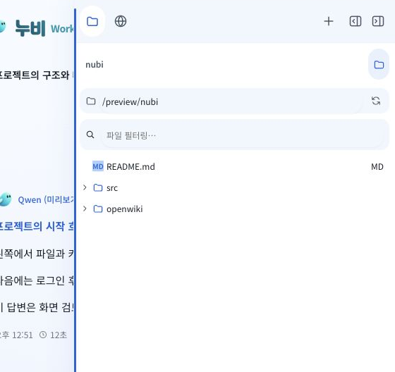

# 오른쪽 사이드바 너비 조절 표시

기존 표시에서는 8px 조절 영역 안쪽 3px에 파란 선이 나타났다. 키보드 초점의 2px 외곽선도 전체 높이에 겹쳐 여러 줄처럼 보였으며 실제 경계와 강조 위치가 달랐다.

공통 identity CSS에서 조절 영역과 색을 그리는 선을 분리했다. 기존 8px 드래그 영역은 유지하고 선만 경계 쪽으로 옮겼다. 호버에는 옅은 누비 파랑의 2px 선을, 드래그에는 진한 파랑을 표시한다. 키보드 초점은 3px 단일 선으로 구분한다. 위아래 12px 여백과 둥근 끝을 유지하며 긴 외곽선과 넓은 배경 색은 제거했다. 고대비 모드에는 시스템 Highlight를 사용한다.

새 패키지는 추가하지 않았다. 기존 useSidebarResize의 pointer capture, 취소, 키보드 조절, 너비 기억과 더블클릭 복원 로직은 그대로 재사용한다. 채팅과 사이드바의 분할/겹침 정책도 유지한다.

Electron 빌드가 완료됐다. 자동 테스트는 실행하지 않았다. 4320 예시 화면에서 다음을 직접 확인했다.

- 좁은 겹침 화면과 넓은 분할 화면의 경계 위치와 단일 선 표시.
- 드래그로 488px에서 440px로 조절하고 드래그 상태 속성이 해제되는 것.
- 키보드 방향키로 너비를 조절하면서 외곽선 없이 단일 3px 파란 선이 표시되는 것.
- 초점을 벗어난 호버의 색이 누비 파랑 55% 투명도로 표시되고 일반 상태에는 배경과 선이 투명해지는 것.
- 넓게 보기에서 조절 영역이 사라지고 분할로 돌아올 때 440px 너비가 보존되는 것.

실행 중인 Electron의 갱신은 이전 자동 승인 검토에서 로그인과 미저장 상태 손실 우려로 거절되어 대기 중이다. 실제 Electron 화면과 Windows 설치판 검증은 포함하지 않는다.

반복 신고 후 실행 중인 llm_router의 Electron 창을 읽기 전용으로 확인했다. 현재 소스에서 이미 변경한 위키 이름과 화면 구성이 이전 상태로 나타나, 새 renderer가 아직 실행 창에 적용되지 않았음을 확인했다. 생성된 renderer JS/CSS의 해시와 index.html의 버전 쿼리는 일치하며 단일 조절선 CSS도 빌드에 포함됐다. 같은 CSS를 다시 변경하는 대신 새로고침 승인을 요청했다. 앱 새로고침과 실제 실행 화면의 조절선 재확인은 승인 후 진행한다.

