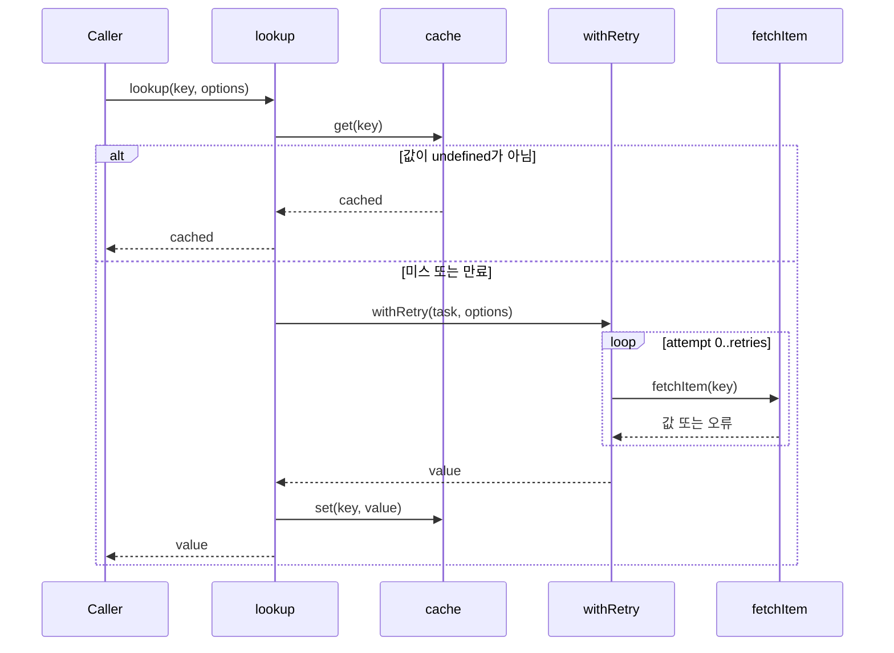
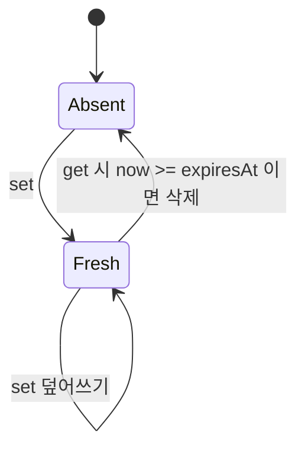

# 아키텍처: 서비스 호출 흐름, 캐시, 재시도

`lookup(key)`는 먼저 메모리 TTL 캐시를 확인합니다. 캐시에 값이 없으면 `fetchItem(key)`를 재시도 정책으로 감싸 호출하고, 성공한 결과를 캐시에 넣습니다. 구성 요소는 세 개입니다: [`src/service.mjs`](../src/service.mjs)(`createService`), [`src/cache.mjs`](../src/cache.mjs)(`createCache`), [`src/retry.mjs`](../src/retry.mjs)(`withRetry`). 실행 방법과 예제는 [빠른 시작](./quickstart.md)에서 다룹니다.

## 호출 흐름

`createService(fetchItem, { ttlMs = 1000, now })`는 캐시를 하나 만들고 `lookup(key, options = {})`를 반환합니다. `now`를 생략하면 `createCache`의 기본값인 `Date.now`가 쓰입니다. `lookup`은 `cache.get(key)`의 결과가 `undefined`가 아니면 그 값을 바로 반환합니다. 아니면 `withRetry(() => fetchItem(key), options)`를 기다린 뒤 `cache.set(key, value)`를 호출합니다. `options`는 `withRetry`에 그대로 전달되므로 `retries` 검증과 `signal` 검사는 **캐시 미스일 때만** 일어납니다. 캐시 히트에서는 잘못된 `retries`나 이미 abort된 `signal`이 있어도 오류 없이 캐시 값이 반환됩니다.

캐시 히트 경로와 재시도가 포함된 미스 경로입니다(`src/service.mjs`의 `lookup`).

`undefined`는 캐시 미스와 구별되지 않습니다. 그래서 `fetchItem`이 `undefined`를 반환하면 매번 다시 가져옵니다. `false` 같은 다른 falsy 값은 캐시됩니다. 재시도가 모두 실패해 예외가 나면 `set`이 실행되지 않으므로 실패는 캐시되지 않습니다. 다만 그 전에 `get`이 만료 항목을 이미 삭제했을 수 있습니다.

## 캐시 수명주기

`createCache(ttlMs, now)`는 `ttlMs`가 유한하지 않거나 음수이면 `'invalid_ttl'`을 throw합니다. `ttlMs = 0`은 허용되며, 같은 시각에 `get`하면 바로 만료됩니다. 저장소는 `Map`이어서 `'toString'` 같은 상속 속성 이름도 일반 키로 다뤄집니다. `set`은 `expiresAt = now() + ttlMs`를 기록합니다. `get`은 `now() >= expiresAt`이면 항목을 삭제하고 `undefined`를 반환하므로 경계 시각과 같은 순간에 만료됩니다. 삭제는 `get`할 때만 일어나며(지연 삭제), 백그라운드 정리나 크기 제한·퇴출 정책은 없습니다. 주입된 `now()`의 반환값은 검증하지 않습니다. 또 `ttlMs`와 시각이 모두 유한해도 합이 `Infinity`로 넘칠 수 있고, 그러면 항목이 만료되지 않습니다(`test/boundaries.mjs`의 `Number.MAX_VALUE` 사례).

항목 수명주기입니다. 만료는 `get`할 때만 판정합니다.

## 재시도와 취소

| 항목 | 현재 동작 (`withRetry`) |
|---|---|
| `retries` | 기본값 2입니다. 0..5 범위의 정수가 아니면 `'invalid_retries'`를 throw하고, 시도는 최대 `retries + 1`회입니다(성공, 재시도 조건을 만족하지 않는 오류, abort 시 더 일찍 끝남). |
| 재시도 조건 | `error.retryable`이 truthy이고 `attempt < retries`일 때만 재시도합니다. 그 밖의 경우 원래 오류를 다시 throw합니다. 단, throw된 값이 `null`/`undefined`이면 `error.retryable` 접근에서 TypeError가 납니다. |
| 지연 | `sleep(100 * 2 ** attempt)`로 100ms, 200ms, …를 기다립니다. `sleep`은 주입할 수 있습니다. |
| task 인자 | `task(attempt)`로 시도 인덱스를 넘기지만, `lookup`의 task는 이 인덱스를 무시하고 `fetchItem(key)`만 호출합니다. |
| 취소 | `signal?.throwIfAborted()`는 각 시도를 시작하기 전에만 검사합니다. |

이 구현에는 롤백도 멱등성 보장도 없습니다. 실패한 시도에서 이미 부작용이 일어났을 수 있고, 재시도하면 그 부작용도 반복될 수 있습니다.

`withRetry`는 `signal`을 task, `fetchItem`, `sleep` 중 어디에도 넘기지 않습니다. 그래서 기본 task와 기본 `setTimeout` 기반 `sleep`은 abort되어도 중단되지 않습니다. 진행 중인 시도가 성공하면 그 결과는 그대로 반환됩니다. sleep 중에 abort가 일어나면 sleep이 끝나고 다음 시도 직전에 throw합니다. 반면 주입한 `fetchItem`이나 `sleep`이 클로저로 같은 signal을 잡고 있다면 스스로 취소할 수 있습니다.

## 변경과 동시성 한계

값은 참조로 저장되고 복제되지 않습니다. 따라서 호출자가 반환된 객체를 바꾸면 그 변경이 캐시된 값에도 나타납니다. 같은 키에 대한 동시 미스는 병합되지 않습니다. 각 호출이 `fetchItem`을 따로 실행하고, 나중에 끝난 `set`이 앞의 값을 덮어씁니다.

## 현재 동작과 2024년 제안

README에는 2024년 제안이 "never implemented"로 표시되어 있습니다.

| 2024년 제안 (구현 안 됨) | 현재 구현 |
|---|---|
| 값 깊은 복제 | 참조 저장 |
| 동시 요청 병합 | 미스마다 `fetchItem` 호출 |
| 네트워크 요청 즉시 중단 | 시도 시작 전 abort 검사만 수행 |

## 검증 진입점

`npm test`(`node --test test/*.mjs`)는 [`test/boundaries.mjs`](../test/boundaries.mjs)를 실행합니다. 이 파일은 경계 시각 만료, 참조 변경, `Infinity` 오버플로, 3회 시도와 100/200ms 지연, abort 후 성공 결과, `undefined`/`false` 캐시, 동시 미스를 검사합니다. 이 문서는 테스트 코드를 읽고 작성했으며 테스트를 실행한 결과는 아닙니다.
