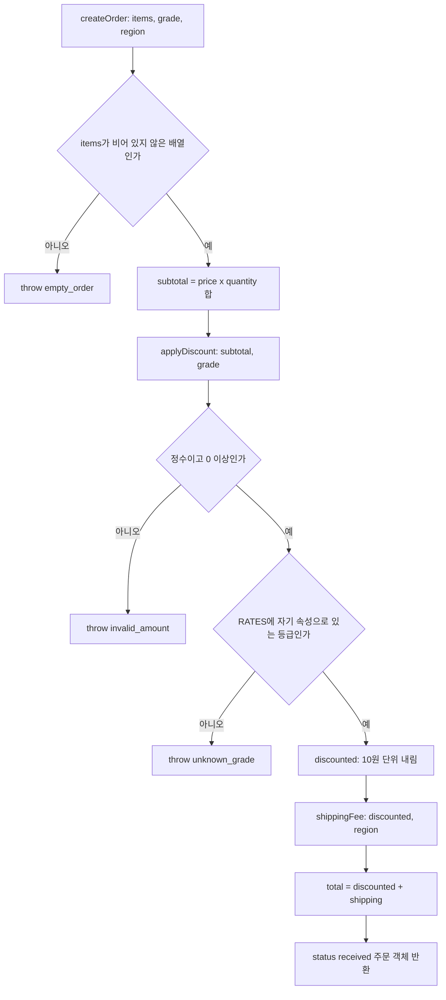
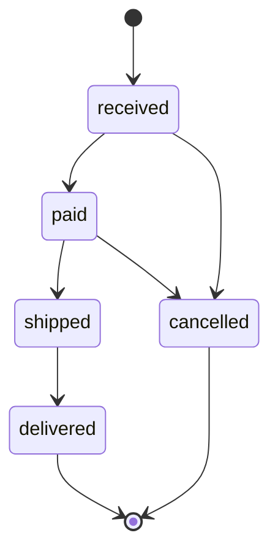

# 주문 계산 구조와 정책

주문은 [`createOrder`](../src/order.mjs)에서 만들어진다. 이 함수는 항목 소계를 더하고, [`applyDiscount`](../src/discount.mjs)로 등급 할인을 적용한 뒤, **할인 후 금액**(`discounted`)을 [`shippingFee`](../src/shipping.mjs)에 넘겨 배송비를 정한다. 결과는 `{subtotal, discounted, shipping, total, status: 'received'}` 객체다(`src/order.mjs` L4-L9). 상태 전이는 독립 모듈인 [`src/status.mjs`](../src/status.mjs)가 맡고, 외부 정산용 [`src/legacy/export.mjs`](../src/legacy/export.mjs)는 완성된 주문 객체를 소비하기만 한다.

실행 방법과 작업별 안내는 [빠른 시작](quickstart.md)을 참고한다.

## 모듈 의존성

| 모듈 | 역할 | 의존 관계 |
| --- | --- | --- |
| `src/order.mjs` | 진입점 `createOrder` | `discount.mjs`, `shipping.mjs`를 import (L1-L2) |
| `src/discount.mjs` | 등급 할인율 `RATES`, `discountRate`, `applyDiscount` | 다른 모듈에 의존하지 않음 |
| `src/shipping.mjs` | `FREE_SHIPPING_MIN`, `BASE_FEE`, `REMOTE_EXTRA`, `shippingFee` | 다른 모듈에 의존하지 않음 |
| `src/status.mjs` | `canMove`, `move` | 독립 모듈. `createOrder`가 호출하지 않으며 호출자가 주문 객체를 넘긴다 |
| `src/legacy/export.mjs` | `exportRow` | 아무것도 import하지 않음. 주문 객체의 `total`, `shipping`, `status`를 읽음 |

## 주문 계산 흐름

`createOrder`가 소계 → 할인 → 할인 후 금액 기준 배송비 → 합계 순으로 계산하는 흐름과 실패 분기.

- 기본값은 `grade = 'normal'`, `region = 'seoul'`이다(`src/order.mjs` L4). 인자 객체 자체를 생략하고 `createOrder()`를 호출하면 구조 분해 단계에서 `TypeError`가 나며, `empty_order`가 아니다.
- 반환 객체에는 `region`이 저장되지 않는다. 그래서 `exportRow`는 지역을 별도 인자로 받는다.

## 할인 정책

- 할인율 표는 `RATES = {normal: 0, silver: 3, gold: 7, vip: 12}`(퍼센트 정수, 동결 객체)이다(`src/discount.mjs` L2). [AGENTS.md](../AGENTS.md)는 할인율을 이 표에만 두도록 규정한다.
- `discountRate`는 `Object.hasOwn(RATES, grade)`로 검사하므로 `toString` 같은 상속 속성 이름도 `unknown_grade`로 거부된다(L4-L7).
- `applyDiscount`는 `Math.floor(amount * (100 - rate) / 1000) * 10`으로 할인 후 금액을 10원 단위로 내림한다(L10-L13). `amount`가 정수가 아니거나 음수이면 `invalid_amount`를 던진다. 정수 검사는 안전 정수 범위를 확인하지 않으므로, 매우 큰 금액에서의 정확한 산술은 보장되지 않는다.
- `test/discount.test.mjs`가 단언하는 예: `applyDiscount(10000, 'gold')` → 9300, `applyDiscount(12345, 'silver')` → 11970, `applyDiscount(10.5, 'gold')` → `invalid_amount`.

## 배송비 정책

**배송비는 할인 전 소계가 아니라 할인 후 금액으로 계산된다.** `createOrder`는 `shippingFee(discounted, region)`을 호출한다(`src/order.mjs` L8). 따라서 소계가 50000 이상이어도 할인 후 금액이 50000 미만이면 기본 배송비가 붙는다.

| 조건 (`src/shipping.mjs` L7-L11) | 결과 |
| --- | --- |
| 입력 금액이 정수가 아니거나 음수 | `invalid_amount` |
| 금액 `>= 50000` (`FREE_SHIPPING_MIN`) | 기본 배송비 0 |
| 금액 `< 50000` | 기본 배송비 3000 (`BASE_FEE`) |
| `region`이 정확히 `'jeju'` 또는 `'island'` | 기본 배송비에 4500(`REMOTE_EXTRA`)을 더함. 무료 배송이어도 추가됨 |
| 그 밖의 `region` 값 (대소문자가 다른 `'Jeju'` 포함) | 추가 요금 없음 |

현재 테스트 입력은 할인 전/후 기준을 구별하지 못한다. `test/order.test.mjs`의 gold+jeju 주문(소계 40000 → 37200)은 두 기준 모두 50000 미만이고, 60000 normal 주문은 할인이 없다. 기준을 바꾸거나 지키려면 둘을 구별하는 테스트를 추가해야 한다.

## 입력 검증의 한계

- `createOrder`가 직접 하는 검사는 `items`가 비어 있지 않은 배열인지뿐이다(`empty_order`, L5).
- 항목별 `price`/`quantity`는 검증하지 않는다. 합계 `subtotal`이 `applyDiscount`의 정수·비음수 검사에 걸릴 때만 `invalid_amount`가 난다. 예를 들어 필드가 빠지면 합계가 `NaN`이 되어 거부되지만, 소수나 음수 항목이 있어도 합계가 0 이상의 정수가 되면(예: `price: 0.5, quantity: 2`) 그대로 통과한다.

## 상태 전이

`src/status.mjs`의 `NEXT` 표(L1-L7)가 허용하는 전이. `delivered`와 `cancelled`는 나가는 전이가 없는 종료 상태다.

- `move(order, to)`는 `canMove(order.status, to)`가 거짓이면 `invalid_transition`을 던지고, 아니면 `{...order, status: to}`를 새로 반환한다(L13-L16). 원본 객체의 `status`는 바뀌지 않지만 복사는 얕은 복사다. 금액은 다시 계산하지 않는다.
- `canMove`는 `(NEXT[from] || []).includes(to)`이다(L9-L11). 일반적인 알 수 없는 상태 문자열은 빈 목록이 되어 `invalid_transition`으로 끝난다. 다만 `NEXT`는 일반 객체여서 `'toString'`처럼 `Object.prototype`에 있는 이름이 `status`로 들어오면 함수가 조회되어 `.includes` 호출에서 `TypeError`가 난다.
- `test/order.test.mjs`는 `received → paid` 성공, `received → delivered`와 `shipped → cancelled`의 `invalid_transition`을 단언한다.

## legacy 정산 경계

`src/legacy/`는 외부 정산 시스템과 맞춘 코드이므로 **수정하지 않는다**([AGENTS.md](../AGENTS.md) L5, `src/legacy/export.mjs` L1).

`exportRow(order, region)`은 `total,shipping,extra,status` 형식의 CSV 한 줄을 만든다(L4-L7). `extra`는 `shipping.mjs`의 값을 쓰지 않고 자체 상수 `LEGACY_REMOTE_EXTRA = 4500`과 인라인 지역 목록 `['jeju', 'island']`로 다시 계산한다(L2, L5).

> **경고:** `shipping.mjs`의 `REMOTE_EXTRA`나 `REMOTE_REGIONS`를 바꿔도 legacy 값은 따라 바뀌지 않는다. 그러면 같은 행 안에서 `shipping` 열(새 정책)과 `extra` 열(옛 값)이 서로 어긋난다.

`test/order.test.mjs`는 60000원 normal 제주 주문의 `exportRow` 결과가 `'64500,4500,4500,received'`라고 단언한다.

## 정책 변경 시 함께 볼 테스트

테스트는 `npm test`(`node --test`, `package.json`)로 실행한다. 아래 내용은 테스트 코드가 단언하는 범위이며, 이 문서를 쓰면서 실행 결과를 확인한 것은 아니다.

| 바꾸는 정책 | 고칠 테스트 |
| --- | --- |
| `RATES`, 내림 규칙, 금액 검증 | `test/discount.test.mjs`, 그리고 gold 주문 합계 44700을 단언하는 `test/order.test.mjs` |
| 무료 배송 기준, 기본 배송비, 도서 추가 요금, 지역 목록 | `test/shipping.test.mjs`, `test/order.test.mjs` (gold+jeju `shipping: 7500`, `exportRow` 결과) |
| 배송비 기준 금액(할인 전/후) | `test/order.test.mjs`. 현재 입력으로는 차이가 드러나지 않으므로 구별하는 사례 추가가 필요 |
| `NEXT` 전이 표 | `test/order.test.mjs`의 상태 전이 테스트 |
| legacy 내보내기 | 수정 대상 아님. `test/order.test.mjs`의 `exportRow` 단언이 형식을 고정함 |

정책을 바꾸면 [AGENTS.md](../AGENTS.md) L6에 따라 이 문서도 함께 확인한다.
