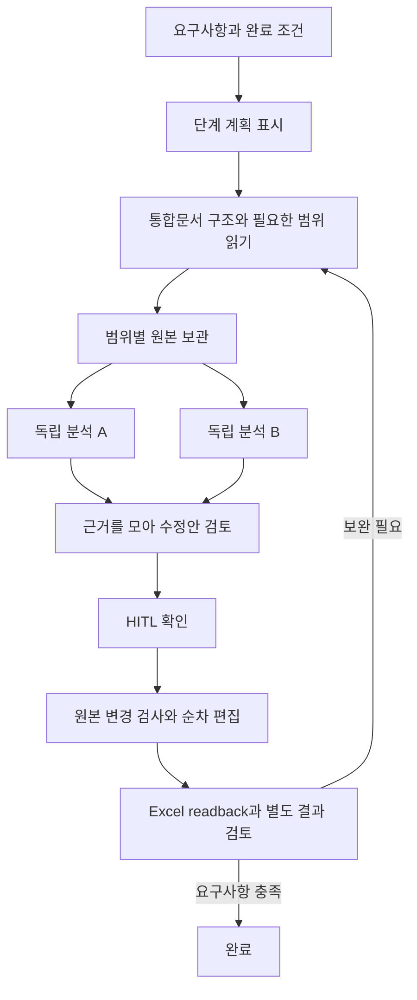

# Excel 2016 에이전트 확장과 Anthropic 하네스 적용

2026-09-22. **소스 반영 상태**다. 이 변경의 Windows 빌드, VSTO 설치, Excel COM 실행, 회사 Qwen 실행은 미검증이다. 사용자가 최종 빌드를 요청할 때까지 빌드·설치파일 생성·설치 워크플로를 실행하지 않는다. 기존 설치 검증 실패는 `BUILD-STATUS.md`에 그대로 유지한다.

## 제품 기준

Windows 설치형 Excel 2016에서 사용자의 요구사항을 문서 결과로 완성한다. 사내 카탈로그의 정확한 Qwen 3.8 27B ID를 기준으로 평가하고, 다른 누비 제공자·모델·사용자 선택을 보존한다. Claude의 설계 원칙을 적용하는 것과 Claude 전용 SDK/인증을 제품 의존성으로 추가하는 것은 별개다.

범용 채팅 답변보다 Excel 기능을 실행하는 도구가 우선이다. 다만 Excel 자체에 있는 기능, 제품에서 조회하는 기능, 실제 수정·복구를 지원하는 기능을 구분한다. `excel_capabilities`는 현재 도구의 범위를 모델에게 알려 주며, 미구현 기능을 실행했다고 말하지 못하게 한다.

## 이번에 연결한 도구

| 도구 | Excel 2016에서 하는 일 | 상태 |
|---|---|---|
| `list_worksheets` | 현재 작업에 바인딩한 통합문서의 시트 이름·숨김·보호 상태를 페이지별 조회 | 네이티브 RPC와 에이전트 연결 |
| `inspect_worksheet` | 표 이름/범위, 내장 차트 이름/종류/위치, 피벗 이름/범위, 이름 정의, 사용 범위 힌트·인쇄·필터 상태 | 조회만 연결 |
| `read_worksheet_range` | 다른 시트의 명시한 범위에서 값·수식·오류·표시값·서식·셀 속성 읽기 | 기존 COM 리더 재사용 |
| `get_range_data` | 보관한 원본의 필요한 셀만 정확히 조회; 참조한 서식도 검토 근거에 보존 | worker 메모리 |
| `analyze_ranges` | 독립 질문을 별도 문맥으로 분석하고 셀 근거를 가진 결과 취합 | 선택 모델로 최대 2개 동시 요청 |
| `excel_capabilities` | 실제 조회/수정/문서 작성/미지원 기능과 Excel 2016 제약 확인 | 정적 기능 계약 |

기존 `apply_changes`의 값·자료형·수식·글꼴·숫자 형식·정렬 편집과 `verify_selection`, 질문 폼, HITL, 변경 복구를 유지한다. 새 문서 작성 모드는 기존 ExcelJS 초안 생성과 Excel 계산/저장 경로를 계속 사용한다.

다른 시트의 읽기 권한이 그 시트의 편집 권한이 되지는 않는다. 편집 대상은 최초 선택 범위다. 모델이 읽은 원본 범위의 fingerprint를 편집 요청에 붙이고, native engine이 적용 직전에 원본을 재검사한다. 원본이 달라지면 쓰기 전에 거절하고 새 자료로 재검토한다.

## Anthropic 원칙을 반영한 실행 구조

1. **초기 계획과 완료 기준을 분리한다.** 기존 요구사항 계약·단계별 검증을 유지한다. 모델이 계획 문구만 바꾸거나 성공을 선언해 완료 상태를 변경하지 못한다.
2. **작은 실행과 관찰을 반복한다.** 총괄 Pi 실행기는 한 도구의 결과를 받은 뒤 다음 도구를 결정한다. `analyze_ranges` 안에서만 독립된 읽기 전용 모델 요청을 병렬화한다. 분석기는 Excel 쓰기·스크립트·추가 하위 에이전트 생성 도구가 없다.
3. **문맥을 격리한다.** 하위 분석에는 해당 질문과 지정 원본만 전달한다. 다른 분석의 대화·실패 기록·인증정보를 복사하지 않는다. 한 분석의 결과를 입력으로 요구하는 후속 분석은 그 결과가 나온 다음 총괄이 시작한다.
4. **요약과 원본을 구분한다.** 부모 문맥에는 범위 참조와 작은 미리보기를 반환한다. 값·수식은 원본에 남기고, 최종 검토기는 새로 읽은 원본을 받는다. 요약이나 미리보기만으로 실제 셀 편집·전체 데이터 확인을 증명하지 않는다.
5. **부분 실패를 국소화한다.** 동일 질문·원본·상세 데이터의 정상 응답은 재사용한다. 실패한 분석만 다시 호출하고 원본이 바뀌면 이전 분석을 무효화한다. 형식이 정상인 분석도 아직 업무적으로 옳다고 확정하지 않으며 총괄 검토가 남아 있다.
6. **실제 요청 상태를 표시한다.** 분석별 시작·결과·실패가 기존 진행 기록에 표시된다. 별도 표시에서 참고한 시트/셀 범위를 확인한다. 내부 추론 원문을 노출하거나 가상 진행률을 만들지 않는다.
7. **실행기와 평가기를 분리한다.** 기존 action/step/result reviewer는 별도 문맥에서 원본과 요구사항을 비교한다. 외부 평가는 별도 정답, 비변경 셀, 참고 시트 보존, 저장 후 재열기를 채점한다. 동일 Qwen의 자기평가만으로 정확도를 주장하지 않는다.

## Excel 2016에 맞춘 제약

- COM 도구는 모두 Excel UI/STA에서 순차 실행한다. 병렬화 대상은 COM 객체를 떼어낸 데이터의 모델 분석이다. Office object model은 thread-safe하지 않다는 [Microsoft 설명](https://learn.microsoft.com/en-us/visualstudio/vsto/threading-support-in-office?view=vs-2022)을 따른다.
- `ActiveWorkbook`으로 임의 전환하지 않고 최초 선택의 실제 COM 문서 identity와 opaque 시트 ID를 확인한다. 시트 삭제·문서 닫기 시 바인딩을 폐기한다. 읽기로 선택 영역을 바꾸지 않는다.
- `Range.Formula`와 Excel 2016 함수를 기준으로 한다. `INDEX/MATCH`, `SUMIFS`, `COUNTIFS`, `IFERROR` 등의 조합을 안내한다. Microsoft는 [XLOOKUP이 Excel 2016/2019에서 지원되지 않음](https://support.microsoft.com/en-us/excel/functions/xlookup-function)을 명시한다. `16.0`이라는 버전 문자열만으로 Microsoft 365 기능을 사용하지 않는다.
- `UsedRange`는 서식만 있는 빈 영역을 포함할 수 있으므로 데이터 전체라는 증거로 사용하지 않는다. 범위를 명시하고 잘린 읽기·미리보기·누락 자료를 표시한다.
- 여러 시트를 순서대로 읽는 것은 통합문서 전체의 원자적 스냅샷이 아니다. 원본 재읽기와 쓰기 직전 fingerprint 검사로 변화를 감지하며, 여러 시트의 원자적 트랜잭션이나 재시작 복구를 제공한다고 주장하지 않는다.

## 리소스와 복구 계약

현재 값은 최적 성능의 실측 결과가 아니라 초기 제어값이다.

- 목록/구조 조회: 페이지당 20개. 범위 읽기: 최대 1,000셀, 상세 재조회: 최대 100셀. 기존 native payload 한도도 적용한다.
- 한 실행의 활성 원본: 최대 8개 범위, 모델용 원본 합계 60,000자. 한 분석 입력의 원본은 32,000자, 상세 조회 출력은 16,000자 이하다. **문자 수 제한은 토큰 수나 모델 context length의 증명이 아니다.** 초과하면 묵시적으로 자르지 않고 더 작은 범위 요청을 요구한다. 많은 시트를 무제한 읽는 기능은 아직 아니다.
- 하위 질문: 한 도구 호출에 1~4개, 실제 동시 모델 요청은 최대 2개. ChatGPT는 현재 토큰 refresh 공유 경로의 동시성 검증 전까지 1개다. 429 발생 시 대기 중인 추가 요청을 보내지 않고 이후 동시성을 1로 줄인다.
- 분석 요청은 시간 초과와 취소를 전달한다. TLS/인증 같은 영구 장애는 즉시 표면화한다. 수정 가능한 응답 오류는 기존 감독기에서 원인·자료를 확인해 보완한다. 진전 없는 실패 3회 HITL을 유지한다.
- 완료 분석 캐시는 질문·원본 fingerprint·실제 분석 데이터로 구분한다. 셀 값/서식/이름이 바뀌면 이전 참조와 요약을 폐기한다. 원본은 worker 메모리에만 남고 재시작 후 이어받는 디스크 체크포인트는 미구현이다.
- 단순한 단일 범위 작업은 기존 실행기로 처리한다. 모든 질문을 무조건 여러 에이전트로 나누지 않는다.

## 검토한 BP와 오픈소스

| 근거 | 반영 방식 | 도입 경계 |
|---|---|---|
| [Anthropic multi-agent research](https://www.anthropic.com/engineering/multi-agent-research-system) | 명확한 위임 범위, 독립 문맥, 결과 취합, 독립 작업에만 병렬화 | 원칙 적용. Claude 연구 벤치마크를 Qwen/Excel 성능으로 인용하지 않음 |
| [Anthropic context engineering](https://www.anthropic.com/engineering/effective-context-engineering-for-ai-agents) | 필요 시 원본 조회, 참조 보관, 문맥 재구성, 하위 분석 격리 | 원칙 적용. 전체 시트/대화 복사를 피함 |
| [Anthropic long-running harness](https://www.anthropic.com/engineering/effective-harnesses-for-long-running-agents) | 처음 정한 완료 기준, 작은 작업 단위, 남은 작업 재개, 성급한 완료 방지 | 기존 계획·readback·복구와 연결. 디스크 지속성은 별도 미구현 |
| [Anthropic generator/evaluator harness](https://www.anthropic.com/engineering/harness-design-long-running-apps) | 생성/실행과 요구사항 검토의 역할·문맥 분리 | 기존 별도 reviewer 유지. 매 단계에 불필요한 다중 투표를 추가하지 않음 |
| [Anthropic agent evals](https://www.anthropic.com/engineering/demystifying-evals-for-ai-agents) | 결정적 결과 검사 + 모델 검토 + 사람 기준, 깨끗한 평가 환경, 결과 중심 채점 | 실제 COM 평가기에 다중 시트 원본 보존 검사와 비교 설정 추가 |
| [anthropics/cwc-long-running-agents](https://github.com/anthropics/cwc-long-running-agents), Apache-2.0 | 문맥 경계의 상태 전달과 별도 검토 역할을 참고 | 유지보수하지 않는 데모임을 확인. Claude Code hook 패키지를 Excel worker에 설치하지 않음; 코드 복사 없음 |
| [Pi for Excel](https://github.com/tmustier/pi-for-excel), MIT | 통합문서 개요 → 작은 범위 읽기 → 보호된 쓰기/검증이라는 기능 구성을 참고 | Office.js 런타임을 그대로 이식하지 않고 Excel 2016 COM 도구로 연결 |
| [Office AI Agent](https://github.com/it235/office-ai-agent), Apache-2.0 | Office 내부 관찰·도구 실행 구조 참고. 기존 고정 소스 보존 | 기존 제품 통합 유지. upstream의 모든 도구가 지원된다는 뜻은 아님 |
| [Deep Agents JS](https://github.com/langchain-ai/deepagentsjs), MIT | 하위 문맥 격리와 결과 전달 패턴 | 현재 Pi 실행기/인증과 중복되어 런타임 추가 보류 |
| [LangGraph JS](https://github.com/langchain-ai/langgraphjs), MIT | 상태·분기·재개 설계 비교 | 전체 graph/checkpoint migration은 별도 증거가 필요하여 보류 |
| [Qwen-Agent](https://github.com/QwenLM/Qwen-Agent), Apache-2.0 | Qwen 도구 호출/계획의 호환성 비교 후보 | Python 런타임을 추가하지 않음. 사내 Qwen ID가 공개 모델과 같은 기능을 가진다고 가정하지 않음 |
| [p-queue](https://github.com/sindresorhus/p-queue), MIT | 동시성·취소·대기 제어 비교 | 제한된 로컬 분석 풀에는 새 의존성을 추가하지 않음. 기능 완성 상태로 큰 기능 확장이 예정되지 않은 프로젝트라는 유지보수 설명도 확인 |

실제 재사용 런타임은 기존 오픈소스 Pi와 ExcelJS다. 새로 검토한 저장소의 코드를 번들에 추가하거나 라이선스를 바꾸지 않았다. 정책/원칙의 적용과 패키지 설치를 구분한다.

## 다음 Excel 기능의 구현 계약

많은 메뉴를 단순히 모델 프롬프트에 적어 넣지 않는다. 각 기능은 `관찰 → 제안 → HITL → 바인딩/충돌 검사 → 실제 COM 작업 → readback → 복구 가능 여부`를 구현해야 사용할 수 있다.

| 기능군 | 현재 범위 | 다음에 필요한 도구/검증 |
|---|---|---|
| 수식·자료형·양식 | 선택 범위 편집, 기존 수식 보존 | Excel 2016 AutoFill, 시트 간 의존성 조회와 정확한 함수 호환성 검사 확대 |
| 표·정렬·필터 | 표/필터 구조 조회 | 행 단위 이동의 모든 값·수식·서식 보존, 숨김 행과 필터 상태 readback |
| 차트 | 이름·종류·위치 조회 | 계열 원본, 차트 유형·축·레이블 명세, 생성/수정 후 객체 readback |
| 피벗 | 이름·범위 조회 | 캐시 원본·필드·집계 설정, refresh 영향 범위, 결과 대조 |
| 기존 시트 구조·인쇄 | 상태 조회; 새 문서에서는 병합·크기·인쇄 구성 | 기존 문서의 삽입/삭제/병합/열 너비/페이지 변경과 복구 계약 |
| 여러 시트 편집 | 다른 시트 읽기 + 최초 선택 범위 쓰기 | 시트별 승인된 write scope, 충돌·부분 적용 기록, 원자성 부재를 드러내는 UX |
| 대형 통합문서 | 제한된 범위의 필요 시 조회 | 누적 원본 저장/검색, 완전한 범위 커버리지, 디스크 정책과 재시작 재바인딩 |

이 표의 다음 기능은 **계획이며 아직 실행 도구가 아니다**. 완료 기준을 충족하기 전에는 capability catalog에서 활성화하지 않는다.

## 검증 상태와 실모델 평가

- `npm test`: 제어된 모델/호스트 응답으로 다중 시트 바인딩, 원본 변경 무효화, 서식 근거 보존, 병렬 요청 수, 429 축소, 정상 분기 재사용, 취소/시간 초과, Pi 실제 실행기와 새 도구 경로를 검사한다. 실제 모델 정확도는 측정하지 않는다.
- 새 C# native 계약 검사는 소스에 추가했다. 이번에는 사용자 빌드 제한에 따라 **컴파일/실행하지 않았다**. 새 COM 경로 및 VSTO UI도 Windows에서 미검증이다.
- 실제 평가기는 원본 시트가 변경되지 않았는지, 결과와 원본이 저장/재열기 후 유지되는지 검사한다. 추가 다중 시트 사례는 `eval/cases.json`에 있으며 연결이 없으면 `blocked`, 정확도 `null`을 유지한다.
- `NUBI_EVAL_ANALYSIS_CONCURRENCY=1|2`로 같은 제공자·정확한 Qwen ID·평가 집합·코드·초기 문서를 사용한 비교가 가능하다. 반복마다 새 실행/새 통합문서를 사용하고 결과 정답은 모델에 주지 않는다. 실행 순서를 교차하고 대표 기업 양식의 보류 집합으로 재확인한다.
- 결과 정확도, 비대상 셀/시트 보존, 수식/양식 유지, 질문 적합성, 완료까지 걸린 시간(p50/p95), 모델 호출·사용량·최대 입력 크기·캐시 재사용·재시도·무진전 중단을 함께 본다. 빠른 실패를 속도 향상으로 계산하거나 성공 사례만 골라 비교하지 않는다.
- 모델 usage가 없으면 토큰 사용량은 미측정이다. `peakAnalysisInputChars`를 토큰 수로 바꾸어 보고하지 않는다. 병렬화가 항상 더 정확하거나 저렴하다는 결론은 내리지 않는다.

## Existing-template filling

See [TEMPLATE-FILLING.md](TEMPLATE-FILLING.md) for the distinct analysis schema and original-workbook input path, mapping/transaction HITL and same-run question forms. This adds merged-anchor scalar value writes; it does not add merge/unmerge or arbitrary template reconstruction. Field profiles can be embedded in Excel-made .xlsx copies for reuse; answers remain run-local. Copy and input reports expose compared, changed and unverified properties. NASCA is delegated to the company Excel policy, not independently certified. This is not a shared company catalog. New COM code remains uncompiled pending the final-build request.
